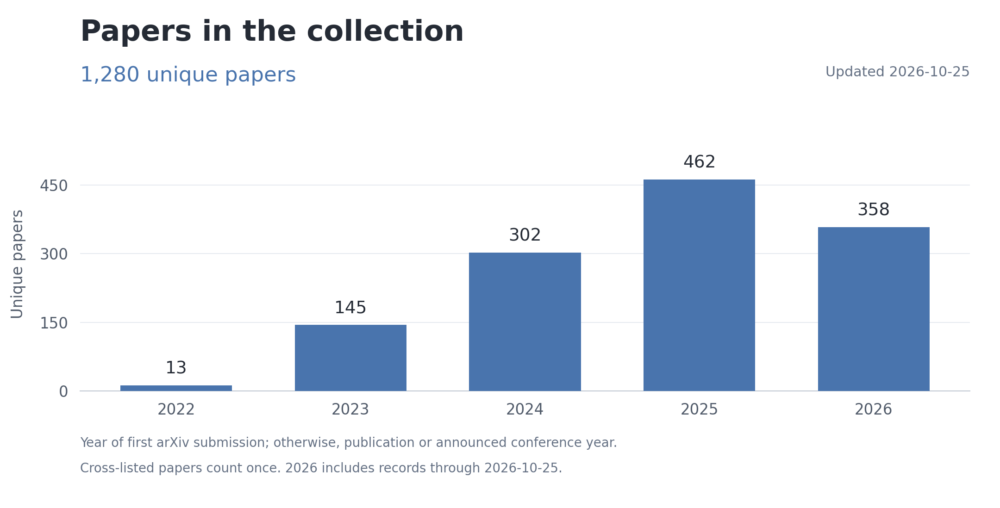
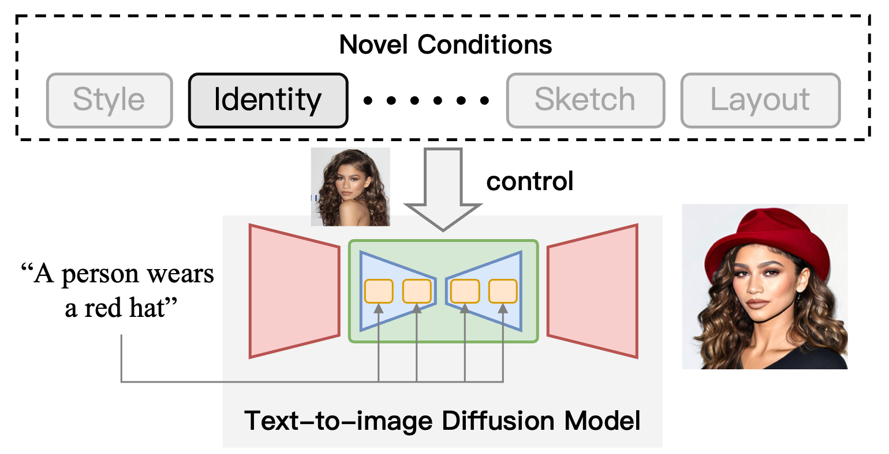

[](https://github.com/sindresorhus/awesome)
[](https://github.com/PRIV-Creation/Awesome-Controllable-T2I-Diffusion-Models/commits/main)
[](https://github.com/PRIV-Creation/Awesome-Controllable-T2I-Diffusion-Models/issues)
[](https://doi.org/10.1109/TPAMI.2025.3646548)

<br />
<p align="center">
  <h1 align="center">Awesome Controllable T2I Diffusion Models</h1>
</p>
<br />

A curated collection of research on controlling text-to-image diffusion models with novel conditions, including personalization, spatial control, and multimodal generation. Recent entries also cover control of flow-matching image models, preference-based personalization, and studies of controllability.

Our survey, [Controllable Generation with Text-to-Image Diffusion Models: A Survey](https://arxiv.org/abs/2403.04279), is published in [IEEE TPAMI, volume 48, issue 4, pages 4771–4791, April 2026](https://doi.org/10.1109/TPAMI.2025.3646548).

<p align="center">
  
</p>

Statistics count each paper once, including papers listed in multiple categories. Years use the first arXiv submission date, with the publication or announced conference year used for papers without an identified arXiv record. [Paper-level data](data/paper-statistics.csv) · [Counts and methodology](data/paper-statistics.json)

<p align="center">
  
</p>
<p align="center"><em>Taxonomy illustration from the 2024 collection.</em></p>

## 💖 Citation
**If you find value in our survey paper or curated collection, please consider citing our work and starring our repo to support us.**

```text
@article{cao2026controllable,
  title={Controllable Generation With Text-to-Image Diffusion Models: A Survey},
  author={Pu Cao and Feng Zhou and Qing Song and Lu Yang},
  journal={IEEE Transactions on Pattern Analysis and Machine Intelligence},
  volume={48},
  number={4},
  pages={4771--4791},
  year={2026},
  doi={10.1109/TPAMI.2025.3646548}
}
```

## 🎁 How to contribute to this repository?
Suggest a paper or a metadata correction through an [issue](https://github.com/PRIV-Creation/Awesome-Controllable-T2I-Diffusion-Models/issues). Include the following information so maintainers can verify and classify the entry:
```text
1. Paper title
2. arXiv or publisher URL
3. Publication status and its official source
4. Suggested category
5. Official code or project page (if available)
```

## 🌈 Contents

- [Generation with Specific Condition](#generation-with-specific-condition)
  - [Personalization](#personalization)
    - [Subject-Driven Generation](#subject-driven-generation)
    - [Person-Driven Generation](#person-driven-generation)
    - [Style-Driven Generation](#style-driven-generation)
    - [Interaction-Driven Generation](#interaction-driven-generation)
    - [Image-Driven Generation](#image-driven-generation)
    - [Distribution-Driven Generation](#distribution-driven-generation)
    - [Preference-Driven Generation](#preference-driven-generation)
  - [Spatial Control](#spatial-control)
  - [Advanced Text-Conditioned Generation](#advanced-text-conditioned-generation)
  - [In-Context Generation](#in-context-generation)
  - [Brain-Guided Generation](#brain-guided-generation)
  - [Sound-Guided Generation](#sound-guided-generation)
  - [Text Rendering](#text-rendering)
- [Generation with Multiple Conditions](#generation-with-multiple-conditions)
  - [Joint Training](#joint-training)
  - [Continual Learning](#continual-learning)
  - [Weight Fusion](#weight-fusion)
  - [Attention-based Integration](#attention-based-integration)
  - [Guidance Composition](#guidance-composition)
- [Universal Controllable Generation](#universal-controllable-generation)
  - [Universal Conditional Score Prediction](#universal-conditional-score-prediction)
  - [Universal Condition-Guided Score Estimation](#universal-condition-guided-score-estimation)
- [Analysis and Evaluation](#analysis-and-evaluation)


<!-- start -->

<a id="generation-with-specific-condition"></a>

## 🚀Generation with Specific Condition
<a id="personalization"></a>

### 🍇Personalization
<a id="subject-driven-generation"></a>

#### 🍉Subject-Driven Generation
**ReCoG: Relational Concept Graph for Training-Free Personalization.**<br>
*Changseon Yu, Hyeokjun Kweon.*<br>
NeurIPS 2026 (accepted). [[Paper](https://neurips.cc/virtual/2026/poster/149776)] [[arXiv](https://arxiv.org/abs/2610.31282)]

**Diffu-LoRA: A Novel Low-Rank Adaptation for Personalized Diffusion Models.**<br>
*Tianjing Li, Wei Zhu.*<br>
arXiv 2026. [[Paper](https://arxiv.org/abs/2610.10550)]

**Disentangling Dual Image References in Frequency Aware Diffusion Models for Personalized Generation.**<br>
*Haipeng Liu, Yang Wang, Meng Wang.*<br>
NeurIPS 2026 (accepted). [[Paper](https://neurips.cc/virtual/2026/poster/150058)] [[arXiv](https://arxiv.org/abs/2610.07684)]

**RefDiT: Local Attribute Guidance in Reference-Based Image Generation.**<br>
*Rameshwar Mishra, Srikrishna Karanam, A V Subramanyam.*<br>
arXiv 2026. [[Paper](https://arxiv.org/abs/2609.04976)]

**CRAFT: Constrained Reward via Attention Fine-Tuning for Subject Personalization without Composed Targets.**<br>
*Jihun Park, Kyoungmin Lee, Jongmin Gim, Hyeonseo Jo, Jaeyeul Kim, Han Zou, Zhenpeng Zhan, Yan Zhang, Sunghoon Im.*<br>
arXiv 2026. [[Paper](https://arxiv.org/abs/2608.14403)]

**In-Loop Model Adaptation with Coupled Latent-Noise Guidance for High-Fidelity Subject-Driven Text-to-Image Generation.**<br>
*Yushun Tang, Weiming Chen, Siyi Liu, Yi Zhang, Feng Wu, Zhihai He.*<br>
arXiv 2026. [[Paper](https://arxiv.org/abs/2608.09244)]

**TreeAdapter: Hierarchical Taxonomy-Guided Adapter Composition for Fine-Grained Species Image Generation.**<br>
*Yuze Sun, Zhongjie Duan, Yingda Chen.*<br>
arXiv 2026. [[Paper](https://arxiv.org/abs/2607.24215)]

**From Open Loop to Closed Loop: A Test-Time Iterative Optimization Framework for Reference-Consistent Image Generation.**<br>
*Baixuan Zhao, Xinyu Zhang, Huayu Zheng, Shuaicheng Liu, Xiongkuo Min, Guangtao Zhai, Xiaohong Liu.*<br>
arXiv 2026. [[Paper](https://arxiv.org/abs/2607.04691)]

**LILAC: Layer-Wise Independent LoRAs and Cascaded Conditioning for Multi-Concept Customization of Diffusion Models.**<br>
*Marian Lupascu, Sebastian Ripa, Mihai Trascau, Mariana-Iuliana Georgescu, Ionut Mironica.*<br>
arXiv 2026. [[Paper](https://arxiv.org/abs/2607.04801)]

**Decoupled Guidance: Disentangling Subject and Context Pathways in Text-to-Image Personalization.**<br>
*Seongmin Kim, Kyucheol Shin, Heesun Jung, Jinseo Kim, Sungyong Baik.*<br>
arXiv 2026. [[Paper](https://arxiv.org/abs/2607.00766)]

**HomeDiffusion: Zero-Shot Object Customization with Multi-View Representation Learning for Indoor Scenes.**<br>
*Guoqiu Li, Jin Song, Yiyun Fei.*<br>
AAAI 2025. [[Paper](https://doi.org/10.1609/aaai.v39i5.32496)] [[arXiv](https://arxiv.org/abs/2606.29828)]

**Keep The Essentials: Efficient Reference Conditioned Generation via Token Dropping.**<br>
*Rishubh Parihar, Ayush Raina, R. Venkatesh Babu, Or Patashnik.*<br>
arXiv 2026. [[Paper](https://arxiv.org/abs/2606.23682)]

**Redirecting the Flow: Image Customization through Attention Distribution Shift.**<br>
*Jie Li, Suorong Yang, Jian Zhao, Furao Shen.*<br>
arXiv 2026. [[Paper](https://arxiv.org/abs/2606.16866)]

**Equilibrated Diffusion: Frequency-aware Textual Embedding for Equilibrated Image Customization.**<br>
*Liyuan Ma, Xueji Fang, Guo-Jun Qi.*<br>
ACM MM 2024. [[Paper](https://doi.org/10.1145/3664647.3680729)] [[arXiv](https://arxiv.org/abs/2606.02129)]

**Squeezing Capacity from Multimodal Large Language Models for Subject-driven Generation.**<br>
*Shuhong Zheng, Aashish Kumar Misraa, Yu-Teng Li, Yu-Jhe Li, Igor Gilitschenski.*<br>
arXiv 2026. [[Paper](https://arxiv.org/abs/2605.26111)]

**SwiftPie: Lightning-fast Subject-driven Image Personalization via One step Diffusion.**<br>
*Huy Duong, Trong-Tung Nguyen, Cuong Pham, Anh Tran, Khoi Nguyen, Minh Hoai.*<br>
arXiv 2026. [[Paper](https://arxiv.org/abs/2605.01510)]

**SEAL: Semantic-aware Single-image Sticker Personalization with a Large-scale Sticker-tag Dataset.**<br>
*Changhyun Roh, Yonghyun Jeong, Jonghyun Lee, Chanho Eom, Jihyong Oh.*<br>
arXiv 2026. [[Paper](https://arxiv.org/abs/2604.26883)]

**Disentangling to Re-couple: Resolving the Similarity-Controllability Paradox in Subject-Driven Text-to-Image Generation.**<br>
*Shuang Li, Chao Deng, Hang Chen, Liqun Liu, Zhenyu Hu, Te Cao, Mengge Xue, Yuan Chen, Peng Shu, Huan Yu, Jie Jiang.*<br>
CVPR 2026. [[Paper](https://openaccess.thecvf.com/content/CVPR2026/html/Li_Disentangling_to_Re-couple_Resolving_the_Similarity-Controllability_Paradox_in_Subject-Driven_Text-to-Image_CVPR_2026_paper.html)] [[arXiv](https://arxiv.org/abs/2604.00849)]

**Zero-Shot Personalization of Objects via Textual Inversion.**<br>
*Aniket Roy, Maitreya Suin, Rama Chellappa.*<br>
arXiv 2026. [[Paper](https://arxiv.org/abs/2603.23010)]

**Not All Layers Are Created Equal: Adaptive LoRA Ranks for Personalized Image Generation.**<br>
*Donald Shenaj, Federico Errica, Antonio Carta.*<br>
arXiv 2026. [[Paper](https://arxiv.org/abs/2603.21884)]

**Leveraging Cross-Modal Knowledge Transfer for Knowledge-Aware Concept Customization.**<br>
*Chenyang Zhu, Hongxiang Li, Xiu Li, Long Chen.*<br>
ECCV 2026. [[Paper](https://eccv.ecva.net/virtual/2026/poster/3362)] [[arXiv](https://arxiv.org/abs/2603.12743)]

**PureCC: Pure Learning for Text-to-Image Concept Customization.**<br>
*Zhichao Liao, Xiaole Xian, Qingyu Li, Wenyu Qin, Meng Wang, Weicheng Xie, Siyang Song, Pingfa Feng, Long Zeng, Liang Pan.*<br>
CVPR 2026. [[Paper](https://openaccess.thecvf.com/content/CVPR2026/html/Liao_PureCC_Pure_Learning_for_Text-to-Image_Concept_Customization_CVPR_2026_paper.html)] [[arXiv](https://arxiv.org/abs/2603.07561)]

**FlowFixer: Towards Detail-Preserving Subject-Driven Generation.**<br>
*Jinyoung Jun, Won-Dong Jang, Wenbin Ouyang, Raghudeep Gadde, Jungbeom Lee.*<br>
CVPR 2026. [[Paper](https://openaccess.thecvf.com/content/CVPR2026/html/Jun_FlowFixer_Towards_Detail-Preserving_Subject-Driven_Generation_CVPR_2026_paper.html)] [[arXiv](https://arxiv.org/abs/2602.21402)]

**ConceptPrism: Concept Disentanglement in Personalized Diffusion Models via Residual Token Optimization.**<br>
*Minseo Kim, Minchan Kwon, Dongyeun Lee, Yunho Jeon, Junmo Kim.*<br>
CVPR 2026. [[Paper](https://openaccess.thecvf.com/content/CVPR2026/html/Kim_ConceptPrism_Concept_Disentanglement_in_Personalized_Diffusion_Models_via_Residual_Token_CVPR_2026_paper.html)] [[arXiv](https://arxiv.org/abs/2602.19575)]

**Inject Where It Matters: Training-Free Spatially-Adaptive Identity Preservation for Text-to-Image Personalization.**<br>
*Guandong Li, Mengxia Ye.*<br>
arXiv 2026. [[Paper](https://arxiv.org/abs/2602.13994)]

**Unified Personalized Understanding, Generating and Editing.**<br>
*Yu Zhong, Tianwei Lin, Ruike Zhu, Yuqian Yuan, Haoyu Zheng, Liang Liang, Wenqiao Zhang, Feifei Shao, Haoyuan Li, Wanggui He, Hao Jiang, Yueting Zhuang.*<br>
CVPR 2026. [[Paper](https://openaccess.thecvf.com/content/CVPR2026/html/Zhong_Unified_Personalized_Understanding_Generating_and_Editing_CVPR_2026_paper.html)] [[arXiv](https://arxiv.org/abs/2601.06965)]

**Unified Customized Generation by Disentangled Reward Modeling.**<br>
*Shaojin Wu, Mengqi Huang, Yufeng Cheng, Wenxu Wu, Jiahe Tian, Yiming Luo, Fei Ding, Qian He.*<br>
CVPR 2026. [[Paper](https://openaccess.thecvf.com/content/CVPR2026/html/Wu_Unified_Customized_Generation_by_Disentangled_Reward_Modeling_CVPR_2026_paper.html)]

**Consis-GCPO: Consistency-Preserving Group Causal Preference Optimization for Vision Customization.**<br>
*Qiaoqiao Jin, Dong She, Siming Fu, Hualiang Wang, weihao zhou, Jidong Jiang.*<br>
ICLR 2026. [[Paper](https://proceedings.iclr.cc/paper_files/paper/2026/hash/00d1f03b87a401b1c7957e0cc785d0bc-Abstract-Conference.html)]

**Boost the Identity-Preserving Embedding for Consistent Visual Generation.**<br>
*Zixun Xia, Kai Wang, Shuyu Guo, Boqian Li, Jian Yang, Yaxing Wang.*<br>
ICML 2026. [[Paper](https://proceedings.mlr.press/v306/xia26i.html)]

**TOPA: Mitigating Concept Dominance in Diffusion Personalization via Target-Oriented Perturbation Augmentation.**<br>
*Jiayou Lu, Mingzhi Lyu, Junfeng Huang, Wai-Kin Adams Kong.*<br>
ECCV 2026. [[Paper](https://eccv.ecva.net/virtual/2026/poster/4256)]

**Beyond Pixel Mimicry: Disentangled Self-Similarity Rewards for Diverse Subject-Driven Generation.**<br>
*Qian Wang, Zhenyu Li, Abdelrahman Eldesokey, Peter Wonka.*<br>
ECCV 2026. [[Paper](https://eccv.ecva.net/virtual/2026/poster/5173)]

**Toward Semantically-Consistent Tuning-Free Customization for Rectified Flow Transformers.**<br>
*Jian Jin, Kai Zhang, Zhenyong Fu, Jian Yang.*<br>
NeurIPS 2026 (accepted). [[Paper](https://neurips.cc/virtual/2026/poster/152751)]

**MorphSIG: Subject-Driven Image Generation via Decoupled Anchoring and Feature Transport.**<br>
*Hailong Yan, Yongrui Zhang, Xiangtao Zhang, Le Zhang.*<br>
NeurIPS 2026 (accepted). [[Paper](https://neurips.cc/virtual/2026/poster/156050)]

**WaveletLoRA: Frequency-Aware Content-Style Decomposition for Personalized Image Generation.**<br>
*Peiyao Wang, Jiahui Sun, Weining Wang, Jing Liu.*<br>
NeurIPS 2026 (accepted). [[Paper](https://neurips.cc/virtual/2026/poster/152557)]

**Identifying and Mitigating Diversity Collapse in Zero-Shot Personalization with I2I Editing Models.**<br>
*Uichan Lee, Jongeon Baek, Sangheum Hwang.*<br>
NeurIPS 2026 (accepted). [[Paper](https://neurips.cc/virtual/2026/poster/149053)]

**Where and When Identity Forms: Identity-Vital Attention Redistribution for Training-Free Subject-Driven Generation.**<br>
*Luan Thanh Trinh, Atsuki Osanai, Kenji Doi.*<br>
NeurIPS 2026 (accepted). [[Paper](https://neurips.cc/virtual/2026/poster/155917)]

**Continuous Personalized Diffusion Model via Spinor-Component Forward Geometry.**<br>
*GeonWoo Jeong, SEUNG HUN OH, Sang Beom Chu, WONJUN KIM, Bokyoon Na.*<br>
NeurIPS 2026 (accepted). [[Paper](https://neurips.cc/virtual/2026/poster/153749)]

**Mix-Opt: Mixed Optimization for Memory-Efficient Personalization of Text-to-Image Diffusion Models.**<br>
*Seokeon Choi, Sunghyun Park, Hyoungwoo Park, Jeongho Kim, Sungrack Yun.*<br>
NeurIPS 2026 (accepted). [[Paper](https://neurips.cc/virtual/2026/poster/152257)]

**Object Fusion via Diffusion Time-step for Customized Image Editing with Single Example.**<br>
*Xue Song, Zhongqi Yue, Jiequan Cui, Hanwang Zhang, Jingjing Chen.*<br>
AAAI 2026. [[Paper](https://doi.org/10.1609/aaai.v40i11.37869)]

**Dual Optimal Transport for Multi-Concept Composition: Structure Alignment and Texture Injection in Diffusion Models.**<br>
*Hao Fu, Tianyu Su, Meng Liu, Chenfang Yang, Tian Gan.*<br>
ICML 2026. [[Paper](https://proceedings.mlr.press/v306/fu26o.html)]

**ASemConsist: Adaptive Semantic Feature Control for Training-Free Identity-Consistent Generation.**<br>
*Shin Seong Kim, Minjung Shin, Hyunin Cho, Youngjung Uh.*<br>
arXiv 2025. [[Paper](https://arxiv.org/abs/2512.23245)]

**Geometric Disentanglement of Text Embeddings for Subject-Consistent Text-to-Image Generation using A Single Prompt.**<br>
*Shangxun Li, Youngjung Uh.*<br>
arXiv 2025. [[Paper](https://arxiv.org/abs/2512.16443)]

**Directional Textual Inversion for Personalized Text-to-Image Generation.**<br>
*Kunhee Kim, NaHyeon Park, Kibeom Hong, Hyunjung Shim.*<br>
ICLR 2026. [[Paper](https://proceedings.iclr.cc/paper_files/paper/2026/hash/dbc8ce0fdfcd55172d73fb05dbae07fc-Abstract-Conference.html)] [[arXiv](https://arxiv.org/abs/2512.13672)]

**Omni-Attribute: Open-vocabulary Attribute Encoder for Visual Concept Personalization.**<br>
*Tsai-Shien Chen, Aliaksandr Siarohin, Gordon Guocheng Qian, Kuan-Chieh Jackson Wang, Egor Nemchinov, Moayed Haji-Ali, Riza Alp Guler, Willi Menapace, Ivan Skorokhodov, Anil Kag, Jun-Yan Zhu, Sergey Tulyakov.*<br>
CVPR 2026. [[Paper](https://openaccess.thecvf.com/content/CVPR2026/html/Chen_Omni-Attribute_Open-vocabulary_Attribute_Encoder_for_Visual_Concept_Personalization_CVPR_2026_paper.html)] [[arXiv](https://arxiv.org/abs/2512.10955)]

**Dynamic Image Prompt Adapter for Scalable Zero-shot Personalized Text-to-Image Generation.**<br>
*Zhizhong Wang, Tianyi Chu, Richard Wang, Nanyang Wang, Kehan Li.*<br>
ECCV 2026. [[Paper](https://eccv.ecva.net/virtual/2026/poster/4423)] [[arXiv](https://arxiv.org/abs/2512.09814)]

**LoFA: Learning to Predict Personalized Prior for Fast Adaptation of Visual Generative Models.**<br>
*Yiming Hao, Mutian Xu, Chongjie Ye, Jie Qin, Shunlin Lu, Yipeng Qin, Xiaoguang Han.*<br>
CVPR 2026. [[Paper](https://openaccess.thecvf.com/content/CVPR2026/html/Hao_LoFA_Learning_to_Predict_Personalized_Prior_for_Fast_Adaptation_of_CVPR_2026_paper.html)] [[arXiv](https://arxiv.org/abs/2512.08785)]

**Not All Birds Look The Same: Identity-Preserving Generation For Birds.**<br>
*Aaron Sun, Oindrila Saha, Subhransu Maji.*<br>
CVPR 2026. [[Paper](https://openaccess.thecvf.com/content/CVPR2026/html/Sun_Not_All_Birds_Look_The_Same_Identity-Preserving_Generation_For_Birds_CVPR_2026_paper.html)] [[arXiv](https://arxiv.org/abs/2512.04485)]

**PhyCustom: Towards Realistic Physical Customization in Text-to-Image Generation.**<br>
*Fan Wu, Cheng Chen, Zhoujie Fu, Jiacheng Wei, Yi Xu, Deheng Ye, Guosheng Lin.*<br>
arXiv 2025. [[Paper](https://arxiv.org/abs/2512.02794)]

**MINDiff: Mask-Integrated Negative Attention for Controlling Overfitting in Text-to-Image Personalization.**<br>
*Seulgi Jeong, Jaeil Kim.*<br>
arXiv 2025. [[Paper](https://arxiv.org/abs/2511.17888)]

**Coffee: Controllable Diffusion Fine-tuning.**<br>
*Ziyao Zeng, Jingcheng Ni, Ruyi Liu, Alex Wong.*<br>
arXiv 2025. [[Paper](https://arxiv.org/abs/2511.14113)]

**FreeFuse: Multi-Subject LoRA Fusion via Adaptive Token-Level Routing at Test Time.**<br>
*Yaoli Liu, Yao-Xiang Ding, Kun Zhou.*<br>
arXiv 2025. [[Paper](https://arxiv.org/abs/2510.23515)]

**From Competition to Synergy: Unlocking Reinforcement Learning for Subject-Driven Image Generation.**<br>
*Ziwei Huang, Ying Shu, Hao Fang, Quanyu Long, Wenya Wang, Qiushi Guo, Tiezheng Ge, Leilei Gan.*<br>
arXiv 2025. [[Paper](https://arxiv.org/abs/2510.18263)]

**Chimera: Compositional Image Generation using Part-based Concepting.**<br>
*Shivam Singh, Yiming Chen, Agneet Chatterjee, Amit Raj, James Hays, Yezhou Yang, Chitta Baral.*<br>
arXiv 2025. [[Paper](https://arxiv.org/abs/2510.18083)]

**ConceptSplit: Decoupled Multi-Concept Personalization of Diffusion Models via Token-wise Adaptation and Attention Disentanglement.**<br>
*Habin Lim, Yeongseob Won, Juwon Seo, Gyeong-Moon Park.*<br>
ICCV 2025. [[Paper](https://openaccess.thecvf.com/content/ICCV2025/html/Lim_ConceptSplit_Decoupled_Multi-Concept_Personalization_of_Diffusion_Models_via_Token-wise_Adaptation_ICCV_2025_paper.html)] [[arXiv](https://arxiv.org/abs/2510.04668)]

**DEFT: Decompositional Efficient Fine-Tuning for Text-to-Image Models.**<br>
*Komal Kumar, Rao Anwer, Fahad Shahbaz Khan, Salman Khan, Ivan Laptev, Hisham Cholakkal.*<br>
NeurIPS 2025. [[Paper](https://papers.nips.cc/paper_files/paper/2025/hash/93a34a7138bdad95e874018d5f491cc6-Abstract-Conference.html)] [[arXiv](https://arxiv.org/abs/2509.22793)] [[DOI](https://doi.org/10.52202/085713-3413)]

**CusEnhancer: A Zero-Shot Scene and Controllability Enhancement Method for Photo Customization via ResInversion.**<br>
*Maoye Ren, Praneetha Vaddamanu, Jianjin Xu, Fernando De la Torre Frade.*<br>
arXiv 2025. [[Paper](https://arxiv.org/abs/2509.20775)]

**One-shot Embroidery Customization via Contrastive LoRA Modulation.**<br>
*Jun Ma, Qian He, Gaofeng He, Huang Chen, Chen Liu, Xiaogang Jin, Huamin Wang.*<br>
ACM TOG 2025. [[Paper](https://doi.org/10.1145/3763290)] [[arXiv](https://arxiv.org/abs/2509.18948)]

**Stencil: Subject-Driven Generation with Context Guidance.**<br>
*Gordon Chen, Ziqi Huang, Cheston Tan, Ziwei Liu.*<br>
arXiv 2025. [[Paper](https://arxiv.org/abs/2509.17120)]

**Animalbooth: multimodal feature enhancement for animal subject personalization.**<br>
*Chen Liu, Haitao Wu, Kafeng Wang, Weiran Huang.*<br>
arXiv 2025. [[Paper](https://arxiv.org/abs/2509.16702)]

**TIDE: Achieving Balanced Subject-Driven Image Generation via Target-Instructed Diffusion Enhancement.**<br>
*Jibai Lin, Bo Ma, Yating Yang, Xi Zhou, Rong Ma, Turghun Osman, Ahtamjan Ahmat, Rui Dong, Lei Wang.*<br>
arXiv 2025. [[Paper](https://arxiv.org/abs/2509.06499)]

**Steering Guidance for Personalized Text-to-Image Diffusion Models.**<br>
*Sunghyun Park, Seokeon Choi, Hyoungwoo Park, Sungrack Yun.*<br>
ICCV 2025. [[Paper](https://openaccess.thecvf.com/content/ICCV2025/html/Park_Steering_Guidance_for_Personalized_Text-to-Image_Diffusion_Models_ICCV_2025_paper.html)] [[arXiv](https://arxiv.org/abs/2508.00319)]

**Zero-Shot Dynamic Concept Personalization with Grid-Based LoRA.**<br>
*Rameen Abdal, Or Patashnik, Ekaterina Deyneka, Hao Chen, Aliaksandr Siarohin, Sergey Tulyakov, Daniel Cohen-Or, Kfir Aberman.*<br>
SIGGRAPH Asia 2025. [[Paper](https://doi.org/10.1145/3757377.3763987)] [[arXiv](https://arxiv.org/abs/2507.17963)]

**FreeCus: Free Lunch Subject-driven Customization in Diffusion Transformers.**<br>
*Yanbing Zhang, Zhe Wang, Qin Zhou, Mengping Yang.*<br>
ICCV 2025. [[Paper](https://openaccess.thecvf.com/content/ICCV2025/html/Zhang_FreeCus_Free_Lunch_Subject-driven_Customization_in_Diffusion_Transformers_ICCV_2025_paper.html)] [[arXiv](https://arxiv.org/abs/2507.15249)]

**ID-EA: Identity-driven Text Enhancement and Adaptation with Textual Inversion for Personalized Text-to-Image Generation.**<br>
*Hyun-Jun Jin, Young-Eun Kim, Seong-Whan Lee.*<br>
arXiv 2025. [[Paper](https://arxiv.org/abs/2507.11990)]

**CoDi: Subject-Consistent and Pose-Diverse Text-to-Image Generation.**<br>
*Zhanxin Gao, Beier Zhu, Liang Yao, Jian Yang, Ying Tai.*<br>
ICLR 2026. [[Paper](https://arxiv.org/abs/2507.08396)] [[Proceedings](https://proceedings.iclr.cc/paper_files/paper/2026/hash/b8ce770a6b25e603fbff4a37f9e31edc-Abstract-Conference.html)]

**T-LoRA: Single Image Diffusion Model Customization Without Overfitting.**<br>
*Vera Soboleva, Aibek Alanov, Andrey Kuznetsov, Konstantin Sobolev.*<br>
AAAI 2026. [[Paper](https://doi.org/10.1609/aaai.v40i11.37861)] [[arXiv](https://arxiv.org/abs/2507.05964)]

**APT: Adaptive Personalized Training for Diffusion Models with Limited Data.**<br>
*JungWoo Chae, Jiyoon Kim, JaeWoong Choi, Kyungyul Kim, Sangheum Hwang.*<br>
CVPR 2025. [[Paper](https://openaccess.thecvf.com/content/CVPR2025/html/Chae_APT_Adaptive_Personalized_Training_for_Diffusion_Models_with_Limited_Data_CVPR_2025_paper.html)] [[arXiv](https://arxiv.org/abs/2507.02687)]

**IC-Custom: Diverse Image Customization via In-Context Learning.**<br>
*Yaowei Li, Xiaoyu Li, Zhaoyang Zhang, Yuxuan Bian, Gan Liu, Xinyuan Li, Jiale Xu, Wenbo Hu, Yating Liu, Lingen Li, Jing Cai, Yuexian Zou, Yancheng He, Ying Shan.*<br>
ICLR 2026. [[Paper](https://proceedings.iclr.cc/paper_files/paper/2026/hash/04b7126c370f175204442098356dc239-Abstract-Conference.html)] [[arXiv](https://arxiv.org/abs/2507.01926)]

**Mitigating Semantic Collapse in Generative Personalization with Test-Time Embedding Adjustment.**<br>
*Anh Bui, Thuy-Trang Vu, Trung Le, Junae Kim, Tamas Abraham, Rollin Omari, Amardeep Kaur, Dinh Phung.*<br>
ICLR 2026. [[Paper](https://proceedings.iclr.cc/paper_files/paper/2026/hash/143ea4a156ef64f32d4d905206cf32e1-Abstract-Conference.html)] [[arXiv](https://arxiv.org/abs/2506.22685)]

**Preserve Anything: Controllable Image Synthesis with Object Preservation.**<br>
*Prasen Kumar Sharma, Neeraj Matiyali, Siddharth Srivastava, Gaurav Sharma.*<br>
ICCV 2025. [[Paper](https://openaccess.thecvf.com/content/ICCV2025/html/Sharma_Preserve_Anything_Controllable_Image_Synthesis_with_Object_Preservation_ICCV_2025_paper.html)] [[arXiv](https://arxiv.org/abs/2506.22531)]

**Noise Consistency Regularization for Improved Subject-Driven Image Synthesis.**<br>
*Yao Ni, Song Wen, Piotr Koniusz, Anoop Cherian.*<br>
arXiv 2025. [[Paper](https://arxiv.org/abs/2506.06483)]

**PartComposer: Learning and Composing Part-Level Concepts from Single-Image Examples.**<br>
*Junyu Liu, R. Kenny Jones, Daniel Ritchie.*<br>
arXiv 2025. [[Paper](https://arxiv.org/abs/2506.03004)]

**ComposeAnything: Composite Object Priors for Text-to-Image Generation.**<br>
*Zeeshan Khan, Shizhe Chen, Cordelia Schmid.*<br>
arXiv 2025. [[Paper](https://arxiv.org/abs/2505.24086)]

**AlignGen: Boosting Personalized Image Generation with Cross-Modality Prior Alignment.**<br>
*Yiheng Lin, Shifang Zhao, Ting Liu, Xiaochao Qu, Luoqi Liu, Yao Zhao, Yunchao Wei.*<br>
arXiv 2025. [[Paper](https://arxiv.org/abs/2505.21911)]

**Preserve and Personalize: Personalized Text-to-Image Diffusion Models without Distributional Drift.**<br>
*Gihoon Kim, Hyungjin Park, Taesup Kim.*<br>
ICLR 2026. [[Paper](https://proceedings.iclr.cc/paper_files/paper/2026/hash/1a281c4e60aa2184525b4c098ff5bed5-Abstract-Conference.html)] [[arXiv](https://arxiv.org/abs/2505.19519)]

**Mod-Adapter: Tuning-Free and Versatile Multi-concept Personalization via Modulation Adapter.**<br>
*Weizhi Zhong, Huan Yang, Zheng Liu, Huiguo He, Zijian He, Xuesong Niu, Di ZHANG, Guanbin Li.*<br>
ICLR 2026. [[Paper](https://proceedings.iclr.cc/paper_files/paper/2026/hash/0a9bc5536c595ee44a72b575b258d141-Abstract-Conference.html)] [[arXiv](https://arxiv.org/abs/2505.18612)]

**UniCTokens: Boosting Personalized Understanding and Generation via Unified Concept Tokens.**<br>
*Ruichuan An, Sihan Yang, Renrui Zhang, Zijun Shen, Ming Lu, Gaole Dai, Hao Liang, Ziyu Guo, Shilin Yan, Yulin Luo, Bocheng Zou, Chaoqun Yang, Wentao Zhang.*<br>
NeurIPS 2025. [[Paper](https://papers.nips.cc/paper_files/paper/2025/hash/d531364f1771e0972c1d11c334a0efb4-Abstract-Conference.html)] [[arXiv](https://arxiv.org/abs/2505.14671)] [[DOI](https://doi.org/10.52202/085713-4840)]

**DRC: Enhancing Personalized Image Generation via Disentangled Representation Composition.**<br>
*Yiyan Xu, Wuqiang Zheng, Wenjie Wang, Fengbin Zhu, Xinting Hu, Yang Zhang, Fuli Feng, Tat-Seng Chua.*<br>
ACM MM 2025. [[Paper](https://doi.org/10.1145/3746027.3755051)] [[arXiv](https://arxiv.org/abs/2504.17349)]

**DreamO: A Unified Framework for Image Customization.**<br>
*Chong Mou, Yanze Wu, Wenxu Wu, Zinan Guo, Pengze Zhang, Yufeng Cheng, Yiming Luo, Fei Ding, Shiwen Zhang, Xinghui Li, Mengtian Li, Mingcong Liu, Yunsheng Jiang, Shaojin Wu, Songtao Zhao, Jian Zhang, Qian He, Xinglong Wu.*<br>
SIGGRAPH Asia 2025. [[Paper](https://doi.org/10.1145/3757377.3763956)] [[arXiv](https://arxiv.org/abs/2504.16915)] [[Code](https://github.com/bytedance/DreamO)]

**InstantCharacter: Personalize Any Characters with a Scalable Diffusion Transformer Framework.**<br>
*Jiale Tao, Yanbing Zhang, Qixun Wang, Yiji Cheng, Haofan Wang, Xu Bai, Zhengguang Zhou, Ruihuang Li, Linqing Wang, Chunyu Wang, Qin Lin, Qinglin Lu.*<br>
arXiv 2025. [[Paper](https://arxiv.org/abs/2504.12395)] [[Code](https://github.com/Tencent-Hunyuan/InstantCharacter)]

**Flux Already Knows -- Activating Subject-Driven Image Generation without Training.**<br>
*Hao Kang, Stathi Fotiadis, Liming Jiang, Qing Yan, Yumin Jia, Zichuan Liu, Min Jin Chong, Xin Lu.*<br>
arXiv 2025. [[Paper](https://arxiv.org/abs/2504.11478)]

**FlexIP: Dynamic Control of Preservation and Personality for Customized Image Generation.**<br>
*Linyan Huang, Haonan Lin, Yanning Zhou, Kaiwen Xiao.*<br>
arXiv 2025. [[Paper](https://arxiv.org/abs/2504.07405)]

**Less-to-More Generalization: Unlocking More Controllability by In-Context Generation.**<br>
*Shaojin Wu, Mengqi Huang, Wenxu Wu, Yufeng Cheng, Fei Ding, Qian He.*<br>
ICCV 2025. [[Paper](https://arxiv.org/abs/2504.02160)] [[Code](https://github.com/bytedance/UNO)] [[Project](https://bytedance.github.io/UNO/)]

**Meta-LoRA: Meta-Learning LoRA Components for Domain-Aware ID Personalization.**<br>
*Barış Batuhan Topal, Umut Özyurt, Zafer Doğan Budak, Ramazan Gokberk Cinbis.*<br>
arXiv 2025. [[Paper](https://arxiv.org/abs/2503.22352)]

**Single Image Iterative Subject-driven Generation and Editing.**<br>
*Yair Shpitzer, Gal Chechik, Idan Schwartz.*<br>
arXiv 2025. [[Paper](https://arxiv.org/abs/2503.16025)] [[Code](https://github.com/yairshp/SISO)] [[Project](https://siso-paper.github.io/)]

**Efficient Personalization of Quantized Diffusion Model without Backpropagation.**<br>
*Hoigi Seo, Wongi Jeong, Kyungryeol Lee, Se Young Chun.*<br>
CVPR 2025. [[Paper](https://openaccess.thecvf.com/content/CVPR2025/html/Seo_Efficient_Personalization_of_Quantized_Diffusion_Model_without_Backpropagation_CVPR_2025_paper.html)] [[arXiv](https://arxiv.org/abs/2503.14868)]

**Personalize Anything for Free with Diffusion Transformer.**<br>
*Haoran Feng, Zehuan Huang, Lin Li, Lu Sheng.*<br>
AAAI 2026. [[Paper](https://doi.org/10.1609/aaai.v40i5.37394)] [[arXiv](https://arxiv.org/abs/2503.12590)] [[Code](https://github.com/fenghora/personalize-anything)] [[Project](https://fenghora.github.io/Personalize-Anything-Page/)]

**Conceptrol: Concept Control of Zero-shot Personalized Image Generation.**<br>
*Qiyuan He, Angela Yao.*<br>
arXiv 2025. [[Paper](https://arxiv.org/abs/2503.06568)]

**ACCORD: Alleviating Concept Coupling through Dependence Regularization for Text-to-Image Diffusion Personalization.**<br>
*Shi Zhan Liu, Hao ZHENG, Hang Yu, Jianguo Li.*<br>
ICLR 2026. [[Paper](https://proceedings.iclr.cc/paper_files/paper/2026/hash/6d2ecdf5e9141fa050edae6c65da19fe-Abstract-Conference.html)] [[arXiv](https://arxiv.org/abs/2503.01122)]

**SYNTHIA: Novel Concept Design with Affordance Composition.**<br>
*Hyeonjeong Ha, Xiaomeng Jin, Jeonghwan Kim, Jiateng Liu, Zhenhailong Wang, Khanh Duy Nguyen, Ansel Blume, Nanyun Peng, Kai-Wei Chang, Heng Ji.*<br>
arXiv 2025. [[Paper](https://arxiv.org/abs/2502.17793)]

**E-MD3C: Taming Masked Diffusion Transformers for Efficient Zero-Shot Object Customization.**<br>
*Trung X. Pham, Zhang Kang, Ji Woo Hong, Xuran Zheng, Chang D. Yoo.*<br>
arXiv 2025. [[Paper](https://arxiv.org/abs/2502.09164)]

**Generating Multi-Image Synthetic Data for Text-to-Image Customization.**<br>
*Nupur Kumari, Xi Yin, Jun-Yan Zhu, Ishan Misra, Samaneh Azadi.*<br>
ICCV 2025. [[Paper](https://openaccess.thecvf.com/content/ICCV2025/html/Kumari_Generating_Multi-Image_Synthetic_Data_for_Text-to-Image_Customization_ICCV_2025_paper.html)] [[arXiv](https://arxiv.org/abs/2502.01720)]

**One-Prompt-One-Story: Free-Lunch Consistent Text-to-Image Generation Using a Single Prompt.**<br>
*Tao Liu, Kai Wang, Senmao Li, Joost van de Weijer, Fahad Khan, Shiqi Yang, Yaxing Wang, Jian Yang, Ming-Ming Cheng.*<br>
ICLR 2025. [[Paper](https://proceedings.iclr.cc/paper_files/paper/2025/hash/3d681cc4487b97c08e5aa67224dd74f2-Abstract-Conference.html)] [[arXiv](https://arxiv.org/abs/2501.13554)]

**TokenVerse: Versatile Multi-concept Personalization in Token Modulation Space.**<br>
*Daniel Garibi, Shahar Yadin, Roni Paiss, Omer Tov, Shiran Zada, Ariel Ephrat, Tomer Michaeli, Inbar Mosseri, Tali Dekel.*<br>
ACM TOG 2025. [[Paper](https://doi.org/10.1145/3730843)] [[arXiv](https://arxiv.org/abs/2501.12224)]

**Transformed Low-rank Adaptation via Tensor Decomposition and Its Applications to Text-to-image Models.**<br>
*Zerui Tao, Yuhta Takida, Naoki Murata, Qibin Zhao, Yuki Mitsufuji.*<br>
ICCV 2025. [[Paper](https://openaccess.thecvf.com/content/ICCV2025/html/Tao_Transformed_Low-rank_Adaptation_via_Tensor_Decomposition_and_Its_Applications_to_ICCV_2025_paper.html)] [[arXiv](https://arxiv.org/abs/2501.08727)]

**SceneBooth: Diffusion-based Framework for Subject-preserved Text-to-Image Generation.**<br>
*Shang Chai, Zihang Lin, Min Zhou, Xubin Li, Liansheng Zhuang, Houqiang Li.*<br>
arXiv 2025. [[Paper](https://arxiv.org/abs/2501.03490)]

**Nested Attention: Semantic-aware Attention Values for Concept Personalization.**<br>
*Or Patashnik, Rinon Gal, Daniil Ostashev, Sergey Tulyakov, Kfir Aberman, Daniel Cohen-Or.*<br>
SIGGRAPH 2025. [[Paper](https://doi.org/10.1145/3721238.3730634)] [[arXiv](https://arxiv.org/abs/2501.01407)]

**TFCustom: Customized Image Generation with Time-Aware Frequency Feature Guidance.**<br>
*Mushui Liu, Dong She, Jingxuan Pang, Qihan Huang, Jiacheng Ying, Wanggui He, Yuanlei Hou, Siming Fu.*<br>
CVPR 2025. [[Paper](https://openaccess.thecvf.com/content/CVPR2025/html/Liu_TFCustom_Customized_Image_Generation_with_Time-Aware_Frequency_Feature_Guidance_CVPR_2025_paper.html)]

**PS-Diffusion: Photorealistic Subject-Driven Image Editing with Disentangled Control and Attention.**<br>
*Weicheng Wang, Guoli Jia, Zhongqi Zhang, Liang Lin, Jufeng Yang.*<br>
CVPR 2025. [[Paper](https://openaccess.thecvf.com/content/CVPR2025/html/Wang_PS-Diffusion_Photorealistic_Subject-Driven_Image_Editing_with_Disentangled_Control_and_Attention_CVPR_2025_paper.html)]

**UniversalBooth: Model-Agnostic Personalized Text-to-Image Generation.**<br>
*Songhua Liu, Ruonan Yu, Xinchao Wang.*<br>
ICCV 2025. [[Paper](https://openaccess.thecvf.com/content/ICCV2025/html/Liu_UniversalBooth_Model-Agnostic_Personalized_Text-to-Image_Generation_ICCV_2025_paper.html)]

**QR-LoRA: Efficient and Disentangled Fine-tuning via QR Decomposition for Customized Generation.**<br>
*Jiahui Yang, Yongjia Ma, Donglin Di, Jianxun Cui, Hao Li, Wei Chen, Yan Xie, Xun Yang, Wangmeng Zuo.*<br>
ICCV 2025. [[Paper](https://openaccess.thecvf.com/content/ICCV2025/html/Yang_QR-LoRA_Efficient_and_Disentangled_Fine-tuning_via_QR_Decomposition_for_Customized_ICCV_2025_paper.html)]

**P3S-Diffusion:A Selective Subject-driven Generation Framework via Point Supervision.**<br>
*Junjie Hu, Shuyong Gao, Lingyi Hong, Qishan Wang, Yuzhou Zhao, Yan Wang, Wenqiang Zhang.*<br>
arXiv 2024. [[Paper](https://arxiv.org/abs/2412.19533)]

**DECOR:Decomposition and Projection of Text Embeddings for Text-to-Image Customization.**<br>
*Geonhui Jang, Jin-Hwa Kim, Yong-Hyun Park, Junho Kim, Gayoung Lee, Yonghyun Jeong.*<br>
arXiv 2024. [[Paper](https://arxiv.org/abs/2412.09169)]

**ObjectMate: A Recurrence Prior for Object Insertion and Subject-Driven Generation.**<br>
*Daniel Winter, Asaf Shul, Matan Cohen, Dana Berman, Yael Pritch, Alex Rav-Acha, Yedid Hoshen.*<br>
ICCV 2025. [[Paper](https://openaccess.thecvf.com/content/ICCV2025/html/Winter_ObjectMate_A_Recurrence_Prior_for_Object_Insertion_and_Subject-Driven_Generation_ICCV_2025_paper.html)] [[arXiv](https://arxiv.org/abs/2412.08645)]

**PatchDPO: Patch-level DPO for Finetuning-free Personalized Image Generation.**<br>
*Qihan Huang, Long Chan, Jinlong Liu, Wanggui He, Hao Jiang, Mingli Song, Jie Song.*<br>
CVPR 2025. [[Paper](https://openaccess.thecvf.com/content/CVPR2025/html/Huang_PatchDPO_Patch-level_DPO_for_Finetuning-free_Personalized_Image_Generation_CVPR_2025_paper.html)] [[arXiv](https://arxiv.org/abs/2412.03177)]

**LoRA Diffusion: Zero-Shot LoRA Synthesis for Diffusion Model Personalization.**<br>
*Ethan Smith, Rami Seid, Alberto Hojel, Paramita Mishra, Jianbo Wu.*<br>
arXiv 2024. [[Paper](https://arxiv.org/abs/2412.02352)]

**InstantSwap: Fast Customized Concept Swapping across Sharp Shape Differences.**<br>
*Chenyang Zhu, Kai Li, Yue Ma, Longxiang Tang, Chengyu Fang, Chubin Chen, Qifeng Chen, Xiu Li.*<br>
ICLR 2025. [[Paper](https://proceedings.iclr.cc/paper_files/paper/2025/hash/db0ee27cb50dd9087b133f6e7d28a90e-Abstract-Conference.html)] [[arXiv](https://arxiv.org/abs/2412.01197)]

**DreamBlend: Advancing Personalized Fine-tuning of Text-to-Image Diffusion Models.**<br>
*Shwetha Ram, Tal Neiman, Qianli Feng, Andrew Stuart, Son Tran, Trishul Chilimbi.*<br>
arXiv 2024. [[Paper](https://arxiv.org/abs/2411.19390)]

**Diffusion Self-Distillation for Zero-Shot Customized Image Generation.**<br>
*Shengqu Cai, Eric Ryan Chan, Yunzhi Zhang, Leonidas Guibas, Jiajun Wu, Gordon Wetzstein.*<br>
CVPR 2025. [[Paper](https://openaccess.thecvf.com/content/CVPR2025/html/Cai_Diffusion_Self-Distillation_for_Zero-Shot_Customized_Image_Generation_CVPR_2025_paper.html)] [[arXiv](https://arxiv.org/abs/2411.18616)]

**DreamCache: Finetuning-Free Lightweight Personalized Image Generation via Feature Caching.**<br>
*Emanuele Aiello, Umberto Michieli, Diego Valsesia, Mete Ozay, Enrico Magli.*<br>
CVPR 2025. [[Paper](https://arxiv.org/abs/2411.17786)] [[Code](https://github.com/Emanuele97x/DreamCache)] [[Project](https://emanuele97x.github.io/DreamCache/)]

**DreamMix: Decoupling Object Attributes for Enhanced Editability in Customized Image Inpainting.**<br>
*Yicheng Yang, Pengxiang Li, Lu Zhang, Liqian Ma, Ping Hu, Siyu Du, Yunzhi Zhuge, Xu Jia, Huchuan Lu.*<br>
arXiv 2024. [[Paper](https://arxiv.org/abs/2411.17223)]

**Large-Scale Text-to-Image Model with Inpainting is a Zero-Shot Subject-Driven Image Generator.**<br>
*Chaehun Shin, Jooyoung Choi, Heeseung Kim, Sungroh Yoon.*<br>
CVPR 2025. [[Paper](https://openaccess.thecvf.com/content/CVPR2025/html/Shin_Large-Scale_Text-to-Image_Model_with_Inpainting_is_a_Zero-Shot_Subject-Driven_Image_CVPR_2025_paper.html)] [[arXiv](https://arxiv.org/abs/2411.15466)]

**Foundation Cures Personalization: Improving Personalized Models’ Prompt Consistency via Hidden Foundation Knowledge.**<br>
*Yiyang Cai, Zhengkai Jiang, Yulong Liu, Chunyang Jiang, Wei Xue, Yike Guo, Wenhan Luo.*<br>
NeurIPS 2025. [[Paper](https://papers.nips.cc/paper_files/paper/2025/hash/12fa90b384f16f08738e4c6564008b07-Abstract-Conference.html)] [[arXiv](https://arxiv.org/abs/2411.15277)] [[DOI](https://doi.org/10.52202/085713-0431)]

**Hollowed Net for On-Device Personalization of Text-to-Image Diffusion Models.**<br>
*Wonguk Cho, Seokeon Choi, Debasmit Das, Matthias Reisser, Taesup Kim, Sungrack Yun, Fatih Porikli.*<br>
NeurIPS 2024. [[Paper](https://papers.nips.cc/paper_files/paper/2024/hash/4b814aa0d7c7955a0581e819981e2f81-Abstract-Conference.html)] [[arXiv](https://arxiv.org/abs/2411.01179)] [[DOI](https://doi.org/10.52202/079017-1363)]

**MagicTailor: Component-Controllable Personalization in Text-to-Image Diffusion Models.**<br>
*Donghao Zhou, Jiancheng Huang, Jinbin Bai, Jiaze Wang, Hao Chen, Guangyong Chen, Xiaowei Hu, Pheng-Ann Heng.*<br>
arXiv 2024. [[Paper](https://arxiv.org/abs/2410.13370)]

**DreamSteerer: Enhancing Source Image Conditioned Editability using Personalized Diffusion Models.**<br>
*Zhengyang Yu, Zhaoyuan Yang, Jing Zhang.*<br>
NeurIPS 2024. [[Paper](https://papers.nips.cc/paper_files/paper/2024/hash/da9e48b452127d5a84cd70a3c9c83a78-Abstract-Conference.html)] [[arXiv](https://arxiv.org/abs/2410.11208)] [[DOI](https://doi.org/10.52202/079017-3836)]

**DisEnvisioner: Disentangled and Enriched Visual Prompt for Customized Image Generation.**<br>
*Jing He, Haodong Li, Yongzhe Hu, Guibao Shen, Yingjie Cai, Weichao Qiu, Ying-Cong Chen.*<br>
ICLR 2025. [[Paper](https://arxiv.org/abs/2410.02067)] [[Proceedings](https://proceedings.iclr.cc/paper_files/paper/2025/hash/c87df228922b47a8cd0f3303410e88ca-Abstract-Conference.html)]

**Resolving Multi-Condition Confusion for Finetuning-Free Personalized Image Generation.**<br>
*Qihan Huang, Siming Fu, Jinlong Liu, Hao Jiang, Yipeng Yu, Jie Song.*<br>
AAAI 2025. [[Paper](https://doi.org/10.1609/aaai.v39i4.32386)] [[arXiv](https://arxiv.org/abs/2409.17920)]

**CustomContrast: A Multilevel Contrastive Perspective for Subject-Driven Text-to-Image Customization.**<br>
*Nan Chen, Mengqi Huang, Zhuowei Chen, Yang Zheng, Lei Zhang, Zhendong Mao.*<br>
AAAI 2025. [[Paper](https://doi.org/10.1609/aaai.v39i2.32210)] [[arXiv](https://arxiv.org/abs/2409.05606)]

**CoRe: Context-Regularized Text Embedding Learning for Text-to-Image Personalization.**<br>
*Feize Wu, Yun Pang, Junyi Zhang, Lianyu Pang, Jian Yin, Baoquan Zhao, Qing Li, Xudong Mao.*<br>
AAAI 2025. [[Paper](https://doi.org/10.1609/aaai.v39i8.32904)] [[arXiv](https://arxiv.org/abs/2408.15914)]

**Subject-driven Text-to-Image Generation via Preference-based Reinforcement Learning.**<br>
*Yanting Miao, William Loh, Suraj Kothawade, Pascal Poupart, Abdullah Rashwan, Yeqing Li.*<br>
NeurIPS 2024. [[Paper](https://papers.nips.cc/paper_files/paper/2024/hash/df40e4147b55744ab782b09ccde054db-Abstract-Conference.html)] [[arXiv](https://arxiv.org/abs/2407.12164)] [[DOI](https://doi.org/10.52202/079017-3928)]

**PartCraft: Crafting Creative Objects by Parts.**<br>
*Kam Woh Ng, Xiatian Zhu, Yi-Zhe Song, Tao Xiang.*<br>
ECCV 2024. [[Paper](https://arxiv.org/abs/2407.04604)]

**CustAny: Customizing Anything from A Single Example.**<br>
*Lingjie Kong, Kai Wu, Chengming Xu, Xiaobin Hu, Wenhui Han, Jinlong Peng, Donghao Luo, Mengtian Li, Jiangning Zhang, Chengjie Wang, Yanwei Fu.*<br>
CVPR 2025. [[Paper](https://openaccess.thecvf.com/content/CVPR2025/html/Kong_CustAny_Customizing_Anything_from_A_Single_Example_CVPR_2025_paper.html)] [[arXiv](https://arxiv.org/abs/2406.11643)]

**Interpreting the Weight Space of Customized Diffusion Models.**<br>
*Amil Dravid, Yossi Gandelsman, Kuan-Chieh Wang, Rameen Abdal, Gordon Wetzstein, Alexei A. Efros, Kfir Aberman.*<br>
NeurIPS 2024. [[Paper](https://papers.nips.cc/paper_files/paper/2024/hash/f85364507054c257959c2011c28bfc0d-Abstract-Conference.html)] [[arXiv](https://arxiv.org/abs/2406.09413)] [[DOI](https://doi.org/10.52202/079017-4363)]

**MS-Diffusion: Multi-subject Zero-shot Image Personalization with Layout Guidance.**<br>
*Xierui Wang, Siming Fu, Qihan Huang, Wanggui He, Hao Jiang.*<br>
arXiv 2024. [[Paper](https://arxiv.org/abs/2406.07209)] [[Code](https://github.com/MS-Diffusion/MS-Diffusion)] [[Project](https://MS-Diffusion.github.io)]

**PaRa: Personalizing Text-to-Image Diffusion via Parameter Rank Reduction.**<br>
*Shangyu Chen, Zizheng Pan, Jianfei Cai, Dinh Phung.*<br>
ICLR 2025. [[Paper](https://proceedings.iclr.cc/paper_files/paper/2025/hash/f09e8dd9274cb7c2dd0dc65ffc6f427a-Abstract-Conference.html)] [[arXiv](https://arxiv.org/abs/2406.05641)]

**AttnDreamBooth: Towards Text-Aligned Personalized Text-to-Image Generation.**<br>
*Lianyu Pang, Jian Yin, Baoquan Zhao, Feize Wu, Fu Lee Wang, Qing Li, Xudong Mao.*<br>
NeurIPS 2024. [[Paper](https://papers.nips.cc/paper_files/paper/2024/hash/465a13a95741fab2e912f98adb07df1d-Abstract-Conference.html)] [[arXiv](https://arxiv.org/abs/2406.05000)] [[DOI](https://doi.org/10.52202/079017-1259)]

**Spectrum-Aware Parameter Efficient Fine-Tuning for Diffusion Models.**<br>
*Xinxi Zhang, Song Wen, Ligong Han, Felix Juefei-Xu, Akash Srivastava, Junzhou Huang, Hao Wang, Molei Tao, Dimitris N. Metaxas.*<br>
arXiv 2024. [[Paper](https://arxiv.org/abs/2405.21050)]

**AttenCraft: Attention-guided Disentanglement of Multiple Concepts for Text-to-Image Customization.**<br>
*Junjie Shentu, Matthew Watson, Noura Al Moubayed.*<br>
arXiv 2024. [[Paper](https://arxiv.org/abs/2405.17965)]

**RefDrop: Controllable Consistency in Image or Video Generation via Reference Feature Guidance.**<br>
*Jiaojiao Fan, Haotian Xue, Qinsheng Zhang, Yongxin Chen.*<br>
arXiv 2024. [[Paper](https://arxiv.org/abs/2405.17661)]

**ClassDiffusion: More Aligned Personalization Tuning with Explicit Class Guidance.**<br>
*Jiannan Huang, Jun Hao Liew, Hanshu Yan, Yuyang Yin, Yao Zhao, Yunchao Wei.*<br>
arXiv 2024. [[Paper](https://arxiv.org/abs/2405.17532)]

**User-Friendly Customized Generation with Multi-Modal Prompts.**<br>
*Linhao Zhong, Yan Hong, Wentao Chen, Binglin Zhou, Yiyi Zhang, Jianfu Zhang, Liqing Zhang.*<br>
arXiv 2024. [[Paper](https://arxiv.org/abs/2405.16501)] [[Code](https://github.com/zhongzero/Multi-Modal-Prompt)]

**RectifID: Personalizing Rectified Flow with Anchored Classifier Guidance.**<br>
*Zhicheng Sun, Zhenhao Yang, Yang Jin, Haozhe Chi, Kun Xu, Kun Xu, Liwei Chen, Hao Jiang, Yang Song, Kun Gai, Yadong Mu.*<br>
NeurIPS 2024. [[Paper](https://papers.nips.cc/paper_files/paper/2024/hash/afa58a5b6adc0845e0fd632132a64c39-Abstract-Conference.html)] [[arXiv](https://arxiv.org/abs/2405.14677)] [[DOI](https://doi.org/10.52202/079017-3075)]

**Personalized Residuals for Concept-Driven Text-to-Image Generation.**<br>
*Cusuh Ham, Matthew Fisher, James Hays, Nicholas Kolkin, Yuchen Liu, Richard Zhang, Tobias Hinz.*<br>
arXiv 2024. [[Paper](https://arxiv.org/abs/2405.12978)]

**Improving Subject-Driven Image Synthesis with Subject-Agnostic Guidance.**<br>
*Kelvin C. K. Chan, Yang Zhao, Xuhui Jia, Ming-Hsuan Yang, Huisheng Wang.*<br>
arXiv 2024. [[Paper](https://arxiv.org/abs/2405.01356)]

**MMTryon: Multi-Modal Multi-Reference Control for High-Quality Fashion  Generation.**<br>
*Xujie Zhang, Ente Lin, Xiu Li, Yuxuan Luo, Michael Kampffmeyer, Xin Dong, Xiaodan Liang.*<br>
arXiv 2024. [[Paper](https://arxiv.org/abs/2405.00448)]

**Infusion: Preventing Customized Text-to-Image Diffusion from Overfitting.**<br>
*Weili Zeng, Yichao Yan, Qi Zhu, Zhuo Chen, Pengzhi Chu, Weiming Zhao, Xiaokang Yang.*<br>
ACM MM 2024. [[Paper](https://doi.org/10.1145/3664647.3680894)] [[arXiv](https://arxiv.org/abs/2404.14007)]

**CAT: Contrastive Adapter Training for Personalized Image Generation.**<br>
*Jae Wan Park, Sang Hyun Park, Jun Young Koh, Junha Lee, Min Song.*<br>
arXiv 2024. [[Paper](https://arxiv.org/abs/2404.07554)]

**MoMA: Multimodal LLM Adapter for Fast Personalized Image Generation.**<br>
*Kunpeng Song, Yizhe Zhu, Bingchen Liu, Qing Yan, Ahmed Elgammal, Xiao Yang.*<br>
arXiv 2024. [[Paper](https://arxiv.org/abs/2404.05674)]

**U-VAP: User-specified Visual Appearance Personalization via Decoupled Self Augmentation.**<br>
*You Wu, Kean Liu, Xiaoyue Mi, Fan Tang, Juan Cao, Jintao Li.*<br>
arXiv 2024. [[Paper](https://arxiv.org/abs/2403.20231)]

**Automated Black-box Prompt Engineering for Personalized Text-to-Image Generation.**<br>
*Yutong He, Alexander Robey, Naoki Murata, Yiding Jiang, Joshua Williams, George J. Pappas, Hamed Hassani, Yuki Mitsufuji, Ruslan Salakhutdinov, J. Zico Kolter.*<br>
arXiv 2024. [[Paper](https://arxiv.org/abs/2403.19103)]

**Attention Calibration for Disentangled Text-to-Image Personalization.**<br>
*Yanbing Zhang, Mengping Yang, Qin Zhou, Zhe Wang.*<br>
arXiv 2024. [[Paper](https://arxiv.org/abs/2403.18551)]

**Selectively Informative Description can Reduce Undesired Embedding Entanglements in Text-to-Image Personalization.**<br>
*Jimyeong Kim, Jungwon Park, Wonjong Rhee.*<br>
arXiv 2024. [[Paper](https://arxiv.org/abs/2403.15330)]

**MM-Diff: High-Fidelity Image Personalization via Multi-Modal Condition Integration.**<br>
*Zhichao Wei, Qingkun Su, Long Qin, Weizhi Wang.*<br>
arXiv 2024. [[Paper](https://arxiv.org/abs/2403.15059)]

**Generative Active Learning for Image Synthesis Personalization.**<br>
*Xulu Zhang, Wengyu Zhang, Xiaoyong Wei, Jinlin Wu, Zhaoxiang Zhang, Zhen Lei, Qing Li.*<br>
ACM MM 2024. [[Paper](https://doi.org/10.1145/3664647.3680773)] [[arXiv](https://arxiv.org/abs/2403.14987)]

**Harmonizing Visual and Textual Embeddings for Zero-Shot Text-to-Image Customization.**<br>
*Yeji Song, Jimyeong Kim, Wonhark Park, Wonsik Shin, Wonjong Rhee, Nojun Kwak.*<br>
AAAI 2025. [[Paper](https://doi.org/10.1609/aaai.v39i19.34264)] [[arXiv](https://arxiv.org/abs/2403.14155)]

**Tuning-Free Image Customization with Image and Text Guidance.**<br>
*Pengzhi Li, Qiang Nie, Ying Chen, Xi Jiang, Kai Wu, Yuhuan Lin, Yong Liu, Jinlong Peng, Chengjie Wang, Feng Zheng.*<br>
arXiv 2024. [[Paper](https://arxiv.org/abs/2403.12658)]

**Fast Personalized Text-to-Image Syntheses With Attention Injection.**<br>
*Yuxuan Zhang, Yiren Song, Jinpeng Yu, Han Pan, Zhongliang Jing.*<br>
arXiv 2024. [[Paper](https://arxiv.org/abs/2403.11284)]

**OMG: Occlusion-friendly Personalized Multi-concept Generation in Diffusion Models.**<br>
*Zhe Kong, Yong Zhang, Tianyu Yang, Tao Wang, Kaihao Zhang, Bizhu Wu, Guanying Chen, Wei Liu, Wenhan Luo.*<br>
arXiv 2024. [[Paper](https://arxiv.org/abs/2403.10983)]

**StableGarment: Garment-Centric Generation via Stable Diffusion.**<br>
*Rui Wang, Hailong Guo, Jiaming Liu, Huaxia Li, Haibo Zhao, Xu Tang, Yao Hu, Hao Tang, Peipei Li.*<br>
arXiv 2024. [[Paper](https://arxiv.org/abs/2403.10783)]

**Block-wise LoRA: Revisiting Fine-grained LoRA for Effective Personalization and Stylization in Text-to-Image Generation.**<br>
*Likun Li, Haoqi Zeng, Changpeng Yang, Haozhe Jia, Di Xu.*<br>
arXiv 2024. [[Paper](https://arxiv.org/abs/2403.07500)]

**FaceChain-SuDe: Building Derived Class to Inherit Category Attributes for One-shot Subject-Driven Generation.**<br>
*Pengchong Qiao, Lei Shang, Chang Liu, Baigui Sun, Xiangyang Ji, Jie Chen.*<br>
arXiv 2024. [[Paper](https://arxiv.org/abs/2403.06775)]

**RealCustom: Narrowing Real Text Word for Real-Time Open-Domain Text-to-Image Customization.**<br>
*Mengqi Huang, Zhendong Mao, Mingcong Liu, Qian He, Yongdong Zhang.*<br>
arXiv 2024. [[Paper](https://arxiv.org/abs/2403.00483)]

**DiffuseKronA: A Parameter Efficient Fine-tuning Method for Personalized Diffusion Models.**<br>
*Shyam Marjit, Harshit Singh, Nityanand Mathur, Sayak Paul, Chia-Mu Yu, Pin-Yu Chen.*<br>
arXiv 2024. [[Paper](https://arxiv.org/abs/2402.17412)]

**Direct Consistency Optimization for Robust Customization of Text-to-Image Diffusion models.**<br>
*Kyungmin Lee, Sangkyung Kwak, Kihyuk Sohn, Jinwoo Shin.*<br>
NeurIPS 2024. [[Paper](https://papers.nips.cc/paper_files/paper/2024/hash/baf583e395665636887b3bda9b5ec7a1-Abstract-Conference.html)] [[arXiv](https://arxiv.org/abs/2402.12004)] [[DOI](https://doi.org/10.52202/079017-3281)]

**ComFusion: Personalized Subject Generation in Multiple Specific Scenes From Single Image.**<br>
*Yan Hong, Jianfu Zhang.*<br>
arXiv 2024. [[Paper](https://arxiv.org/abs/2402.11849)]

**Visual Concept-driven Image Generation with Text-to-Image Diffusion Model.**<br>
*Tanzila Rahman, Shweta Mahajan, Hsin-Ying Lee, Jian Ren, Sergey Tulyakov, Leonid Sigal.*<br>
arXiv 2024. [[Paper](https://arxiv.org/abs/2402.11487)]

**Textual Localization: Decomposing Multi-concept Images for Subject-Driven Text-to-Image Generation.**<br>
*Junjie Shentu, Matthew Watson, Noura Al Moubayed.*<br>
arXiv 2024. [[Paper](https://arxiv.org/abs/2402.09966)]

**DreamMatcher: Appearance Matching Self-Attention for Semantically-Consistent Text-to-Image Personalization.**<br>
*Jisu Nam, Heesu Kim, DongJae Lee, Siyoon Jin, Seungryong Kim, Seunggyu Chang.*<br>
CVPR 2024. [[Paper](https://arxiv.org/abs/2402.09812)]

**SeFi-IDE: Semantic-Fidelity Identity Embedding for Personalized Diffusion-Based Generation.**<br>
*Yang Li, Songlin Yang, Wei Wang, Jing Dong.*<br>
arXiv 2024. [[Paper](https://arxiv.org/abs/2402.00631)]

**Pick-and-Draw: Training-free Semantic Guidance for Text-to-Image Personalization.**<br>
*Henglei Lv, Jiayu Xiao, Liang Li.*<br>
ACM MM 2024. [[Paper](https://doi.org/10.1145/3664647.3680658)] [[arXiv](https://arxiv.org/abs/2401.16762)]

**Object-Driven One-Shot Fine-tuning of Text-to-Image Diffusion with Prototypical Embedding.**<br>
*Jianxiang Lu, Cong Xie, Hui Guo.*<br>
arXiv 2024. [[Paper](https://arxiv.org/abs/2401.15708)]

**BootPIG: Bootstrapping Zero-shot Personalized Image Generation Capabilities in Pretrained Diffusion Models.**<br>
*Senthil Purushwalkam, Akash Gokul, Shafiq Joty, Nikhil Naik.*<br>
arXiv 2024. [[Paper](https://arxiv.org/abs/2401.13974)]

**PALP: Prompt Aligned Personalization of Text-to-Image Models.**<br>
*Moab Arar, Andrey Voynov, Amir Hertz, Omri Avrahami, Shlomi Fruchter, Yael Pritch, Daniel Cohen-Or, Ariel Shamir.*<br>
SIGGRAPH Asia 2024. [[Paper](https://doi.org/10.1145/3680528.3687604)] [[arXiv](https://arxiv.org/abs/2401.06105)]

**DreamBooth++: Boosting Subject-Driven Generation via Region-Level References Packing.**<br>
*Zhongyi Fan, Zixin Yin, Gang Li, Yibing Zhan, Heliang Zheng.*<br>
ACM MM 2024. [[Paper](https://doi.org/10.1145/3664647.3680734)]

**Cross Initialization for Personalized Text-to-Image Generation.**<br>
*Lianyu Pang, Jian Yin, Haoran Xie, Qiping Wang, Qing Li, Xudong Mao.*<br>
CVPR 2024. [[Paper](https://arxiv.org/abs/2312.15905)]

**DreamTuner: Single Image is Enough for Subject-Driven Generation.**<br>
*Miao Hua, Jiawei Liu, Fei Ding, Wei Liu, Jie Wu, Qian He.*<br>
arXiv 2023. [[Paper](https://arxiv.org/abs/2312.13691)]

**Decoupled Textual Embeddings for Customized Image Generation.**<br>
*Yufei Cai, Yuxiang Wei, Zhilong Ji, Jinfeng Bai, Hu Han, Wangmeng Zuo.*<br>
arXiv 2023. [[Paper](https://arxiv.org/abs/2312.11826)]

**Compositional Inversion for Stable Diffusion Models.**<br>
*Xulu Zhang, Xiao-Yong Wei, Jinlin Wu, Tianyi Zhang, Zhaoxiang Zhang, Zhen Lei, Qing Li.*<br>
AAAI 2024. [[Paper](https://arxiv.org/abs/2312.08048)]

**Customization Assistant for Text-to-image Generation.**<br>
*Yufan Zhou, Ruiyi Zhang, Jiuxiang Gu, Tong Sun.*<br>
CVPR 2024. [[Paper](https://arxiv.org/abs/2312.03045)]

**VideoBooth: Diffusion-based Video Generation with Image Prompts.**<br>
*Yuming Jiang, Tianxing Wu, Shuai Yang, Chenyang Si, Dahua Lin, Yu Qiao, Chen Change Loy, Ziwei Liu.*<br>
arXiv 2023. [[Paper](https://arxiv.org/abs/2312.00777)]

**HiFi Tuner: High-Fidelity Subject-Driven Fine-Tuning for Diffusion Models.**<br>
*Zhonghao Wang, Wei Wei, Yang Zhao, Zhisheng Xiao, Mark Hasegawa-Johnson, Humphrey Shi, Tingbo Hou.*<br>
arXiv 2023. [[Paper](https://arxiv.org/abs/2312.00079)]

**VideoAssembler: Identity-Consistent Video Generation with Reference Entities using Diffusion Model.**<br>
*Haoyu Zhao, Tianyi Lu, Jiaxi Gu, Xing Zhang, Zuxuan Wu, Hang Xu, Yu-Gang Jiang.*<br>
arXiv 2023. [[Paper](https://arxiv.org/abs/2311.17338)]

**CLiC: Concept Learning in Context.**<br>
*Mehdi Safaee, Aryan Mikaeili, Or Patashnik, Daniel Cohen-Or, Ali Mahdavi-Amiri.*<br>
CVPR 2024. [[Paper](https://arxiv.org/abs/2311.17083)]

**CatVersion- Concatenating Embeddings for Diffusion-Based Text-to-Image Personalization.**<br>
*Ruoyu Zhao, Mingrui Zhu, Shiyin Dong, Nannan Wang, Xinbo Gao.*<br>
arXiv 2023. [[Paper](https://arxiv.org/abs/2311.14631)]

**Lego- Learning to Disentangle and Invert Concepts Beyond Object Appearance in Text-to-Image Diffusion Models.**<br>
*Saman Motamed, Danda Pani Paudel, Luc Van Gool.*<br>
arXiv 2023. [[Paper](https://arxiv.org/abs/2311.13833)]

**An Image is Worth Multiple Words- Multi-attribute Inversion for Constrained Text-to-Image Synthesis.**<br>
*Aishwarya Agarwal, Srikrishna Karanam, Tripti Shukla, Balaji Vasan Srinivasan.*<br>
arXiv 2023. [[Paper](https://arxiv.org/abs/2311.11919)]

**DIFFNAT- Improving Diffusion Image Quality Using Natural Image  Statistics.**<br>
*Aniket Roy, Maiterya Suin, Anshul Shah, Ketul Shah, Jiang Liu, Rama Chellappa.*<br>
arXiv 2023. [[Paper](https://arxiv.org/abs/2311.09753)]

**A Data Perspective on Enhanced Identity Preservation for Diffusion  Personalization.**<br>
*Xingzhe He, Zhiwen Cao, Nicholas Kolkin, Lantao Yu, Helge Rhodin, Ratheesh Kalarot.*<br>
arXiv 2023. [[Paper](https://arxiv.org/abs/2311.04315)]

**CustomNet: Object Customization with Variable-Viewpoints in Text-to-Image Diffusion Models.**<br>
*Ziyang Yuan, Mingdeng Cao, Xintao Wang, Zhongang Qi, Chun Yuan, Ying Shan.*<br>
ACM MM 2024. [[Paper](https://doi.org/10.1145/3664647.3681396)] [[arXiv](https://arxiv.org/abs/2310.19784)]

**AN IMAGE IS WORTH MULTIPLE WORDS : LEARNING OBJECT LEVEL CONCEPTS USING MULTI-CONCEPT PROMPT LEARNING.**<br>
*Chen Jin, Ryutaro Tanno, Amrutha Saseendran, Tom Diethe, Philip Teare.*<br>
arXiv 2023. [[Paper](https://arxiv.org/abs/2310.12274)]

**Kosmos-G: Generating Images in Context with Multimodal Large Language Models.**<br>
*Xichen Pan, Li Dong, Shaohan Huang, Zhiliang Peng, Wenhu Chen, Furu Wei.*<br>
arXiv 2023. [[Paper](https://arxiv.org/abs/2310.02992)]

**Navigating Text-To-Image Customization: From LyCORIS Fine-Tuning to Model Evaluation.**<br>
*Shin-Ying Yeh, Yu-Guan Hsieh, Zhidong Gao, Bernard B W Yang, Giyeong Oh, Yanmin Gong.*<br>
ICLR 2024. [[Paper](https://arxiv.org/abs/2309.14859)]

**Subject-Diffusion- Open Domain Personalized  Text-to-Image Generation without Test-time  Fine-tuning.**<br>
*Jian Ma, Junhao Liang, Chen Chen, Haonan Lu.*<br>
ICLR2024 (3566). [[Paper](https://arxiv.org/abs/2307.11410)]

**Domain-Agnostic Tuning-Encoder for Fast Personalization of  Text-To-Image Models .**<br>
*Moab Arar, Rinon Gal, Yuval Atzmon, Gal Chechik, Daniel Cohen-Or, Ariel Shamir, Amit H. Bermano.*<br>
SIGGRAPH ASIA 2023. [[Paper](https://arxiv.org/abs/2307.06925)]

**Generate Anything Anywhere in Any Scene.**<br>
*Yuheng Li, Haotian Liu, Yangming Wen, Yong Jae Lee.*<br>
arXiv 2023. [[Paper](https://arxiv.org/abs/2306.17154)]

**Controlling Text-to-Image Diffusion by Orthogonal Finetuning .**<br>
*Zeju Qiu, Weiyang Liu, Haiwen Feng, Yuxuan Xue, Yao Feng, Zhen Liu, Dan Zhang, Adrian Weller, Bernhard Schölkopf.*<br>
NeurIPS 2023. [[Paper](https://arxiv.org/abs/2306.07280)]

**COMCAT: Towards Efficient Compression and Customization of
Attention-Based Vision Models.**<br>
*Jinqi Xiao, Miao Yin, Yu Gong, Xiao Zang, Jian Ren, Bo Yuan.*<br>
arXiv 2023. [[Paper](https://arxiv.org/abs/2305.17235)]

**Break-A-Scene: Extracting Multiple Concepts from a Single Image.**<br>
*Omri Avrahami, Kfir Aberman, Ohad Fried, Daniel Cohen-Or, Dani Lischinski.*<br>
SIGGRAPH ASIA 2023. [[Paper](https://arxiv.org/abs/2305.16311)]

**ProSpect- Prompt Spectrum for Attribute-Aware Personalization of  Diffusion Models.**<br>
*Yuxin Zhang, Weiming Dong, Fan Tang, Nisha Huang, Haibin Huang, Chongyang Ma, Tong-Yee Lee, Oliver Deussen, Changsheng Xu.*<br>
TOG 2023. [[Paper](https://arxiv.org/abs/2305.16225)]

**BLIP-Diffusion- Pre-trained Subject Representation for  Controllable Text-to-Image Generation and Editing.**<br>
*Dongxu Li, Junnan Li, Steven C. H. Hoi.*<br>
NeurIPS 2023. [[Paper](https://arxiv.org/abs/2305.14720)]

**DisenBooth- Disentangled Parameter-Efficient Tuning for Subject-Driven  Text-to-Image Generation.**<br>
*Hong Chen, Yipeng Zhang, Simin Wu, Xin Wang, Xuguang Duan, Yuwei Zhou, Wenwu Zhu.*<br>
arXiv 2023. [[Paper](https://arxiv.org/abs/2305.03374)]

**Key-Locked Rank One Editing for Text-to-Image Personalization.**<br>
*Yoad Tewel, Rinon Gal, Gal Chechik, Yuval Atzmon.*<br>
SIGGRAPH 2023. [[Paper](https://arxiv.org/abs/2305.01644)]

**Gradient-Free Textual Inversion.**<br>
*Zhengcong Fei, Mingyuan Fan, Junshi Huang.*<br>
ACM MM 2023. [[Paper](https://arxiv.org/abs/2304.05818)]

**Controllable Textual Inversion for Personalized Text-to-Image Generation.**<br>
*Jianan Yang, Haobo Wang, Yanming Zhang, Ruixuan Xiao, Sai Wu, Gang Chen, Junbo Zhao.*<br>
arXiv 2023. [[Paper](https://arxiv.org/abs/2304.05265)]

**InstantBooth- Personalized Text-to-Image Generation without Test-Time  Finetuning.**<br>
*Jing Shi, Wei Xiong, Zhe Lin, Hyun Joon Jung.*<br>
CVPR 2024. [[Paper](https://arxiv.org/abs/2304.03411)]

**Taming Encoder for Zero Fine-tuning Image Customization  with Text-to-Image Diffusion Models.**<br>
*Xuhui Jia, Yang Zhao, Kelvin C. K. Chan, Yandong Li, Han Zhang, Boqing Gong, Tingbo Hou, Huisheng Wang, Yu-Chuan Su.*<br>
arXiv 2023. [[Paper](https://arxiv.org/abs/2304.02642)]

**Subject-driven Text-to-Image Generation via  Apprenticeship Learning.**<br>
*Wenhu Chen, Hexiang Hu, Yandong Li, Nataniel Ruiz, Xuhui Jia, Ming-Wei Chang, William W. Cohen.*<br>
NeurIPS 2023. [[Paper](https://arxiv.org/abs/2304.00186)]

**A Closer Look at Parameter-Efficient Tuning in Diffusion Models .**<br>
*Chendong Xiang, Fan Bao, Chongxuan Li, Hang Su, Jun Zhu.*<br>
arXiv 2023. [[Paper](https://arxiv.org/abs/2303.18181)]

**SVDiff- Compact Parameter Space for Diffusion Fine-Tuning.**<br>
*Ligong Han, Yinxiao Li, Han Zhang, Peyman Milanfar, Dimitris Metaxas, Feng Yang.*<br>
ICCV 2023. [[Paper](https://arxiv.org/abs/2303.11305)]

**P+- Extended Textual Conditioning in Text-to-Image Generation.**<br>
*Andrey Voynov, Qinghao Chu, Daniel Cohen-Or, Kfir Aberman.*<br>
arXiv 2023. [[Paper](https://arxiv.org/abs/2303.09522)]

**Unified Multi-Modal Latent Diffusion for
Joint Subject and Text Conditional Image Generation.**<br>
*Yiyang Ma, Huan Yang, Wenjing Wang, Jianlong Fu, Jiaying Liu.*<br>
arXiv 2023. [[Paper](https://arxiv.org/abs/2303.09319)]

**ELITE- Encoding Visual Concepts into Textual Embeddings  for Customized Text-to-Image Generation.**<br>
*Yuxiang Wei, Yabo Zhang, Zhilong Ji, Jinfeng Bai, Lei Zhang, Wangmeng Zuo.*<br>
ICCV 2023. [[Paper](https://arxiv.org/abs/2302.13848)]

**Designing an Encoder for Fast Personalization of Text-to-Image  Models.**<br>
*Rinon Gal, Moab Arar, Yuval Atzmon, Amit H. Bermano, Gal Chechik, Daniel Cohen-Or.*<br>
arXiv 2023. [[Paper](https://arxiv.org/abs/2302.12228)]

**Is This Loss Informative? Faster Text-to-Image Customization by Tracking Objective Dynamics.**<br>
*Anton Voronov, Mikhail Khoroshikh, Artem Babenko, Max Ryabinin.*<br>
NeurIPS 2023. [[Paper](https://arxiv.org/abs/2302.04841)]

**Multi-Concept Customization of Text-to-Image Diffusion.**<br>
*Nupur Kumari, Bingliang Zhang, Richard Zhang, Eli Shechtman, Jun-Yan Zhu.*<br>
CVPR 2023. [[Paper](https://arxiv.org/abs/2212.04488)]

**DreamArtist: Towards Controllable One-Shot Text-to-Image Generation via Positive-Negative Prompt-Tuning.**<br>
*Ziyi Dong, Pengxu Wei, Liang Lin.*<br>
arXiv 2022. [[Paper](https://arxiv.org/abs/2211.11337)]

**Re-Imagen: Retrieval-Augmented Text-to-Image Generator.**<br>
*Wenhu Chen, Hexiang Hu, Chitwan Saharia, William W. Cohen.*<br>
ICLR 2023. [[Paper](https://arxiv.org/abs/2209.14491)]

**DreamBooth- Fine Tuning Text-to-Image Diffusion Models  for Subject-Driven Generation.**<br>
*Nataniel Ruiz, Yuanzhen Li, Varun Jampani, Yael Pritch, Michael Rubinstein, Kfir Aberman.*<br>
CVPR 2023. [[Paper](https://arxiv.org/abs/2208.12242)]

**An Image is Worth One Word- Personalizing  Text-to-Image Generation using Textual Inversion.**<br>
*Rinon Gal, Yuval Alaluf, Yuval Atzmon, Or Patashnik, Amit H. Bermano, Gal Chechik, Daniel Cohen-Or.*<br>
ICLR 2023. [[Paper](https://arxiv.org/abs/2208.01618)]


<a id="person-driven-generation"></a>

#### 🍊Person-Driven Generation
**WithEveryone: Unified Planning and Identity Grounding for Group Image Generation.**<br>
*Hengyuan Xu, Qixun Wang, Yiji Cheng, Miles Yang, Zhao Zhong, Wei Cheng, Xingjun Ma, Yu-gang Jiang.*<br>
arXiv 2026. [[Paper](https://arxiv.org/abs/2608.20336)] [[Project](https://doby-xu.github.io/WithEveryone/)]

**Diff-ID: Identity Consistent Facial Image Generation and Morphing via Diffusion Models.**<br>
*Taimoor Rizwan, Sara Atito, Muhammad Awais, Zhenhua Feng, Josef Kittler.*<br>
arXiv 2026. [[Paper](https://arxiv.org/abs/2607.25078)]

**MagicMakeup: A Region-Controllable Diffusion Transformer for High-Fidelity Makeup-Transfer.**<br>
*Ziyi Wang, Siming Zheng, Yang Yang, Shusong Xu, Hao Zhang, Bo Li, Changqing Zou, Peng-Tao Jiang.*<br>
ECCV 2026. [[Paper](https://arxiv.org/abs/2607.20924)] [[Proceedings](https://eccv.ecva.net/virtual/2026/poster/5049)]

**The Devil Is in the Leakage: A Disentangled Dual-Purification Framework for High-Fidelity Hairstyle Transfer.**<br>
*Jijie Li, Jiankuo Zhao, Xiangyu Zhu, Zhen Lei.*<br>
ACM MM 2026 (accepted). [[Paper](https://2026.acmmm.org/site/technical-programme.html)] [[arXiv](https://arxiv.org/abs/2607.11281)]

**H-Adapter: Pose-Robust Hairstyle Transfer via Attention-Derived, Source-Aligned Hair Masks.**<br>
*Seulgi Jeong, Yunseong Cho, Sanghun Park.*<br>
ECCV 2026. [[Paper](https://eccv.ecva.net/virtual/2026/poster/5686)] [[arXiv](https://arxiv.org/abs/2606.25578)]

**CaricHarmony: Contrastive Diffusion Paths for Identity-Preserving Caricature Synthesis.**<br>
*Dongyu Wang, Dar-Yen Chen, Yi-Zhe Song.*<br>
CVPR 2026. [[Paper](https://openaccess.thecvf.com/content/CVPR2026/html/Wang_CaricHarmony_Contrastive_Diffusion_Paths_for_Identity-Preserving_Caricature_Synthesis_CVPR_2026_paper.html)] [[arXiv](https://arxiv.org/abs/2606.13964)]

**Face inpainting with Identity Preserving Latent Diffusion Models.**<br>
*João Santos, Carlos Santiago, Manuel Marques.*<br>
arXiv 2026. [[Paper](https://arxiv.org/abs/2605.16696)]

**AdaptDiff: Adaptive Guidance in Diffusion Models for Diverse and Identity-Consistent Face Synthesis (Student Abstract).**<br>
*Eduarda Caldeira, Tahar Chettaoui, Naser Damer, Fadi Boutros.*<br>
AAAI 2026 (Student Abstract). [[Paper](https://doi.org/10.1609/aaai.v40i48.42193)] [[arXiv](https://arxiv.org/abs/2603.29569)]

**MMFace-DiT: A Dual-Stream Diffusion Transformer for High-Fidelity Multimodal Face Generation.**<br>
*Bharath Krishnamurthy, Ajita Rattani.*<br>
CVPR 2026. [[Paper](https://openaccess.thecvf.com/content/CVPR2026/html/Krishnamurthy_MMFace-DiT_A_Dual-Stream_Diffusion_Transformer_for_High-Fidelity_Multimodal_Face_Generation_CVPR_2026_paper.html)] [[arXiv](https://arxiv.org/abs/2603.29029)]

**ExpPortrait: Expressive Portrait Generation via Personalized Representation.**<br>
*Junyi Wang, Yudong Guo, Boyang Guo, Shengming Yang, Juyong Zhang.*<br>
CVPR 2026. [[Paper](https://openaccess.thecvf.com/content/CVPR2026/html/Wang_ExpPortrait_Expressive_Portrait_Generation_via_Personalized_Representation_CVPR_2026_paper.html)] [[arXiv](https://arxiv.org/abs/2602.19900)]

**Controlled Face Manipulation and Synthesis for Data Augmentation.**<br>
*Joris Kirchner, Amogh Gudi, Marian Bittner, Chirag Raman.*<br>
arXiv 2026. [[Paper](https://arxiv.org/abs/2602.19219)]

**FlexID: Training-Free Flexible Identity Injection via Intent-Aware Modulation for Text-to-Image Generation.**<br>
*Guandong Li, Yijun Ding.*<br>
arXiv 2026. [[Paper](https://arxiv.org/abs/2602.07554)]

**Semantic Alignment for Pose-Invariant Identity Preserving Diffusion.**<br>
*Jiwon Kim, SeonHwa Kim, Soobin Park, Eunju Cha, Kyong Hwan Jin.*<br>
CVPR 2026. [[Paper](https://openaccess.thecvf.com/content/CVPR2026/html/Kim_Semantic_Alignment_for_Pose-Invariant_Identity_Preserving_Diffusion_CVPR_2026_paper.html)]

**OmniPortrait: Fine-Grained Personalized Portrait Synthesis via Pivotal Optimization.**<br>
*Dongxu Yue, Bo Lin, Yao Tang, Jiajun Liang, Zhihai He, Chun Yuan.*<br>
ICLR 2026. [[Paper](https://proceedings.iclr.cc/paper_files/paper/2026/hash/64f4014a46a58a23bcfd9988e8204a12-Abstract-Conference.html)]

**FabricTryOn: Taming Image Editing Models for Garment Re-Texturing.**<br>
*Jun Ma, Qian He, Gaofeng He, Huang Chen, Chen Liu, Xiaogang Jin, Yin Yang, Huamin Wang.*<br>
SIGGRAPH 2026. [[Paper](https://doi.org/10.1145/3799902.3811105)]

**AttriHuman: Controllable Human Image Generation with Spatial Alignment and Attribute Consistency.**<br>
*Wenzhuo Fan, Hongsheng Zheng, Jianchi Sun, Fei Fang, Chunxia Xiao.*<br>
ACM MM 2026 (accepted). [[Paper](https://2026.acmmm.org/site/technical-programme.html)]

**IdentityStory: Taming Your Identity-Preserving Generator for Human-Centric Story Generation.**<br>
*Donghao Zhou, Jingyu Lin, Guibao Shen, Quande Liu, Jialin Gao, Lihao Liu, Lan Du, Cunjian Chen, Chi-Wing Fu, Xiaowei Hu, Pheng-Ann Heng.*<br>
AAAI 2026. [[Paper](https://doi.org/10.1609/aaai.v40i16.38365)] [[arXiv](https://arxiv.org/abs/2512.23519)]

**PMMD: A pose-guided multi-view multi-modal diffusion for person generation.**<br>
*Ziyu Shang, Haoran Liu, Rongchao Zhang, Zhiqian Wei, Tongtong Feng.*<br>
arXiv 2025. [[Paper](https://arxiv.org/abs/2512.15069)]

**HiFi-Portrait: Zero-shot Identity-preserved Portrait Generation with High-fidelity Multi-face Fusion.**<br>
*Yifang Xu, Benxiang Zhai, Yunzhuo Sun, Ming Li, Yang Li, Sidan Du.*<br>
CVPR 2025. [[Paper](https://openaccess.thecvf.com/content/CVPR2025/html/Xu_HiFi-Portrait_Zero-shot_Identity-preserved_Portrait_Generation_with_High-fidelity_Multi-face_Fusion_CVPR_2025_paper.html)] [[arXiv](https://arxiv.org/abs/2512.14542)]

**Jointly Conditioned Diffusion Model for Multi-View Pose-Guided Person Image Synthesis.**<br>
*Chengyu Xie, Zhi Gong, Junchi Ren, Linkun Yu, Si Shen, Fei Shen, Xiaoyu Du.*<br>
arXiv 2025. [[Paper](https://arxiv.org/abs/2511.15092)]

**FashionMAC: Deformation-Free Fashion Image Generation with Fine-Grained Model Appearance Customization.**<br>
*Rong Zhang, Jinxiao Li, Jingnan Wang, Zhiwen Zuo, Jianfeng Dong, Wei Li, Chi Wang, Weiwei Xu, Xun Wang.*<br>
AAAI 2026. [[Paper](https://doi.org/10.1609/aaai.v40i15.38266)] [[arXiv](https://arxiv.org/abs/2511.14031)]

**BeyondFacial: Identity-Preserving Personalized Generation Beyond Facial Close-ups.**<br>
*Songsong Zhang, Chuanqi Tang, Minglong Li, Xueqiong Li, Shaowu Yang, Yuanxi Peng, Wenjing Yang, Jing Zhao.*<br>
ACM MM 2026 (accepted). [[Paper](https://2026.acmmm.org/site/technical-programme.html)] [[arXiv](https://arxiv.org/abs/2511.11989)]

**Taming Identity Consistency and Prompt Diversity in Diffusion Models via Latent Concatenation and Masked Conditional Flow Matching.**<br>
*Aditi Singhania, Arushi Jain, Krutik Malani, Riddhi Dhawan, Souymodip Chakraborty, Vineet Batra, Ankit Phogat.*<br>
arXiv 2025. [[Paper](https://arxiv.org/abs/2511.08061)]

**PSTF-AttControl: Per-Subject-Tuning-Free Personalized Image Generation with Controllable Face Attributes.**<br>
*Xiang liu, Zhaoxiang Liu, Huan Hu, Zipeng Wang, Ping Chen, Zezhou Chen, Kai Wang, Shiguo Lian.*<br>
arXiv 2025. [[Paper](https://arxiv.org/abs/2510.25084)]

**Face-MakeUpV2: Facial Consistency Learning for Controllable Text-to-Image Generation.**<br>
*Dawei Dai, Yinxiu Zhou, Chenghang Li, Guolai Jiang, Chengfang Zhang.*<br>
arXiv 2025. [[Paper](https://arxiv.org/abs/2510.21775)]

**WithAnyone: Towards Controllable and ID Consistent Image Generation.**<br>
*Hengyuan Xu, Wei Cheng, Peng Xing, Yixiao Fang, Shuhan Wu, Rui Wang, Xianfang Zeng, Daxin Jiang, Gang Yu, Xingjun Ma, Yu-Gang Jiang.*<br>
arXiv 2025. [[Paper](https://arxiv.org/abs/2510.14975)] [[Code](https://github.com/Doby-Xu/WithAnyone)] [[Project](https://doby-xu.github.io/WithAnyone/)]

**DreamMakeup: Face Makeup Customization using Latent Diffusion Models.**<br>
*Geon Yeong Park, Inhwa Han, Serin Yang, Yeobin Hong, Seongmin Jeong, Heechan Jeon, Myeongjin Goh, Sung Won Yi, Jin Nam, Jong Chul Ye.*<br>
arXiv 2025. [[Paper](https://arxiv.org/abs/2510.10918)]

**AgeBooth: Controllable Facial Aging and Rejuvenation via Diffusion Models.**<br>
*Shihao Zhu, Bohan Cao, Ziheng Ouyang, Zhen Li, Peng-Tao Jiang, Qibin Hou.*<br>
arXiv 2025. [[Paper](https://arxiv.org/abs/2510.05715)]

**Teleportraits: Training-Free People Insertion into Any Scene.**<br>
*Jialu Gao, K J Joseph, Fernando De La Torre.*<br>
ICCV 2025. [[Paper](https://openaccess.thecvf.com/content/ICCV2025/html/Gao_Teleportraits_Training-Free_People_Insertion_into_Any_Scene_ICCV_2025_paper.html)] [[arXiv](https://arxiv.org/abs/2510.05660)]

**DiT-VTON: Diffusion Transformer Framework for Unified Multi-Category Virtual Try-On and Virtual Try-All with Integrated Image Editing.**<br>
*Qi Li, Shuwen Qiu, Julien Han, Xingzi Xu, Mehmet Saygin Seyfioglu, Kee Kiat Koo, Karim Bouyarmane.*<br>
arXiv 2025. [[Paper](https://arxiv.org/abs/2510.04797)]

**InstructVTON: Optimal Auto-Masking and Natural-Language-Guided Interactive Style Control for Inpainting-Based Virtual Try-On.**<br>
*Julien Han, Shuwen Qiu, Qi Li, Xingzi Xu, Mehmet Saygin Seyfioglu, Kavosh Asadi, Karim Bouyarmane.*<br>
arXiv 2025. [[Paper](https://arxiv.org/abs/2509.20524)]

**PosBridge: Multi-View Positional Embedding Transplant for Identity-Aware Image Editing.**<br>
*Peilin Xiong, Junwen Chen, Honghui Yuan, Keiji Yanai.*<br>
arXiv 2025. [[Paper](https://arxiv.org/abs/2508.17302)]

**Odo: Depth-Guided Diffusion for Identity-Preserving Body Reshaping.**<br>
*Siddharth Khandelwal, Sridhar Kamath, Arjun Jain.*<br>
arXiv 2025. [[Paper](https://arxiv.org/abs/2508.13065)]

**FLUX-Makeup: High-Fidelity, Identity-Consistent, and Robust Makeup Transfer via Diffusion Transformer.**<br>
*Jian Zhu, Shanyuan Liu, Liuzhuozheng Li, Yue Gong, He Wang, Bo Cheng, Yuhang Ma, Liebucha Wu, Xiaoyu Wu, Dawei Leng, Yuhui Yin, Yang Xu.*<br>
arXiv 2025. [[Paper](https://arxiv.org/abs/2508.05069)]

**Locally Controlled Face Aging with Latent Diffusion Models.**<br>
*Lais Isabelle Alves dos Santos, Julien Despois, Thibaut Chauffier, Sileye O. Ba, Giovanni Palma.*<br>
arXiv 2025. [[Paper](https://arxiv.org/abs/2507.21600)]

**KB-DMGen: Knowledge-Based Global Guidance and Dynamic Pose Masking for Human Image Generation.**<br>
*Shibang Liu, Xuemei Xie, Guangming Shi.*<br>
arXiv 2025. [[Paper](https://arxiv.org/abs/2507.20083)]

**Flux-Sculptor: Text-Driven Rich-Attribute Portrait Editing through Decomposed Spatial Flow Control.**<br>
*Tianyao He, Runqi Wang, Yang Chen, Dejia Song, Nemo Chen, Xu Tang, Yao Hu.*<br>
arXiv 2025. [[Paper](https://arxiv.org/abs/2507.03979)]

**Pose-Star: Anatomy-Aware Editing for Open-World Fashion Images.**<br>
*Yuran Dong, Mang Ye.*<br>
ICCV 2025. [[Paper](https://openaccess.thecvf.com/content/ICCV2025/html/Dong_Pose-Star_Anatomy-Aware_Editing_for_Open-World_Fashion_Images_ICCV_2025_paper.html)] [[arXiv](https://arxiv.org/abs/2507.03402)]

**The Aging Multiverse: Generating Condition-Aware Facial Aging Tree via Training-Free Diffusion.**<br>
*Bang Gong, Luchao Qi, Jiaye Wu, Zhicheng Fu, Chunbo Song, John Nicholson, Roni Sengupta.*<br>
SIGGRAPH Asia 2025. [[Paper](https://doi.org/10.1145/3757377.3763988)] [[arXiv](https://arxiv.org/abs/2506.21008)]

**Learning Joint ID-Textual Representation for ID-Preserving Image Synthesis.**<br>
*Zichuan Liu, Liming Jiang, Qing Yan, Yumin Jia, Hao Kang, Xin Lu.*<br>
arXiv 2025. [[Paper](https://arxiv.org/abs/2504.14202)]

**ID-Booth: Identity-consistent Face Generation with Diffusion Models.**<br>
*Darian Tomašević, Fadi Boutros, Chenhao Lin, Naser Damer, Vitomir Štruc, Peter Peer.*<br>
arXiv 2025. [[Paper](https://arxiv.org/abs/2504.07392)]

**High-Fidelity Diffusion Face Swapping with ID-Constrained Facial Conditioning.**<br>
*Dailan He, Xiahong Wang, Shulun Wang, Hao Shao, Bingqi Ma, Guanglu Song, Yu Liu, Hongsheng Li.*<br>
CVPR 2026. [[Paper](https://openaccess.thecvf.com/content/CVPR2026/html/He_High-Fidelity_Diffusion_Face_Swapping_with_ID-Constrained_Facial_Conditioning_CVPR_2026_paper.html)] [[arXiv](https://arxiv.org/abs/2503.22179)]

**Parametric Shadow Control for Portrait Generation in Text-to-Image Diffusion Models.**<br>
*Haoming Cai, Tsung-Wei Huang, Shiv Gehlot, Brandon Y. Feng, Sachin Shah, Guan-Ming Su, Christopher Metzler.*<br>
ICCV 2025. [[Paper](https://openaccess.thecvf.com/content/ICCV2025/html/Cai_Parametric_Shadow_Control_for_Portrait_Generation_in_Text-to-Image_Diffusion_Models_ICCV_2025_paper.html)] [[arXiv](https://arxiv.org/abs/2503.21943)]

**Exploring Disentangled and Controllable Human Image Synthesis: From End-to-End to Stage-by-Stage.**<br>
*Zhengwentai Sun, Chenghong Li, Hongjie Liao, Xihe Yang, Keru Zheng, Heyuan Li, Yihao Zhi, Shuliang Ning, Shuguang Cui, Xiaoguang Han.*<br>
arXiv 2025. [[Paper](https://arxiv.org/abs/2503.19486)]

**HyperLoRA: Parameter-Efficient Adaptive Generation for Portrait Synthesis.**<br>
*Mengtian Li, Jinshu Chen, Wanquan Feng, Bingchuan Li, Fei Dai, Songtao Zhao, Qian He.*<br>
CVPR 2025. [[Paper](https://openaccess.thecvf.com/content/CVPR2025/html/Li_HyperLoRA_Parameter-Efficient_Adaptive_Generation_for_Portrait_Synthesis_CVPR_2025_paper.html)] [[arXiv](https://arxiv.org/abs/2503.16944)]

**InfiniteYou: Flexible Photo Recrafting While Preserving Your Identity.**<br>
*Liming Jiang, Qing Yan, Yumin Jia, Zichuan Liu, Hao Kang, Xin Lu.*<br>
ICCV 2025. [[Paper](https://arxiv.org/abs/2503.16418)] [[Code](https://github.com/bytedance/InfiniteYou)] [[Project](https://bytedance.github.io/InfiniteYou/)]

**Multi-focal Conditioned Latent Diffusion for Person Image Synthesis.**<br>
*Jiaqi Liu, Jichao Zhang, Paolo Rota, Nicu Sebe.*<br>
CVPR 2025. [[Paper](https://openaccess.thecvf.com/content/CVPR2025/html/Liu_Multi-focal_Conditioned_Latent_Diffusion_for_Person_Image_Synthesis_CVPR_2025_paper.html)] [[arXiv](https://arxiv.org/abs/2503.15686)]

**DiffPortrait360: Consistent Portrait Diffusion for 360 View Synthesis.**<br>
*Yuming Gu, Phong Tran, Yujian Zheng, Hongyi Xu, Heyuan Li, Adilbek Karmanov, Hao Li.*<br>
CVPR 2025. [[Paper](https://openaccess.thecvf.com/content/CVPR2025/html/Gu_DiffPortrait360_Consistent_Portrait_Diffusion_for_360_View_Synthesis_CVPR_2025_paper.html)] [[arXiv](https://arxiv.org/abs/2503.15667)]

**Visual Persona: Foundation Model for Full-Body Human Customization.**<br>
*Jisu Nam, Soowon Son, Zhan Xu, Jing Shi, Difan Liu, Feng Liu, Seungryong Kim, Yang Zhou.*<br>
CVPR 2025. [[Paper](https://openaccess.thecvf.com/content/CVPR2025/html/Nam_Visual_Persona_Foundation_Model_for_Full-Body_Human_Customization_CVPR_2025_paper.html)] [[arXiv](https://arxiv.org/abs/2503.15406)]

**DynamicID: Zero-Shot Multi-ID Image Personalization with Flexible Facial Editability.**<br>
*Xirui Hu, Jiahao Wang, Hao Chen, Weizhan Zhang, Benqi Wang, Yikun Li, Haishun Nan.*<br>
ICCV 2025. [[Paper](https://openaccess.thecvf.com/content/ICCV2025/html/Hu_DynamicID_Zero-Shot_Multi-ID_Image_Personalization_with_Flexible_Facial_Editability_ICCV_2025_paper.html)] [[arXiv](https://arxiv.org/abs/2503.06505)]

**InstaFace: Identity-Preserving Facial Editing with Single Image Inference.**<br>
*MD Wahiduzzaman Khan, Mingshan Jia, Xiaolin Zhang, En Yu, Caifeng Shan, Kaska Musial-Gabrys.*<br>
arXiv 2025. [[Paper](https://arxiv.org/abs/2502.20577)]

**DP-Adapter: Dual-Pathway Adapter for Boosting Fidelity and Text Consistency in Customizable Human Image Generation.**<br>
*Ye Wang, Xuping Xie, Lanjun Wang, Zili Yi, Rui Ma.*<br>
arXiv 2025. [[Paper](https://arxiv.org/abs/2502.13999)]

**TruePose: Human-Parsing-guided Attention Diffusion for Full-ID Preserving Pose Transfer.**<br>
*Zhihong Xu, Dongxia Wang, Peng Du, Yang Cao, Qing Guo.*<br>
arXiv 2025. [[Paper](https://arxiv.org/abs/2502.03426)]

**IC-Portrait: In-Context Matching for View-Consistent Personalized Portrait.**<br>
*Han Yang, Enis Simsar, Sotiris Anagnostidis, Yanlong Zang, Thomas Hofmann, Ziwei Liu.*<br>
arXiv 2025. [[Paper](https://arxiv.org/abs/2501.17159)]

**ODPG: Outfitting Diffusion with Pose Guided Condition.**<br>
*Seohyun Lee, Jintae Park, Sanghyeok Park.*<br>
arXiv 2025. [[Paper](https://arxiv.org/abs/2501.06769)]

**Face-MakeUp: Multimodal Facial Prompts for Text-to-Image Generation.**<br>
*Dawei Dai, Mingming Jia, Yinxiu Zhou, Hang Xing, Chenghang Li.*<br>
arXiv 2025. [[Paper](https://arxiv.org/abs/2501.02523)]

**TimeBooth: Disentangled Facial Invariant Representation for Diverse and Personalized Face Aging.**<br>
*Zepeng Su, Zhulin Liu, Zongyan Zhang, Tong Zhang, C.L.Philip Chen.*<br>
ICCV 2025. [[Paper](https://openaccess.thecvf.com/content/ICCV2025/html/Su_TimeBooth_Disentangled_Facial_Invariant_Representation_for_Diverse_and_Personalized_Face_ICCV_2025_paper.html)]

**Dense-Face: Personalized Face Generation Model via Dense Annotation Prediction.**<br>
*Xiao Guo, Manh Tran, Jiaxin Cheng, Xiaoming Liu.*<br>
arXiv 2024. [[Paper](https://arxiv.org/abs/2412.18149)]

**RealisID: Scale-Robust and Fine-Controllable Identity Customization via Local and Global Complementation.**<br>
*Zhaoyang Sun, Fei Du, Weihua Chen, Fan Wang, Yaxiong Chen, Yi Rong, Shengwu Xiong.*<br>
AAAI 2025. [[Paper](https://doi.org/10.1609/aaai.v39i7.32769)] [[arXiv](https://arxiv.org/abs/2412.16832)]

**PersonaMagic: Stage-Regulated High-Fidelity Face Customization with Tandem Equilibrium.**<br>
*Xinzhe Li, Jiahui Zhan, Shengfeng He, Yangyang Xu, Junyu Dong, Huaidong Zhang, Yong Du.*<br>
AAAI 2025. [[Paper](https://doi.org/10.1609/aaai.v39i5.32529)] [[arXiv](https://arxiv.org/abs/2412.15674)]

**Consistent Human Image and Video Generation with Spatially Conditioned Diffusion.**<br>
*Mingdeng Cao, Chong Mou, Ziyang Yuan, Xintao Wang, Zhaoyang Zhang, Ying Shan, Yinqiang Zheng.*<br>
arXiv 2024. [[Paper](https://arxiv.org/abs/2412.14531)]

**Learning Flow Fields in Attention for Controllable Person Image Generation.**<br>
*Zijian Zhou, Shikun Liu, Xiao Han, Haozhe Liu, Kam Woh Ng, Tian Xie, Yuren Cong, Hang Li, Mengmeng Xu, Juan-Manuel Perez-Rua, Aditya Patel, Tao Xiang, Miaojing Shi, Sen He.*<br>
CVPR 2025. [[Paper](https://openaccess.thecvf.com/content/CVPR2025/html/Zhou_Learning_Flow_Fields_in_Attention_for_Controllable_Person_Image_Generation_CVPR_2025_paper.html)] [[arXiv](https://arxiv.org/abs/2412.08486)]

**Fusion Embedding for Pose-Guided Person Image Synthesis with Diffusion Model.**<br>
*Donghwna Lee, Kirok Kim, Jisu Lee, Kyungha Min, Wooju Kim.*<br>
arXiv 2024. [[Paper](https://arxiv.org/abs/2412.07333)]

**SerialGen: Personalized Image Generation by First Standardization Then Personalization.**<br>
*Cong Xie, Han Zou, Ruiqi Yu, Yan Zhang, Zhenpeng Zhan.*<br>
CVPR 2025. [[Paper](https://openaccess.thecvf.com/content/CVPR2025/html/Xie_SerialGen_Personalized_Image_Generation_by_First_Standardization_Then_Personalization_CVPR_2025_paper.html)] [[arXiv](https://arxiv.org/abs/2412.01485)]

**EmojiDiff: Advanced Facial Expression Control with High Identity Preservation in Portrait Generation.**<br>
*Liangwei Jiang, Ruida Li, Zhifeng Zhang, Shuo Fang, Chenguang Ma.*<br>
arXiv 2024. [[Paper](https://arxiv.org/abs/2412.01254)]

**Face2QR: A Unified Framework for Aesthetic, Face-Preserving, and Scannable QR Code Generation.**<br>
*Xuehao Cui, Guangyang Wu, Zhenghao Gan, Guangtao Zhai, Xiaohong Liu.*<br>
NeurIPS 2024. [[Paper](https://papers.nips.cc/paper_files/paper/2024/hash/3379db43afd10e49be5cee62ad71cb31-Abstract-Conference.html)] [[arXiv](https://arxiv.org/abs/2411.19246)] [[DOI](https://doi.org/10.52202/079017-0918)]

**TED-VITON: Transformer-Empowered Diffusion Models for Virtual Try-On.**<br>
*Zhenchen Wan, Yanwu Xu, Zhaoqing Wang, Feng Liu, Tongliang Liu, Mingming Gong.*<br>
arXiv 2024. [[Paper](https://arxiv.org/abs/2411.17017)]

**MegaPortrait: Revisiting Diffusion Control for High-fidelity Portrait Generation.**<br>
*Han Yang, Sotiris Anagnostidis, Enis Simsar, Thomas Hofmann.*<br>
arXiv 2024. [[Paper](https://arxiv.org/abs/2411.04357)]

**What to Preserve and What to Transfer: Faithful, Identity-Preserving Diffusion-based Hairstyle Transfer.**<br>
*Chaeyeon Chung, Sunghyun Park, Jeongho Kim, Jaegul Choo.*<br>
AAAI 2025. [[Paper](https://doi.org/10.1609/aaai.v39i3.32261)] [[arXiv](https://arxiv.org/abs/2408.16450)]

**UniPortrait: A Unified Framework for Identity-Preserving Single- and Multi-Human Image Personalization.**<br>
*Junjie He, Yifeng Geng, Liefeng Bo.*<br>
ICCV 2025. [[Paper](https://arxiv.org/abs/2408.05939)] [[Code](https://github.com/junjiehe96/UniPortrait)] [[Project](https://aigcdesigngroup.github.io/UniPortrait-Page/)]

**Boost Your Human Image Generation Model via Direct Preference Optimization.**<br>
*Sanghyeon Na, Yonggyu Kim, Hyunjoon Lee.*<br>
CVPR 2025. [[Paper](https://openaccess.thecvf.com/content/CVPR2025/html/Na_Boost_Your_Human_Image_Generation_Model_via_Direct_Preference_Optimization_CVPR_2025_paper.html)] [[arXiv](https://arxiv.org/abs/2405.20216)]

**Face Adapter for Pre-Trained Diffusion Models with Fine-Grained ID and Attribute Control.**<br>
*Yue Han, Junwei Zhu, Keke He, Xu Chen, Yanhao Ge, Wei Li, Xiangtai Li, Jiangning Zhang, Chengjie Wang, Yong Liu.*<br>
arXiv 2024. [[Paper](https://arxiv.org/abs/2405.12970)]

**MasterWeaver: Taming Editability and Identity for Personalized Text-to-Image Generation.**<br>
*Yuxiang Wei, Zhilong Ji, Jinfeng Bai, Hongzhi Zhang, Lei Zhang, Wangmeng Zuo.*<br>
arXiv 2024. [[Paper](https://arxiv.org/abs/2405.05806)]

**InstantFamily: Masked Attention for Zero-shot Multi-ID Image Generation.**<br>
*Chanran Kim, Jeongin Lee, Shichang Joung, Bongmo Kim, Yeul-Min Baek.*<br>
arXiv 2024. [[Paper](https://arxiv.org/abs/2404.19427)]

**ConsistentID: Portrait Generation with Multimodal Fine-Grained Identity Preserving.**<br>
*Jiehui Huang, Xiao Dong, Wenhui Song, Hanhui Li, Jun Zhou, Yuhao Cheng, Shutao Liao, Long Chen, Yiqiang Yan, Shengcai Liao, Xiaodan Liang.*<br>
arXiv 2024. [[Paper](https://arxiv.org/abs/2404.16771)]

**PuLID: Pure and Lightning ID Customization via Contrastive Alignment.**<br>
*Zinan Guo, Yanze Wu, Zhuowei Chen, Lang Chen, Qian He.*<br>
arXiv 2024. [[Paper](https://arxiv.org/abs/2404.16022)]

**ID-Aligner: Enhancing Identity-Preserving Text-to-Image Generation with Reward Feedback Learning.**<br>
*Weifeng Chen, Jiacheng Zhang, Jie Wu, Hefeng Wu, Xuefeng Xiao, Liang Lin.*<br>
arXiv 2024. [[Paper](https://arxiv.org/abs/2404.15449)]

**ID-Animator: Zero-Shot Identity-Preserving Human Video Generation.**<br>
*Xuanhua He, Quande Liu, Shengju Qian, Xin Wang, Tao Hu, Ke Cao, Keyu Yan, Jie Zhang.*<br>
arXiv 2024. [[Paper](https://arxiv.org/abs/2404.15275)]

**From Parts to Whole: A Unified Reference Framework for Controllable Human Image Generation.**<br>
*Zehuan Huang, Hongxing Fan, Lipeng Wang, Lu Sheng.*<br>
arXiv 2024. [[Paper](https://arxiv.org/abs/2404.15267)]

**MoA: Mixture-of-Attention for Subject-Context Disentanglement in Personalized Image Generation.**<br>
*Kuan-Chieh Wang, Daniil Ostashev, Yuwei Fang, Sergey Tulyakov, Kfir Aberman.*<br>
SIGGRAPH Asia 2024. [[Paper](https://doi.org/10.1145/3680528.3687662)] [[arXiv](https://arxiv.org/abs/2404.11565)]

**LCM-Lookahead for Encoder-based Text-to-Image Personalization.**<br>
*Rinon Gal, Or Lichter, Elad Richardson, Or Patashnik, Amit H. Bermano, Gal Chechik, Daniel Cohen-Or.*<br>
arXiv 2024. [[Paper](https://arxiv.org/abs/2404.03620)]

**FlashFace: Human Image Personalization with High-fidelity Identity Preservation.**<br>
*Shilong Zhang, Lianghua Huang, Xi Chen, Yifei Zhang, Zhi-Fan Wu, Yutong Feng, Wei Wang, Yujun Shen, Yu Liu, Ping Luo.*<br>
arXiv 2024. [[Paper](https://arxiv.org/abs/2403.17008)]

**IDAdapter: Learning Mixed Features for Tuning-Free Personalization of Text-to-Image Models.**<br>
*Siying Cui, Jia Guo, Xiang An, Jiankang Deng, Yongle Zhao, Xinyu Wei, Ziyong Feng.*<br>
arXiv 2024. [[Paper](https://arxiv.org/abs/2403.13535)]

**Infinite-ID: Identity-preserved Personalization via ID-semantics Decoupling Paradigm.**<br>
*Yi Wu, Ziqiang Li, Heliang Zheng, Chaoyue Wang, Bin Li.*<br>
arXiv 2024. [[Paper](https://arxiv.org/abs/2403.11781)]

**StableMakeup: When Real-World Makeup Transfer Meets Diffusion Model.**<br>
*Yuxuan Zhang, Yirui Yuan, Yiren Song, Jiaming Liu.*<br>
SIGGRAPH 2025. [[Paper](https://doi.org/10.1145/3721238.3730702)] [[arXiv](https://arxiv.org/abs/2403.07764)]

**Face2Diffusion for Fast and Editable Face Personalization.**<br>
*Kaede Shiohara, Toshihiko Yamasaki.*<br>
CVPR 2024. [[Paper](https://arxiv.org/abs/2403.05094)]

**CapHuman: Capture Your Moments in Parallel Universes.**<br>
*Chao Liang, Fan Ma, Linchao Zhu, Yingying Deng, Yi Yang.*<br>
arXiv 2024. [[Paper](https://arxiv.org/abs/2402.00627)]

**StableIdentity: Inserting Anybody into Anywhere at First Sight.**<br>
*Qinghe Wang, Xu Jia, Xiaomin Li, Taiqing Li, Liqian Ma, Yunzhi Zhuge, Huchuan Lu.*<br>
arXiv 2024. [[Paper](https://arxiv.org/abs/2401.15975)]

**InstantID: Zero-shot Identity-Preserving Generation in Seconds.**<br>
*Qixun Wang, Xu Bai, Haofan Wang, Zekui Qin, Anthony Chen, Huaxia Li, Xu Tang, Yao Hu.*<br>
arXiv 2024. [[Paper](https://arxiv.org/abs/2401.07519)]

**Towards a Simultaneous and Granular Identity-Expression Control in Personalized Face Generation.**<br>
*Renshuai Liu, Bowen Ma, Wei Zhang, Zhipeng Hu, Changjie Fan, Tangjie Lv, Yu Ding, Xuan Cheng.*<br>
arXiv 2024. [[Paper](https://arxiv.org/abs/2401.01207)]

**FuseAnyPart: Diffusion-Driven Facial Parts Swapping via Multiple Reference Images.**<br>
*Zheng Yu, Yaohua Wang, Siying Cui, Aixi Zhang, Wei-Long Zheng, Senzhang Wang.*<br>
NeurIPS 2024. [[Paper](https://papers.nips.cc/paper_files/paper/2024/hash/939f20cc178460749e4ab5fa28fd3b10-Abstract-Conference.html)] [[DOI](https://doi.org/10.52202/079017-2569)]

**PortraitBooth: A Versatile Portrait Model for Fast Identity-preserved Personalization.**<br>
*Xu Peng, Junwei Zhu, Boyuan Jiang, Ying Tai, Donghao Luo, Jiangning Zhang, Wei Lin, Taisong Jin, Chengjie Wang, Rongrong Ji.*<br>
CVPR 2024. [[Paper](https://arxiv.org/abs/2312.06354)]

**Stellar: Systematic Evaluation of Human-Centric Personalized Text-to-Image Methods.**<br>
*Panos Achlioptas, Alexandros Benetatos, Iordanis Fostiropoulos, Dimitris Skourtis.*<br>
arXiv 2023. [[Paper](https://arxiv.org/abs/2312.06116)]

**PhotoMaker: Customizing Realistic Human Photos via Stacked ID Embedding.**<br>
*Zhen Li, Mingdeng Cao, Xintao Wang, Zhongang Qi, Ming-Ming Cheng, Ying Shan.*<br>
arXiv 2023. [[Paper](https://arxiv.org/abs/2312.04461)]

**DemoCaricature: Democratising Caricature Generation with a Rough Sketch.**<br>
*Dar-Yen Chen, Subhadeep Koley, Aneeshan Sain, Pinaki Nath Chowdhury, Tao Xiang, Ayan Kumar Bhunia, Yi-Zhe Song.*<br>
arXiv 2023. [[Paper](https://arxiv.org/abs/2312.04364)]

**ViscoNet: Bridging and Harmonizing Visual and Textual Conditioning for ControlNet.**<br>
*Soon Yau Cheong, Armin Mustafa, Andrew Gilbert.*<br>
arXiv 2023. [[Paper](https://arxiv.org/abs/2312.03154)]

**FaceStudio: Put Your Face Everywhere in Seconds.**<br>
*Yuxuan Yan, Chi Zhang, Rui Wang, Yichao Zhou, Gege Zhang, Pei Cheng, Gang Yu, Bin Fu.*<br>
arXiv 2023. [[Paper](https://arxiv.org/abs/2312.02663)]

**Retrieving Conditions from Reference Images for Diffusion Models.**<br>
*Haoran Tang, Xin Zhou, Jieren Deng, Zhihong Pan, Hao Tian, Pratik Chaudhari.*<br>
arXiv 2023. [[Paper](https://arxiv.org/abs/2312.02521)]

**When StyleGAN Meets Stable Diffusion- a W + Adapter for Personalized Image Generation.**<br>
*Xiaoming Li, Xinyu Hou, Chen Change Loy.*<br>
arXiv 2023. [[Paper](https://arxiv.org/abs/2311.17461)]

**High-fidelity Person-centric Subject-to-Image Synthesis.**<br>
*Yibin Wang, Weizhong Zhang, Jianwei Zheng, Cheng Jin.*<br>
arXiv 2023. [[Paper](https://arxiv.org/abs/2311.10329)]

**MagiCapture- High-Resolution Multi-Concept Portrait Customization.**<br>
*Junha Hyung, Jaeyo Shin, Jaegul Choo.*<br>
arXiv 2023. [[Paper](https://arxiv.org/abs/2309.06895)]

**PhotoVerse- Tuning-Free Image Customization with Text-to-Image Diffusion Models.**<br>
*Li Chen, Mengyi Zhao, Yiheng Liu, Mingxu Ding, Yangyang Song, Shizun Wang, Xu Wang, Hao Yang, Jing Liu, Kang Du, Min Zheng.*<br>
arXiv 2023. [[Paper](https://arxiv.org/abs/2309.05793)]

**HyperDreamBooth- HyperNetworks for Fast  Personalization of Text-to-Image Models .**<br>
*Nataniel Ruiz, Yuanzhen Li, Varun Jampani, Wei Wei, Tingbo Hou, Yael Pritch, Neal Wadhwa, Michael Rubinstein, Kfir Aberman.*<br>
CVPR 2024. [[Paper](https://arxiv.org/abs/2307.06949)]

**DreamIdentity- Improved Editability for Efficient  Face-identity Preserved Image Generation .**<br>
*Zhuowei Chen, Shancheng Fang, Wei Liu, Qian He, Mengqi Huang, Yongdong Zhang, Zhendong Mao.*<br>
arXiv 2023. [[Paper](https://arxiv.org/abs/2307.00300)]

**Face0- Instantaneously Conditioning a Text-to-Image Model on a Face.**<br>
*Dani Valevski, Danny Wasserman, Yossi Matias, Yaniv Leviathan.*<br>
arXiv 2023. [[Paper](https://arxiv.org/abs/2306.06638)]

**Conditioning Diffusion Models via Attributes and Semantic Masks for Face Generation.**<br>
*Nico Giambi, Giuseppe Lisanti.*<br>
arXiv 2023. [[Paper](https://arxiv.org/abs/2306.00914)]

**FastComposer: Tuning-Free Multi-Subject Image Generation with Localized Attention.**<br>
*Guangxuan Xiao, Tianwei Yin, William T. Freeman, Frédo Durand, Song Han.*<br>
arXiv 2023. [[Paper](https://arxiv.org/abs/2305.10431)]


<a id="style-driven-generation"></a>

#### 🍋Style-Driven Generation
**Local Content-Style Control for Diffusion-based Image Stylization.**<br>
*Amir Semmo.*<br>
arXiv 2026. [[Paper](https://arxiv.org/abs/2610.08704)]

**Salvation Lies Within: Eliciting Inherent Style Transfer in Step-Distilled Diffusion Models.**<br>
*Shengyin Sun, Yiming Li, Yingzhao Lian, Xing Li, Xingzhi Zhou, Anxin Tian, Zhili Wang, Haoyang Li, Ziqiang Cui, Chen Ma.*<br>
arXiv 2026. [[Paper](https://arxiv.org/abs/2610.05066)]

**TRACE: Time-Adaptive Residual Attention Control with Content-Style Decomposition for Training-Free Diffusion Style Transfer.**<br>
*Duc Khoan Le, Kim Ngoc Tran, Minh Nhat Le, Thanh An Tran, Viet Toan Nguyen, Khanh An Lay, Tran Thai Son, Hoang Pham Minh.*<br>
arXiv 2026. [[Paper](https://arxiv.org/abs/2610.04922)]

**CLeaR: A Unified Framework for Resolving the Leakage-Degradation Dilemma in Style Transfer.**<br>
*Teng Zhou, Yunhao Chen.*<br>
arXiv 2026. [[Paper](https://arxiv.org/abs/2609.38136)]

**Multimodal Conditioning of Fine-Tuned Stable Diffusion XL for Controllable and Culturally Faithful Ulos Motif Generation.**<br>
*Humasak Simanjuntak, Tamara Yunika Sianipar, Bronson T. M Siallagan, Difya Laurensya Ambarita, Arlinta Barus.*<br>
arXiv 2026. [[Paper](https://arxiv.org/abs/2609.17987)]

**Abstract-LoRA: Unlocking Single-Image Style Transfer through Targeted U-Net Block Training.**<br>
*Xinglin Hu.*<br>
arXiv 2026. [[Paper](https://arxiv.org/abs/2609.13239)]

**LensStyle: Learning the Optical Aesthetics for Controllable Stylized Lens Effect Rendering.**<br>
*Yachuan Huang, Liwen Xiao, Liao Shen, Qiwen Wang, Huiqiang Sun, Zhiyu Pan, Zhiguo Cao.*<br>
arXiv 2026. [[Paper](https://arxiv.org/abs/2609.04939)]

**Through Van Gogh’s Eyes: Global Style Transfer with Diffusion Model.**<br>
*Jeongha Lee, Yujin Kim, Ghazanfar Ali, Suhyun Kim, Jae-In Hwang.*<br>
ECCV 2026. [[Paper](https://eccv.ecva.net/virtual/2026/poster/5399)] [[arXiv](https://arxiv.org/abs/2608.11546)]

**Beyond Starry Night: Shortcut-Aware Control-State Planning for Artist-Grounded Text to Image Generation.**<br>
*Kuan Xing, Ye Wang, Changyi Gan, Yuheng Li, Thao Nguyen, Yi Chang, Yilin Wang.*<br>
arXiv 2026. [[Paper](https://arxiv.org/abs/2608.06751)]

**AnyStyle: A Single LoRA is Sufficient for Image-Guided Style Transfer.**<br>
*Yongwen Lai, Chaoqun Wang.*<br>
ECCV 2026. [[Paper](https://eccv.ecva.net/virtual/2026/poster/4851)] [[arXiv](https://arxiv.org/abs/2607.04677)]

**TeleStyle V2: Beyond Content-Preserving Style Transfer with Self-Distillation and Distribution-Matching-Distillation.**<br>
*Shiwen Zhang, Yifan Xu, Haibin Huang, Chi Zhang, Xuelong Li.*<br>
arXiv 2026. [[Paper](https://arxiv.org/abs/2606.20709)]

**Compressing Image Style Training into a Single Model Forward.**<br>
*Zhongjie Duan, Yingda Chen.*<br>
arXiv 2026. [[Paper](https://arxiv.org/abs/2606.13809)]

**Scheduled Style Injection: Expanding the Style-Content Pareto Frontier in Training-Free Diffusion-based Style Transfer.**<br>
*Amey Sunil Kulkarni.*<br>
arXiv 2026. [[Paper](https://arxiv.org/abs/2605.26538)]

**Stylistic Attribute Control in Latent Diffusion Models.**<br>
*Max Reimann, Benito Buchheim, Jürgen Döllner.*<br>
arXiv 2026. [[Paper](https://arxiv.org/abs/2605.02583)]

**Towards In-Context Tone Style Transfer with A Large-Scale Triplet Dataset.**<br>
*Yuhai Deng, Huimin She, Wei Shen, Meng Li, Ruoxi Wu, Lunxi Yuan, Xiang Li.*<br>
ECCV 2026. [[Paper](https://eccv.ecva.net/virtual/2026/poster/4607)] [[arXiv](https://arxiv.org/abs/2604.16114)]

**MAST: Mask-Guided Attention Control for Training-Free Regional-Multi Style Transfer.**<br>
*Dongkyung Kang, Jaeyeon Hwang, Junseo Park, Minji Kang, Yeryeong Lee, Beomseok Ko, Hanyoung Roh, Jeongmin Shin, Hyeryung Jang.*<br>
arXiv 2026. [[Paper](https://arxiv.org/abs/2604.12281)]

**MegaStyle: Constructing Diverse and Scalable Style Dataset via Consistent Text-to-Image Style Mapping.**<br>
*Junyao Gao, Sibo Liu, Jiaxing Li, Yanan SUN, Yuanpeng Tu, Fei Shen, Weidong Zhang, Cairong Zhao, Jun Zhang.*<br>
NeurIPS Evaluations and Datasets Track 2026 (accepted). [[Paper](https://neurips.cc/virtual/2026/poster/139382)] [[arXiv](https://arxiv.org/abs/2604.08364)]

**Generative Phomosaic with Structure-Aligned and Personalized Diffusion.**<br>
*Jaeyoung Chung, Hyunjin Son, Kyoung Mu Lee.*<br>
arXiv 2026. [[Paper](https://arxiv.org/abs/2604.06989)]

**Abstraction in Style: Beyond Texture and Color.**<br>
*Min Lu, Yuanfeng He, Anthony Chen, Jianhuang He, Pu Wang, Daniel Cohen-Or, Hui Huang.*<br>
SIGGRAPH 2026. [[Paper](https://doi.org/10.1145/3799902.3811082)] [[arXiv](https://arxiv.org/abs/2603.29924)]

**HAM: A Training-Free Style Transfer Approach via Heterogeneous Attention Modulation for Diffusion Models.**<br>
*Yeqi He, Liang Li, Zhiwen Yang, Xichun Sheng, Zhidong Zhao, Chenggang Yan.*<br>
arXiv 2026. [[Paper](https://arxiv.org/abs/2603.24043)]

**Mixture of Style Experts for Diverse Image Stylization.**<br>
*Shihao Zhu, Ziheng Ouyang, Yijia Kang, Qilong Wang, Mi Zhou, Bo Li, Ming-Ming Cheng, Qibin Hou.*<br>
CVPR 2026. [[Paper](https://openaccess.thecvf.com/content/CVPR2026/html/Zhu_Mixture_of_Style_Experts_for_Diverse_Image_Stylization_CVPR_2026_paper.html)] [[arXiv](https://arxiv.org/abs/2603.16649)]

**StyleGallery: Training-free and Semantic-aware Personalized Style Transfer from Arbitrary Image References.**<br>
*Boyu He, Yunfan Ye, Chang Liu, Weishang Wu, Fang Liu, Zhiping Cai.*<br>
CVPR 2026. [[Paper](https://arxiv.org/abs/2603.10354)]

**CleanStyle: Plug-and-Play Style Conditioning Purification for Text-to-Image Stylization.**<br>
*Xiaoman Feng, Mingkun Lei, Yang Wang, Dingwen Fu, Chi Zhang.*<br>
arXiv 2026. [[Paper](https://arxiv.org/abs/2602.20721)]

**RegionRoute: Regional Style Transfer with Diffusion Model.**<br>
*Bowen Chen, Jake Zuena, Alan C. Bovik, Divya Kothandaraman.*<br>
CVPR 2026. [[Paper](https://openaccess.thecvf.com/content/CVPR2026/html/Chen_RegionRoute_Regional_Style_Transfer_with_Diffusion_Model_CVPR_2026_paper.html)] [[arXiv](https://arxiv.org/abs/2602.19254)]

**Style-Aware Gloss Control for Generative Non-Photorealistic Rendering.**<br>
*Santiago Jimenez-Navarro, Belen Masia, Ana Serrano.*<br>
arXiv 2026. [[Paper](https://arxiv.org/abs/2602.16611)]

**CoCoDiff: Correspondence-Consistent Diffusion Model for Fine-grained Style Transfer.**<br>
*Wenbo Nie, Zixiang Li, Renshuai Tao, Bin WU, Yunchao Wei, Yao Zhao.*<br>
ICLR 2026. [[Paper](https://proceedings.iclr.cc/paper_files/paper/2026/hash/fd946a6c99541fddc3d64a3ea39a1bc2-Abstract-Conference.html)] [[arXiv](https://arxiv.org/abs/2602.14464)]

**PokeFusion Attention: A Lightweight Cross-Attention Mechanism for Style-Conditioned Image Generation.**<br>
*Jingbang Tang.*<br>
arXiv 2026. [[Paper](https://arxiv.org/abs/2602.03220)]

**TeleStyle: Content-Preserving Style Transfer in Images and Videos.**<br>
*Shiwen Zhang, Xiaoyan Yang, Bojia Zi, Haibin Huang, Chi Zhang, Xuelong Li.*<br>
arXiv 2026. [[Paper](https://arxiv.org/abs/2601.20175)]

**FBSDiff++: Improved Frequency Band Substitution of Diffusion Features for Efficient and Highly Controllable Text-Driven Image-to-Image Translation.**<br>
*Xiang Gao, Yunpeng Jia.*<br>
arXiv 2026. [[Paper](https://arxiv.org/abs/2601.19115)]

**Sissi: Zero-shot Style-guided Image Synthesis via Semantic-style Integration.**<br>
*Yingying Deng, Xiangyu He, Fan Tang, Weiming Dong, Xucheng Yin.*<br>
arXiv 2026. [[Paper](https://arxiv.org/abs/2601.06605)]

**QwenStyle: Content-Preserving Style Transfer with Qwen-Image-Edit.**<br>
*Shiwen Zhang, Haibin Huang, Chi Zhang, Xuelong Li.*<br>
arXiv 2026. [[Paper](https://arxiv.org/abs/2601.06202)]

**LAMS-Edit: Latent and Attention Mixing with Schedulers for Improved Content Preservation in Diffusion-Based Image and Style Editing.**<br>
*Wingwa Fu, Takayuki Okatani.*<br>
arXiv 2026. [[Paper](https://arxiv.org/abs/2601.02987)]

**StyleDistillation: A New Insight of Image Style Enables Personalized Aesthetic Manipulation.**<br>
*Yuxin Wang, Xiaoyu Geng, Yuke Li, Zheng Wang.*<br>
ICML 2026. [[Paper](https://proceedings.mlr.press/v306/wang26bi.html)]

**Learning to Stylize by Learning to Destylize: A Scalable Paradigm for Supervised Style Transfer.**<br>
*Ye Wang, Zili Yi, Yibo Zhang, Peng Zheng, Xuping Xie, Jiang Lin, Yijun Li, Yilin Wang, Rui Ma.*<br>
ECCV 2026. [[Paper](https://eccv.ecva.net/virtual/2026/poster/3668)]

**StyleFM: Frequency Manipulation Empowered by Recursive Attention on Diffusion Models for Arbitrary Style Transfer.**<br>
*Yingnan Ma, Zhenye Liu, Siying Liu, Anup Basu.*<br>
AAAI 2026. [[Paper](https://doi.org/10.1609/aaai.v40i10.37730)]

**ACID-Style: An Adaptive Condition Injection Diffusion Model for Arbitrary Style Transfer.**<br>
*Ting Yang, Siyu Yang, Xiyao Liu, Songtao Wu, Gerald Schaefer, Kuanhong Xu, Hui Fang.*<br>
AAAI 2026. [[Paper](https://doi.org/10.1609/aaai.v40i14.38158)]

**One is Enough: Disentangled Style Transfer via One-to-One Token Distillation.**<br>
*Derui Zhang, Yiji Feng, Fei Gao, Nannan Wang.*<br>
ACM MM 2026 (accepted). [[Paper](https://2026.acmmm.org/site/technical-programme.html)]

**StyleCom: Taming Style Transfer and Collage Prior for Training-Based Cross-Domain Image Composition.**<br>
*Qiang Lyu, Tao Yang, Kunze Wu, Yuheng Li, Yuanjun Liao, Zeyu Qiu, Haolin Shi, Yuning Gong, Jianlou Si, Fangda Chen, Bing Zhang, Junyuan Xiao, Yanchao Zhao, Zicong Chen, Yichen Liu, Chongxiao Wang, Jun Huang, Fei Ding, Zhou Jiang, Zhihao Li, Chun Pong Lau, Weiqiang Wang.*<br>
ACM MM 2026 (accepted). [[Paper](https://2026.acmmm.org/site/technical-programme.html)]

**SCAdapter: Content-Style Disentanglement for Diffusion Style Transfer.**<br>
*Luan Thanh Trinh, Kenji Doi, Atsuki Osanai.*<br>
arXiv 2025. [[Paper](https://arxiv.org/abs/2512.12963)]

**Inversion-Free Style Transfer with Dual Rectified Flows.**<br>
*Yingying Deng, Xiangyu He, Fan Tang, Weiming Dong, Xucheng Yin.*<br>
arXiv 2025. [[Paper](https://arxiv.org/abs/2511.20986)]

**SplitFlux: Learning to Decouple Content and Style from a Single Image.**<br>
*Yitong Yang, Yinglin Wang, Changshuo Wang, Yongjun Zhang, Ziyang Chen, Shuting He.*<br>
CVPR 2026. [[Paper](https://openaccess.thecvf.com/content/CVPR2026/html/Yang_SplitFlux_Learning_to_Decouple_Content_and_Style_from_a_Single_CVPR_2026_paper.html)] [[arXiv](https://arxiv.org/abs/2511.15258)]

**A Style is Worth One Code: Unlocking Code-to-Style Image Generation with Discrete Style Space.**<br>
*Huijie Liu, Shuhao Cui, Haoxiang Cao, Shuai Ma, Kai Wu, Guoliang Kang.*<br>
CVPR 2026. [[Paper](https://openaccess.thecvf.com/content/CVPR2026/html/Liu_A_Style_is_Worth_One_Code_Unlocking_Code-to-Style_Image_Generation_CVPR_2026_paper.html)] [[arXiv](https://arxiv.org/abs/2511.10555)]

**V-Shuffle: Zero-Shot Style Transfer via Value Shuffle.**<br>
*Haojun Tang, Qiwei Lin, Tongda Xu, Lida Huang, Yan Wang.*<br>
arXiv 2025. [[Paper](https://arxiv.org/abs/2511.06365)]

**Personalized Image Filter: Mastering Your Photographic Style.**<br>
*Chengxuan Zhu, Shuchen Weng, Jiacong Fang, Peixuan Zhang, Si Li, Chao Xu, Boxin Shi.*<br>
arXiv 2025. [[Paper](https://arxiv.org/abs/2510.16791)]

**Few-shot multi-token DreamBooth with LoRa for style-consistent character generation.**<br>
*Ruben Pascual, Mikel Sesma-Sara, Aranzazu Jurio, Daniel Paternain, Mikel Galar.*<br>
arXiv 2025. [[Paper](https://arxiv.org/abs/2510.09475)]

**StyleKeeper: Prevent Content Leakage using Negative Visual Query Guidance.**<br>
*Jaeseok Jeong, Junho Kim, Gayoung Lee, Yunjey Choi, Youngjung Uh.*<br>
ICCV 2025. [[Paper](https://openaccess.thecvf.com/content/ICCV2025/html/Jeong_StyleKeeper_Prevent_Content_Leakage_using_Negative_Visual_Query_Guidance_ICCV_2025_paper.html)] [[arXiv](https://arxiv.org/abs/2510.06827)]

**CraftGraffiti: Exploring Human Identity with Custom Graffiti Art via Facial-Preserving Diffusion Models.**<br>
*Ayan Banerjee, Fernando Vilariño, Josep Lladós.*<br>
arXiv 2025. [[Paper](https://arxiv.org/abs/2508.20640)]

**USO: Unified Style and Subject-Driven Generation via Disentangled and Reward Learning.**<br>
*Shaojin Wu, Mengqi Huang, Yufeng Cheng, Wenxu Wu, Jiahe Tian, Yiming Luo, Fei Ding, Qian He.*<br>
arXiv 2025. [[Paper](https://arxiv.org/abs/2508.18966)] [[Code](https://github.com/bytedance/USO)] [[Project](https://bytedance.github.io/USO/)]

**Leveraging Diffusion Models for Stylization using Multiple Style Images.**<br>
*Dan Ruta, Abdelaziz Djelouah, Raphael Ortiz, Christopher Schroers.*<br>
arXiv 2025. [[Paper](https://arxiv.org/abs/2508.12784)]

**SPG: Style-Prompting Guidance for Style-Specific Content Creation.**<br>
*Qian Liang, Zichong Chen, Yang Zhou, Hui Huang.*<br>
arXiv 2025. [[Paper](https://arxiv.org/abs/2508.11476)]

**SCFlow: Implicitly Learning Style and Content Disentanglement with Flow Models.**<br>
*Pingchuan Ma, Xiaopei Yang, Yusong Li, Ming Gui, Felix Krause, Johannes Schusterbauer, Björn Ommer.*<br>
ICCV 2025. [[Paper](https://openaccess.thecvf.com/content/ICCV2025/html/Ma_SCFlow_Implicitly_Learning_Style_and_Content_Disentanglement_with_Flow_Models_ICCV_2025_paper.html)] [[arXiv](https://arxiv.org/abs/2508.03402)]

**Local Prompt Adaptation for Style-Consistent Multi-Object Generation in Diffusion Models.**<br>
*Ankit Sanjyal.*<br>
arXiv 2025. [[Paper](https://arxiv.org/abs/2507.20094)]

**Domain Generalizable Portrait Style Transfer.**<br>
*Xinbo Wang, Wenju Xu, Qing Zhang, Wei-Shi Zheng.*<br>
ICCV 2025. [[Paper](https://openaccess.thecvf.com/content/ICCV2025/html/Wang_Domain_Generalizable_Portrait_Style_Transfer_ICCV_2025_paper.html)] [[arXiv](https://arxiv.org/abs/2507.04243)]

**Personalized Image Generation from an Author Writing Style.**<br>
*Sagar Gandhi, Vishal Gandhi.*<br>
arXiv 2025. [[Paper](https://arxiv.org/abs/2507.03313)]

**CDST: Color Disentangled Style Transfer for Universal Style Reference Customization.**<br>
*Shiwen Zhang, Zhuowei Chen, Lang Chen, Yanze Wu.*<br>
arXiv 2025. [[Paper](https://arxiv.org/abs/2506.13770)]

**Training-Free Diffusion Framework for Stylized Image Generation with Identity Preservation.**<br>
*Mohammad Ali Rezaei, Helia Hajikazem, Saeed Khanehgir, Mahdi Javanmardi.*<br>
arXiv 2025. [[Paper](https://arxiv.org/abs/2506.06802)]

**Training-free Stylized Text-to-Image Generation with Fast Inference.**<br>
*Xin Ma, Yaohui Wang, Xinyuan Chen, Tien-Tsin Wong, Cunjian Chen.*<br>
arXiv 2025. [[Paper](https://arxiv.org/abs/2505.19063)]

**OmniConsistency: Learning Style-Agnostic Consistency from Paired Stylization Data.**<br>
*Yiren Song, Cheng Liu, Mike Zheng Shou.*<br>
NeurIPS 2025. [[Paper](https://papers.nips.cc/paper_files/paper/2025/hash/e4cd50120b6d7e8daff1749d6bbaa889-Abstract-Conference.html)] [[arXiv](https://arxiv.org/abs/2505.18445)] [[DOI](https://doi.org/10.52202/085713-5216)]

**OmniStyle: Filtering High Quality Style Transfer Data at Scale.**<br>
*Ye Wang, Ruiqi Liu, Jiang Lin, Fei Liu, Zili Yi, Yilin Wang, Rui Ma.*<br>
CVPR 2025. [[Paper](https://openaccess.thecvf.com/content/CVPR2025/html/Wang_OmniStyle_Filtering_High_Quality_Style_Transfer_Data_at_Scale_CVPR_2025_paper.html)] [[arXiv](https://arxiv.org/abs/2505.14028)]

**Style Customization of Text-to-Vector Generation with Image Diffusion Priors.**<br>
*Peiying Zhang, Nanxuan Zhao, Jing Liao.*<br>
SIGGRAPH 2025. [[Paper](https://doi.org/10.1145/3721238.3730707)] [[arXiv](https://arxiv.org/abs/2505.10558)]

**LLM-Enabled Style and Content Regularization for Personalized Text-to-Image Generation.**<br>
*Anran Yu, Wei Feng, Yaochen Zhang, Xiang Li, Lei Meng, Lei Wu, Xiangxu Meng.*<br>
arXiv 2025. [[Paper](https://arxiv.org/abs/2504.15309)]

**ICAS: IP Adapter and ControlNet-based Attention Structure for Multi-Subject Style Transfer Optimization.**<br>
*Fuwei Liu.*<br>
arXiv 2025. [[Paper](https://arxiv.org/abs/2504.13224)]

**Semantix: An Energy-guided Sampler for Semantic Style Transfer.**<br>
*Huiang He, Minghui HU, Chuanxia Zheng, Chaoyue Wang, Tat-Jen Cham.*<br>
ICLR 2025. [[Paper](https://proceedings.iclr.cc/paper_files/paper/2025/hash/4cf53c9fa86318d37bbeadac59c1a34d-Abstract-Conference.html)] [[arXiv](https://arxiv.org/abs/2503.22344)]

**Free-Lunch Color-Texture Disentanglement for Stylized Image Generation.**<br>
*Jiang Qin, Alexandra Gomez-Villa, Senmao Li, Shiqi Yang, Yaxing Wang, Kai Wang, Joost van de Weijer.*<br>
NeurIPS 2025. [[Paper](https://papers.nips.cc/paper_files/paper/2025/hash/c376f801570bee349ec1f18f1dd0bcc8-Abstract-Conference.html)] [[arXiv](https://arxiv.org/abs/2503.14275)] [[DOI](https://doi.org/10.52202/085713-4487)]

**ConsisLoRA: Enhancing Content and Style Consistency for LoRA-based Style Transfer.**<br>
*Bolin Chen, Baoquan Zhao, Haoran Xie, Yi Cai, Qing Li, Xudong Mao.*<br>
arXiv 2025. [[Paper](https://arxiv.org/abs/2503.10614)]

**DyArtbank: Diverse Artistic Style Transfer via Pre-trained Stable Diffusion and Dynamic Style Prompt Artbank.**<br>
*Zhanjie Zhang, Quanwei Zhang, Guangyuan Li, Junsheng Luan, Mengyuan Yang, Yun Wang, Lei Zhao.*<br>
arXiv 2025. [[Paper](https://arxiv.org/abs/2503.08392)]

**U-StyDiT: Ultra-high Quality Artistic Style Transfer Using Diffusion Transformers.**<br>
*Zhanjie Zhang, Ao Ma, Ke Cao, Jing Wang, Shanyuan Liu, Yuhang Ma, Bo Cheng, Dawei Leng, Yuhui Yin.*<br>
arXiv 2025. [[Paper](https://arxiv.org/abs/2503.08157)]

**Balanced Image Stylization with Style Matching Score.**<br>
*Yuxin Jiang, Liming Jiang, Shuai Yang, Jia-Wei Liu, Ivor W. Tsang, Mike Zheng Shou.*<br>
ICCV 2025. [[Paper](https://openaccess.thecvf.com/content/ICCV2025/html/Jiang_Balanced_Image_Stylization_with_Style_Matching_Score_ICCV_2025_paper.html)] [[arXiv](https://arxiv.org/abs/2503.07601)]

**AttenST: A Training-Free Attention-Driven Style Transfer Framework with Pre-Trained Diffusion Models.**<br>
*Bo Huang, Wenlun Xu, Qizhuo Han, Haodong Jing, Ying Li.*<br>
arXiv 2025. [[Paper](https://arxiv.org/abs/2503.07307)]

**SigStyle: Signature Style Transfer via Personalized Text-to-Image Models.**<br>
*Ye Wang, Tongyuan Bai, Xuping Xie, Zili Yi, Yilin Wang, Rui Ma.*<br>
AAAI 2025. [[Paper](https://doi.org/10.1609/aaai.v39i8.32868)] [[arXiv](https://arxiv.org/abs/2502.13997)]

**StyleBlend: Enhancing Style-Specific Content Creation in Text-to-Image Diffusion Models.**<br>
*Zichong Chen, Shijin Wang, Yang Zhou.*<br>
arXiv 2025. [[Paper](https://arxiv.org/abs/2502.09064)]

**Less is More: Masking Elements in Image Condition Features Avoids Content Leakages in Style Transfer Diffusion Models.**<br>
*Lin Zhu, Xinbing Wang, Chenghu Zhou, Qinying Gu, Nanyang Ye.*<br>
ICLR 2025. [[Paper](https://proceedings.iclr.cc/paper_files/paper/2025/hash/a547d86953a4e36aa8a1390e6f4708e2-Abstract-Conference.html)] [[arXiv](https://arxiv.org/abs/2502.07466)]

**Training-Free Style and Content Transfer by Leveraging U-Net Skip Connections in Stable Diffusion.**<br>
*Ludovica Schaerf, Andrea Alfarano, Fabrizio Silvestri, Leonardo Impett.*<br>
arXiv 2025. [[Paper](https://arxiv.org/abs/2501.14524)]

**StyleSSP: Sampling StartPoint Enhancement for Training-free Diffusion-based Method for Style Transfer.**<br>
*Ruojun Xu, Weijie Xi, XiaoDi Wang, Yongbo Mao, Zach Cheng.*<br>
CVPR 2025. [[Paper](https://openaccess.thecvf.com/content/CVPR2025/html/Xu_StyleSSP_Sampling_StartPoint_Enhancement_for_Training-free_Diffusion-based_Method_for_Style_CVPR_2025_paper.html)] [[arXiv](https://arxiv.org/abs/2501.11319)]

**ArtCrafter: Text-Image Aligning Style Transfer via Embedding Reframing.**<br>
*Nisha Huang, Kaer Huang, Yifan Pu, Jiangshan Wang, Jie Guo, Yiqiang Yan, Xiu Li, Tong-Yee Lee.*<br>
arXiv 2025. [[Paper](https://arxiv.org/abs/2501.02064)]

**Wasserstein Style Distribution Analysis and Transform for Stylized Image Generation.**<br>
*Xi Yu, Xiang Gu, Zhihao Shi, Jian Sun.*<br>
ICCV 2025. [[Paper](https://openaccess.thecvf.com/content/ICCV2025/html/Yu_Wasserstein_Style_Distribution_Analysis_and_Transform_for_Stylized_Image_Generation_ICCV_2025_paper.html)]

**Co-Painter: Fine-Grained Controllable Image Stylization via Implicit Decoupling and Adaptive Injection.**<br>
*Bowen Fu, Wei Wei, Jiaqi Tang, Jiangtao Nie, Yanyu Ye, Xiaogang Xu, Ying-Cong Chen, Lei Zhang.*<br>
ICCV 2025. [[Paper](https://openaccess.thecvf.com/content/ICCV2025/html/Fu_Co-Painter_Fine-Grained_Controllable_Image_Stylization_via_Implicit_Decoupling_and_Adaptive_ICCV_2025_paper.html)]

**Efficient Hi-Fi Style Transfer via Statistical Attention and Modulation.**<br>
*Zhirui Fang, Yi Li, Xin Xie, Chengyan Li, Yanqing Guo.*<br>
IJCAI 2025. [[Paper](https://www.ijcai.org/proceedings/2025/110)] [[DOI](https://doi.org/10.24963/ijcai.2025/110)]

**Training-free Fourier Phase Diffusion for Style Transfer.**<br>
*Siyuan Zhang, Wei Ma, Libin Liu, Zheng Li, Hongbin Zha.*<br>
IJCAI 2025. [[Paper](https://www.ijcai.org/proceedings/2025/266)] [[DOI](https://doi.org/10.24963/ijcai.2025/266)]

**Style-Editor: Text-driven Object-centric Style Editing.**<br>
*Jihun Park, Jongmin Gim, Kyoungmin Lee, Seunghun Lee, Sunghoon Im.*<br>
CVPR 2025. [[Paper](https://openaccess.thecvf.com/content/CVPR2025/html/Park_Style-Editor_Text-driven_Object-centric_Style_Editing_CVPR_2025_paper.html)]

**Text to Sketch Generation with Multi-Styles.**<br>
*Tengjie Li, Shikui Tu, Lei Xu.*<br>
NeurIPS 2025. [[Paper](https://papers.nips.cc/paper_files/paper/2025/hash/35f805e65c77652efa731edc10c8e3a6-Abstract-Conference.html)] [[DOI](https://doi.org/10.52202/085713-1261)]

**Single Trajectory Distillation for Accelerating Image and Video Style Transfer.**<br>
*Sijie Xu, Runqi Wang, Wei Zhu, Dejia Song, Nemo Chen, Xu Tang, Yao Hu.*<br>
ACM MM 2025. [[Paper](https://doi.org/10.1145/3746027.3754900)] [[arXiv](https://arxiv.org/abs/2412.18945)]

**Guided and Variance-Corrected Fusion with One-shot Style Alignment for Large-Content Image Generation.**<br>
*Shoukun Sun, Min Xian, Tiankai Yao, Fei Xu, Luca Capriotti.*<br>
AAAI 2025. [[Paper](https://doi.org/10.1609/aaai.v39i7.32764)] [[arXiv](https://arxiv.org/abs/2412.12771)]

**StyleStudio: Text-Driven Style Transfer with Selective Control of Style Elements.**<br>
*Mingkun Lei, Xue Song, Beier Zhu, Hao Wang, Chi Zhang.*<br>
CVPR 2025. [[Paper](https://arxiv.org/abs/2412.08503)] [[Code](https://github.com/Westlake-AGI-Lab/StyleStudio)] [[Project](https://stylestudio-official.github.io/)]

**UnZipLoRA: Separating Content and Style from a Single Image.**<br>
*Chang Liu, Viraj Shah, Aiyu Cui, Svetlana Lazebnik.*<br>
ICCV 2025. [[Paper](https://openaccess.thecvf.com/content/ICCV2025/html/Liu_UnZipLoRA_Separating_Content_and_Style_from_a_Single_Image_ICCV_2025_paper.html)] [[arXiv](https://arxiv.org/abs/2412.04465)]

**Z-STAR+: A Zero-shot Style Transfer Method via Adjusting Style Distribution.**<br>
*Yingying Deng, Xiangyu He, Fan Tang, Weiming Dong.*<br>
arXiv 2024. [[Paper](https://arxiv.org/abs/2411.19231)]

**Style-Friendly SNR Sampler for Style-Driven Generation.**<br>
*Jooyoung Choi, Chaehun Shin, Yeongtak Oh, Heeseung Kim, Jungbeom Lee, Sungroh Yoon.*<br>
arXiv 2024. [[Paper](https://arxiv.org/abs/2411.14793)]

**Stylecodes: Encoding Stylistic Information For Image Generation.**<br>
*Ciara Rowles.*<br>
arXiv 2024. [[Paper](https://arxiv.org/abs/2411.12811)]

**CSGO: Content-Style Composition in Text-to-Image Generation.**<br>
*Peng Xing, Haofan Wang, Yanpeng Sun, Qixun Wang, Xu Bai, Hao Ai, Renyuan Huang, Zechao Li.*<br>
arXiv 2024. [[Paper](https://arxiv.org/abs/2408.16766)] [[Code](https://github.com/instantX-research/CSGO)] [[Project](https://csgo-gen.github.io/)]

**FBSDiff: Plug-and-Play Frequency Band Substitution of Diffusion Features for Highly Controllable Text-Driven Image Translation.**<br>
*Xiang Gao, Jiaying Liu.*<br>
ACM MM 2024. [[Paper](https://doi.org/10.1145/3664647.3681380)] [[arXiv](https://arxiv.org/abs/2408.00998)]

**DiffArtist: Towards Structure and Appearance Controllable Image Stylization.**<br>
*Ruixiang Jiang, Chang Wen Chen.*<br>
ACM MM 2025. [[Paper](https://doi.org/10.1145/3746027.3755010)] [[arXiv](https://arxiv.org/abs/2407.15842)]

**StyleShot: A Snapshot on Any Style.**<br>
*Junyao Gao, Yanchen Liu, Yanan Sun, Yinhao Tang, Yanhong Zeng, Kai Chen, Cairong Zhao.*<br>
arXiv 2024. [[Paper](https://arxiv.org/abs/2407.01414)] [[Code](https://github.com/open-mmlab/StyleShot)] [[Project](https://styleshot.github.io/)]

**InstantStyle-Plus: Style Transfer with Content-Preserving in Text-to-Image Generation.**<br>
*Haofan Wang, Peng Xing, Renyuan Huang, Hao Ai, Qixun Wang, Xu Bai.*<br>
arXiv 2024. [[Paper](https://arxiv.org/abs/2407.00788)] [[Code](https://github.com/instantX-research/InstantStyle-Plus)]

**Stylebreeder: Exploring and Democratizing Artistic Styles through Text-to-Image Models.**<br>
*Matthew Zheng, Enis Simsar, Hidir Yesiltepe, Federico Tombari, Joel Simon, Pinar Yanardag.*<br>
NeurIPS Datasets and Benchmarks Track 2024. [[Paper](https://papers.nips.cc/paper_files/paper/2024/hash/3be05f62bdba744a29bc27d182968b41-Abstract-Datasets_and_Benchmarks_Track.html)] [[arXiv](https://arxiv.org/abs/2406.14599)] [[DOI](https://doi.org/10.52202/079017-1074)]

**RB-Modulation: Training-Free Personalization of Diffusion Models using Stochastic Optimal Control.**<br>
*Litu Rout, Yujia Chen, Nataniel Ruiz, Abhishek Kumar, Constantine Caramanis, Sanjay Shakkottai, Wen-Sheng Chu.*<br>
arXiv 2024. [[Paper](https://arxiv.org/abs/2405.17401)]

**ArtWeaver: Advanced Dynamic Style Integration via Diffusion Model.**<br>
*Chengming Xu, Kai Hu, Qilin Wang, Donghao Luo, Jiangning Zhang, Xiaobin Hu, Yanwei Fu, Chengjie Wang.*<br>
arXiv 2024. [[Paper](https://arxiv.org/abs/2405.15287)]

**VectorPainter: A Novel Approach to Stylized Vector Graphics Synthesis  with Vectorized Strokes.**<br>
*Juncheng Hu, Ximing Xing, Zhengqi Zhang, Jing Zhang, Qian Yu.*<br>
arXiv 2024. [[Paper](https://arxiv.org/abs/2405.02962)]

**Customizing Text-to-Image Models with a Single Image Pair.**<br>
*Maxwell Jones, Sheng-Yu Wang, Nupur Kumari, David Bau, Jun-Yan Zhu.*<br>
SIGGRAPH Asia 2024. [[Paper](https://doi.org/10.1145/3680528.3687642)] [[arXiv](https://arxiv.org/abs/2405.01536)]

**MuseumMaker: Continual Style Customization without Catastrophic Forgetting.**<br>
*Chenxi Liu, Gan Sun, Wenqi Liang, Jiahua Dong, Can Qin, Yang Cong.*<br>
arXiv 2024. [[Paper](https://arxiv.org/abs/2404.16612)]

**StyleBooth: Image Style Editing with Multimodal Instruction.**<br>
*Zhen Han, Chaojie Mao, Zeyinzi Jiang, Yulin Pan, Jingfeng Zhang.*<br>
arXiv 2024. [[Paper](https://arxiv.org/abs/2404.12154)]

**Towards Highly Realistic Artistic Style Transfer via Stable Diffusion with Step-aware and Layer-aware Prompt.**<br>
*Zhanjie Zhang, Quanwei Zhang, Huaizhong Lin, Wei Xing, Juncheng Mo, Shuaicheng Huang, Jinheng Xie, Guangyuan Li, Junsheng Luan, Lei Zhao, Dalong Zhang, Lixia Chen.*<br>
arXiv 2024. [[Paper](https://arxiv.org/abs/2404.11474)]

**Text-to-Image Synthesis for Any Artistic Styles: Advancements in Personalized Artistic Image Generation via Subdivision and Dual Binding.**<br>
*Junseo Park, Beomseok Ko, Hyeryung Jang.*<br>
arXiv 2024. [[Paper](https://arxiv.org/abs/2404.05256)]

**InstantStyle: Free Lunch towards Style-Preserving in Text-to-Image Generation.**<br>
*Haofan Wang, Matteo Spinelli, Qixun Wang, Xu Bai, Zekui Qin, Anthony Chen.*<br>
arXiv 2024. [[Paper](https://arxiv.org/abs/2404.02733)]

**Implicit Style-Content Separation using B-LoRA.**<br>
*Yarden Frenkel, Yael Vinker, Ariel Shamir, Daniel Cohen-Or.*<br>
arXiv 2024. [[Paper](https://arxiv.org/abs/2403.14572)]

**DEADiff: An Efficient Stylization Diffusion Model with Disentangled Representations.**<br>
*Tianhao Qi, Shancheng Fang, Yanze Wu, Hongtao Xie, Jiawei Liu, Lang Chen, Qian He, Yongdong Zhang.*<br>
CVPR 2024. [[Paper](https://arxiv.org/abs/2403.06951)]

**Visual Style Prompting with Swapping Self-Attention.**<br>
*Jaeseok Jeong, Junho Kim, Yunjey Choi, Gayoung Lee, Youngjung Uh.*<br>
arXiv 2024. [[Paper](https://arxiv.org/abs/2402.12974)]

**FineStyle: Fine-grained Controllable Style Personalization for Text-to-image Models.**<br>
*Gong Zhang, Kihyuk Sohn, Meera Hahn, Humphrey Shi, Irfan Essa.*<br>
NeurIPS 2024. [[Paper](https://papers.nips.cc/paper_files/paper/2024/hash/5edb0d52b6959d946afac7600f9f1e0c-Abstract-Conference.html)] [[DOI](https://doi.org/10.52202/079017-1677)]

**Towards Accurate Guided Diffusion Sampling through Symplectic Adjoint Method.**<br>
*Jiachun Pan, Hanshu Yan, Jun Hao Liew, Jiashi Feng, Vincent Y. F. Tan.*<br>
arXiv 2023. [[Paper](https://arxiv.org/abs/2312.12030)]

**Style Aligned Image Generation via Shared Attention.**<br>
*Amir Hertz, Andrey Voynov, Shlomi Fruchter, Daniel Cohen-Or.*<br>
CVPR 2024. [[Paper](https://arxiv.org/abs/2312.02133)]

**ArtAdapter: Text-to-Image Style Transfer using Multi-Level Style Encoder and Explicit Adaptation.**<br>
*Dar-Yen Chen, Hamish Tennent, Ching-Wen Hsu.*<br>
arXiv 2023. [[Paper](https://arxiv.org/abs/2312.02109)]

**StyleCrafter- Enhancing Stylized Text-to-Video Generation with Style Adapter.**<br>
*Gongye Liu, Menghan Xia, Yong Zhang, Haoxin Chen, Jinbo Xing, Xintao Wang, Yujiu Yang, Ying Shan.*<br>
arXiv 2023. [[Paper](https://arxiv.org/abs/2312.00330)]

**StyleDrop: Text-to-Image Generation in Any Style.**<br>
*Kihyuk Sohn, Nataniel Ruiz, Kimin Lee, Daniel Castro Chin, Irina Blok, Huiwen Chang, Jarred Barber, Lu Jiang, Glenn Entis, Yuanzhen Li, Yuan Hao, Irfan Essa, Michael Rubinstein, Dilip Krishnan.*<br>
arXiv 2023. [[Paper](https://arxiv.org/abs/2306.00983)]


<a id="interaction-driven-generation"></a>

#### 🍍Interaction-Driven Generation
**Composing People Together: Iterative Pose-Image Generation for Multi-Person Interaction Scenes.**<br>
*Wenxuan Peng, Bharath Hariharan, Hadar Averbuch-Elor.*<br>
SIGGRAPH 2026. [[Paper](https://doi.org/10.1145/3799902.3811129)] [[arXiv](https://arxiv.org/abs/2605.23178)] [[Code](https://github.com/Cornell-VAILab/PeopleComposer)] [[Project](https://cornell-vailab.github.io/PeopleComposer/)]

**ViHOI: Human-Object Interaction Synthesis with Visual Priors.**<br>
*Songjin Cai, Linjie Zhong, Ling Guo, Changxing Ding.*<br>
CVPR 2026. [[Paper](https://openaccess.thecvf.com/content/CVPR2026/html/Cai_ViHOI_Human-Object_Interaction_Synthesis_with_Visual_Priors_CVPR_2026_paper.html)] [[arXiv](https://arxiv.org/abs/2603.24383)]

**Semantic Derivative Flow: Graph-Guided Diffusion for Controllable Instance Interactions.**<br>
*Shibin Mei, Hang Wang, Bingbing Ni.*<br>
CVPR 2026. [[Paper](https://openaccess.thecvf.com/content/CVPR2026/html/Mei_Semantic_Derivative_Flow_Graph-Guided_Diffusion_for_Controllable_Instance_Interactions_CVPR_2026_paper.html)]

**Interact-Custom: Customized Human Object Interaction Image Generation.**<br>
*Zhu Xu, Zhaowen Wang, Yuxin Peng, Yang Liu.*<br>
ACM MM 2025. [[Paper](https://doi.org/10.1145/3746027.3754911)] [[arXiv](https://arxiv.org/abs/2508.19575)]

**CEIDM: A Controlled Entity and Interaction Diffusion Model for Enhanced Text-to-Image Generation.**<br>
*Mingyue Yang, Dianxi Shi, Jialu Zhou, Xinyu Wei, Leqian Li, Shaowu Yang, Chunping Qiu.*<br>
arXiv 2025. [[Paper](https://arxiv.org/abs/2508.17760)]

**Improving Personalized Image Generation through Social Context Feedback.**<br>
*Parul Gupta, Abhinav Dhall, Thanh-Toan Do.*<br>
arXiv 2025. [[Paper](https://arxiv.org/abs/2507.16095)]

**VerbDiff: Text-Only Diffusion Models with Enhanced Interaction Awareness.**<br>
*SeungJu Cha, Kwanyoung Lee, Ye-Chan Kim, Hyunwoo Oh, Dong-Jin Kim.*<br>
CVPR 2025. [[Paper](https://openaccess.thecvf.com/content/CVPR2025/html/Cha_VerbDiff_Text-Only_Diffusion_Models_with_Enhanced_Interaction_Awareness_CVPR_2025_paper.html)] [[arXiv](https://arxiv.org/abs/2503.16406)]

**Reference-free Human-Object Interaction Editing.**<br>
*Jiun Tian Hoe, Weipeng Hu, Wei Zhou, Chao Xie, Ziwei Wang, Xudong Jiang, Yap-Peng Tan, Chee Seng Chan.*<br>
arXiv 2025. [[Paper](https://arxiv.org/abs/2503.09130)] [[Code](https://github.com/jiuntian/interactedit)] [[Project](https://jiuntian.github.io/InteractEdit/)]

**PersonaHOI: Effortlessly Improving Face Personalization in Human-Object Interaction Generation.**<br>
*Xinting Hu, Haoran Wang, Jan Eric Lenssen, Bernt Schiele.*<br>
CVPR 2025. [[Paper](https://openaccess.thecvf.com/content/CVPR2025/html/Hu_PersonaHOI_Effortlessly_Improving_Face_Personalization_in_Human-Object_Interaction_Generation_CVPR_2025_paper.html)] [[arXiv](https://arxiv.org/abs/2501.05823)]

**DreamRelation: Bridging Customization and Relation Generation.**<br>
*Qingyu Shi, Lu Qi, Jianzong Wu, Jinbin Bai, Jingbo Wang, Yunhai Tong, Xiangtai Li.*<br>
CVPR 2025. [[Paper](https://openaccess.thecvf.com/content/CVPR2025/html/Shi_DreamRelation_Bridging_Customization_and_Relation_Generation_CVPR_2025_paper.html)] [[arXiv](https://arxiv.org/abs/2410.23280)]

**SG-Adapter: Enhancing Text-to-Image Generation with Scene Graph Guidance.**<br>
*Guibao Shen, Luozhou Wang, Jiantao Lin, Wenhang Ge, Chaozhe Zhang, Xin Tao, Yuan Zhang, Pengfei Wan, Zhongyuan Wang, Guangyong Chen, Yijun Li, Ying-Cong Chen.*<br>
arXiv 2024. [[Paper](https://arxiv.org/abs/2405.15321)]

**VirtualModel: Generating Object-ID-retentive Human-object Interaction Image by Diffusion Model for E-commerce Marketing.**<br>
*Binghui Chen, Chongyang Zhong, Wangmeng Xiang, Yifeng Geng, Xuansong Xie.*<br>
arXiv 2024. [[Paper](https://arxiv.org/abs/2405.09985)]

**InteractDiffusion: Interaction Control in Text-to-Image Diffusion Models.**<br>
*Jiun Tian Hoe, Xudong Jiang, Chee Seng Chan, Yap-Peng Tan, Weipeng Hu.*<br>
arXiv 2023. [[Paper](https://arxiv.org/abs/2312.05849)]

**MotionCrafter: One-Shot Motion Customization of Diffusion Models.**<br>
*Yuxin Zhang, Fan Tang, Nisha Huang, Haibin Huang, Chongyang Ma, Weiming Dong, Changsheng Xu.*<br>
arXiv 2023. [[Paper](https://arxiv.org/abs/2312.05288)]

**DreaMoving: A Human Dance Video Generation Framework based on Diffusion Models.**<br>
*Mengyang Feng, Jinlin Liu, Kai Yu, Yuan Yao, Zheng Hui, Xiefan Guo, Xianhui Lin, Haolan Xue, Chen Shi, Xiaowen Li, Aojie Li, Xiaoyang Kang, Biwen Lei, Miaomiao Cui, Peiran Ren, Xuansong Xie.*<br>
arXiv 2023. [[Paper](https://arxiv.org/abs/2312.05107)]

**Customizing Motion in Text-to-Video Diffusion Models.**<br>
*Joanna Materzynska, Josef Sivic, Eli Shechtman, Antonio Torralba, Richard Zhang, Bryan Russell.*<br>
arXiv 2023. [[Paper](https://arxiv.org/abs/2312.04966)]

**SAVE: Protagonist Diversification with Structure Agnostic Video Editing.**<br>
*Yeji Song, Wonsik Shin, Junsoo Lee, Jeesoo Kim, Nojun Kwak.*<br>
arXiv 2023. [[Paper](https://arxiv.org/abs/2312.02503)]

**LAMP: Learn A Motion Pattern for Few-Shot-Based Video Generation.**<br>
*Ruiqi Wu, Liangyu Chen, Tong Yang, Chunle Guo, Chongyi Li, Xiangyu Zhang.*<br>
arXiv 2023. [[Paper](https://arxiv.org/abs/2310.10769)]

**MotionDirector- Motion Customization of Text-to-Video Diffusion Models.**<br>
*Rui Zhao, Yuchao Gu, Jay Zhangjie Wu, David Junhao Zhang, Jiawei Liu, Weijia Wu, Jussi Keppo, Mike Zheng Shou.*<br>
arXiv 2023. [[Paper](https://arxiv.org/abs/2310.08465)]

**AnimateDiff- Animate Your Personalized Text-to-Image Diffusion Models  without Specific Tuning.**<br>
*Yuwei Guo, Ceyuan Yang, Anyi Rao, Zhengyang Liang, Yaohui Wang, Yu Qiao, Maneesh Agrawala, Dahua Lin, Bo Dai.*<br>
ICLR2024 (6688). [[Paper](https://arxiv.org/abs/2307.04725)]

**ReVersion- Diffusion-Based Relation Inversion from Images .**<br>
*Ziqi Huang, Tianxing Wu, Yuming Jiang, Kelvin C. K. Chan, Ziwei Liu.*<br>
arXiv 2023. [[Paper](https://arxiv.org/abs/2303.13495)]


<a id="image-driven-generation"></a>

#### 🍎Image-Driven Generation
**RefRoute: Decoupling Conditioning Cost from References via Compact Residual Conditioning and Spatial Routing.**<br>
*Wanning He, Yuyao Zhang, Yu-Wing Tai.*<br>
arXiv 2026. [[Paper](https://arxiv.org/abs/2610.07720)]

**Diffusion Image Editing via Asynchronous Token Decoding.**<br>
*Yang Shi, Liangsi Lu, Minzhe Guo, Yifeng Xie, Yanhui Chen, Jingchao Wang, Xuhang Chen.*<br>
ACM MM 2026 (accepted). [[Paper](https://2026.acmmm.org/site/technical-programme.html)] [[arXiv](https://arxiv.org/abs/2608.09322)]

**Consistent Feature Transport for Image Relighting.**<br>
*Bohan Zhang, Huanwei Liang, Yuhan He, Hongteng Xu, Quxiao Chao, Luoqi Liu, Dixin Luo, Ting Liu.*<br>
arXiv 2026. [[Paper](https://arxiv.org/abs/2607.17833)]

**To Blend In, First Decouple: Rethinking Camouflage Image Generation via Context-Decoupled Representations.**<br>
*Wenzhuang Wang, Yifan Zhao, Mingcan Ma, Yunlong Che, Haoran Chen, Ming Liu, Jia Li.*<br>
arXiv 2026. [[Paper](https://arxiv.org/abs/2607.17768)]

**DICT: Data Injection and Contrastive Trajectory Refinement for Conditional Image Generation with Diffusion Models.**<br>
*Chunnan Shang, Zhizhong Wang, Xin Zhang, Hongwei Wang.*<br>
ECCV 2026. [[Paper](https://eccv.ecva.net/virtual/2026/poster/5857)] [[arXiv](https://arxiv.org/abs/2607.03899)]

**DetailAnywhere: Fashion Detail Generation via Cross-Modal Feature Alignment Distillation.**<br>
*Zijun Li, Yimin Zhou, Jia Sun, Honglie Wang, Pengcheng Wei, Junlong Wu, Yongrui Heng, Jiyuan Wang, Huan Ouyang, Boheng Zhang, Huaiqing Wang, Dewen Fan, Qianqian Gan, Fan Yang, Tingting Gao.*<br>
arXiv 2026. [[Paper](https://arxiv.org/abs/2607.02220)]

**Controllable Texture Tiling via Diffusion Transformers with Transformed Rotary Embeddings.**<br>
*Junrong Huang, Zhiyuan Zhang, Rui Tang, Hongbo Fu, Jing Liao.*<br>
SIGGRAPH 2026. [[Paper](https://doi.org/10.1145/3799902.3811172)] [[arXiv](https://arxiv.org/abs/2606.22945)]

**LUCID: Learning Unified Control for Image Deflaring and Exposure Mastery in Nighttime Photography.**<br>
*Tingyu Yang, Yuan Cheng, Xiaoyun Yuan.*<br>
SIGGRAPH 2026. [[Paper](https://doi.org/10.1145/3799902.3811133)] [[arXiv](https://arxiv.org/abs/2606.06901)]

**Towards Controllable Image Generation through Representation-Conditioned Diffusion Models.**<br>
*Nithesh Chandher Karthikeyan, Jonas Unger, Gabriel Eilertsen.*<br>
arXiv 2026. [[Paper](https://arxiv.org/abs/2605.27343)]

**Injecting Image Guidance into Text-Conditioned Diffusion Models at Inference.**<br>
*Agata Żywot, Iason Skylitsis, Thijmen Nijdam, Zoe Tzifa-Kratira, Derck Prinzhorn, Konrad Szewczyk, Aritra Bhowmik.*<br>
arXiv 2026. [[Paper](https://arxiv.org/abs/2605.25191)]

**LimeCross: Context-Conditioned Layered Image Editing with Structural Consistency.**<br>
*Ryugo Morita, Stanislav Frolov, Brian Bernhard Moser, Ko Watanabe, Riku Takahashi, Issey Sukeda, Andreas Dengel.*<br>
arXiv 2026. [[Paper](https://arxiv.org/abs/2605.10319)]

**Advancing Aesthetic Image Generation via Composition Transfer.**<br>
*Kai Zou, Zhiwei Zhao, Bin Liu, Nenghai Yu.*<br>
arXiv 2026. [[Paper](https://arxiv.org/abs/2605.04609)]

**CatalogStitch: Dimension-Aware and Occlusion-Preserving Object Compositing for Catalog Image Generation.**<br>
*Sanyam Jain, Pragya Kandari, Manit Singhal, He Zhang, Soo Ye Kim.*<br>
arXiv 2026. [[Paper](https://arxiv.org/abs/2604.08836)]

**DreamLite: A Lightweight On-Device Unified Model for Image Generation and Editing.**<br>
*Kailai Feng, Yuxiang WEI, Bo Chen, Yang Pan, Hu Ye, Songwei Liu, Chenqian Yan, Yuan Gao, Wangmeng Zuo.*<br>
ECCV 2026. [[Paper](https://eccv.ecva.net/virtual/2026/poster/4308)] [[arXiv](https://arxiv.org/abs/2603.28713)]

**PHAC: Promptable Human Amodal Completion.**<br>
*Seung Young Noh, Ju Yong Chang.*<br>
CVPR 2026. [[Paper](https://openaccess.thecvf.com/content/CVPR2026/html/Noh_PHAC_Promptable_Human_Amodal_Completion_CVPR_2026_paper.html)] [[arXiv](https://arxiv.org/abs/2603.14741)]

**PICS: Pairwise Image Compositing with Spatial Interactions.**<br>
*Hang Zhou, Xinxin Zuo, Sen Wang, Li Cheng.*<br>
ICLR 2026. [[Paper](https://proceedings.iclr.cc/paper_files/paper/2026/hash/dffd1c523512e557f4e75e8309049213-Abstract-Conference.html)] [[arXiv](https://arxiv.org/abs/2603.06873)]

**HiFi-Inpaint: Towards High-Fidelity Reference-Based Inpainting for Generating Detail-Preserving Human-Product Images.**<br>
*Yichen Liu, Donghao Zhou, Jie Wang, Xin Gao, Guisheng Liu, Jiatong Li, Quanwei Zhang, Qiang Lyu, Lanqing Guo, Shilei Wen, Weiqiang Wang, Pheng-Ann Heng.*<br>
CVPR 2026. [[Paper](https://openaccess.thecvf.com/content/CVPR2026/html/Liu_HiFi-Inpaint_Towards_High-Fidelity_Reference-Based_Inpainting_for_Generating_Detail-Preserving_Human-Product_Images_CVPR_2026_paper.html)] [[arXiv](https://arxiv.org/abs/2603.02210)]

**Continuous Control of Editing Models via Adaptive-Origin Guidance.**<br>
*Alon Wolf, Chen Katzir, Kfir Aberman, Or Patashnik.*<br>
SIGGRAPH 2026. [[Paper](https://doi.org/10.1145/3799902.3811077)] [[arXiv](https://arxiv.org/abs/2602.03826)]

**RemEdit: Efficient Diffusion Editing with Riemannian Geometry.**<br>
*Eashan Adhikarla, Brian D. Davison.*<br>
arXiv 2026. [[Paper](https://arxiv.org/abs/2601.17927)]

**RCEdit-500K: Reference Completion for Image-Conditioned Image Editing.**<br>
*Jingxu Zhang, Daneul Kim, Yueming Pan, DONG CHEN, Kai Qiu, Yang Liu, Yifan Yang, Qi Dai, Xiaoyan Sun, Chong Luo.*<br>
ECCV 2026. [[Paper](https://eccv.ecva.net/virtual/2026/poster/5946)]

**UniDG: Universal Defect Generation via Defect-Context Editing.**<br>
*Yuanting Fan, Jun Liu, Bin-Bin Gao, Xiaochen Chen, Yuhuan Lin, Zhewei Dai, Jiawei Zhan, Chengjie Wang.*<br>
NeurIPS 2026 (accepted). [[Paper](https://neurips.cc/virtual/2026/poster/154905)]

**OrionEdit: Bridging Reference and Source Images for Generalized Cross-Image Editing.**<br>
*Zeyu Jiang, Lai Man Po, Xuyuan Xu, Yexin Wang, Guoping Gong, Haoxuan Wu, Chenbo Yan, Kun Li, Yuyang Liu.*<br>
CVPR 2026. [[Paper](https://openaccess.thecvf.com/content/CVPR2026/html/Jiang_OrionEdit_Bridging_Reference_and_Source_Images_for_Generalized_Cross-Image_Editing_CVPR_2026_paper.html)]

**Multimodal-Guided Diffusion Model for Composite Image Lighting Adaptation via Curriculum Lighting Learning.**<br>
*Zhirui Liu, Shangquan Sun, Renjing Pei, Chaopeng Li, Zhigao Cui, Fenglong Song, Hao Zheng, Wenqi Ren.*<br>
ACM MM 2026 (accepted). [[Paper](https://2026.acmmm.org/site/technical-programme.html)]

**Rethinking Image Illumination Harmonization via Physics-Guided Diffusion Model.**<br>
*Zhongyun Bao, Shuaishuai Liu, Changqing Geng, Feifei Wei, Gang Fu, Chunxia Xiao.*<br>
ACM MM 2026 (accepted). [[Paper](https://2026.acmmm.org/site/technical-programme.html)]

**Portrait Illumination Harmonization in Image Compositing via Frequency-Aware Diffusion Model.**<br>
*Chunxia Xiao, Zhongyun Bao, Liangyu Tu.*<br>
ACM MM 2026 (accepted). [[Paper](https://2026.acmmm.org/site/technical-programme.html)]

**The Consistency Critic: Correcting Inconsistencies in Generated Images via Reference-Guided Attentive Alignment.**<br>
*Ziheng Ouyang, Yiren Song, Yaoli Liu, Shihao Zhu, Qibin Hou, Ming-Ming Cheng, Mike Zheng Shou.*<br>
CVPR 2026. [[Paper](https://openaccess.thecvf.com/content/CVPR2026/html/Ouyang_The_Consistency_Critic_Correcting_Inconsistencies_in_Generated_Images_via_Reference-Guided_CVPR_2026_paper.html)] [[arXiv](https://arxiv.org/abs/2511.20614)]

**Kontinuous Kontext: Continuous Strength Control for Instruction-based Image Editing.**<br>
*Rishubh Parihar, Or Patashnik, Daniil Ostashev, Venkatesh Babu Radhakrishnan, Daniel Cohen-Or, Kuan-Chieh Jackson Wang.*<br>
CVPR 2026. [[Paper](https://openaccess.thecvf.com/content/CVPR2026/html/Parihar_Kontinuous_Kontext_Continuous_Strength_Control_for_Instruction-based_Image_Editing_CVPR_2026_paper.html)] [[arXiv](https://arxiv.org/abs/2510.08532)]

**Griffin: Generative Reference and Layout Guided Image Composition.**<br>
*Aryan Mikaeili, Amirhossein Alimohammadi, Negar Hassanpour, Ali Mahdavi-Amiri, Andrea Tagliasacchi.*<br>
arXiv 2025. [[Paper](https://arxiv.org/abs/2509.23643)]

**Does FLUX Already Know How to Perform Physically Plausible Image Composition?**<br>
*Shilin Lu, Zhuming Lian, Zihan Zhou, Shaocong Zhang, Chen Zhao, Adams Kong.*<br>
ICLR 2026. [[Paper](https://proceedings.iclr.cc/paper_files/paper/2026/hash/735766de67d41f9aa4095a94f3125de4-Abstract-Conference.html)] [[arXiv](https://arxiv.org/abs/2509.21278)]

**FreeInsert : Personalized Object Insertion with Geometric and Style Control.**<br>
*Yuhong Zhang, Han Wang, Yiwen Wang, Rong Xie, Li Song.*<br>
ACM MM 2025. [[Paper](https://doi.org/10.1145/3746027.3755603)] [[arXiv](https://arxiv.org/abs/2509.20756)]

**CAMILA: Context-Aware Masking for Image Editing with Language Alignment.**<br>
*Hyunseung Kim, Chiho Choi, Srikanth Malla, Sai Padmanabhan, Saurabh Bagchi, Joon Hee Choi.*<br>
NeurIPS 2025. [[Paper](https://papers.nips.cc/paper_files/paper/2025/hash/1df27e31a0c0b916797a49198cb28d6a-Abstract-Conference.html)] [[arXiv](https://arxiv.org/abs/2509.19731)] [[DOI](https://doi.org/10.52202/085713-0707)]

**LADB: Latent Aligned Diffusion Bridges for Semi-Supervised Domain Translation.**<br>
*Xuqin Wang, Tao Wu, Yanfeng Zhang, Lu Liu, Dong Wang, Mingwei Sun, Yongliang Wang, Niclas Zeller, Daniel Cremers.*<br>
arXiv 2025. [[Paper](https://arxiv.org/abs/2509.08628)]

**Physically Controllable Relighting of Photographs.**<br>
*Chris Careaga, Yağız Aksoy.*<br>
SIGGRAPH 2025. [[Paper](https://doi.org/10.1145/3721238.3730666)] [[arXiv](https://arxiv.org/abs/2508.05626)]

**Devil is in the Detail: Towards Injecting Fine Details of Image Prompt in Image Generation via Conflict-free Guidance and Stratified Attention.**<br>
*Kyungmin Jo, Jooyeol Yun, Jaegul Choo.*<br>
CVPR 2025. [[Paper](https://arxiv.org/abs/2508.02004)]

**Visually grounded emotion regulation via diffusion models and user-driven reappraisal.**<br>
*Edoardo Pinzuti, Oliver Tüscher, André Ferreira Castro.*<br>
arXiv 2025. [[Paper](https://arxiv.org/abs/2507.10861)]

**AssetDropper: Asset Extraction via Diffusion Models with Reward-Driven Optimization.**<br>
*Lanjiong Li, Guanhua Zhao, Lingting Zhu, Zeyu Cai, Lequan Yu, Jian Zhang, Zeyu Wang.*<br>
SIGGRAPH 2025. [[Paper](https://doi.org/10.1145/3721238.3730731)] [[arXiv](https://arxiv.org/abs/2506.07738)]

**Cora: Correspondence-aware image editing using few step diffusion.**<br>
*Amirhossein Alimohammadi, Aryan Mikaeili, Sauradip Nag, Negar Hassanpour, Andrea Tagliasacchi, Ali Mahdavi-Amiri.*<br>
SIGGRAPH 2025. [[Paper](https://doi.org/10.1145/3721238.3730650)] [[arXiv](https://arxiv.org/abs/2505.23907)]

**ControlTac: Scaling Tactile Data with Physically Controlled Tactile Image Generation.**<br>
*Dongyu Luo, Kelin Yu, Amir-Hossein Shahidzadeh, Cornelia Fermüller, Yiannis Aloimonos, Ruohan Gao.*<br>
arXiv 2025. [[Paper](https://arxiv.org/abs/2505.20498)]

**A Controllable Appearance Representation for Flexible Transfer and Editing.**<br>
*Santiago Jimenez-Navarro, Julia Guerrero-Viu, Belen Masia.*<br>
arXiv 2025. [[Paper](https://arxiv.org/abs/2504.15028)]

**Insert Anything: Image Insertion via In-Context Editing in DiT.**<br>
*Wensong Song, Hong Jiang, Zongxin Yang, Zheqiao Cheng, Ruijie Quan, Yi Yang.*<br>
AAAI 2026. [[Paper](https://doi.org/10.1609/aaai.v40i11.37866)] [[arXiv](https://arxiv.org/abs/2504.15009)]

**Cobra: Efficient Line Art COlorization with BRoAder References.**<br>
*Junhao Zhuang, Lingen Li, Xuan Ju, Zhaoyang Zhang, Chun Yuan, Ying Shan.*<br>
SIGGRAPH 2025. [[Paper](https://doi.org/10.1145/3721238.3730660)] [[arXiv](https://arxiv.org/abs/2504.12240)]

**SPICE: A Synergistic, Precise, Iterative, and Customizable Image Editing Workflow.**<br>
*Kenan Tang, Yanhong Li, Yao Qin.*<br>
arXiv 2025. [[Paper](https://arxiv.org/abs/2504.09697)]

**DreamFuse: Adaptive Image Fusion with Diffusion Transformer.**<br>
*Junjia Huang, Pengxiang Yan, Jiyang Liu, Jie Wu, Zhao Wang, Yitong Wang, Liang Lin, Guanbin Li.*<br>
ICCV 2025. [[Paper](https://openaccess.thecvf.com/content/ICCV2025/html/Huang_DreamFuse_Adaptive_Image_Fusion_with_Diffusion_Transformer_ICCV_2025_paper.html)] [[arXiv](https://arxiv.org/abs/2504.08291)]

**Disentangling Instruction Influence in Diffusion Transformers for Parallel Multi-Instruction-Guided Image Editing.**<br>
*Hui Liu, Bin Zou, Kecheng Chen, Suiyun Zhang, Rui Liu, Yifan Bai, Haoliang Li.*<br>
ACM MM 2026 (accepted). [[Paper](https://2026.acmmm.org/site/technical-programme.html)] [[arXiv](https://arxiv.org/abs/2504.04784)]

**PBR-Inspired Controllable Diffusion for Image Generation.**<br>
*Bowen Xue, Giuseppe Claudio Guarnera, Shuang Zhao, Zahra Montazeri.*<br>
arXiv 2025. [[Paper](https://arxiv.org/abs/2503.15147)]

**Image Referenced Sketch Colorization Based on Animation Creation Workflow.**<br>
*Dingkun Yan, Xinrui Wang, Zhuoru Li, Suguru Saito, Yusuke Iwasawa, Yutaka Matsuo, Jiaxian Guo.*<br>
CVPR 2025. [[Paper](https://openaccess.thecvf.com/content/CVPR2025/html/Yan_Image_Referenced_Sketch_Colorization_Based_on_Animation_Creation_Workflow_CVPR_2025_paper.html)] [[arXiv](https://arxiv.org/abs/2502.19937)]

**IP-Composer: Semantic Composition of Visual Concepts.**<br>
*Sara Dorfman, Dana Cohen-Bar, Rinon Gal, Daniel Cohen-Or.*<br>
arXiv 2025. [[Paper](https://arxiv.org/abs/2502.13951)]

**PartEdit: Fine-Grained Image Editing using Pre-Trained Diffusion Models.**<br>
*Aleksandar Cvejic, Abdelrahman Eldesokey, Peter Wonka.*<br>
SIGGRAPH 2025. [[Paper](https://doi.org/10.1145/3721238.3730747)] [[arXiv](https://arxiv.org/abs/2502.04050)]

**LayerTracer: Cognitive-Aligned Layered SVG Synthesis via Diffusion Transformer.**<br>
*Yiren Song, Danze Chen, Mike Zheng Shou.*<br>
ICCV 2025. [[Paper](https://openaccess.thecvf.com/content/ICCV2025/html/Song_LayerTracer_Cognitive-Aligned_Layered_SVG_Synthesis_via_Diffusion_Transformer_ICCV_2025_paper.html)] [[arXiv](https://arxiv.org/abs/2502.01105)]

**IP-Prompter: Training-Free Theme-Specific Image Generation via Dynamic Visual Prompting.**<br>
*Yuxin Zhang, Minyan Luo, Weiming Dong, Xiao Yang, Haibin Huang, Chongyang Ma, Oliver Deussen, Tong-Yee Lee, Changsheng Xu.*<br>
SIGGRAPH 2025. [[Paper](https://doi.org/10.1145/3721238.3730670)] [[arXiv](https://arxiv.org/abs/2501.15641)]

**SynthLight: Portrait Relighting with Diffusion Model by Learning to Re-render Synthetic Faces.**<br>
*Sumit Chaturvedi, Mengwei Ren, Yannick Hold-Geoffroy, Jingyuan Liu, Julie Dorsey, Zhixin Shu.*<br>
CVPR 2025. [[Paper](https://openaccess.thecvf.com/content/CVPR2025/html/Chaturvedi_SynthLight_Portrait_Relighting_with_Diffusion_Model_by_Learning_to_Re-render_CVPR_2025_paper.html)] [[arXiv](https://arxiv.org/abs/2501.09756)]

**KV-Edit: Training-Free Image Editing for Precise Background Preservation.**<br>
*Tianrui Zhu, Shiyi Zhang, Jiawei Shao, Yansong Tang.*<br>
ICCV 2025. [[Paper](https://openaccess.thecvf.com/content/ICCV2025/html/Zhu_KV-Edit_Training-Free_Image_Editing_for_Precise_Background_Preservation_ICCV_2025_paper.html)]

**GeoComplete: Geometry-Aware Diffusion for Reference-Driven Image Completion.**<br>
*Beibei Lin, Tingting Chen, Robby Tan.*<br>
NeurIPS 2025. [[Paper](https://papers.nips.cc/paper_files/paper/2025/hash/3276c45e631ad20e28379467e1846bb3-Abstract-Conference.html)] [[DOI](https://doi.org/10.52202/085713-1184)]

**EasyRef: Omni-Generalized Group Image Reference for Diffusion Models via Multimodal LLM.**<br>
*Zhuofan Zong, Dongzhi Jiang, Bingqi Ma, Guanglu Song, Hao Shao, Dazhong Shen, Yu Liu, Hongsheng Li.*<br>
ICML 2025. [[Paper](https://proceedings.mlr.press/v267/zong25a.html)] [[arXiv](https://arxiv.org/abs/2412.09618)]

**AnomalyControl: Learning Cross-modal Semantic Features for Controllable Anomaly Synthesis.**<br>
*Shidan He, Lei Liu, Xiujun Shu, Bo Wang, Yuanhao Feng, Shen Zhao.*<br>
arXiv 2024. [[Paper](https://arxiv.org/abs/2412.06510)]

**Pinco: Position-induced Consistent Adapter for Diffusion Transformer in Foreground-conditioned Inpainting.**<br>
*Guangben Lu, Yuzhen Du, Yizhe Tang, Zhimin Sun, Ran Yi, Yifan Qi, Tianyi Wang, Lizhuang Ma, Fangyuan Zou.*<br>
ICCV 2025. [[Paper](https://openaccess.thecvf.com/content/ICCV2025/html/Lu_Pinco_Position-induced_Consistent_Adapter_for_Diffusion_Transformer_in_Foreground-conditioned_Inpainting_ICCV_2025_paper.html)] [[arXiv](https://arxiv.org/abs/2412.03812)]

**Refine-by-Align: Reference-Guided Artifacts Refinement through Semantic Alignment.**<br>
*Yizhi Song, Liu He, Zhifei Zhang, Soo Ye Kim, HE Zhang, Wei Xiong, Zhe Lin, Brian Price, Scott Cohen, Jianming Zhang, Daniel Aliaga.*<br>
ICLR 2025. [[Paper](https://proceedings.iclr.cc/paper_files/paper/2025/hash/2a28bea6298d106eed091ac403d8c22b-Abstract-Conference.html)] [[arXiv](https://arxiv.org/abs/2412.00306)]

**IPAdapter-Instruct: Resolving Ambiguity in Image-based Conditioning using Instruct Prompts.**<br>
*Ciara Rowles, Shimon Vainer, Dante De Nigris, Slava Elizarov, Konstantin Kutsy, Simon Donné.*<br>
arXiv 2024. [[Paper](https://arxiv.org/abs/2408.03209)] [[Code](https://github.com/unity-research/IP-Adapter-Instruct)] [[Project](https://unity-research.github.io/IP-Adapter-Instruct.github.io/)]

**Magic Insert: Style-Aware Drag-and-Drop.**<br>
*Nataniel Ruiz, Yuanzhen Li, Neal Wadhwa, Yael Pritch, Michael Rubinstein, David E. Jacobs, Shlomi Fruchter.*<br>
ICCV 2025. [[Paper](https://openaccess.thecvf.com/content/ICCV2025/html/Ruiz_Magic_Insert_Style-Aware_Drag-and-Drop_ICCV_2025_paper.html)] [[arXiv](https://arxiv.org/abs/2407.02489)]

**pOps: Photo-Inspired Diffusion Operators.**<br>
*Elad Richardson, Yuval Alaluf, Ali Mahdavi-Amiri, Daniel Cohen-Or.*<br>
SIGGRAPH 2025. [[Paper](https://doi.org/10.1145/3721238.3730615)] [[arXiv](https://arxiv.org/abs/2406.01300)]

**An Item Is Worth a Prompt: Versatile Image Editing with Disentangled Control.**<br>
*Aosong Feng, Weikang Qiu, Jinbin Bai, Zhen Dong, Kaicheng Zhou, Xiao Zhang, Rex Ying, Leandros Tassiulas.*<br>
AAAI 2025. [[Paper](https://doi.org/10.1609/aaai.v39i16.33819)] [[arXiv](https://arxiv.org/abs/2403.04880)]

**Zero-shot Image Editing with Reference Imitation.**<br>
*Xi Chen, Yutong Feng, Mengting Chen, Yiyang Wang, Shilong Zhang, Yu Liu, Yujun Shen, Hengshuang Zhao.*<br>
NeurIPS 2024. [[Paper](https://papers.nips.cc/paper_files/paper/2024/hash/98b2b307aa4aa323df2ba3a83460f25e-Abstract-Conference.html)] [[DOI](https://doi.org/10.52202/079017-2669)]

**CFDiffusion: Controllable Foreground Relighting in Image Compositing via Diffusion Model.**<br>
*Ziqi Yu, Jing Zhou, Zhongyun Bao, Gang Fu, Weilei He, Chao Liang, Chunxia Xiao.*<br>
ACM MM 2024. [[Paper](https://doi.org/10.1145/3664647.3681283)]

**FreeControl: Training-Free Spatial Control of Any Text-to-Image Diffusion Model with Any Condition.**<br>
*Sicheng Mo, Fangzhou Mu, Kuan Heng Lin, Yanli Liu, Bochen Guan, Yin Li, Bolei Zhou.*<br>
arXiv 2023. [[Paper](https://arxiv.org/abs/2312.07536)]

**Context Diffusion: In-Context Aware Image Generation.**<br>
*Ivona Najdenkoska, Animesh Sinha, Abhimanyu Dubey, Dhruv Mahajan, Vignesh Ramanathan, Filip Radenovic.*<br>
arXiv 2023. [[Paper](https://arxiv.org/abs/2312.03584)]

**ViscoNet: Bridging and Harmonizing Visual and Textual Conditioning for ControlNet.**<br>
*Soon Yau Cheong, Armin Mustafa, Andrew Gilbert.*<br>
arXiv 2023. [[Paper](https://arxiv.org/abs/2312.03154)]

**IP-Adapter: Text Compatible Image Prompt Adapter for Text-to-Image Diffusion Models.**<br>
*Hu Ye, Jun Zhang, Sibo Liu, Xiao Han, Wei Yang.*<br>
arXiv 2023. [[Paper](https://arxiv.org/abs/2308.06721)]

**Uni-ControlNet: All-in-One Control to Text-to-Image Diffusion Models.**<br>
*Shihao Zhao, Dongdong Chen, Yen-Chun Chen, Jianmin Bao, Shaozhe Hao, Lu Yuan, Kwan-Yee K. Wong.*<br>
NeurIPS 2023. [[Paper](https://arxiv.org/abs/2305.16322)]

**Prompt-Free Diffusion: Taking “Text” out of Text-to-Image Diffusion Models.**<br>
*Xingqian Xu, Jiayi Guo, Zhangyang Wang, Gao Huang, Irfan Essa, Humphrey Shi.*<br>
arXiv 2023. [[Paper](https://arxiv.org/abs/2305.16223)]

**Versatile Diffusion: Text, Images and Variations All in One Diffusion Model.**<br>
*Xingqian Xu, Zhangyang Wang, Eric Zhang, Kai Wang, Humphrey Shi.*<br>
ICCV 2023. [[Paper](https://arxiv.org/abs/2211.08332)]

**Hierarchical Text-Conditional Image Generation with CLIP Latents.**<br>
*Aditya Ramesh, Prafulla Dhariwal, Alex Nichol, Casey Chu, Mark Chen.*<br>
arXiv 2022. [[Paper](https://arxiv.org/abs/2204.06125)]


<a id="distribution-driven-generation"></a>

#### 🍐Distribution-Driven Generation
**Histogram-constrained Image Generation.**<br>
*Haoming Liu, Yuanhe Guo, Yijia Cao, Shenji Wan, Hongyi Wen.*<br>
arXiv 2026. [[Paper](https://arxiv.org/abs/2606.31683)]

**Semantic Browsing: Controllable Diversity for Image Generation.**<br>
*Sara Dorfman, Maya Vishnevsky, Omer Dahary, Or Patashnik, Danny Cohen-Or.*<br>
ECCV 2026. [[Paper](https://eccv.ecva.net/virtual/2026/poster/4450)] [[arXiv](https://arxiv.org/abs/2606.23679)]

**Colorful-Noise: Training-Free Low-Frequency Noise Manipulation for Color-Based Conditional Image Generation.**<br>
*Nadav Z. Cohen, Ofir Abramovich, Ariel Shamir.*<br>
SIGGRAPH 2026. [[Paper](https://doi.org/10.1145/3799902.3811104)] [[arXiv](https://arxiv.org/abs/2605.00548)]

**ParetoSlider: Diffusion Models Post-Training for Continuous Reward Control.**<br>
*Shelly Golan, Michael Finkelson, Ariel Bereslavsky, Yotam Nitzan, Or Patashnik.*<br>
NeurIPS 2026 (accepted). [[Paper](https://neurips.cc/virtual/2026/poster/154172)] [[arXiv](https://arxiv.org/abs/2604.20816)]

**On-the-fly Repulsion in the Contextual Space for Rich Diversity in Diffusion Transformers.**<br>
*Omer Dahary, Benaya Koren, Daniel Garibi, Daniel Cohen-Or.*<br>
SIGGRAPH 2026. [[Paper](https://doi.org/10.1145/3799902.3811074)] [[arXiv](https://arxiv.org/abs/2603.28762)]

**GASS: Geometry-Aware Spherical Sampling for Disentangled Diversity Enhancement in Text-to-Image Generation.**<br>
*Ye Zhu, Kaleb Newman, Johannes F. Lutzeyer, Adriana Romero-Soriano, Michal Drozdzal, Olga Russakovsky.*<br>
ICML 2026. [[Paper](https://proceedings.mlr.press/v306/zhu26ai.html)]

**Breaking the Static: Dynamic Text Conditioning for Diverse Image Generation.**<br>
*Meng Yu, Ruidong Chen, Qingfeng Shi, Yingmao Miao, Yancheng Bai, Lei Sun, Xiangxiang Chu, Hesheng Wang, Xiaodan Liang.*<br>
NeurIPS 2026 (accepted). [[Paper](https://neurips.cc/virtual/2026/poster/152353)]

**CLUE: Controllable Latent space of Unprompted Embeddings for Diversity Management in Text-to-Image Synthesis.**<br>
*Keunwoo Park, Jihye Chae, Joong Ho Ahn, Jihoon Kweon.*<br>
arXiv 2025. [[Paper](https://arxiv.org/abs/2511.10993)]

**Color Conditional Generation with Sliced Wasserstein Guidance.**<br>
*Alexander Lobashev, Maria Larchenko, Dmitry Guskov.*<br>
NeurIPS 2025. [[Paper](https://papers.nips.cc/paper_files/paper/2025/hash/f093c712465ae554e7a14a23b04afbca-Abstract-Conference.html)] [[arXiv](https://arxiv.org/abs/2503.19034)] [[DOI](https://doi.org/10.52202/085713-5489)]

**DreamDistribution: Learning Prompt Distribution for Diverse In-distribution Generation.**<br>
*Brian Nlong Zhao, Yuhang Xiao, Jiashu Xu, Xinyang Jiang, Yifan Yang, Dongsheng Li, Laurent Itti, Vibhav Vineet, Yunhao Ge.*<br>
ICLR 2025. [[Paper](https://arxiv.org/abs/2312.14216)]

**Concept-centric Personalization with Large-scale Diffusion Priors.**<br>
*Pu Cao, Lu Yang, Feng Zhou, Tianrui Huang, Qing Song.*<br>
arXiv 2023. [[Paper](https://arxiv.org/abs/2312.08195)]


<a id="preference-driven-generation"></a>

#### 🫐Preference-Driven Generation


**ICG: Improving Cover Image Generation via MLLM-based Prompting and Personalized Preference Alignment.**<br>
*Zhipeng Bian, Jieming Zhu, Qijiong Liu, Wang Lin, Guohao Cai, Zhaocheng Du, Jiacheng Sun, Zhou Zhao, Zhenhua Dong.*<br>
arXiv 2026. [[Paper](https://arxiv.org/abs/2605.27374)]

**Premier: Personalized Preference Modulation with Learnable User Embedding in Text-to-Image Generation.**<br>
*Zihao Wang, Yuxiang Wei, Xinpeng Zhou, Tianyu Zhang, Tao Liang, Yalong Bai, Hongzhi Zhang, Wangmeng Zuo.*<br>
CVPR 2026. [[Paper](https://openaccess.thecvf.com/content/CVPR2026/html/Wang_Premier_Personalized_Preference_Modulation_with_Learnable_User_Embedding_in_Text-to-Image_CVPR_2026_paper.html)] [[arXiv](https://arxiv.org/abs/2603.20725)]

**Bridging the Intention-Expression Gap: Aligning Multi-Dimensional Preferences via Hierarchical Relevance Feedback in Text-to-Image Diffusion.**<br>
*Wenxi Wang, Hongbin Liu, Mingqian Li, Junyan Yuan, Junqi Zhang.*<br>
arXiv 2026. [[Paper](https://arxiv.org/abs/2603.14936)]

**Personalized Image Generation via Human-in-the-loop Bayesian Optimization.**<br>
*Rajalaxmi Rajagopalan, Debottam Dutta, Yu-Lin Wei, Romit Roy Choudhury.*<br>
ICML 2026. [[Paper](https://proceedings.mlr.press/v306/rajagopalan26a.html)] [[arXiv](https://arxiv.org/abs/2602.02388)]

**Foundation Encoders Are All You Need for Preference-Aware Personalization.**<br>
*Hyungjin Kim, Seokho Ahn, Young-Duk Seo.*<br>
CVPR 2026. [[Paper](https://openaccess.thecvf.com/content/CVPR2026/html/Kim_Foundation_Encoders_Are_All_You_Need_for_Preference-Aware_Personalization_CVPR_2026_paper.html)]

**Zero-Shot Image Personalization from Personas.**<br>
*Harini S I, Somesh Singh, Yaman K Singla, David Doermann, Rajiv Shah.*<br>
ECCV 2026. [[Paper](https://eccv.ecva.net/virtual/2026/poster/5327)]

**PrefGen: Multimodal Preference Learning for Preference-Conditioned Image Generation.**<br>
*Wenyi Mo, Tianyu Zhang, Yalong Bai, Ligong Han, Ying Ba, Dimitris N. Metaxas.*<br>
arXiv 2025. [[Paper](https://arxiv.org/abs/2512.06020)]

**Personalized Reward Modeling for Text-to-Image Generation.**<br>
*Jeongeun Lee, Ryang Heo, Dongha Lee.*<br>
ECCV 2026. [[Paper](https://eccv.ecva.net/virtual/2026/poster/4339)] [[arXiv](https://arxiv.org/abs/2511.19458)]

**Personalized Image Editing in Text-to-Image Diffusion Models via Collaborative Direct Preference Optimization.**<br>
*Connor Dunlop, Matthew Zheng, Kavana Venkatesh, Pinar Yanardag.*<br>
NeurIPS 2025. [[Paper](https://papers.nips.cc/paper_files/paper/2025/hash/f503d55f1b711673591c88e943c59695-Abstract-Conference.html)] [[arXiv](https://arxiv.org/abs/2511.05616)] [[DOI](https://doi.org/10.52202/085713-5592)]

**Draw Your Mind: Personalized Generation via Condition-Level Modeling in Text-to-Image Diffusion Models.**<br>
*Hyungjin Kim, Seokho Ahn, Young-Duk Seo.*<br>
ICCV 2025. [[Paper](https://openaccess.thecvf.com/content/ICCV2025/html/Kim_Draw_Your_Mind_Personalized_Generation_via_Condition-Level_Modeling_in_Text-to-Image_ICCV_2025_paper.html)] [[arXiv](https://arxiv.org/abs/2508.03481)]

**Personalized Preference Fine-tuning of Diffusion Models.**<br>
*Meihua Dang, Anikait Singh, Linqi Zhou, Stefano Ermon, Jiaming Song.*<br>
CVPR 2025. [[Paper](https://openaccess.thecvf.com/content/CVPR2025/html/Dang_Personalized_Preference_Fine-tuning_of_Diffusion_Models_CVPR_2025_paper.html)] [[arXiv](https://arxiv.org/abs/2501.06655)]

**Personalized Visual Content Generation in Conversational Systems.**<br>
*Xianquan Wang, Zhaocheng Du, Huibo Xu, Shukang Yin, Yupeng Han, Jieming Zhu, Kai Zhang, Qi Liu.*<br>
NeurIPS 2025. [[Paper](https://papers.nips.cc/paper_files/paper/2025/hash/314116cd378bab6283ae19c07a4ea367-Abstract-Conference.html)] [[DOI](https://doi.org/10.52202/085713-1160)]

**Preference Adaptive and Sequential Text-to-Image Generation.**<br>
*Ofir Nabati, Guy Tennenholtz, Chihwei Hsu, Moonkyung Ryu, Deepak Ramachandran, Yinlam Chow, Xiang Li, Craig Boutilier.*<br>
ICML 2025. [[Paper](https://proceedings.mlr.press/v267/nabati25a.html)]


<a id="spatial-control"></a>

### 🍔Spatial Control
**Spatially Gated Demographic Steering for Debiasing Multi-Person Text-to-Image Generation.**<br>
*Venkatesh Thirugnana Sambandham, Torsten Schon.*<br>
arXiv 2026. [[Paper](https://arxiv.org/abs/2610.29651)]

**FlashControl: One-Step Controllable Generator via Distillation-Friendly Single-Stream Teachers.**<br>
*Ngan Nguyen, Dung Nguyen, Quan Dao, Dimitris N. Metaxas, Minh Hoai, Cuong Pham, Anh Tran.*<br>
arXiv 2026. [[Paper](https://arxiv.org/abs/2610.22537)]

**From Prompting to Composing: A Spatial Canvas Interface for Poster Generation.**<br>
*Yitong Wang, Fangyun Wei, Jinjing Zhao, Sirui Zhang, Hongyang Zhang, Dong Chen, Bo Dai, Yan Lu.*<br>
arXiv 2026. [[Paper](https://arxiv.org/abs/2610.12230)]

**ProgressNet: Sketching and Prompting with a Frozen Text-to-Image Model.**<br>
*Arkaprabha Basu, Chaitat Utintu, Yi-Zhe Song.*<br>
arXiv 2026. [[Paper](https://arxiv.org/abs/2610.03512)]

**Paint Anything: Toward Any-Color Controllable Image Generation and Editing.**<br>
*Ji Xie, Dewei Zhou, Xinyu Huang, Xun Wang.*<br>
NeurIPS 2026 (accepted). [[Paper](https://neurips.cc/virtual/2026/poster/149500)] [[arXiv](https://arxiv.org/abs/2609.20816)]

**GazeDiT: Gaze-Accurate Diffusion Image Generation for Eye Tracking via Spatial Conditioning.**<br>
*Dongze Wu, David Colmenares, Fengting Yang, Jogendra Nath Kundu, Yao Xie, Ali Behrooz, Conny Lu.*<br>
arXiv 2026. [[Paper](https://arxiv.org/abs/2609.17814)]

**An End-to-End Automated Pipeline for Controllable Crack Data Synthesis.**<br>
*Conghui Li, Muxin Pu, Chern Hong Lim, Weiyao Lin, Xin Wang.*<br>
arXiv 2026. [[Paper](https://arxiv.org/abs/2609.12431)]

**AcFlow: Controlling Text-to-Image Diffusion Transformers via Learned Conditional Activation Flow.**<br>
*Junran Wang, Zehao Jin, Tianyu Luan, Ruixuan Deng, Tian Qiu, Xinjie Shen.*<br>
arXiv 2026. [[Paper](https://arxiv.org/abs/2609.10723)]

**SpatialGuard: Harness-Guided Verifiable Spatial Reasoning for Text-to-Image Generation.**<br>
*Ziyun Qian, Zizhi Chen, Yizhou Liu, Mingyang Sun, Dingkang Yang, Lihua Zhang.*<br>
arXiv 2026. [[Paper](https://arxiv.org/abs/2609.01582)]

**Grounding Free-Form Instructions for Fashion Complementary Image Generation.**<br>
*Matteo Attimonelli, Claudio Pomo, Alessandro De Bellis, Danilo Danese, Dietmar Jannach, Tommaso Di Noia.*<br>
arXiv 2026. [[Paper](https://arxiv.org/abs/2608.23302)]

**OccluRank: Controllable Occlusion-Aware Layout-to-Image Generation by Adding Just an Ordinal Rank.**<br>
*Wenyang Hong, Yuan Wang, Yanbin Hao, Lanqing Xue, Ke Wang, Xiang Wang, Kuien Liu, Richang Hong.*<br>
arXiv 2026. [[Paper](https://arxiv.org/abs/2608.20932)]

**Bridging Language and Spherical Space: Object-Centric Control for Text-to-Panorama Generation.**<br>
*Derui Li, Qian Qiao, Yuhao Sun, Wenhao Guo, Peng Lu.*<br>
arXiv 2026. [[Paper](https://arxiv.org/abs/2608.20691)]

**PoseAdapter: Dual-Stream 2.5D Controllable Image Generation for Complex Multi-Object Scenes.**<br>
*Yufeng Chi, Huimin Ma, Fan Gao, Zhice Niu, Keqin Li, Jianmin Li.*<br>
ACM MM 2026 (accepted). [[Paper](https://2026.acmmm.org/site/technical-programme.html)] [[arXiv](https://arxiv.org/abs/2608.15583)]

**InstancePin: Instance-Addressable Layout-to-Image Diffusion via Coordinate Pinning.**<br>
*Chaoyue Wu, Yunfei Zhang, Si Wu.*<br>
arXiv 2026. [[Paper](https://arxiv.org/abs/2608.00588)]

**Appearance Pointers -- Multimodal Region Control of Diffusion Transformers.**<br>
*Rahul Sajnani, Yulia Gryaditskaya, Radomír Měch, Srinath Sridhar, Matheus Gadelha.*<br>
arXiv 2026. [[Paper](https://arxiv.org/abs/2607.19344)]

**Think, Plan, Paint: Layout-Aware Reasoning for Controllable Image Generation in Unified Models.**<br>
*Junhao Liu, Jian-Wei Zhang, Tao Huang, Miles Yang, Zhao Zhong, Liefeng Bo.*<br>
NeurIPS 2026 (accepted). [[Paper](https://neurips.cc/virtual/2026/poster/149971)] [[arXiv](https://arxiv.org/abs/2607.16409)]

**InstanceControl: Controllable Complex Image Generation without Instance Labeling.**<br>
*XIAOYU LIU, Huan Wang, FAN LI, Zhixing Wang, Jiaqi Xu, Ming LIU, Wangmeng Zuo.*<br>
ECCV 2026. [[Paper](https://eccv.ecva.net/virtual/2026/poster/5105)] [[arXiv](https://arxiv.org/abs/2606.31924)]

**One Image is All You Need: Agentic One-Shot Image Generation via Text-Based World Models for Long-Tail Spatial Perception.**<br>
*Keqin Zeng, Shuting Su, Shihao Lin, Ziyue Li, Rui Zhao.*<br>
arXiv 2026. [[Paper](https://arxiv.org/abs/2606.20764)]

**Anchor-Conditioned Compositional Control for Landscape Image Generation.**<br>
*Gadha Lekshmi P, Govind Arun, Rohith Syam, Ahmed Elgammal.*<br>
arXiv 2026. [[Paper](https://arxiv.org/abs/2606.07638)]

**AsyncPatch Diffusion: spatially-flexible image generation.**<br>
*Samuele Papa, Valentin De Bortoli, Guillaume Couairon, Daniel Sýkora, Romuald Elie, Klaus Greff.*<br>
arXiv 2026. [[Paper](https://arxiv.org/abs/2606.07079)]

**TrioPose: Native Triple-Stream Diffusion Transformers for Pose-Guided Text-to-Image Generation.**<br>
*Dian Gu, Zhengyi Yang.*<br>
arXiv 2026. [[Paper](https://arxiv.org/abs/2606.07053)]

**Envisioning Beyond the Few: Disentangled Semantics and Primitives for Few-Shot Atypical Layout-to-Image Generation.**<br>
*Nan Bao, Yifan Zhao, Wenzhuang Wang, Jia Li.*<br>
ICML 2026. [[Paper](https://proceedings.mlr.press/v306/bao26f.html)] [[arXiv](https://arxiv.org/abs/2605.31266)]

**UniVL: Unified Vision-Language Embedding for Spatially Grounded Contextual Image Generation.**<br>
*Jiayun Wang, Yu Wang, Weijie Gan, Zhenting Wang, Wei Wei.*<br>
arXiv 2026. [[Paper](https://arxiv.org/abs/2605.21611)]

**OcclusionFormer: Arranging Z-Order for Layout-Grounded Image Generation.**<br>
*Ziye Li, Henghui Ding.*<br>
ICML 2026. [[Paper](https://proceedings.mlr.press/v306/li26ah.html)] [[arXiv](https://arxiv.org/abs/2605.21343)]

**D2-CDIG: Controlled Diffusion Remote Sensing Image Generation with Dual Priors of DEM and Cloud-Fog.**<br>
*Zuopeng Zhao, Ying Liu, Kanyaphakphachsorn Pharksuwan, Su Luo, Xiaoyu Li, Maocai Ning.*<br>
arXiv 2026. [[Paper](https://arxiv.org/abs/2605.14326)]

**Efficient Geometry-Controlled High-Resolution Satellite Image Synthesis.**<br>
*Vlad Vasilescu, Daniela Faur, Teodor Costachioiu.*<br>
arXiv 2026. [[Paper](https://arxiv.org/abs/2605.04557)]

**Camera Control for Text-to-Image Generation via Learning Viewpoint Tokens.**<br>
*Xinxuan Lu, Charless Fowlkes, Alexander C. Berg.*<br>
CVPR 2026. [[Paper](https://openaccess.thecvf.com/content/CVPR2026/html/Lu_Camera_Control_for_Text-to-Image_Generation_via_Learning_Viewpoint_Tokens_CVPR_2026_paper.html)] [[arXiv](https://arxiv.org/abs/2604.19954)]

**TokenLight: Precise Lighting Control in Images using Attribute Tokens.**<br>
*Sumit Chaturvedi, Yannick Hold-Geoffroy, Mengwei Ren, Jingyuan Liu, He Zhang, Yiqun Mei, Julie Dorsey, Zhixin Shu.*<br>
CVPR 2026. [[Paper](https://openaccess.thecvf.com/content/CVPR2026/html/Chaturvedi_TokenLight_Precise_Lighting_Control_in_Images_using_Attribute_Tokens_CVPR_2026_paper.html)] [[arXiv](https://arxiv.org/abs/2604.15310)]

**Training-Free Object-Background Compositional T2I via Dynamic Spatial Guidance and Multi-Path Pruning.**<br>
*Yang Deng, David Mould, Paul L. Rosin, Yu-Kun Lai.*<br>
arXiv 2026. [[Paper](https://arxiv.org/abs/2604.09850)]

**GroundingAnomaly: Spatially-Grounded Diffusion for Few-Shot Anomaly Synthesis.**<br>
*Yishen Liu, Hongcang Chen, Pengcheng Zhao, Yunfan Bao, Yuxi Tian, Jieming Zhang, Hao Chen, Zheng Zhi, Yongchun Liu, Ying Li, Dongpu Cao.*<br>
arXiv 2026. [[Paper](https://arxiv.org/abs/2604.08301)]

**Improving Controllable Generation: Faster Training and Better Performance via x0-Supervision.**<br>
*Amadou S. Sangare, Adrien Maglo, Mohamed Chaouch, Bertrand Luvison.*<br>
CVPR 2026. [[Paper](https://openaccess.thecvf.com/content/CVPR2026/html/Sangare_Improving_Controllable_Generation_Faster_Training_and_Better_Performance_via_x0-Supervision_CVPR_2026_paper.html)] [[arXiv](https://arxiv.org/abs/2604.05761)]

**PoseDreamer: Scalable and Photorealistic Human Data Generation Pipeline with Diffusion Models.**<br>
*Lorenza Prospero, Orest Kupyn, Ostap Viniavskyi, João F. Henriques, Christian Rupprecht.*<br>
arXiv 2026. [[Paper](https://arxiv.org/abs/2603.28763)]

**Agentic Flow Steering and Parallel Rollout Search for Spatially Grounded Text-to-Image Generation.**<br>
*Ping Chen, Daoxuan Zhang, Xiangming Wang, Yungeng Liu, Haijin Zeng, Yongyong Chen.*<br>
arXiv 2026. [[Paper](https://arxiv.org/abs/2603.18627)]

**EchoGen: Cycle-Consistent Learning for Unified Layout-Image Generation and Understanding.**<br>
*Kai Zou, Hongbo Liu, Dian Zheng, Jianxiong Gao, Zhiwei Zhao, Bin Liu.*<br>
AAAI 2026. [[Paper](https://doi.org/10.1609/aaai.v40i16.38418)] [[arXiv](https://arxiv.org/abs/2603.18001)]

**RSGen: Enhancing Layout-Driven Remote Sensing Image Generation with Diverse Edge Guidance.**<br>
*Xianbao Hou, Yonghao He, Zeyd Boukhers, John See, Hu Su, Wei Sui, Cong Yang.*<br>
arXiv 2026. [[Paper](https://arxiv.org/abs/2603.15484)]

**ChArtist: Generating Pictorial Charts with Unified Spatial and Subject Control.**<br>
*Shishi Xiao, Tongyu Zhou, David H. Laidlaw, Gromit Yeuk-Yin Chan.*<br>
CVPR 2026. [[Paper](https://openaccess.thecvf.com/content/CVPR2026/html/Xiao_ChArtist_Generating_Pictorial_Charts_with_Unified_Spatial_and_Subject_Control_CVPR_2026_paper.html)] [[arXiv](https://arxiv.org/abs/2603.14209)]

**NumColor: Precise Numeric Color Control in Text-to-Image Generation.**<br>
*Muhammad Atif Butt, Diego Hernandez, Alexandra Gomez-Villa, Kai Wang, Javier Vazquez-Corral, Joost Van De Weijer.*<br>
arXiv 2026. [[Paper](https://arxiv.org/abs/2603.13547)]

**InnoAds-Composer: Efficient Condition Composition for E-Commerce Poster Generation.**<br>
*Yuxin Qin, Ke Cao, Haowei Liu, Ao Ma, Fengheng Li, Honghe Zhu, Zheng Zhang, Run Ling, Wei Feng, Xuanhua He, Zhanjie Zhang, Zhen Guo, Haoyi Bian, Jingjing Lv, Junjie Shen, Ching Law.*<br>
CVPR 2026. [[Paper](https://openaccess.thecvf.com/content/CVPR2026/html/Qin_InnoAds-Composer_Efficient_Condition_Composition_for_E-Commerce_Poster_Generation_CVPR_2026_paper.html)] [[arXiv](https://arxiv.org/abs/2603.05898)]

**Layer-wise Instance Binding for Regional and Occlusion Control in Text-to-Image Diffusion Transformers.**<br>
*Ruidong Chen, Yancheng Bai, Xuanpu Zhang, Jianhao Zeng, Lanjun Wang, Dan Song, Lei Sun, Xiangxiang Chu, Anan Liu.*<br>
CVPR 2026. [[Paper](https://arxiv.org/abs/2603.05769)] [[Project](https://littlefatshiba.github.io/layerbind-page)]

**SeeThrough3D: Occlusion Aware 3D Control in Text-to-Image Generation.**<br>
*Vaibhav Agrawal, Rishubh Parihar, Pradhaan S Bhat, Ravi Kiran Sarvadevabhatla, Venkatesh Babu Radhakrishnan.*<br>
CVPR 2026. [[Paper](https://openaccess.thecvf.com/content/CVPR2026/html/Agrawal_SeeThrough3D_Occlusion_Aware_3D_Control_in_Text-to-Image_Generation_CVPR_2026_paper.html)] [[arXiv](https://arxiv.org/abs/2602.23359)]

**CoLoGen: Progressive Learning of Concept-Localization Duality for Unified Image Generation.**<br>
*Yuxin Song, Yu Lu, Haoyuan Sun, Huanjin Yao, Fanglong Liu, Yifan Sun, Haocheng Feng, Hang Zhou, Jingdong Wang.*<br>
CVPR 2026. [[Paper](https://openaccess.thecvf.com/content/CVPR2026/html/Song_CoLoGen_Progressive_Learning_of_Concept-Localization_Duality_for_Unified_Image_Generation_CVPR_2026_paper.html)] [[arXiv](https://arxiv.org/abs/2602.22150)]

**BBQ-to-Image: Numeric Bounding Box and Qolor Control in Large-Scale Text-to-Image Models.**<br>
*Eliran Kachlon, Alexander Visheratin, Nimrod Sarid, Tal Hacham, Eyal Gutflaish, Saar Huberman, Hezi Zisman, David Ruppin, Ron Mokady.*<br>
arXiv 2026. [[Paper](https://arxiv.org/abs/2602.20672)]

**MultiDiffSense: Diffusion-Based Multi-Modal Visuo-Tactile Image Generation Conditioned on Object Shape and Contact Pose.**<br>
*Sirine Bhouri, Lan Wei, Jian-Qing Zheng, Dandan Zhang.*<br>
arXiv 2026. [[Paper](https://arxiv.org/abs/2602.19348)]

**Multi-Level Conditioning by Pairing Localized Text and Sketch for Fashion Image Generation.**<br>
*Ziyue Liu, Davide Talon, Federico Girella, Zanxi Ruan, Mattia Mondo, Loris Bazzani, Yiming Wang, Marco Cristani.*<br>
arXiv 2026. [[Paper](https://arxiv.org/abs/2602.18309)]

**Controlling Your Image via Simplified Vector Graphics.**<br>
*Lanqing Guo, Xi Liu, Yufei Wang, Zhihao Li, Siyu Huang.*<br>
arXiv 2026. [[Paper](https://arxiv.org/abs/2602.14443)]

**Rethinking Multi-Condition DiTs: Eliminating Redundant Attention via Position-Alignment and Keyword-Scoping.**<br>
*Chao Zhou, Tianyi Wei, Yiling Chen, Wenbo Zhou, Nenghai Yu.*<br>
arXiv 2026. [[Paper](https://arxiv.org/abs/2602.06850)]

**Localized Control in Diffusion Models via Latent Vector Prediction.**<br>
*Pablo Domingo-Gregorio, Javier Ruiz-Hidalgo.*<br>
arXiv 2026. [[Paper](https://arxiv.org/abs/2602.01991)]

**SimGraph: A Unified Framework for Scene Graph-Based Image Generation and Editing.**<br>
*Thanh-Nhan Vo, Trong-Thuan Nguyen, Tam V. Nguyen, Minh-Triet Tran.*<br>
arXiv 2026. [[Paper](https://arxiv.org/abs/2601.21498)]

**A Temporal and Content Co-Awareness Latent Diffusion for Controllable Hand Image Generation.**<br>
*Shuang Hao, Pengfei Ren, Haifeng Sun, Ting Pan, Qi Qi, Lei Zhang, Cong Liu, Jianxin Liao, Jingyu Wang.*<br>
CVPR 2026. [[Paper](https://openaccess.thecvf.com/content/CVPR2026/html/Hao_A_Temporal_and_Content_Co-Awareness_Latent_Diffusion_for_Controllable_Hand_CVPR_2026_paper.html)]

**I-DRUID: Layout to image generation via instance-disentangled representation and unpaired data.**<br>
*Fengxiang Yang, Tianyi Zheng, Bangjie Yin, Shice Liu, Jinwei Chen, Peng-Tao Jiang, Bo Li.*<br>
ICLR 2026. [[Paper](https://proceedings.iclr.cc/paper_files/paper/2026/hash/61dad41cb106aef1154a82965f42df0e-Abstract-Conference.html)]

**AnyCanvas: Potential Field Guidance for Training-Free Spatial Control in Text-to-Image Diffusion.**<br>
*Tianyi Xie, Zhiyuan Yu, Kaihong Huang, Beilun Wang, Zhaoyang Wang, Dian Shen.*<br>
ICML 2026. [[Paper](https://proceedings.mlr.press/v306/xie26ab.html)]

**SGP2: Coarse-to-Fine Controllable Multimodal Remote Sensing Image Generation.**<br>
*Pengyu Chen, Xi Yang, Nannan Wang.*<br>
ECCV 2026. [[Paper](https://eccv.ecva.net/virtual/2026/poster/3377)]

**TerraDiT-Ω: Unified Spatial Control for Satellite Image Synthesis with Any Geospatial Primitive.**<br>
*Brian Wei, Srikumar Sastry, Daniel Cher, Eric Xing, Nathan Jacobs.*<br>
ECCV 2026. [[Paper](https://eccv.ecva.net/virtual/2026/poster/4512)]

**MetaPoint: Unlocking Precise Spatial Control in Visual Generation.**<br>
*Dewei Zhou, Xinyu Huang, Xun Wang, Ji Xie, Yabo Zhang, Liang Li, Kunchang Li, Zongxin Yang, Yi Yang.*<br>
ECCV 2026. [[Paper](https://eccv.ecva.net/virtual/2026/poster/3537)]

**FreLay: Frequency-aware Energy Function for Training-free Layout-to-Image Generation.**<br>
*Bonan Li, Yinhan Hu, Songhua Liu, Zeyu Xiao, Xinchao Wang.*<br>
AAAI 2026. [[Paper](https://doi.org/10.1609/aaai.v40i8.37522)]

**Any2RSI: Controllable Remote Sensing Text-to-Image Generation via Any Control and Enriched Description.**<br>
*Xu Zhang, Jianzhong Huang, Lefei Zhang.*<br>
AAAI 2026. [[Paper](https://doi.org/10.1609/aaai.v40i15.38283)]

**RatioMorph: Controllable Diffusion Framework for Automotive Viewpoint and Proportion Manipulation in Vehicle Design.**<br>
*Haeji Go, Jae-Hun Lee, Shinyeong Noh, Kayoung Kim, Kyuseong Lim, Jee Eun Song, Mingyu Lee, Joowan Sung, Soonbeom Kwon, Myoungbok Shin, Junsang Park.*<br>
AAAI 2026. [[Paper](https://doi.org/10.1609/aaai.v40i47.41463)]

**HumanFlow: Controllable Human Image Generation via Flow Matching.**<br>
*Wenzhuo Fan, Hongsheng Zheng, Jianchi Sun, Fei Fang, Hong Ding, Chunxia Xiao.*<br>
ACM TOG 2026. [[Paper](https://doi.org/10.1145/3811361)]

**Support-Aware Transmittance Refinement for Fine-Grained Occlusion Control in Image Generation.**<br>
*Wan Jiang, Wenle Yu, Xue Wang, Xiaojing Chen, Hui Zhang, Jingjing Wu, Shengeng Tang, Richang Hong.*<br>
ACM MM 2026 (accepted). [[Paper](https://2026.acmmm.org/site/technical-programme.html)]

**AnomalyBrush: Highly-Aligned Anomaly Image Generation with a Dual-Branch Diffusion Model.**<br>
*Gaoxiang Li, Min Ren, Ying Zhang, Linxin Zhang, Yongzhen Huang.*<br>
ACM MM 2026 (accepted). [[Paper](https://2026.acmmm.org/site/technical-programme.html)]

**Making Your Object Camouflage: A Training-Free Diffusion Model for Controllable Camouflaged Image Generation.**<br>
*Guojin Zhong, Qianjun Zhang, Jin Yuan, Xuan Liu.*<br>
ACM MM 2026 (accepted). [[Paper](https://2026.acmmm.org/site/technical-programme.html)]

**RealCamo: Boosting Real Camouflage Synthesis with Layout Controls and Textual-Visual Guidance.**<br>
*Chunyuan Chen, Yunuo Cai, Shujuan Li, Weiyun Liang, Bin Wang, Jing Xu.*<br>
arXiv 2025. [[Paper](https://arxiv.org/abs/2512.22974)]

**InfSplign: Inference-Time Spatial Alignment of Text-to-Image Diffusion Models.**<br>
*Sarah Rastegar, Violeta Chatalbasheva, Sieger Falkena, Anuj Singh, Yanbo Wang, Tejas Gokhale, Hamid Palangi, Hadi Jamali-Rad.*<br>
arXiv 2025. [[Paper](https://arxiv.org/abs/2512.17851)]

**LumiCtrl : Learning Illuminant Prompts for Lighting Control in Personalized Text-to-Image Models.**<br>
*Muhammad Atif Butt, Kai Wang, Javier Vazquez-Corral, Joost Van De Weijer.*<br>
arXiv 2025. [[Paper](https://arxiv.org/abs/2512.17489)]

**ControlVP: Interactive Geometric Refinement of AI-Generated Images with Consistent Vanishing Points.**<br>
*Ryota Okumura, Kaede Shiohara, Toshihiko Yamasaki.*<br>
arXiv 2025. [[Paper](https://arxiv.org/abs/2512.07504)]

**MagicQuill V2: Precise and Interactive Image Editing with Layered Visual Cues.**<br>
*Zichen Liu, Yue Yu, Hao Ouyang, Qiuyu Wang, Shuailei Ma, Ka Leong Cheng, Wen Wang, Qingyan Bai, Yuxuan Zhang, Yanhong Zeng, Yixuan Li, Xing Zhu, Yujun Shen, Qifeng Chen.*<br>
CVPR 2026. [[Paper](https://openaccess.thecvf.com/content/CVPR2026/html/Liu_MagicQuill_V2_Precise_and_Interactive_Image_Editing_with_Layered_Visual_CVPR_2026_paper.html)] [[arXiv](https://arxiv.org/abs/2512.03046)]

**NumeriKontrol: Adding Numeric Control to Diffusion Transformers for Instruction-based Image Editing.**<br>
*Zhenyu Xu, Xiaoqi Shen, Haotian Nan, Xinyu Zhang.*<br>
arXiv 2025. [[Paper](https://arxiv.org/abs/2511.23105)]

**ConsistCompose: Unified Multimodal Layout Control for Image Composition.**<br>
*Xuanke Shi, Boxuan Li, Xiaoyang Han, Zhongang Cai, Lei Yang, Quan Wang, Dahua Lin.*<br>
CVPR 2026. [[Paper](https://openaccess.thecvf.com/content/CVPR2026/html/Shi_ConsistCompose_Unified_Multimodal_Layout_Control_for_Image_Composition_CVPR_2026_paper.html)] [[arXiv](https://arxiv.org/abs/2511.18333)]

**CareCom: Generative Image Composition with Calibrated Reference Features.**<br>
*Jiaxuan Chen, Bo Zhang, Qingdong He, Jinlong Peng, Li Niu.*<br>
AAAI 2026. [[Paper](https://doi.org/10.1609/aaai.v40i4.37278)] [[arXiv](https://arxiv.org/abs/2511.11060)]

**Laytrol: Preserving Pretrained Knowledge in Layout Control for Multimodal Diffusion Transformers.**<br>
*Sida Huang, Siqi Huang, Ping Luo, Hongyuan Zhang.*<br>
arXiv 2025. [[Paper](https://arxiv.org/abs/2511.07934)]

**A Two-Stage System for Layout-Controlled Image Generation using Large Language Models and Diffusion Models.**<br>
*Jan-Hendrik Koch, Jonas Krumme, Konrad Gadzicki.*<br>
arXiv 2025. [[Paper](https://arxiv.org/abs/2511.06888)]

**MALeR: Improving Compositional Fidelity in Layout-Guided Generation.**<br>
*Shivank Saxena, Dhruv Srivastava, Makarand Tapaswi.*<br>
arXiv 2025. [[Paper](https://arxiv.org/abs/2511.06002)]

**FreeControl: Efficient, Training-Free Structural Control via One-Step Attention Extraction.**<br>
*Jiang Lin, Xinyu Chen, Song Wu, Zhiqiu Zhang, Jizhi Zhang, Ye Wang, Qiang Tang, Qian Wang, Jian Yang, Zili Yi.*<br>
NeurIPS 2025. [[Paper](https://papers.nips.cc/paper_files/paper/2025/hash/00ed9ab006311be67879ecef8f80d7c5-Abstract-Conference.html)] [[arXiv](https://arxiv.org/abs/2511.05219)] [[DOI](https://doi.org/10.52202/085713-0019)]

**SpatialLock: Precise Spatial Control in Text-to-Image Synthesis.**<br>
*Biao Liu, Yuanzhi Liang.*<br>
arXiv 2025. [[Paper](https://arxiv.org/abs/2511.04112)]

**Proportion and Perspective Control for Flow-Based Image Generation.**<br>
*Julien Boudier, Hugo Caselles-Dupré.*<br>
arXiv 2025. [[Paper](https://arxiv.org/abs/2510.21763)]

**ContextGen: Contextual Layout Anchoring for Identity-Consistent Multi-Instance Generation.**<br>
*Ruihang Xu, Dewei Zhou, Fan Ma, Yi Yang.*<br>
ICLR 2026. [[Paper](https://proceedings.iclr.cc/paper_files/paper/2026/hash/9b01b79449b54c24ead5725e14affa79-Abstract-Conference.html)] [[arXiv](https://arxiv.org/abs/2510.11000)]

**Stitch: Training-Free Position Control in Multimodal Diffusion Transformers.**<br>
*Jessica Bader, Mateusz Pach, Maria A. Bravo, Serge Belongie, Zeynep Akata.*<br>
arXiv 2025. [[Paper](https://arxiv.org/abs/2509.26644)]

**REFINE-CONTROL: A Semi-supervised Distillation Method For Conditional Image Generation.**<br>
*Yicheng Jiang, Jin Yuan, Hua Yuan, Yao Zhang, Yong Rui.*<br>
arXiv 2025. [[Paper](https://arxiv.org/abs/2509.22139)]

**SemanticControl: A Training-Free Approach for Handling Loosely Aligned Visual Conditions in ControlNet.**<br>
*Woosung Joung, Daewon Chae, Jinkyu Kim.*<br>
arXiv 2025. [[Paper](https://arxiv.org/abs/2509.21938)]

**TDEdit: A Unified Diffusion Framework for Text-Drag Guided Image Manipulation.**<br>
*Qihang Wang, Yaxiong Wang, Lechao Cheng, Zhun Zhong.*<br>
arXiv 2025. [[Paper](https://arxiv.org/abs/2509.21905)]

**InstanceAssemble: Layout-Aware Image Generation via Instance Assembling Attention.**<br>
*Qiang Xiang, Shuang Sun, Binglei Li, Dejia Song, Huaxia Li, Yibo Chen, Xu Tang, Yao Hu, Junping Zhang.*<br>
NeurIPS 2025. [[Paper](https://papers.nips.cc/paper_files/paper/2025/hash/a793ef048356f4249df0a997758d9f33-Abstract-Conference.html)] [[arXiv](https://arxiv.org/abs/2509.16691)] [[DOI](https://doi.org/10.52202/085713-3849)]

**MaskAttn-SDXL: Controllable Region-Level Text-To-Image Generation.**<br>
*Yu Chang, Jiahao Chen, Anzhe Cheng, Paul Bogdan.*<br>
arXiv 2025. [[Paper](https://arxiv.org/abs/2509.15357)]

**FICGen: Frequency-Inspired Contextual Disentanglement for Layout-driven Degraded Image Generation.**<br>
*Wenzhuang Wang, Yifan Zhao, Mingcan Ma, Ming Liu, Zhonglin Jiang, Yong Chen, Jia Li.*<br>
ICCV 2025. [[Paper](https://openaccess.thecvf.com/content/ICCV2025/html/Wang_FICGen_Frequency-Inspired_Contextual_Disentanglement_for_Layout-driven_Degraded_Image_Generation_ICCV_2025_paper.html)] [[arXiv](https://arxiv.org/abs/2509.01107)]

**MUSE: Multi-Subject Unified Synthesis via Explicit Layout Semantic Expansion.**<br>
*Fei Peng, Junqiang Wu, Yan Li, Tingting Gao, Di Zhang, Huiyuan Fu.*<br>
ICCV 2025. [[Paper](https://openaccess.thecvf.com/content/ICCV2025/html/Peng_MUSE_Multi-Subject_Unified_Synthesis_via_Explicit_Layout_Semantic_Expansion_ICCV_2025_paper.html)] [[arXiv](https://arxiv.org/abs/2508.14440)]

**LEARN: A Story-Driven Layout-to-Image Generation Framework for STEM Instruction.**<br>
*Maoquan Zhang, Bisser Raytchev, Xiujuan Sun.*<br>
arXiv 2025. [[Paper](https://arxiv.org/abs/2508.11153)]

**EVCtrl: Efficient Control Adapter for Visual Generation.**<br>
*Zixiang Yang, Yue Ma, Yinhan Zhang, Shanhui Mo, Dongrui Liu, Linfeng Zhang.*<br>
arXiv 2025. [[Paper](https://arxiv.org/abs/2508.10963)]

**NanoControl: A Lightweight Framework for Precise and Efficient Control in Diffusion Transformer.**<br>
*Shanyuan Liu, Jian Zhu, Junda Lu, Yue Gong, Liuzhuozheng Li, Bo Cheng, Yuhang Ma, Liebucha Wu, Xiaoyu Wu, Dawei Leng, Yuhui Yin.*<br>
arXiv 2025. [[Paper](https://arxiv.org/abs/2508.10424)]

**Towards Spatially Consistent Image Generation: On Incorporating Intrinsic Scene Properties into Diffusion Models.**<br>
*Hyundo Lee, Suhyung Choi, Inwoo Hwang, Byoung-Tak Zhang.*<br>
arXiv 2025. [[Paper](https://arxiv.org/abs/2508.10382)]

**Dual Recursive Feedback on Generation and Appearance Latents for Pose-Robust Text-to-Image Diffusion.**<br>
*Jiwon Kim, Pureum Kim, SeonHwa Kim, Soobin Park, Eunju Cha, Kyong Hwan Jin.*<br>
ICCV 2025. [[Paper](https://openaccess.thecvf.com/content/ICCV2025/html/Kim_Dual_Recursive_Feedback_on_Generation_and_Appearance_Latents_for_Pose-Robust_ICCV_2025_paper.html)] [[arXiv](https://arxiv.org/abs/2508.09575)]

**LaRender: Training-Free Occlusion Control in Image Generation via Latent Rendering.**<br>
*Xiaohang Zhan, Dingming Liu.*<br>
ICCV 2025. [[Paper](https://openaccess.thecvf.com/content/ICCV2025/html/Zhan_LaRender_Training-Free_Occlusion_Control_in_Image_Generation_via_Latent_Rendering_ICCV_2025_paper.html)] [[arXiv](https://arxiv.org/abs/2508.07647)]

**CannyEdit: Selective Canny Control and Dual-Prompt Guidance for Training-Free Image Editing.**<br>
*Weiyan Xie, Han Gao, Didan Deng, Kaican Li, April Hua Liu, Yongxiang Huang, Nevin L. Zhang.*<br>
arXiv 2025. [[Paper](https://arxiv.org/abs/2508.06937)]

**LAMIC: Layout-Aware Multi-Image Composition via Scalability of Multimodal Diffusion Transformer.**<br>
*Yuzhuo Chen, Zehua Ma, Jianhua Wang, Kai Kang, Shunyu Yao, Weiming Zhang.*<br>
AAAI 2026. [[Paper](https://doi.org/10.1609/aaai.v40i4.37311)] [[arXiv](https://arxiv.org/abs/2508.00477)]

**PositionIC: Unified Position and Identity Consistency for Image Customization.**<br>
*Junjie Hu, Tianyang Han, Kai Ma, Jialin Gao, Yang Song, Xianhua He, Junfeng Luo, Xiaoming Wei, Wenqiang Zhang.*<br>
CVPR 2026. [[Paper](https://openaccess.thecvf.com/content/CVPR2026/html/Hu_PositionIC_Unified_Position_and_Identity_Consistency_for_Image_Customization_CVPR_2026_paper.html)] [[arXiv](https://arxiv.org/abs/2507.13861)]

**DeepShade: Enable Shade Simulation by Text-conditioned Image Generation.**<br>
*Longchao Da, Xiangrui Liu, Mithun Shivakoti, Thirulogasankar Pranav Kutralingam, Yezhou Yang, Hua Wei.*<br>
IJCAI 2025. [[Paper](https://www.ijcai.org/proceedings/2025/1068)] [[arXiv](https://arxiv.org/abs/2507.12103)] [[DOI](https://doi.org/10.24963/ijcai.2025/1068)]

**Prompt-Free Conditional Diffusion for Multi-object Image Augmentation.**<br>
*Haoyu Wang, Lei Zhang, Wei Wei, Chen Ding, Yanning Zhang.*<br>
IJCAI 2025. [[Paper](https://www.ijcai.org/proceedings/2025/217)] [[arXiv](https://arxiv.org/abs/2507.06146)] [[DOI](https://doi.org/10.24963/ijcai.2025/217)]

**RichControl: Structure- and Appearance-Rich Training-Free Spatial Control for Text-to-Image Generation.**<br>
*Lexi Pang, Liheng Zhang, Hang Ye, Xiaoxuan Ma, Yizhou Wang.*<br>
arXiv 2025. [[Paper](https://arxiv.org/abs/2507.02792)]

**UniMC: Taming Diffusion Transformer for Unified Keypoint-Guided Multi-Class Image Generation.**<br>
*Qin Guo, Ailing Zeng, Dongxu Yue, Ceyuan Yang, Yang Cao, Hanzhong Guo, Fei Shen, Wei Liu, Xihui Liu, Dan Xu.*<br>
ICML 2025. [[Paper](https://proceedings.mlr.press/v267/guo25s.html)] [[arXiv](https://arxiv.org/abs/2507.02713)]

**Heeding the Inner Voice: Aligning ControlNet Training via Intermediate Features Feedback.**<br>
*Nina Konovalova, Maxim Nikolaev, Andrey Kuznetsov, Aibek Alanov.*<br>
arXiv 2025. [[Paper](https://arxiv.org/abs/2507.02321)]

**Control and Realism: Best of Both Worlds in Layout-to-Image without Training.**<br>
*Bonan Li, Yinhan Hu, Songhua Liu, Xinchao Wang.*<br>
ICML 2025. [[Paper](https://proceedings.mlr.press/v267/li25ab.html)] [[arXiv](https://arxiv.org/abs/2506.15563)]

**X-Scene: Large-Scale Driving Scene Generation with High Fidelity and Flexible Controllability.**<br>
*Yu Yang, Alan Liang, Jianbiao Mei, Yukai Ma, Yong Liu, Gim Hee Lee.*<br>
NeurIPS 2025. [[Paper](https://papers.nips.cc/paper_files/paper/2025/hash/969f0d274237b8fe99baa74c2fad5d93-Abstract-Conference.html)] [[arXiv](https://arxiv.org/abs/2506.13558)] [[DOI](https://doi.org/10.52202/085713-3487)]

**ControlThinker: Unveiling Latent Semantics for Controllable Image Generation through Visual Reasoning.**<br>
*Feng Han, Yang Jiao, Shaoxiang Chen, Junhao Xu, Jingjing Chen, Yu-Gang Jiang.*<br>
arXiv 2025. [[Paper](https://arxiv.org/abs/2506.03596)]

**IMAGHarmony: Controllable Image Editing with Consistent Object Quantity and Layout.**<br>
*Fei Shen, Yutong Gao, Jian Yu, Xiaoyu Du, Jinhui Tang.*<br>
arXiv 2025. [[Paper](https://arxiv.org/abs/2506.01949)]

**ISAC: Training-Free Instance-to-Semantic Attention Control for Multi-Instance Generation.**<br>
*Sanghyun Jo, Wooyeol Lee, Ziseok Lee, Jonghyun Choi, Jaesik Park, Kyungsu Kim.*<br>
arXiv 2025. [[Paper](https://arxiv.org/abs/2505.20935)]

**PSDiffusion: Harmonized Multi-Layer Image Generation via Layout and Appearance Alignment.**<br>
*Dingbang Huang, Wenbo Li, Yifei Zhao, Xinyu Pan, Chun Wang, Yanhong Zeng, Bo Dai.*<br>
arXiv 2025. [[Paper](https://arxiv.org/abs/2505.11468)]

**LightLab: Controlling Light Sources in Images with Diffusion Models.**<br>
*Nadav Magar, Amir Hertz, Eric Tabellion, Yael Pritch, Alex Rav-Acha, Ariel Shamir, Yedid Hoshen.*<br>
SIGGRAPH 2025. [[Paper](https://doi.org/10.1145/3721238.3730696)] [[arXiv](https://arxiv.org/abs/2505.09608)]

**HCMA: Hierarchical Cross-model Alignment for Grounded Text-to-Image Generation.**<br>
*Hang Wang, Zhi-Qi Cheng, Chenhao Lin, Chao Shen, Lei Zhang.*<br>
arXiv 2025. [[Paper](https://arxiv.org/abs/2505.06512)]

**InstanceGen: Image Generation with Instance-level Instructions.**<br>
*Etai Sella, Yanir Kleiman, Hadar Averbuch-Elor.*<br>
SIGGRAPH 2025. [[Paper](https://doi.org/10.1145/3721238.3730613)] [[arXiv](https://arxiv.org/abs/2505.05678)]

**ESPLoRA: Enhanced Spatial Precision with Low-Rank Adaption in Text-to-Image Diffusion Models for High-Definition Synthesis.**<br>
*Andrea Rigo, Luca Stornaiuolo, Mauro Martino, Bruno Lepri, Nicu Sebe.*<br>
arXiv 2025. [[Paper](https://arxiv.org/abs/2504.13745)]

**Compass Control: Multi Object Orientation Control for Text-to-Image Generation.**<br>
*Rishubh Parihar, Vaibhav Agrawal, Sachidanand VS, Venkatesh Babu Radhakrishnan.*<br>
CVPR 2025. [[Paper](https://openaccess.thecvf.com/content/CVPR2025/html/Parihar_Compass_Control_Multi_Object_Orientation_Control_for_Text-to-Image_Generation_CVPR_2025_paper.html)] [[arXiv](https://arxiv.org/abs/2504.06752)]

**AP-CAP: Advancing High-Quality Data Synthesis for Animal Pose Estimation via a Controllable Image Generation Pipeline.**<br>
*Lei Wang, Yujie Zhong, Xiaopeng Sun, Jingchun Cheng, Chengjian Feng, Qiong Cao, Lin Ma, Zhaoxin Fan.*<br>
arXiv 2025. [[Paper](https://arxiv.org/abs/2504.00394)]

**Spatial Transport Optimization by Repositioning Attention Map for Training-Free Text-to-Image Synthesis.**<br>
*Woojung Han, Yeonkyung Lee, Chanyoung Kim, Kwanghyun Park, Seong Jae Hwang.*<br>
CVPR 2025. [[Paper](https://openaccess.thecvf.com/content/CVPR2025/html/Han_Spatial_Transport_Optimization_by_Repositioning_Attention_Map_for_Training-Free_Text-to-Image_CVPR_2025_paper.html)] [[arXiv](https://arxiv.org/abs/2503.22168)]

**BlobCtrl: Taming Controllable Blob for Element-level Image Editing.**<br>
*Yaowei Li, Lingen Li, Zhaoyang Zhang, Xiaoyu Li, Guangzhi Wang, Hongxiang Li, Xiaodong Cun, Ying Shan, Yuexian Zou.*<br>
SIGGRAPH Asia 2025. [[Paper](https://doi.org/10.1145/3757377.3763897)] [[arXiv](https://arxiv.org/abs/2503.13434)]

**DreamRenderer: Taming Multi-Instance Attribute Control in Large-Scale Text-to-Image Models.**<br>
*Dewei Zhou, Mingwei Li, Zongxin Yang, Yi Yang.*<br>
ICCV 2025. [[Paper](https://openaccess.thecvf.com/content/ICCV2025/html/Zhou_DreamRenderer_Taming_Multi-Instance_Attribute_Control_in_Large-Scale_Text-to-Image_Models_ICCV_2025_paper.html)] [[arXiv](https://arxiv.org/abs/2503.12885)]

**Leveraging Semantic Attribute Binding for Free-Lunch Color Control in Diffusion Models.**<br>
*Héctor Laria, Alexandra Gomez-Villa, Jiang Qin, Muhammad Atif Butt, Bogdan Raducanu, Javier Vazquez-Corral, Joost van de Weijer, Kai Wang.*<br>
arXiv 2025. [[Paper](https://arxiv.org/abs/2503.09864)]

**Bokeh Diffusion: Defocus Blur Control in Text-to-Image Diffusion Models.**<br>
*Armando Fortes, Tianyi Wei, Shangchen Zhou, Xingang Pan.*<br>
arXiv 2025. [[Paper](https://arxiv.org/abs/2503.08434)]

**EasyControl: Adding Efficient and Flexible Control for Diffusion Transformer.**<br>
*Yuxuan Zhang, Yirui Yuan, Yiren Song, Haofan Wang, Jiaming Liu.*<br>
ICCV 2025. [[Paper](https://openaccess.thecvf.com/content/ICCV2025/html/Zhang_EasyControl_Adding_Efficient_and_Flexible_Control_for_Diffusion_Transformer_ICCV_2025_paper.html)] [[arXiv](https://arxiv.org/abs/2503.07027)]

**PixelPonder: Dynamic Patch Adaptation for Enhanced Multi-Conditional Text-to-Image Generation.**<br>
*Yanjie Pan, Qingdong He, Zhengkai Jiang, Pengcheng Xu, Chaoyi Wang, Jinlong Peng, Haoxuan Wang, Yun Cao, Zhenye Gan, Mingmin Chi, Bo Peng, Yabiao Wang.*<br>
NeurIPS 2026 (accepted). [[Paper](https://neurips.cc/virtual/2026/poster/153024)] [[arXiv](https://arxiv.org/abs/2503.06684)]

**Adding Additional Control to One-Step Diffusion with Joint Distribution Matching.**<br>
*Yihong Luo, Tianyang Hu, Yifan Song, Jiacheng Sun, Zhenguo Li, Jing Tang.*<br>
ICCV 2025. [[Paper](https://openaccess.thecvf.com/content/ICCV2025/html/Luo_Adding_Additional_Control_to_One-Step_Diffusion_with_Joint_Distribution_Matching_ICCV_2025_paper.html)] [[arXiv](https://arxiv.org/abs/2503.06652)]

**ToLo: A Two-Stage, Training-Free Layout-To-Image Generation Framework For High-Overlap Layouts.**<br>
*Linhao Huang, Jing Yu.*<br>
arXiv 2025. [[Paper](https://arxiv.org/abs/2503.01667)]

**DC-ControlNet: Decoupling Inter- and Intra-Element Conditions in Image Generation with Diffusion Models.**<br>
*Hongji Yang, Wencheng Han, Yucheng Zhou, Jianbing Shen.*<br>
ICCV 2025. [[Paper](https://arxiv.org/abs/2502.14779)] [[Project](https://um-lab.github.io/DC-ControlNet/)]

**RelaCtrl: Relevance-Guided Efficient Control for Diffusion Transformers.**<br>
*Ke Cao, Jing Wang, Ao Ma, Jiasong Feng, Xuanhua He, Run Ling, Haowei Liu, Jian Lu, Wei Feng, Haozhe Wang, Hongjuan Pei, Yihua Shao, Zhanjie Zhang, Jie Zhang.*<br>
arXiv 2025. [[Paper](https://arxiv.org/abs/2502.14377)]

**FlexControl: Computation-Aware Conditional Control with Differentiable Router for Text-to-Image Generation.**<br>
*Zheng Fang, Lichuan Xiang, Xu Cai, Kaicheng Zhou, Hongkai Wen.*<br>
ICML 2025. [[Paper](https://proceedings.mlr.press/v267/fang25j.html)] [[arXiv](https://arxiv.org/abs/2502.10451)]

**PreciseCam: Precise Camera Control for Text-to-Image Generation.**<br>
*Edurne Bernal-Berdun, Ana Serrano, Belen Masia, Matheus Gadelha, Yannick Hold-Geoffroy, Xin Sun, Diego Gutierrez.*<br>
CVPR 2025. [[Paper](https://openaccess.thecvf.com/content/CVPR2025/html/Bernal-Berdun_PreciseCam_Precise_Camera_Control_for_Text-to-Image_Generation_CVPR_2025_paper.html)] [[arXiv](https://arxiv.org/abs/2501.12910)]

**GPS as a Control Signal for Image Generation.**<br>
*Chao Feng, Ziyang Chen, Aleksander Holynski, Alexei A. Efros, Andrew Owens.*<br>
CVPR 2025. [[Paper](https://openaccess.thecvf.com/content/CVPR2025/html/Feng_GPS_as_a_Control_Signal_for_Image_Generation_CVPR_2025_paper.html)] [[arXiv](https://arxiv.org/abs/2501.12390)]

**Grounding Text-to-Image Diffusion Models for Controlled High-Quality Image Generation.**<br>
*Ahmad Süleyman, Göksel Biricik.*<br>
arXiv 2025. [[Paper](https://arxiv.org/abs/2501.09194)]

**3DIS-FLUX: simple and efficient multi-instance generation with DiT rendering.**<br>
*Dewei Zhou, Ji Xie, Zongxin Yang, Yi Yang.*<br>
arXiv 2025. [[Paper](https://arxiv.org/abs/2501.05131)]

**Test-time Controllable Image Generation by Explicit Spatial Constraint Enforcement.**<br>
*Z. Zhang, B. Liu, J. Bao, L. Chen, S. Zhu, J. Yu.*<br>
arXiv 2025. [[Paper](https://arxiv.org/abs/2501.01368)]

**EliGen: Entity-Level Controlled Image Generation with Regional Attention.**<br>
*Hong Zhang, Zhongjie Duan, Xingjun Wang, Yingda Chen, Yu Zhang.*<br>
arXiv 2025. [[Paper](https://arxiv.org/abs/2501.01097)]

**Seeds of Structure: Patch PCA Reveals Universal Compositional Cues in Diffusion Models.**<br>
*Qingsong Wang, Zhengchao Wan, Misha Belkin, Yusu Wang.*<br>
NeurIPS 2025. [[Paper](https://papers.nips.cc/paper_files/paper/2025/hash/a9a053cf205783386db4d5673c4cfcd4-Abstract-Conference.html)] [[DOI](https://doi.org/10.52202/085713-3899)]

**EMControl: Adding Conditional Control to Text-to-Image Diffusion Models via Expectation-Maximization.**<br>
*He Wang, Longquan Dai, Jinhui Tang.*<br>
AAAI 2025. [[Paper](https://doi.org/10.1609/aaai.v39i7.32828)]

**FashionTailor: Controllable Clothing Editing for Human Images with Appearance Preserving.**<br>
*Jie Hou, Jianghong Ma, Xiangyu Mu, Haijun Zhang, Zhao Zhang.*<br>
AAAI 2025. [[Paper](https://doi.org/10.1609/aaai.v39i4.32364)]

**AccCtr: Accelerating Training-Free Conditional Control For Diffusion Models.**<br>
*Longquan Dai, He Wang, Yiming Zhang, Shaomeng Wang, Jinhui Tang.*<br>
IJCAI 2025. [[Paper](https://www.ijcai.org/proceedings/2025/95)] [[DOI](https://doi.org/10.24963/ijcai.2025/95)]

**VODiff: Controlling Object Visibility Order in Text-to-Image Generation.**<br>
*Dong Liang, Jinyuan Jia, Yuhao Liu, Zhanghan Ke, Hongbo Fu, Rynson W. H. Lau.*<br>
CVPR 2025. [[Paper](https://openaccess.thecvf.com/content/CVPR2025/html/Liang_VODiff_Controlling_Object_Visibility_Order_in_Text-to-Image_Generation_CVPR_2025_paper.html)]

**Hybrid Layout Control for Diffusion Transformer: Fewer Annotations, Superior Aesthetics.**<br>
*Keming Wu, Junwen Chen, Zhanhao Liang, Yinuo Wang, Ji Li, Chao Zhang, Bin Wang, Yuhui Yuan.*<br>
ICCV 2025. [[Paper](https://openaccess.thecvf.com/content/ICCV2025/html/Wu_Hybrid_Layout_Control_for_Diffusion_Transformer_Fewer_Annotations_Superior_Aesthetics_ICCV_2025_paper.html)]

**IntrinsicControlNet: Cross-distribution Image Generation with Real and Unreal.**<br>
*Jiayuan Lu, Rengan Xie, Zixuan Xie, Zhizhen Wu, Dianbing Xi, Qi Ye, Rui Wang, Hujun Bao, Yuchi Huo.*<br>
ICCV 2025. [[Paper](https://openaccess.thecvf.com/content/ICCV2025/html/Lu_IntrinsicControlNet_Cross-distribution_Image_Generation_with_Real_and_Unreal_ICCV_2025_paper.html)]

**CamEdit: Continuous Camera Parameter Control for Photorealistic Image Editing.**<br>
*Xinran Qin, Zhixin Wang, Fan Li, Haoyu Chen, Renjing Pei, Wenbo Li, Xiaochun Cao.*<br>
NeurIPS 2025. [[Paper](https://papers.nips.cc/paper_files/paper/2025/hash/a60567166d738f4c43e563fdf8a2afe4-Abstract-Conference.html)] [[DOI](https://doi.org/10.52202/085713-3808)]

**ORIGEN: Zero-Shot 3D Orientation Grounding in Text-to-Image Generation.**<br>
*Yunhong Min, Daehyeon Choi, Kyeongmin Yeo, Jihyun Lee, Minhyuk Sung.*<br>
NeurIPS 2025. [[Paper](https://papers.nips.cc/paper_files/paper/2025/hash/ded49449e9239a47057c33ef8d42c26e-Abstract-Conference.html)] [[DOI](https://doi.org/10.52202/085713-5073)]

**GDrag:Towards General-Purpose Interactive Editing with Anti-ambiguity Point Diffusion.**<br>
*Xiaojian Lin, Hanhui Li, Yuhao Cheng, Yiqiang Yan, Xiaodan Liang.*<br>
ICLR 2025. [[Paper](https://proceedings.iclr.cc/paper_files/paper/2025/hash/7ac484b0f1a1719ad5be9aa8c8455fbb-Abstract-Conference.html)]

**ToddlerDiffusion: Interactive Structured Image Generation with Cascaded Schrödinger Bridge.**<br>
*Eslam Abdelrahman, Liangbing Zhao, Tao Hu, MATTHIEU CORD, Patrick Perez, Mohamed Elhoseiny.*<br>
ICLR 2025. [[Paper](https://proceedings.iclr.cc/paper_files/paper/2025/hash/a40462acc6959034c6aa6dfb8e696415-Abstract-Conference.html)]

**T$^3$-S2S: Training-free Triplet Tuning for Sketch to Scene Synthesis in Controllable Concept Art Generation.**<br>
*Zhenhong Sun, Yifu Wang, Yonhon Ng, Yongzhi Xu, Daoyi Dong, Hongdong Li, Pan Ji.*<br>
arXiv 2024. [[Paper](https://arxiv.org/abs/2412.13486)]

**CoMPaSS: Enhancing Spatial Understanding in Text-to-Image Diffusion Models.**<br>
*Gaoyang Zhang, Bingtao Fu, Qingnan Fan, Qi Zhang, Runxing Liu, Hong Gu, Huaqi Zhang, Xinguo Liu.*<br>
ICCV 2025. [[Paper](https://openaccess.thecvf.com/content/ICCV2025/html/Zhang_CoMPaSS_Enhancing_Spatial_Understanding_in_Text-to-Image_Diffusion_Models_ICCV_2025_paper.html)] [[arXiv](https://arxiv.org/abs/2412.13195)]

**CreatiLayout: Siamese Multimodal Diffusion Transformer for Creative Layout-to-Image Generation.**<br>
*Hui Zhang, Dexiang Hong, Yitong Wang, Jie Shao, Xinglong Wu, Zuxuan Wu, Yu-Gang Jiang.*<br>
ICCV 2025. [[Paper](https://arxiv.org/abs/2412.03859)] [[Code](https://github.com/HuiZhang0812/CreatiLayout)] [[Project](https://creatilayout.github.io/)]

**FoundHand: Large-Scale Domain-Specific Learning for Controllable Hand Image Generation.**<br>
*Kefan Chen, Chaerin Min, Linguang Zhang, Shreyas Hampali, Cem Keskin, Srinath Sridhar.*<br>
CVPR 2025. [[Paper](https://openaccess.thecvf.com/content/CVPR2025/html/Chen_FoundHand_Large-Scale_Domain-Specific_Learning_for_Controllable_Hand_Image_Generation_CVPR_2025_paper.html)] [[arXiv](https://arxiv.org/abs/2412.02690)]

**MFTF: Mask-free Training-free Object Level Layout Control Diffusion Model.**<br>
*Shan Yang.*<br>
arXiv 2024. [[Paper](https://arxiv.org/abs/2412.01284)]

**ROICtrl: Boosting Instance Control for Visual Generation.**<br>
*Yuchao Gu, Yipin Zhou, Yunfan Ye, Yixin Nie, Licheng Yu, Pingchuan Ma, Kevin Qinghong Lin, Mike Zheng Shou.*<br>
CVPR 2025. [[Paper](https://openaccess.thecvf.com/content/CVPR2025/html/Gu_ROICtrl_Boosting_Instance_Control_for_Visual_Generation_CVPR_2025_paper.html)] [[arXiv](https://arxiv.org/abs/2411.17949)]

**Controllable Human Image Generation with Personalized Multi-Garments.**<br>
*Yisol Choi, Sangkyung Kwak, Sihyun Yu, Hyungwon Choi, Jinwoo Shin.*<br>
CVPR 2025. [[Paper](https://openaccess.thecvf.com/content/CVPR2025/html/Choi_Controllable_Human_Image_Generation_with_Personalized_Multi-Garments_CVPR_2025_paper.html)] [[arXiv](https://arxiv.org/abs/2411.16801)]

**CIA: Controllable Image Augmentation Framework Based on Stable Diffusion.**<br>
*Mohamed Benkedadra, Dany Rimez, Tiffanie Godelaine, Natarajan Chidambaram, Hamed Razavi Khosroshahi, Horacio Tellez, Matei Mancas, Benoit Macq, Sidi Ahmed Mahmoudi.*<br>
arXiv 2024. [[Paper](https://arxiv.org/abs/2411.16128)]

**LocRef-Diffusion:Tuning-Free Layout and Appearance-Guided Generation.**<br>
*Fan Deng, Yaguang Wu, Xinyang Yu, Xiangjun Huang, Jian Yang, Guangyu Yan, Qiang Xu.*<br>
arXiv 2024. [[Paper](https://arxiv.org/abs/2411.15252)]

**ID-Patch: Robust ID Association for Group Photo Personalization.**<br>
*Yimeng Zhang, Tiancheng Zhi, Jing Liu, Shen Sang, Liming Jiang, Qing Yan, Sijia Liu, Linjie Luo.*<br>
CVPR 2025. [[Paper](https://openaccess.thecvf.com/content/CVPR2025/html/Zhang_ID-Patch_Robust_ID_Association_for_Group_Photo_Personalization_CVPR_2025_paper.html)] [[arXiv](https://arxiv.org/abs/2411.13632)]

**From Text to Pose to Image: Improving Diffusion Model Control and Quality.**<br>
*Clément Bonnet, Ariel N. Lee, Franck Wertel, Antoine Tamano, Tanguy Cizain, Pablo Ducru.*<br>
arXiv 2024. [[Paper](https://arxiv.org/abs/2411.12872)]

**Generating compositional scenes via Text-to-image RGBA Instance Generation.**<br>
*Alessandro Fontanella, Petru-Daniel Tudosiu, Yongxin Yang, Shifeng Zhang, Sarah Parisot.*<br>
NeurIPS 2024. [[Paper](https://papers.nips.cc/paper_files/paper/2024/hash/4d90363e96781894b1327b87d1ade17e-Abstract-Conference.html)] [[arXiv](https://arxiv.org/abs/2411.10913)] [[DOI](https://doi.org/10.52202/079017-1392)]

**Training-Free Layout-to-Image Generation with Marginal Attention Constraints.**<br>
*Huancheng Chen, Jingtao Li, Weiming Zhuang, Haris Vikalo, Lingjuan Lyu.*<br>
arXiv 2024. [[Paper](https://arxiv.org/abs/2411.10495)]

**MagicQuill: An Intelligent Interactive Image Editing System.**<br>
*Zichen Liu, Yue Yu, Hao Ouyang, Qiuyu Wang, Ka Leong Cheng, Wen Wang, Zhiheng Liu, Qifeng Chen, Yujun Shen.*<br>
CVPR 2025. [[Paper](https://openaccess.thecvf.com/content/CVPR2025/html/Liu_MagicQuill_An_Intelligent_Interactive_Image_Editing_System_CVPR_2025_paper.html)] [[arXiv](https://arxiv.org/abs/2411.09703)]

**Layout Control and Semantic Guidance with Attention Loss Backward for T2I Diffusion Model.**<br>
*Guandong Li.*<br>
arXiv 2024. [[Paper](https://arxiv.org/abs/2411.06692)]

**RAGD: Regional-Aware Diffusion Model for Text-to-Image Generation.**<br>
*Zhennan Chen, Yajie Li, Haofan Wang, Zhibo Chen, Zhengkai Jiang, Jun Li, Qian Wang, Jian Yang, Ying Tai.*<br>
ICCV 2025. [[Paper](https://openaccess.thecvf.com/content/ICCV2025/html/Chen_RAGD_Regional-Aware_Diffusion_Model_for_Text-to-Image_Generation_ICCV_2025_paper.html)] [[arXiv](https://arxiv.org/abs/2411.06558)] [[Code](https://github.com/NJU-PCALab/RAG-Diffusion)]

**Controlling Human Shape and Pose in Text-to-Image Diffusion Models via Domain Adaptation.**<br>
*Benito Buchheim, Max Reimann, Jürgen Döllner.*<br>
arXiv 2024. [[Paper](https://arxiv.org/abs/2411.04724)]

**Training-free Regional Prompting for Diffusion Transformers.**<br>
*Anthony Chen, Jianjin Xu, Wenzhao Zheng, Gaole Dai, Yida Wang, Renrui Zhang, Haofan Wang, Shanghang Zhang.*<br>
arXiv 2024. [[Paper](https://arxiv.org/abs/2411.02395)]

**GrounDiT: Grounding Diffusion Transformers via Noisy Patch Transplantation.**<br>
*Phillip Y. Lee, Taehoon Yoon, Minhyuk Sung.*<br>
NeurIPS 2024. [[Paper](https://papers.nips.cc/paper_files/paper/2024/hash/6ba9e7ddd48e6db2dcaa7ec3806714b3-Abstract-Conference.html)] [[arXiv](https://arxiv.org/abs/2410.20474)] [[DOI](https://doi.org/10.52202/079017-1868)]

**HiCo: Hierarchical Controllable Diffusion Model for Layout-to-image Generation.**<br>
*Bo Cheng, Yuhang Ma, Liebucha Wu, Shanyuan Liu, Ao Ma, Xiaoyu Wu, Dawei Leng, Yuhui Yin.*<br>
NeurIPS 2024. [[Paper](https://arxiv.org/abs/2410.14324)] [[Code](https://github.com/360CVGroup/HiCo_T2I)]

**3DIS: Depth-Driven Decoupled Image Synthesis for Universal Multi-Instance Generation.**<br>
*Dewei Zhou, Ji Xie, Zongxin Yang, Yi Yang.*<br>
ICLR 2025. [[Paper](https://proceedings.iclr.cc/paper_files/paper/2025/hash/94706b3e207e01e3ac013bf43623d5d2-Abstract-Conference.html)] [[arXiv](https://arxiv.org/abs/2410.12669)]

**Ctrl-U: Robust Conditional Image Generation via Uncertainty-aware Reward Modeling.**<br>
*Guiyu Zhang, Huan-ang Gao, Zijian Jiang, Hao Zhao, Zhedong Zheng.*<br>
ICLR 2025. [[Paper](https://proceedings.iclr.cc/paper_files/paper/2025/hash/d76f8ea185a09f1dbb57a3365a4af768-Abstract-Conference.html)] [[arXiv](https://arxiv.org/abs/2410.11236)]

**CtrLoRA: An Extensible and Efficient Framework for Controllable Image Generation.**<br>
*Yifeng Xu, Zhenliang He, Shiguang Shan, Xilin CHEN.*<br>
ICLR 2025. [[Paper](https://proceedings.iclr.cc/paper_files/paper/2025/hash/31773c0ba7a4a98d729b9fc0d6d0cc13-Abstract-Conference.html)] [[arXiv](https://arxiv.org/abs/2410.09400)]

**Event-Customized Image Generation.**<br>
*Zhen Wang, Yilei Jiang, Dong Zheng, Jun Xiao, Long Chen.*<br>
ICML 2025. [[Paper](https://proceedings.mlr.press/v267/wang25ar.html)] [[arXiv](https://arxiv.org/abs/2410.02483)]

**Scene Graph Disentanglement and Composition for Generalizable Complex Image Generation.**<br>
*Yunnan Wang, Ziqiang Li, Wenyao Zhang, Zequn Zhang, Baao Xie, Xihui Liu, Wenjun Zeng, Xin Jin.*<br>
NeurIPS 2024. [[Paper](https://papers.nips.cc/paper_files/paper/2024/hash/b288470688e72f58c02031304ad6339f-Abstract-Conference.html)] [[arXiv](https://arxiv.org/abs/2410.00447)] [[DOI](https://doi.org/10.52202/079017-3125)]

**IFAdapter: Instance Feature Control for Grounded Text-to-Image Generation.**<br>
*Yinwei Wu, Xianpan Zhou, Bing Ma, Xuefeng Su, Kai Ma, Xinchao Wang.*<br>
ICCV 2025. [[Paper](https://openaccess.thecvf.com/content/ICCV2025/html/Wu_IFAdapter_Instance_Feature_Control_for_Grounded_Text-to-Image_Generation_ICCV_2025_paper.html)] [[arXiv](https://arxiv.org/abs/2409.08240)]

**Rethinking The Training And Evaluation of Rich-Context Layout-to-Image Generation.**<br>
*Jiaxin Cheng, Zixu Zhao, Tong He, Tianjun Xiao, Zheng Zhang, Yicong Zhou.*<br>
NeurIPS 2024. [[Paper](https://papers.nips.cc/paper_files/paper/2024/hash/71ad539a57b1fd49b19e5c80070cb8b9-Abstract-Conference.html)] [[arXiv](https://arxiv.org/abs/2409.04847)] [[DOI](https://doi.org/10.52202/079017-1983)]

**ControlNeXt: Powerful and Efficient Control for Image and Video Generation.**<br>
*Bohao Peng, Jian Wang, Yuechen Zhang, Wenbo Li, Ming-Chang Yang, Jiaya Jia.*<br>
arXiv 2024. [[Paper](https://arxiv.org/abs/2408.06070)]

**MVPbev: Multi-view Perspective Image Generation from BEV with Test-time Controllability and Generalizability.**<br>
*Buyu Liu, Kai Wang, Yansong Liu, Jun Bao, Tingting Han, Jun Yu.*<br>
ACM MM 2024. [[Paper](https://doi.org/10.1145/3664647.3680764)] [[arXiv](https://arxiv.org/abs/2407.19468)]

**PerLDiff: Controllable Street View Synthesis Using Perspective-Layout Diffusion Model.**<br>
*Jinhua Zhang, Hualian Sheng, Sijia Cai, Bing Deng, Qiao Liang, Wen Li, Ying Fu, Jieping Ye, Shuhang Gu.*<br>
ICCV 2025. [[Paper](https://openaccess.thecvf.com/content/ICCV2025/html/Zhang_PerLDiff_Controllable_Street_View_Synthesis_Using_Perspective-Layout_Diffusion_Model_ICCV_2025_paper.html)] [[arXiv](https://arxiv.org/abs/2407.06109)]

**Enhancing Image Layout Control with Loss-Guided Diffusion Models.**<br>
*Zakaria Patel, Kirill Serkh.*<br>
arXiv 2024. [[Paper](https://arxiv.org/abs/2405.14101)]

**Compositional Text-to-Image Generation with Dense Blob Representations.**<br>
*Weili Nie, Sifei Liu, Morteza Mardani, Chao Liu, Benjamin Eckart, Arash Vahdat.*<br>
arXiv 2024. [[Paper](https://arxiv.org/abs/2405.08246)]

**FlexEControl: Flexible and Efficient Multimodal Control for Text-to-Image Generation.**<br>
*Xuehai He, Jian Zheng, Jacob Zhiyuan Fang, Robinson Piramuthu, Mohit Bansal, Vicente Ordonez, Gunnar A Sigurdsson, Nanyun Peng, Xin Eric Wang.*<br>
arXiv 2024. [[Paper](https://arxiv.org/abs/2405.04834)]

**Anywhere: A Multi-Agent Framework for User-Guided, Reliable, and Diverse Foreground-Conditioned Image Generation.**<br>
*Xie Tianyidan, Rui Ma, Qian Wang, Xiaoqian Ye, Feixuan Liu, Ying Tai, Zhenyu Zhang, Lanjun Wang, Zili Yi.*<br>
AAAI 2025. [[Paper](https://doi.org/10.1609/aaai.v39i7.32797)] [[arXiv](https://arxiv.org/abs/2404.18598)]

**Sketch2Human: Deep Human Generation with Disentangled Geometry and Appearance Control.**<br>
*Linzi Qu, Jiaxiang Shang, Hui Ye, Xiaoguang Han, Hongbo Fu.*<br>
arXiv 2024. [[Paper](https://arxiv.org/abs/2404.15889)]

**GLoD: Composing Global Contexts and Local Details in Image Generation.**<br>
*Moyuru Yamada.*<br>
arXiv 2024. [[Paper](https://arxiv.org/abs/2404.15447)]

**RHanDS: Refining Malformed Hands for Generated Images with Decoupled Structure and Style Guidance.**<br>
*Chengrui Wang, Pengfei Liu, Min Zhou, Ming Zeng, Xubin Li, Tiezheng Ge, Bo Zheng.*<br>
AAAI 2025. [[Paper](https://doi.org/10.1609/aaai.v39i7.32815)] [[arXiv](https://arxiv.org/abs/2404.13984)]

**LTOS: Layout-controllable Text-Object Synthesis via Adaptive Cross-attention Fusions.**<br>
*Xiaoran Zhao, Tianhao Wu, Yu Lai, Zhiliang Tian, Zhen Huang, Yahui Liu, Zejiang He, Dongsheng Li.*<br>
arXiv 2024. [[Paper](https://arxiv.org/abs/2404.13579)]

**Customizing Text-to-Image Diffusion with Object Viewpoint Control.**<br>
*Nupur Kumari, Grace Su, Richard Zhang, Taesung Park, Eli Shechtman, Jun-Yan Zhu.*<br>
SIGGRAPH Asia 2024. [[Paper](https://doi.org/10.1145/3680528.3687564)] [[arXiv](https://arxiv.org/abs/2404.12333)]

**Ctrl-Adapter: An Efficient and Versatile Framework for Adapting Diverse Controls to Any Diffusion Model.**<br>
*Han Lin, Jaemin Cho, Abhay Zala, Mohit Bansal.*<br>
ICLR 2025. [[Paper](https://proceedings.iclr.cc/paper_files/paper/2025/hash/fadec8f2e65f181d777507d1df69b92f-Abstract-Conference.html)] [[arXiv](https://arxiv.org/abs/2404.09967)]

**Magic Clothing: Controllable Garment-Driven Image Synthesis.**<br>
*Weifeng Chen, Tao Gu, Yuhao Xu, Arlene Chen.*<br>
ACM MM 2024. [[Paper](https://doi.org/10.1145/3664647.3680691)] [[arXiv](https://arxiv.org/abs/2404.09512)]

**ControlNet++: Improving Conditional Controls with Efficient Consistency Feedback.**<br>
*Ming Li, Taojiannan Yang, Huafeng Kuang, Jie Wu, Zhaoning Wang, Xuefeng Xiao, Chen Chen.*<br>
arXiv 2024. [[Paper](https://arxiv.org/abs/2404.07987)]

**ObjBlur: A Curriculum Learning Approach With Progressive Object-Level Blurring for Improved Layout-to-Image Generation.**<br>
*Stanislav Frolov, Brian Moser, Sebastian Palacio, Andreas Dengel.*<br>
ACM MM 2024. [[Paper](https://doi.org/10.1145/3664647.3680742)] [[arXiv](https://arxiv.org/abs/2404.07564)]

**SmartControl: Enhancing ControlNet for Handling Rough Visual Conditions.**<br>
*Xiaoyu Liu, Yuxiang Wei, Ming Liu, Xianhui Lin, Peiran Ren, Xuansong Xie, Wangmeng Zuo.*<br>
arXiv 2024. [[Paper](https://arxiv.org/abs/2404.06451)]

**U-Sketch: An Efficient Approach for Sketch to Image Diffusion Models.**<br>
*Ilias Mitsouras, Eleftherios Tsonis, Paraskevi Tzouveli, Athanasios Voulodimos.*<br>
arXiv 2024. [[Paper](https://arxiv.org/abs/2403.18425)]

**ECNet: Effective Controllable Text-to-Image Diffusion Models.**<br>
*Sicheng Li, Keqiang Sun, Zhixin Lai, Xiaoshi Wu, Feng Qiu, Haoran Xie, Kazunori Miyata, Hongsheng Li.*<br>
arXiv 2024. [[Paper](https://arxiv.org/abs/2403.18417)]

**Be Yourself: Bounded Attention for Multi-Subject Text-to-Image Generation.**<br>
*Omer Dahary, Or Patashnik, Kfir Aberman, Daniel Cohen-Or.*<br>
arXiv 2024. [[Paper](https://arxiv.org/abs/2403.16990)]

**Diffusion-based Aesthetic QR Code Generation via Scanning-Robust Perceptual Guidance.**<br>
*Jia-Wei Liao, Winston Wang, Tzu-Sian Wang, Li-Xuan Peng, Cheng-Fu Chou, Jun-Cheng Chen.*<br>
arXiv 2024. [[Paper](https://arxiv.org/abs/2403.15878)]

**ReGround: Improving Textual and Spatial Grounding at No Cost.**<br>
*Yuseung Lee, Minhyuk Sung.*<br>
arXiv 2024. [[Paper](https://arxiv.org/abs/2403.13589)]

**DetDiffusion: Synergizing Generative and Perceptive Models for Enhanced Data Generation and Perception.**<br>
*Yibo Wang, Ruiyuan Gao, Kai Chen, Kaiqiang Zhou, Yingjie Cai, Lanqing Hong, Zhenguo Li, Lihui Jiang, Dit-Yan Yeung, Qiang Xu, Kai Zhang.*<br>
arXiv 2024. [[Paper](https://arxiv.org/abs/2403.13304)]

**Consistency Models Improve Diffusion Inverse Solvers.**<br>
*Tongda Xu, Ziran Zhu, Dailan He, Yuanyuan Wang, Ming Sun, Ning Li, Hongwei Qin, Yan Wang, Jingjing Liu, Ya-Qin Zhang.*<br>
arXiv 2024. [[Paper](https://arxiv.org/abs/2403.12063)]

**One-Step Image Translation with Text-to-Image Models.**<br>
*Gaurav Parmar, Taesung Park, Srinivasa Narasimhan, Jun-Yan Zhu.*<br>
arXiv 2024. [[Paper](https://arxiv.org/abs/2403.12036)]

**SemanticDraw: Towards Real-Time Interactive Content Creation from Image Diffusion Models.**<br>
*Jaerin Lee, Daniel Sungho Jung, Kanggeon Lee, Kyoung Mu Lee.*<br>
CVPR 2025. [[Paper](https://arxiv.org/abs/2403.09055)] [[Code](https://github.com/ironjr/semantic-draw)] [[Project](https://jaerinlee.com/research/semantic-draw)]

**It's All About Your Sketch: Democratising Sketch Control in Diffusion Models.**<br>
*Subhadeep Koley, Ayan Kumar Bhunia, Deeptanshu Sekhri, Aneeshan Sain, Pinaki Nath Chowdhury, Tao Xiang, Yi-Zhe Song.*<br>
arXiv 2024. [[Paper](https://arxiv.org/abs/2403.07234)]

**NoiseCollage: A Layout-Aware Text-to-Image Diffusion Model Based on Noise Cropping and Merging.**<br>
*Takahiro Shirakawa, Seiichi Uchida.*<br>
arXiv 2024. [[Paper](https://arxiv.org/abs/2403.03485)]

**PLACE: Adaptive Layout-Semantic Fusion for Semantic Image Synthesis.**<br>
*Zhengyao Lv, Yuxiang Wei, Wangmeng Zuo, Kwan-Yee K. Wong.*<br>
arXiv 2024. [[Paper](https://arxiv.org/abs/2403.01852)]

**Box It to Bind It: Unified Layout Control and Attribute Binding in T2I Diffusion Models.**<br>
*Ashkan Taghipour, Morteza Ghahremani, Mohammed Bennamoun, Aref Miri Rekavandi, Hamid Laga, Farid Boussaid.*<br>
arXiv 2024. [[Paper](https://arxiv.org/abs/2402.17910)]

**CustomSketching: Sketch Concept Extraction for Sketch-based Image Synthesis and Editing.**<br>
*Chufeng Xiao, Hongbo Fu.*<br>
arXiv 2024. [[Paper](https://arxiv.org/abs/2402.17624)]

**Layout-to-Image Generation with Localized Descriptions using ControlNet with Cross-Attention Control.**<br>
*Denis Lukovnikov, Asja Fischer.*<br>
arXiv 2024. [[Paper](https://arxiv.org/abs/2402.13404)]

**MIGC: Multi-Instance Generation Controller for Text-to-Image Synthesis.**<br>
*Dewei Zhou, You Li, Fan Ma, Xiaoting Zhang, Yi Yang.*<br>
arXiv 2024. [[Paper](https://arxiv.org/abs/2402.05408)]

**InstanceDiffusion: Instance-level Control for Image Generation.**<br>
*Xudong Wang, Trevor Darrell, Sai Saketh Rambhatla, Rohit Girdhar, Ishan Misra.*<br>
arXiv 2024. [[Paper](https://arxiv.org/abs/2402.03290)]

**Adversarial Supervision Makes Layout-to-Image Diffusion Models Thrive.**<br>
*Yumeng Li, Margret Keuper, Dan Zhang, Anna Khoreva.*<br>
ICLR 2024. [[Paper](https://arxiv.org/abs/2401.08815)]

**Ctrl-X: Controlling Structure and Appearance for Text-To-Image Generation Without Guidance.**<br>
*Kuan Heng Lin, Sicheng Mo, Ben Klingher, Fangzhou Mu, Bolei Zhou.*<br>
NeurIPS 2024. [[Paper](https://papers.nips.cc/paper_files/paper/2024/hash/e8e30fda5ab87ea93360a36288ac0145-Abstract-Conference.html)] [[DOI](https://doi.org/10.52202/079017-4095)]

**Towards Flexible, Scalable, and Adaptive Multi-Modal Conditioned Face Synthesis.**<br>
*Jingjing Ren, Cheng Xu, Haoyu Chen, Xinran Qin, Chongyi Li, Lei Zhu.*<br>
arXiv 2023. [[Paper](https://arxiv.org/abs/2312.16274)]

**SCEdit: Efficient and Controllable Image Diffusion Generation via Skip Connection Editing.**<br>
*Zeyinzi Jiang, Chaojie Mao, Yulin Pan, Zhen Han, Jingfeng Zhang.*<br>
arXiv 2023. [[Paper](https://arxiv.org/abs/2312.11392)]

**Local Conditional Controlling for Text-to-Image Diffusion Models.**<br>
*Yibo Zhao, Liang Peng, Yang Yang, Zekai Luo, Hengjia Li, Yao Chen, Zheng Yang, Xiaofei He, Wei Zhao, Qinglin Lu, Wei Liu, Boxi Wu.*<br>
AAAI 2025. [[Paper](https://doi.org/10.1609/aaai.v39i10.33139)] [[arXiv](https://arxiv.org/abs/2312.08768)]

**FreeControl: Training-Free Spatial Control of Any Text-to-Image Diffusion Model with Any Condition.**<br>
*Sicheng Mo, Fangzhou Mu, Kuan Heng Lin, Yanli Liu, Bochen Guan, Yin Li, Bolei Zhou.*<br>
arXiv 2023. [[Paper](https://arxiv.org/abs/2312.07536)]

**InteractDiffusion: Interaction Control in Text-to-Image Diffusion Models.**<br>
*Jiun Tian Hoe, Xudong Jiang, Chee Seng Chan, Yap-Peng Tan, Weipeng Hu.*<br>
arXiv 2023. [[Paper](https://arxiv.org/abs/2312.05849)]

**DemoCaricature: Democratising Caricature Generation with a Rough Sketch.**<br>
*Dar-Yen Chen, Subhadeep Koley, Aneeshan Sain, Pinaki Nath Chowdhury, Tao Xiang, Ayan Kumar Bhunia, Yi-Zhe Song.*<br>
arXiv 2023. [[Paper](https://arxiv.org/abs/2312.04364)]

**LOOSE CONTROL: Lifting ControlNet for Generalized Depth Conditioning.**<br>
*Shariq Farooq Bhat, Niloy J. Mitra, Peter Wonka.*<br>
arXiv 2023. [[Paper](https://arxiv.org/abs/2312.03079)]

**Layered Rendering Diffusion Model for Zero-Shot Guided Image Synthesis.**<br>
*Zipeng Qi, Guoxi Huang, Zebin Huang, Qin Guo, Jinwen Chen, Junyu Han, Jian Wang, Gang Zhang, Lufei Liu, Errui Ding, Jingdong Wang.*<br>
arXiv 2023. [[Paper](https://arxiv.org/abs/2311.18435)]

**HandRefiner: Refining Malformed Hands in Generated Images by Diffusion-based Conditional Inpainting.**<br>
*Wenquan Lu, Yufei Xu, Jing Zhang, Chaoyue Wang, Dacheng Tao.*<br>
ACM MM 2024. [[Paper](https://doi.org/10.1145/3664647.3680693)] [[arXiv](https://arxiv.org/abs/2311.17957)]

**AnyLens: A Generative Diffusion Model with Any Rendering Lens.**<br>
*Andrey Voynov, Amir Hertz, Moab Arar, Shlomi Fruchter, Daniel Cohen-Or.*<br>
arXiv 2023. [[Paper](https://arxiv.org/abs/2311.17609)]

**LoCo: Training-Free Layout-to-Image Synthesis with Localized Constraints.**<br>
*Peiang Zhao, Han Li, Ruiyang Jin, S. Kevin Zhou.*<br>
ACM MM 2025. [[Paper](https://doi.org/10.1145/3746027.3754905)] [[arXiv](https://arxiv.org/abs/2311.12342)]

**An Image is Worth Multiple Words- Multi-attribute Inversion for Constrained Text-to-Image Synthesis.**<br>
*Aishwarya Agarwal, Srikrishna Karanam, Tripti Shukla, Balaji Vasan Srinivasan.*<br>
arXiv 2023. [[Paper](https://arxiv.org/abs/2311.11919)]

**Enhancing Object Coherence in Layout-to-Image Synthesis.**<br>
*Yibin Wang, Weizhong Zhang, Jianwei Zheng, Cheng Jin.*<br>
arXiv 2023. [[Paper](https://arxiv.org/abs/2311.10522)]

**R&B: REGION AND BOUNDARY AWARE ZERO-SHOT
GROUNDED TEXT-TO-IMAGE GENERATION.**<br>
*Jiayu Xiao, Henglei Lv, Liang Li, Shuhui Wang, Qingming Huang.*<br>
arXiv 2023. [[Paper](https://arxiv.org/abs/2310.08872)]

**HyperHuman- Hyper-Realistic Human Generation with Latent Structural  Diffusion.**<br>
*Xian Liu, Jian Ren, Aliaksandr Siarohin, Ivan Skorokhodov, Yanyu Li, Dahua Lin, Xihui Liu, Ziwei Liu, Sergey Tulyakov.*<br>
ICLR 2024. [[Paper](https://arxiv.org/abs/2310.08579)]

**JointNet: Extending Text-to-Image Diffusion for Dense Distribution Modeling.**<br>
*Jingyang Zhang, Shiwei Li, Yuanxun Lu, Tian Fang, David McKinnon, Yanghai Tsin, Long Quan, Yao Yao.*<br>
ICLR 2024. [[Paper](https://arxiv.org/abs/2310.06347)]

**Dense Text-to-Image Generation with Attention Modulation.**<br>
*Yunji Kim, Jiyoung Lee, Jin-Hwa Kim, Jung-Woo Ha, Jun-Yan Zhu.*<br>
ICCV 2023. [[Paper](https://arxiv.org/abs/2308.12964)]

**SSMG: Spatial-Semantic Map Guided Diffusion Model for Free-form Layout-to-Image Generation.**<br>
*Chengyou Jia, Minnan Luo, Zhuohang Dang, Guang Dai, Xiaojun Chang, Mengmeng Wang, Jingdong Wang.*<br>
arXiv 2023. [[Paper](https://arxiv.org/abs/2308.10156)]

**Localized Text-to-Image Generation For Free via Cross Attention Control.**<br>
*Yutong He, Ruslan Salakhutdinov, J. Zico Kolter.*<br>
arXiv 2023. [[Paper](https://arxiv.org/abs/2306.14636)]

**Zero-shot spatial layout conditioning for text-to-image diffusion models.**<br>
*Guillaume Couairon, Marlène Careil, Matthieu Cord, Stéphane Lathuilière, Jakob Verbeek.*<br>
ICCV 2023. [[Paper](https://arxiv.org/abs/2306.13754)]

**Grounded Text-to-Image Synthesis with Attention Refocusing.**<br>
*Quynh Phung, Songwei Ge, Jia-Bin Huang.*<br>
arXiv 2023. [[Paper](https://arxiv.org/abs/2306.05427)]

**GeoDiffusion: Text-Prompted Geometric Control for Object Detection Data Generation.**<br>
*Kai Chen, Enze Xie, Zhe Chen, Yibo Wang, Lanqing Hong, Zhenguo Li, Dit-Yan Yeung.*<br>
ICLR 2024. [[Paper](https://arxiv.org/abs/2306.04607)]

**Conditioning Diffusion Models via Attributes and Semantic Masks for Face Generation.**<br>
*Nico Giambi, Giuseppe Lisanti.*<br>
arXiv 2023. [[Paper](https://arxiv.org/abs/2306.00914)]

**MaGIC: Multi-modality Guided Image Completion.**<br>
*Yongsheng Yu, Hao Wang, Tiejian Luo, Heng Fan, Libo Zhang.*<br>
ICLR 2024. [[Paper](https://arxiv.org/abs/2305.11818)]

**LaCon: Late-Constraint Controllable Visual Generation.**<br>
*Chang Liu, Rui Li, Kaidong Zhang, Xin Luo, Dong Liu.*<br>
TIP 2026. [[Paper](https://ieeexplore.ieee.org/document/11360571)] [[Code](https://github.com/AlonzoLeeeooo/LCDG)]

**HumanSD: A Native Skeleton-Guided Diffusion Model for Human Image Generation.**<br>
*Xuan Ju, Ailing Zeng, Chenchen Zhao, Jianan Wang, Lei Zhang, Qiang Xu.*<br>
ICCV 2023. [[Paper](https://arxiv.org/abs/2304.04269)]

**LayoutDiffusion: Controllable Diffusion Model for
Layout-to-image Generation.**<br>
*Guangcong Zheng, Xianpan Zhou, Xuewei Li, Zhongang Qi, Ying Shan, Xi Li.*<br>
CVPR 2023. [[Paper](https://arxiv.org/abs/2303.17189)]

**Freestyle Layout-to-Image Synthesis.**<br>
*Han Xue, Zhiwu Huang, Qianru Sun, Li Song, Wenjun Zhang.*<br>
CVPR 2023. [[Paper](https://arxiv.org/abs/2303.14412)]

**FreeDoM: Training-Free Energy-Guided Conditional Diffusion Model.**<br>
*Jiwen Yu, Yinhuai Wang, Chen Zhao, Bernard Ghanem, Jian Zhang.*<br>
ICCV 2023. [[Paper](https://arxiv.org/abs/2303.09833)]

**Modulating Pretrained Diffusion Models for Multimodal Image Synthesis.**<br>
*Cusuh Ham, James Hays, Jingwan Lu, Krishna Kumar Singh, Zhifei Zhang, Tobias Hinz.*<br>
SIGGRAPH 2023. [[Paper](https://arxiv.org/abs/2302.12764)]

**LayoutDiffuse: Adapting Foundational Diffusion Models for Layout-to-Image Generation.**<br>
*Jiaxin Cheng, Xiao Liang, Xingjian Shi, Tong He, Tianjun Xiao, Mu Li.*<br>
arXiv 2023. [[Paper](https://arxiv.org/abs/2302.08908)]

**Universal Guidance for Diffusion Models.**<br>
*Arpit Bansal, Hong-Min Chu, Avi Schwarzschild, Soumyadip Sengupta, Micah Goldblum, Jonas Geiping, Tom Goldstein.*<br>
CVPRW 2023. [[Paper](https://arxiv.org/abs/2302.07121)]

**GLIGEN: Open-Set Grounded Text-to-Image Generation.**<br>
*Yuheng Li, Haotian Liu, Qingyang Wu, Fangzhou Mu, Jianwei Yang, Jianfeng Gao, Chunyuan Li, Yong Jae Lee.*<br>
CVPR 2023. [[Paper](https://arxiv.org/abs/2301.07093)]

**SpaText: Spatio-Textual Representation for Controllable Image Generation.**<br>
*Omri Avrahami, Thomas Hayes, Oran Gafni, Sonal Gupta, Yaniv Taigman, Devi Parikh, Dani Lischinski, Ohad Fried, Xi Yin.*<br>
CVPR 2023. [[Paper](https://arxiv.org/abs/2211.14305)]

**Sketch-Guided Text-to-Image Diffusion Models.**<br>
*Andrey Voynov, Kfir Aberman, Daniel Cohen-Or.*<br>
SIGGRAPH 2023. [[Paper](https://arxiv.org/abs/2211.13752)]

**eDiff-I: Text-to-Image Diffusion Models with an Ensemble of Expert Denoisers.**<br>
*Yogesh Balaji, Seungjun Nah, Xun Huang, Arash Vahdat, Jiaming Song, Qinsheng Zhang, Karsten Kreis, Miika Aittala, Timo Aila, Samuli Laine, Bryan Catanzaro, Tero Karras, Ming-Yu Liu.*<br>
arXiv 2022. [[Paper](https://arxiv.org/abs/2211.01324)]


<a id="advanced-text-conditioned-generation"></a>

### 🍿Advanced Text-Conditioned Generation
**CCG Diffusion: Combinatory Categorial Grammar-Driven Compositional and Syntactically Disambiguated Text-to-Image Generation.**<br>
*Ryosuke Yamaki, Daichi Mochihashi, Nobutaka Shimada, Seitaro Shinagawa, Tadahiro Taniguchi.*<br>
arXiv 2026. [[Paper](https://arxiv.org/abs/2610.29415)]

**Dancing Diffusion: Learning Continuous Programs for Image Generation and Editing.**<br>
*Cui Enhe, Jinyue Yang, Bojian Yin, Guoqi Li.*<br>
arXiv 2026. [[Paper](https://arxiv.org/abs/2610.28003)]

**Negation without Confusion: Decomposing Bias and Recomposing Style in Text Embeddings for Negation-aware Image Generation.**<br>
*Sooyeon Park, Hemraj Singh, Kyunghyun Min, Youngjae Yu, Sung-Bae Cho.*<br>
arXiv 2026. [[Paper](https://arxiv.org/abs/2610.25645)]

**SCOPE: Semantic Bounded Credit Optimization for Prompt Engineering in Text-to-image Generation.**<br>
*Yufei Jiao, Jinfa Huang, Zeyue Xue, Tianyu Xie, Yuexiao Ma, Rongrong Ji, Xiawu Zheng, Jiebo Luo.*<br>
arXiv 2026. [[Paper](https://arxiv.org/abs/2610.22264)]

**Look Back to Move Forward: Learning to Revisit for Agentic Compositional Image Generation.**<br>
*Zixu Wang, Xiaoran Zhao, Yahui Liu, Feng-ao Wang, Junhao Xiao, You Shu, Bing Liu, Yiting Liu, Songlei Jian, Zhiliang Tian, Dongsheng Li.*<br>
arXiv 2026. [[Paper](https://arxiv.org/abs/2610.16224)]

**Post-Training Frontier Text-to-Image Models by Composing Preference and Rubric Rewards.**<br>
*Yuanhao Ban, I-Hung Hsu, Anastasios Angelopoulos, Wei-Lin Chiang, Ion Stoica, Cho-Jui Hsieh.*<br>
arXiv 2026. [[Paper](https://arxiv.org/abs/2610.02967)]

**Form and Void: Entangled Composition through an Autonomous AI Agent.**<br>
*Shiwen Wang, Jian Yang, Xu Wang, Xincan Wang, Weiming Dong.*<br>
arXiv 2026. [[Paper](https://arxiv.org/abs/2610.02045)]

**Dual Inversion for Text-to-Image Diffusion Models: From Both Prompt and Noise Perspectives.**<br>
*Xiaolong Liu, Junjian Li, Yuan Xiao, Jiaqi Deng, Dayong Ye, Tianqing Zhu, Huan Huo.*<br>
ACM MM 2026 (accepted). [[Paper](https://2026.acmmm.org/site/technical-programme.html)] [[arXiv](https://arxiv.org/abs/2607.26735)]

**CoBind: Stage-Aware Compositional Binding for Training-Free Text-to-Image Generation.**<br>
*Kaijie Chen, Ethan Caldwell, Mira Vossen, Julian Hartwell, Serena Whitlock, Adrian Bellamy.*<br>
arXiv 2026. [[Paper](https://arxiv.org/abs/2607.16307)]

**Advanced Image Generation: Negative Prompt Optimization and Latent Classifier Guidance.**<br>
*Vaddi Charan Sai Nandan Reddy, Harini B, Chandana M S.*<br>
arXiv 2026. [[Paper](https://arxiv.org/abs/2607.14580)]

**Intermediate Text Representation Guided Text-to-Image Generation for Enhancing One-and-Only Alignment.**<br>
*Soyoun Won, Aryan Yazdan Parast, Basim Azam, Jean Honorio, Naveed Akhtar.*<br>
arXiv 2026. [[Paper](https://arxiv.org/abs/2606.30262)]

**Qwen-Image-Agent: Bridging the Context Gap in Real-World Image Generation.**<br>
*Zekai Zhang, Jiahao Li, Jie Zhang, Kaiyuan Gao, Kun Yan, Lihan Jiang, Ningyuan Tang, Shengming Yin, Tianhe Wu, Xiaoyue Chen, Xiao Xu, Yan Shu, Yanran Zhang, Yixian Xu, Yuxiang Chen, Zhendong Wang, Zihao Liu, Zikai Zhou, Huishuai Zhang, Dongyan Zhao, Chenfei Wu.*<br>
arXiv 2026. [[Paper](https://arxiv.org/abs/2606.26907)]

**STEDiff: Strengthening Text Embedding for Text-to-Image Alignment in Diffusion Model.**<br>
*Hailan Zhang, Haipeng Liu, Bo Fu, Yang Wang.*<br>
arXiv 2026. [[Paper](https://arxiv.org/abs/2606.10653)]

**Unified Safe In-context Image Generation in Multimodal Diffusion Transformers via Restricting Unsafe Information Flows.**<br>
*Xiang Yang, Feifei Li, Mi Zhang, Geng Hong, Xiaoyu You, Mi Wen, Min Yang.*<br>
ICML 2026. [[Paper](https://proceedings.mlr.press/v306/yang26an.html)] [[arXiv](https://arxiv.org/abs/2606.06875)]

**Imagine Before You Draw: Visual Prompt Engineering for Image Generation.**<br>
*Liyu Jia, Fengda Zhang, Jiachun Pan, Kesen Zhao, Saining Zhang, Wang Lin, Weijia Wu, Yue Liao, Aojun Zhou, Hanwang Zhang.*<br>
arXiv 2026. [[Paper](https://arxiv.org/abs/2606.04457)]

**Fisher-Preserving Guidance: Training-Free Manifold Constraints for Safe Diffusion Control.**<br>
*Hao Ren, Zetong Bi, Yiming Zeng, Le Zheng, Zhi Li, Zhaoliang Wan, Lu Qi, Hui Cheng.*<br>
ICML 2026. [[Paper](https://proceedings.mlr.press/v306/ren26a.html)] [[arXiv](https://arxiv.org/abs/2605.29937)]

**Compositional Text-to-Image Generation Via Region-aware Bimodal Direct Preference Optimization.**<br>
*Zhuohan Liu, Wujian Peng, Yitong Chen, Zuxuan Wu.*<br>
CVPR 2026. [[Paper](https://arxiv.org/abs/2605.28615)] [[Code](https://github.com/anzeameol/BiDPO)]

**Latent Action Control for Reasoning-Guided Unified Image Generation.**<br>
*Fuxiang Zhai, Sixiang Chen, Yingjin Li, Shuaibo Li, Jianyu Lai, Tengjun Huang, Lei Zhu.*<br>
arXiv 2026. [[Paper](https://arxiv.org/abs/2605.16961)]

**HEART: Hyperspherical Embedding Alignment via Kent-Representation Traversal in Diffusion Models.**<br>
*Arani Roy, Shristi Das Biswas, Kaushik Roy.*<br>
arXiv 2026. [[Paper](https://arxiv.org/abs/2605.07973)]

**Golden RPG: Confidence-Adaptive Region-Aware Noise for Compositional Text-to-Image Generation.**<br>
*Hao Li.*<br>
arXiv 2026. [[Paper](https://arxiv.org/abs/2604.25314)]

**Long-Text-to-Image Generation via Compositional Prompt Decomposition.**<br>
*Jen-Yuan Huang, Tong Lin, Yilun Du.*<br>
ICLR 2026. [[Paper](https://proceedings.iclr.cc/paper_files/paper/2026/hash/2d04d97593c8c33d415337f408ed0e1b-Abstract-Conference.html)] [[arXiv](https://arxiv.org/abs/2604.18258)]

**Evolutionary Token-Level Prompt Optimization for Diffusion Models.**<br>
*Domício Pereira Neto, João Correia, Penousal Machado.*<br>
arXiv 2026. [[Paper](https://arxiv.org/abs/2604.09861)]

**Let Triggers Control: Frequency-Aware Dropout for Effective Token Control.**<br>
*Junyoung Koh, Hoyeon Moon, Dongha Kim, Seungmin Lee, Sanghyun Park, Min Song.*<br>
arXiv 2026. [[Paper](https://arxiv.org/abs/2603.27199)]

**Adaptive Auxiliary Prompt Blending for Target-Faithful Diffusion Generation.**<br>
*Kwanyoung Lee, SeungJu Cha, Yebin Ahn, Hyunwoo Oh, Sungho Koh, Dong-Jin Kim.*<br>
CVPR 2026. [[Paper](https://openaccess.thecvf.com/content/CVPR2026/html/Lee_Adaptive_Auxiliary_Prompt_Blending_for_Target-Faithful_Diffusion_Generation_CVPR_2026_paper.html)] [[arXiv](https://arxiv.org/abs/2603.19158)]

**ADAPT: Attention Driven Adaptive Prompt Scheduling and InTerpolating Orthogonal Complements for Rare Concepts Generation.**<br>
*Kwanyoung Lee, Hyunwoo Oh, SeungJu Cha, Sungho Koh, Dong-Jin Kim.*<br>
arXiv 2026. [[Paper](https://arxiv.org/abs/2603.19157)]

**Correlation-Weighted Multi-Reward Optimization for Compositional Generation.**<br>
*Jungmyung Wi, Hyunsoo Kim, Donghyun Kim.*<br>
arXiv 2026. [[Paper](https://arxiv.org/abs/2603.18528)]

**The Unreasonable Effectiveness of Text Embedding Interpolation for Continuous Image Steering.**<br>
*Yigit Ekin, Yossi Gandelsman.*<br>
arXiv 2026. [[Paper](https://arxiv.org/abs/2603.17998)]

**coDrawAgents: A Multi-Agent Dialogue Framework for Compositional Image Generation.**<br>
*Chunhan Li, Qifeng Wu, Jia-Hui Pan, Ka-Hei Hui, Jingyu Hu, Yuming Jiang, Bin Sheng, Xihui Liu, Wenjuan Gong, Zhengzhe Liu.*<br>
arXiv 2026. [[Paper](https://arxiv.org/abs/2603.12829)]

**Naïve PAINE: Lightweight Text-to-Image Generation Improvement with Prompt Evaluation.**<br>
*Joong Ho Kim, Nicholas Thai, Souhardya Saha Dip, Dong Lao, Keith G. Mills.*<br>
arXiv 2026. [[Paper](https://arxiv.org/abs/2603.12506)]

**Guiding Diffusion Models with Semantically Degraded Conditions.**<br>
*Shilong Han, Yuming Zhang, Hongxia Wang.*<br>
CVPR 2026. [[Paper](https://openaccess.thecvf.com/content/CVPR2026/html/Han_Guiding_Diffusion_Models_with_Semantically_Degraded_Conditions_CVPR_2026_paper.html)] [[arXiv](https://arxiv.org/abs/2603.10780)]

**CogBlender: Towards Continuous Cognitive Intervention in Text-to-Image Generation.**<br>
*Shengqi Dang, Yi He, Jiaying Lei, Ziqing Qian, Nan Cao.*<br>
arXiv 2026. [[Paper](https://arxiv.org/abs/2603.09286)]

**CFG-Ctrl: Control-Based Classifier-Free Diffusion Guidance.**<br>
*Hanyang Wang, Yiyang Liu, Jiawei Chi, Fangfu Liu, Ran Xue, Yueqi Duan.*<br>
CVPR 2026. [[Paper](https://openaccess.thecvf.com/content/CVPR2026/html/Wang_CFG-Ctrl_Control-Based_Classifier-Free_Diffusion_Guidance_CVPR_2026_paper.html)] [[arXiv](https://arxiv.org/abs/2603.03281)]

**RAISE: Requirement-Adaptive Evolutionary Refinement for Training-Free Text-to-Image Alignment.**<br>
*Liyao Jiang, Ruichen Chen, Chao Gao, Di Niu.*<br>
CVPR 2026. [[Paper](https://openaccess.thecvf.com/content/CVPR2026/html/Jiang_RAISE_Requirement-Adaptive_Evolutionary_Refinement_for_Training-Free_Text-to-Image_Alignment_CVPR_2026_paper.html)] [[arXiv](https://arxiv.org/abs/2603.00483)]

**Diff-Aid: Inference-time Adaptive Interaction Denoising for Rectified Text-to-Image Generation.**<br>
*Binglei Li, Mengping Yang, Zhiyu Tan, Junping Zhang, Hao Li.*<br>
arXiv 2026. [[Paper](https://arxiv.org/abs/2602.13585)]

**Dynamic Frequency Modulation for Controllable Text-driven Image Generation.**<br>
*Tiandong Shi, Ling Zhao, Ji Qi, Jiayi Ma, Chengli Peng.*<br>
arXiv 2026. [[Paper](https://arxiv.org/abs/2602.10662)]

**Rethinking Global Text Conditioning in Diffusion Transformers.**<br>
*Nikita Starodubcev, Daniil Pakhomov, Zongze Wu, Ilya Drobyshevskiy, Yuchen Liu, Zhonghao Wang, Yuqian Zhou, Zhe Lin, Dmitry Baranchuk.*<br>
ICLR 2026. [[Paper](https://proceedings.iclr.cc/paper_files/paper/2026/hash/f13d67d8b994594a12d53e5d21de2bef-Abstract-Conference.html)] [[arXiv](https://arxiv.org/abs/2602.09268)]

**Prompt Reinjection: Alleviating Prompt Forgetting in Multimodal Diffusion Transformers.**<br>
*Yuxuan Yao, Yuxuan Chen, Hui Li, Kaihui Cheng, Qipeng Guo, Yuwei Sun, Zilong Dong, Jingdong Wang, Siyu Zhu.*<br>
ICML 2026. [[Paper](https://proceedings.mlr.press/v306/yao26b.html)] [[arXiv](https://arxiv.org/abs/2602.06886)]

**DeCorStory: Gram-Schmidt Prompt Embedding Decorrelation for Consistent Storytelling.**<br>
*Ayushman Sarkar, Zhenyu Yu, Mohd Yamani Idna Idris.*<br>
arXiv 2026. [[Paper](https://arxiv.org/abs/2602.01306)]

**GenAgent: Scaling Text-to-Image Generation via Agentic Multimodal Reasoning.**<br>
*Kaixun Jiang, Yuzheng Wang, Junjie Zhou, Pandeng Li, Zhihang Liu, Chen-Wei Xie, Zhaoyu Chen, Yun Zheng, Wenqiang Zhang.*<br>
arXiv 2026. [[Paper](https://arxiv.org/abs/2601.18543)]

**Training-Free Text-to-Image Compositional Food Generation via Prompt Grafting.**<br>
*Xinyue Pan, Yuhao Chen, Fengqing Zhu.*<br>
arXiv 2026. [[Paper](https://arxiv.org/abs/2601.17666)]

**Iterative Refinement Improves Compositional Image Generation.**<br>
*Shantanu Jaiswal, Mihir Prabhudesai, Nikash Bhardwaj, Zheyang Qin, Amir Zadeh, Chuan Li, Katerina Fragkiadaki, Deepak Pathak.*<br>
arXiv 2026. [[Paper](https://arxiv.org/abs/2601.15286)]

**Responsible Text-to-Image Diffusion: Interpretable and Linearly Controllable Semantics for Fair and Safe Generation.**<br>
*Sayedmoslem Shokrolahi, Jae-Mo Kang, Il-Min Kim.*<br>
ICML 2026. [[Paper](https://proceedings.mlr.press/v306/shokrolahi26a.html)]

**Region-Aware Test-Time Scaling for Compositional Image Generation.**<br>
*Mingzhu Shen, Peng Ye, Xinyin Ma, Gongfan Fang, Christos-Savvas Bouganis, Yiren Zhao, Xinchao Wang.*<br>
ECCV 2026. [[Paper](https://eccv.ecva.net/virtual/2026/poster/4058)]

**Mitigating Noise-Induced Layout Priors for Object Counting in Diffusion Models.**<br>
*Xiaoling Gu, Xuelong Li, Shengqi Wu, Yongkang Wong, Zizhao Wu, Huan Li, Zhou Yu, Mohan Kankanhalli.*<br>
ICML 2026. [[Paper](https://proceedings.mlr.press/v306/gu26f.html)]

**LinearV: Training-Free Value Space Arithmetic for Rectifying Prior Attribute Bias in Text-to-Image Diffusion Models.**<br>
*Trong-Tai Dam Vu, Anh-Khoa Nguyen Vu, Vinh-Tiep Nguyen.*<br>
ACM MM 2026 (accepted). [[Paper](https://2026.acmmm.org/site/technical-programme.html)]

**SAND: Stage-Aware Noise Decomposition for Training-Free Diffusion Guidance.**<br>
*DaeHyun Kim, Hyo-Jun Lee, Hanul Kim, Yeong Jun Koh.*<br>
ECCV 2026. [[Paper](https://eccv.ecva.net/virtual/2026/poster/4835)]

**Manifold-Optimal Guidance: A Unified Riemannian Control View of Diffusion Guidance.**<br>
*Zexi Jia, Pengcheng Luo, Zhengyao Fang, Jinchao Zhang, Jie Zhou.*<br>
ICML 2026. [[Paper](https://proceedings.mlr.press/v306/jia26g.html)]

**EmoCtrl: Controllable Emotional Image Content Generation.**<br>
*Jingyuan Yang, Weibin Luo, Hui Huang.*<br>
ACM MM 2026 (accepted). [[Paper](https://2026.acmmm.org/site/technical-programme.html)] [[arXiv](https://arxiv.org/abs/2512.22437)]

**AgentComp: From Agentic Reasoning to Compositional Mastery in Text-to-Image Models.**<br>
*Arman Zarei, Jiacheng Pan, Matthew Gwilliam, Soheil Feizi, Zhenheng Yang.*<br>
arXiv 2025. [[Paper](https://arxiv.org/abs/2512.09081)]

**Chain-of-Image Generation: Toward Monitorable and Controllable Image Generation.**<br>
*Young Kyung Kim, Oded Schlesinger, Yuzhou Zhao, J. Matias Di Martino, Guillermo Sapiro.*<br>
arXiv 2025. [[Paper](https://arxiv.org/abs/2512.08645)]

**Guiding What Not to Generate: Automated Negative Prompting for Text-Image Alignment.**<br>
*Sangha Park, Eunji Kim, Yeongtak Oh, Jooyoung Choi, Sungroh Yoon.*<br>
arXiv 2025. [[Paper](https://arxiv.org/abs/2512.07702)]

**HiCoGen: Hierarchical Compositional Text-to-Image Generation in Diffusion Models via Reinforcement Learning.**<br>
*Hongji Yang, Yucheng Zhou, Wencheng Han, Runzhou Tao, Zhongying Qiu, Jianfei Yang, Jianbing Shen.*<br>
CVPR 2026. [[Paper](https://arxiv.org/abs/2511.19965)]

**Synthetic Curriculum Reinforces Compositional Text-to-Image Generation.**<br>
*Shijian Wang, Runhao Fu, Siyi Zhao, Qingqin Zhan, Xingjian Wang, Jiarui Jin, Yuan Lu, Hanqian Wu, Cunjian Chen.*<br>
CVPR 2026. [[Paper](https://openaccess.thecvf.com/content/CVPR2026/html/Wang_Synthetic_Curriculum_Reinforces_Compositional_Text-to-Image_Generation_CVPR_2026_paper.html)] [[arXiv](https://arxiv.org/abs/2511.18378)]

**Compositional Image Synthesis with Inference-Time Scaling.**<br>
*Minsuk Ji, Sanghyeok Lee, Namhyuk Ahn.*<br>
arXiv 2025. [[Paper](https://arxiv.org/abs/2510.24133)]

**VLM-Guided Adaptive Negative Prompting for Creative Generation.**<br>
*Shelly Golan, Yotam Nitzan, Zongze Wu, Or Patashnik.*<br>
ICLR 2026. [[Paper](https://proceedings.iclr.cc/paper_files/paper/2026/hash/08bf1773e94763b6cc366ee7c6582f27-Abstract-Conference.html)] [[arXiv](https://arxiv.org/abs/2510.10715)]

**FOCUS: Optimal Control for Multi-Entity World Modeling in Text-to-Image Generation.**<br>
*Eric Tillmann Bill, Enis Simsar, Thomas Hofmann.*<br>
arXiv 2025. [[Paper](https://arxiv.org/abs/2510.02315)]

**IMG: Calibrating Diffusion Models via Implicit Multimodal Guidance.**<br>
*Jiayi Guo, Chuanhao Yan, Xingqian Xu, Yulin Wang, Kai Wang, Gao Huang, Humphrey Shi.*<br>
ICCV 2025. [[Paper](https://arxiv.org/abs/2509.26231)] [[Code](https://github.com/SHI-Labs/IMG-Multimodal-Diffusion-Alignment)]

**Causal-Adapter: Taming Text-to-Image Diffusion for Faithful Counterfactual Generation.**<br>
*Lei Tong, Zhihua Liu, Chaochao Lu, Dino Oglic, Tom Diethe, Philip Alexander Teare, Sotirios A. Tsaftaris, Chen Jin.*<br>
ICML 2026. [[Paper](https://proceedings.mlr.press/v306/tong26g.html)] [[arXiv](https://arxiv.org/abs/2509.24798)]

**No Concept Left Behind: Test-Time Optimization for Compositional Text-to-Image Generation.**<br>
*Mohammad Hossein Sameti, Amir M. Mansourian, Arash Marioriyad, Soheil Fadaee Oshyani, Mohammad Hossein Rohban, Mahdieh Soleymani Baghshah.*<br>
arXiv 2025. [[Paper](https://arxiv.org/abs/2509.23457)]

**Dynamic Classifier-Free Diffusion Guidance via Online Feedback.**<br>
*Pinelopi Papalampidi, Olivia Wiles, Ira Ktena, Aleksandar Shtedritski, Emanuele Bugliarello, Ivana Kajić, Isabela Albuquerque, Aida Nematzadeh.*<br>
ICLR 2026. [[Paper](https://proceedings.iclr.cc/paper_files/paper/2026/hash/cef8b22f26953d8bdaf93bb64b7cc72f-Abstract-Conference.html)] [[arXiv](https://arxiv.org/abs/2509.16131)]

**PromptEnhancer: A Simple Approach to Enhance Text-to-Image Models via Chain-of-Thought Prompt Rewriting.**<br>
*Linqing Wang, Ximing Xing, Yiji Cheng, Zhiyuan Zhao, Donghao Li, Tiankai Hang, Jiale Tao, Qixun Wang, Ruihuang Li, Comi Chen, Xin Li, Mingrui Wu, Xinchi Deng, Shuyang Gu, Chunyu Wang, Qinglin Lu.*<br>
arXiv 2025. [[Paper](https://arxiv.org/abs/2509.04545)]

**MEPG:Multi-Expert Planning and Generation for Compositionally-Rich Image Generation.**<br>
*Yuan Zhao, Lin Liu.*<br>
arXiv 2025. [[Paper](https://arxiv.org/abs/2509.04126)]

**LumiGen: An LVLM-Enhanced Iterative Framework for Fine-Grained Text-to-Image Generation.**<br>
*Xiaoqi Dong, Xiangyu Zhou, Nicholas Evans, Yujia Lin.*<br>
arXiv 2025. [[Paper](https://arxiv.org/abs/2508.04732)]

**AttriCtrl: A Generalizable Framework for Controlling Semantic Attribute Intensity in Diffusion Models.**<br>
*Die Chen, Zhongjie Duan, Zhiwen Li, Cen Chen, Daoyuan Chen, Yaliang Li, Yinda Chen.*<br>
ICLR 2026. [[Paper](https://proceedings.iclr.cc/paper_files/paper/2026/hash/065d979b1f599f66e8293cc33ee29708-Abstract-Conference.html)] [[arXiv](https://arxiv.org/abs/2508.02151)]

**T2I-Copilot: A Training-Free Multi-Agent Text-to-Image System for Enhanced Prompt Interpretation and Interactive Generation.**<br>
*Chieh-Yun Chen, Min Shi, Gong Zhang, Humphrey Shi.*<br>
ICCV 2025. [[Paper](https://openaccess.thecvf.com/content/ICCV2025/html/Chen_T2I-Copilot_A_Training-Free_Multi-Agent_Text-to-Image_System_for_Enhanced_Prompt_Interpretation_ICCV_2025_paper.html)] [[arXiv](https://arxiv.org/abs/2507.20536)]

**Scale Your Instructions: Enhance the Instruction-Following Fidelity of Unified Image Generation Model by Self-Adaptive Attention Scaling.**<br>
*Chao Zhou, Tianyi Wei, Nenghai Yu.*<br>
ICCV 2025. [[Paper](https://openaccess.thecvf.com/content/ICCV2025/html/Zhou_Scale_Your_Instructions_Enhance_the_Instruction-Following_Fidelity_of_Unified_Image_ICCV_2025_paper.html)] [[arXiv](https://arxiv.org/abs/2507.16240)]

**Taming the Tri-Space Tension: ARC-Guided Hallucination Modeling and Control for Text-to-Image Generation.**<br>
*Jianjiang Yang, Ziyan Huang, Yanshu li, Da Peng, Huaiyuan Yao.*<br>
arXiv 2025. [[Paper](https://arxiv.org/abs/2507.04946)]

**LVLM-Composer's Explicit Planning for Image Generation.**<br>
*Spencer Ramsey, Jeffrey Lee, Amina Grant.*<br>
arXiv 2025. [[Paper](https://arxiv.org/abs/2507.04152)]

**OptiPrune: Boosting Prompt-Image Consistency with Attention-Guided Noise and Dynamic Token Selection.**<br>
*Ziji Lu.*<br>
arXiv 2025. [[Paper](https://arxiv.org/abs/2507.00789)]

**VisualPrompter: Semantic-Aware Prompt Optimization with Visual Feedback for Text-to-Image Synthesis.**<br>
*Shiyu Wu, Mingzhen Sun, Weining Wang, Yequan Wang, Jing Liu.*<br>
ICLR 2026. [[Paper](https://arxiv.org/abs/2506.23138)] [[Code](https://github.com/teheperinko541/VisualPrompter)]

**Reward-Agnostic Prompt Optimization for Text-to-Image Diffusion Models.**<br>
*Semin Kim, Yeonwoo Cha, Jaehoon Yoo, Seunghoon Hong.*<br>
arXiv 2025. [[Paper](https://arxiv.org/abs/2506.16853)]

**Image Generation from Contextually-Contradictory Prompts.**<br>
*Saar Huberman, Or Patashnik, Omer Dahary, Ron Mokady, Daniel Cohen-Or.*<br>
CVPR 2026. [[Paper](https://openaccess.thecvf.com/content/CVPR2026/html/Huberman_Image_Generation_from_Contextually-Contradictory_Prompts_CVPR_2026_paper.html)] [[arXiv](https://arxiv.org/abs/2506.01929)]

**Normalized Attention Guidance: Universal Negative Guidance for Diffusion Models.**<br>
*Dar-Yen Chen, Hmrishav Bandyopadhyay, Kai Zou, Yi-Zhe Song.*<br>
NeurIPS 2025. [[Paper](https://papers.nips.cc/paper_files/paper/2025/hash/c8aefe45deba3639af7120b141b87b50-Abstract-Conference.html)] [[arXiv](https://arxiv.org/abs/2505.21179)] [[DOI](https://doi.org/10.52202/085713-4585)]

**Multimodal LLM-Guided Semantic Correction in Text-to-Image Diffusion.**<br>
*Zheqi Lv, Junhao Chen, Qi Tian, Keting Yin, Shengyu Zhang, Fei Wu.*<br>
arXiv 2025. [[Paper](https://arxiv.org/abs/2505.20053)]

**Enhancing Text-to-Image Diffusion Transformer via Split-Text Conditioning.**<br>
*Yu Zhang, Jialei Zhou, Xinchen Li, Qi Zhang, Zhongwei Wan, Duoqian Miao, Changwei Wang, Longbing Cao.*<br>
NeurIPS 2025. [[Paper](https://papers.nips.cc/paper_files/paper/2025/hash/2b3a408f243e5bad72c19fc9db732229-Abstract-Conference.html)] [[arXiv](https://arxiv.org/abs/2505.19261)] [[DOI](https://doi.org/10.52202/085713-1011)]

**DetailMaster: Can Your Text-to-Image Model Handle Long Prompts?**<br>
*Qirui Jiao, Daoyuan Chen, Yilun Huang, Xika Lin, Ying Shen, Yaliang Li.*<br>
ICML 2026. [[Paper](https://proceedings.mlr.press/v306/jiao26b.html)] [[arXiv](https://arxiv.org/abs/2505.16915)]

**Improving Compositional Generation with Diffusion Models Using Lift Scores.**<br>
*Chenning Yu, Sicun Gao.*<br>
ICML 2025. [[Paper](https://proceedings.mlr.press/v267/yu25e.html)] [[arXiv](https://arxiv.org/abs/2505.13740)]

**CompAlign: Improving Compositional Text-to-Image Generation with a Complex Benchmark and Fine-Grained Feedback.**<br>
*Yixin Wan, Kai-Wei Chang.*<br>
arXiv 2025. [[Paper](https://arxiv.org/abs/2505.11178)]

**PiCo: Enhancing Text-Image Alignment with Improved Noise Selection and Precise Mask Control in Diffusion Models.**<br>
*Chang Xie, Chenyi Zhuang, Pan Gao.*<br>
arXiv 2025. [[Paper](https://arxiv.org/abs/2505.03203)]

**MCCD: Multi-Agent Collaboration-based Compositional Diffusion for Complex Text-to-Image Generation.**<br>
*Mingcheng Li, Xiaolu Hou, Ziyang Liu, Dingkang Yang, Ziyun Qian, Jiawei Chen, Jinjie Wei, Yue Jiang, Qingyao Xu, Lihua Zhang.*<br>
CVPR 2025. [[Paper](https://openaccess.thecvf.com/content/CVPR2025/html/Li_MCCD_Multi-Agent_Collaboration-based_Compositional_Diffusion_for_Complex_Text-to-Image_Generation_CVPR_2025_paper.html)] [[arXiv](https://arxiv.org/abs/2505.02648)]

**VSC: Visual Search Compositional Text-to-Image Diffusion Model.**<br>
*Do Huu Dat, Nam Hyeon-Woo, Po-Yuan Mao, Tae-Hyun Oh.*<br>
ICCV 2025. [[Paper](https://openaccess.thecvf.com/content/ICCV2025/html/Dat_VSC_Visual_Search_Compositional_Text-to-Image_Diffusion_Model_ICCV_2025_paper.html)] [[arXiv](https://arxiv.org/abs/2505.01104)]

**Towards Generalized and Training-Free Text-Guided Semantic Manipulation.**<br>
*Yu Hong, Xiao Cai, Pengpeng Zeng, Shuai Zhang, Jingkuan Song, Lianli Gao, Heng Tao Shen.*<br>
arXiv 2025. [[Paper](https://arxiv.org/abs/2504.17269)]

**Plug-and-Play Interpretable Responsible Text-to-Image Generation via Dual-Space Multi-facet Concept Control.**<br>
*Basim Azam, Naveed Akhtar.*<br>
CVPR 2025. [[Paper](https://openaccess.thecvf.com/content/CVPR2025/html/Azam_Plug-and-Play_Interpretable_Responsible_Text-to-Image_Generation_via_Dual-Space_Multi-facet_Concept_Control_CVPR_2025_paper.html)] [[arXiv](https://arxiv.org/abs/2503.18324)]

**Progressive Prompt Detailing for Improved Alignment in Text-to-Image Generative Models.**<br>
*Ketan Suhaas Saichandran, Xavier Thomas, Prakhar Kaushik, Deepti Ghadiyaram.*<br>
CVPR Workshops 2025. [[Paper](https://arxiv.org/abs/2503.17794)] [[Project](https://ketansuhaas.github.io/scope-diffusers/)]

**MoEdit: On Learning Quantity Perception for Multi-object Image Editing.**<br>
*Yanfeng Li, Kahou Chan, Yue Sun, Chantong Lam, Tong Tong, Zitong Yu, Keren Fu, Xiaohong Liu, Tao Tan.*<br>
CVPR 2025. [[Paper](https://openaccess.thecvf.com/content/CVPR2025/html/Li_MoEdit_On_Learning_Quantity_Perception_for_Multi-object_Image_Editing_CVPR_2025_paper.html)] [[arXiv](https://arxiv.org/abs/2503.10112)]

**Aligning Text to Image in Diffusion Models is Easier Than You Think.**<br>
*Jaa-Yeon Lee, ByungHee Cha, Jeongsol Kim, Jong Chul Ye.*<br>
NeurIPS 2025. [[Paper](https://papers.nips.cc/paper_files/paper/2025/hash/e67931070e119ef84f40048f1b19d39e-Abstract-Conference.html)] [[arXiv](https://arxiv.org/abs/2503.08250)] [[DOI](https://doi.org/10.52202/085713-5249)]

**Fine-Grained Alignment and Noise Refinement for Compositional Text-to-Image Generation.**<br>
*Amir Mohammad Izadi, Seyed Mohammad Hadi Hosseini, Soroush Vafaie Tabar, Ali Abdollahi, Armin Saghafian, Mahdieh Soleymani Baghshah.*<br>
arXiv 2025. [[Paper](https://arxiv.org/abs/2503.06506)]

**Bayesian Optimization for Controlled Image Editing via LLMs.**<br>
*Chengkun Cai, Haoliang Liu, Xu Zhao, Zhongyu Jiang, Tianfang Zhang, Zongkai Wu, John Lee, Jenq-Neng Hwang, Lei Li.*<br>
arXiv 2025. [[Paper](https://arxiv.org/abs/2502.18116)]

**Concept Steerers: Leveraging K-Sparse Autoencoders for Test-Time Controllable Generations.**<br>
*Dahye Kim, Deepti Ghadiyaram.*<br>
arXiv 2025. [[Paper](https://arxiv.org/abs/2501.19066)]

**REG: Rectified Gradient Guidance for Conditional Diffusion Models.**<br>
*Zhengqi Gao, Kaiwen Zha, Tianyuan Zhang, Zihui Xue, Duane S Boning.*<br>
ICML 2025. [[Paper](https://proceedings.mlr.press/v267/gao25t.html)] [[arXiv](https://arxiv.org/abs/2501.18865)]

**LLM Thought Divergence and Convergence for Dialogue-Based Image Generation Control.**<br>
*Hui Li.*<br>
ICCV 2025. [[Paper](https://openaccess.thecvf.com/content/ICCV2025/html/Li_LLM_Thought_Divergence_and_Convergence_for_Dialogue-Based_Image_Generation_Control_ICCV_2025_paper.html)]

**GraPE: A Generate-Plan-Edit Framework for Compositional T2I Synthesis.**<br>
*Ashish Goswami, Satyam Kumar Modi, Santhosh Rishi Deshineni, Harman Singh, Prathosh A. P, Parag Singla.*<br>
arXiv 2024. [[Paper](https://arxiv.org/abs/2412.06089)]

**Generative Photography: Scene-Consistent Camera Control for Realistic Text-to-Image Synthesis.**<br>
*Yu Yuan, Xijun Wang, Yichen Sheng, Prateek Chennuri, Xingguang Zhang, Stanley Chan.*<br>
CVPR 2025. [[Paper](https://openaccess.thecvf.com/content/CVPR2025/html/Yuan_Generative_Photography_Scene-Consistent_Camera_Control_for_Realistic_Text-to-Image_Synthesis_CVPR_2025_paper.html)] [[arXiv](https://arxiv.org/abs/2412.02168)]

**QUOTA: Quantifying Objects with Text-to-Image Models for Any Domain.**<br>
*Wenfang Sun, Yingjun Du, Gaowen Liu, Cees G. M. Snoek.*<br>
arXiv 2024. [[Paper](https://arxiv.org/abs/2411.19534)]

**Enhancing Compositional Text-to-Image Generation with Reliable Random Seeds.**<br>
*Shuangqi Li, Hieu Le, Jingyi Xu, Mathieu Salzmann.*<br>
ICLR 2025. [[Paper](https://proceedings.iclr.cc/paper_files/paper/2025/hash/708e0d691a22212e1e373dc8779cbe53-Abstract-Conference.html)] [[arXiv](https://arxiv.org/abs/2411.18810)]

**ChatGen: Automatic Text-to-Image Generation From FreeStyle Chatting.**<br>
*Chengyou Jia, Changliang Xia, Zhuohang Dang, Weijia Wu, Hangwei Qian, Minnan Luo.*<br>
CVPR 2025. [[Paper](https://openaccess.thecvf.com/content/CVPR2025/html/Jia_ChatGen_Automatic_Text-to-Image_Generation_From_FreeStyle_Chatting_CVPR_2025_paper.html)] [[arXiv](https://arxiv.org/abs/2411.17176)]

**AnySynth: Harnessing the Power of Image Synthetic Data Generation for Generalized Vision-Language Tasks.**<br>
*You Li, Fan Ma, Yi Yang.*<br>
arXiv 2024. [[Paper](https://arxiv.org/abs/2411.16749)]

**Text Embedding is Not All You Need: Attention Control for Text-to-Image Semantic Alignment with Text Self-Attention Maps.**<br>
*Jeeyung Kim, Erfan Esmaeili, Qiang Qiu.*<br>
CVPR 2025. [[Paper](https://openaccess.thecvf.com/content/CVPR2025/html/Kim_Text_Embedding_is_Not_All_You_Need_Attention_Control_for_CVPR_2025_paper.html)] [[arXiv](https://arxiv.org/abs/2411.15236)]

**Token Merging for Training-Free Semantic Binding in Text-to-Image Synthesis.**<br>
*Taihang Hu, Linxuan Li, Joost van de Weijer, Hongcheng Gao, Fahad S. Khan, Jian Yang, Ming-Ming Cheng, Kai Wang, Yaxing Wang.*<br>
NeurIPS 2024. [[Paper](https://papers.nips.cc/paper_files/paper/2024/hash/f8ce25dcb2cb0eb8a24b492bf3e84695-Abstract-Conference.html)] [[arXiv](https://arxiv.org/abs/2411.07132)] [[DOI](https://doi.org/10.52202/079017-4372)]

**Rare-to-Frequent: Unlocking Compositional Generation Power of Diffusion Models on Rare Concepts with LLM Guidance.**<br>
*Dongmin Park, Sebin Kim, Taehong Moon, Minkyu Kim, Kangwook Lee, Jaewoong Cho.*<br>
ICLR 2025. [[Paper](https://proceedings.iclr.cc/paper_files/paper/2025/hash/262ba7d20578417435414ce00e69fb12-Abstract-Conference.html)] [[arXiv](https://arxiv.org/abs/2410.22376)]

**Adapting Diffusion Models for Improved Prompt Compliance and Controllable Image Synthesis.**<br>
*Deepak Sridhar, Abhishek Peri, Rohith Rachala, Nuno Vasconcelos.*<br>
NeurIPS 2024. [[Paper](https://papers.nips.cc/paper_files/paper/2024/hash/0d3090c00d6e877c6e7267efe2734e1b-Abstract-Conference.html)] [[arXiv](https://arxiv.org/abs/2410.21638)] [[DOI](https://doi.org/10.52202/079017-0224)]

**Rectified Diffusion Guidance for Conditional Generation.**<br>
*Mengfei Xia, Nan Xue, Yujun Shen, Ran Yi, Tieliang Gong, Yong-Jin Liu.*<br>
CVPR 2025. [[Paper](https://openaccess.thecvf.com/content/CVPR2025/html/Xia_Rectified_Diffusion_Guidance_for_Conditional_Generation_CVPR_2025_paper.html)] [[arXiv](https://arxiv.org/abs/2410.18737)]

**Progressive Compositionality in Text-to-Image Generative Models.**<br>
*Xu Han, Linghao Jin, Xiaofeng Liu, Paul Pu Liang.*<br>
ICLR 2025. [[Paper](https://proceedings.iclr.cc/paper_files/paper/2025/hash/ced0d3b92bb83b15c43ee32c7f57d867-Abstract-Conference.html)] [[arXiv](https://arxiv.org/abs/2410.16719)]

**CtrlSynth: Controllable Image Text Synthesis for Data-Efficient Multimodal Learning.**<br>
*Qingqing Cao, Mahyar Najibi, Sachin Mehta.*<br>
ICML 2025. [[Paper](https://proceedings.mlr.press/v267/cao25g.html)] [[arXiv](https://arxiv.org/abs/2410.11963)]

**IterComp: Iterative Composition-Aware Feedback Learning from Model Gallery for Text-to-Image Generation.**<br>
*Xinchen Zhang, Ling Yang, Guohao Li, YaQi Cai, xie jiake, Yong Tang, Yujiu Yang, Mengdi Wang, Bin CUI.*<br>
ICLR 2025. [[Paper](https://proceedings.iclr.cc/paper_files/paper/2025/hash/4f44e5c82dc7b0ba4472083e5dedb08e-Abstract-Conference.html)] [[arXiv](https://arxiv.org/abs/2410.07171)]

**GenArtist: Multimodal LLM as an Agent for Unified Image Generation and Editing.**<br>
*Zhenyu Wang, Aoxue Li, Zhenguo Li, Xihui Liu.*<br>
NeurIPS 2024. [[Paper](https://papers.nips.cc/paper_files/paper/2024/hash/e7c786024ca718f2487712bfe9f51030-Abstract-Conference.html)] [[arXiv](https://arxiv.org/abs/2407.05600)] [[DOI](https://doi.org/10.52202/079017-4077)]

**Adding Conditional Control to Diffusion Models with Reinforcement Learning.**<br>
*Yulai Zhao, Masatoshi Uehara, Gabriele Scalia, Sunyuan Kung, Tommaso Biancalani, Sergey Levine, Ehsan Hajiramezanali.*<br>
ICLR 2025. [[Paper](https://proceedings.iclr.cc/paper_files/paper/2025/hash/8bead340bb510de5c8356f60ca039efc-Abstract-Conference.html)] [[arXiv](https://arxiv.org/abs/2406.12120)]

**Information Theoretic Text-to-Image Alignment.**<br>
*Chao Wang, Giulio Franzese, Alessandro Finamore, Massimo Gallo, Pietro Michiardi.*<br>
arXiv 2024. [[Paper](https://arxiv.org/abs/2405.20759)]

**An Empirical Study and Analysis of Text-to-Image Generation Using Large Language Model-Powered Textual Representation.**<br>
*Zhiyu Tan, Mengping Yang, Luozheng Qin, Hao Yang, Ye Qian, Qiang Zhou, Cheng Zhang, Hao Li.*<br>
arXiv 2024. [[Paper](https://arxiv.org/abs/2405.12914)]

**On Mechanistic Knowledge Localization in Text-to-Image Generative Models.**<br>
*Samyadeep Basu, Keivan Rezaei, Priyatham Kattakinda, Ryan Rossi, Cherry Zhao, Vlad Morariu, Varun Manjunatha, Soheil Feizi.*<br>
arXiv 2024. [[Paper](https://arxiv.org/abs/2405.01008)]

**Object-Attribute Binding in Text-to-Image Generation: Evaluation and Control.**<br>
*Maria Mihaela Trusca, Wolf Nuyts, Jonathan Thomm, Robert Honig, Thomas Hofmann, Tinne Tuytelaars, Marie-Francine Moens.*<br>
arXiv 2024. [[Paper](https://arxiv.org/abs/2404.13766)]

**Prompt Optimizer of Text-to-Image Diffusion Models for Abstract Concept Understanding.**<br>
*Zezhong Fan, Xiaohan Li, Chenhao Fang, Topojoy Biswas, Kaushiki Nag, Jianpeng Xu, Kannan Achan.*<br>
arXiv 2024. [[Paper](https://arxiv.org/abs/2404.11589)]

**Object-Conditioned Energy-Based Attention Map Alignment in Text-to-Image Diffusion Models.**<br>
*Yasi Zhang, Peiyu Yu, Ying Nian Wu.*<br>
arXiv 2024. [[Paper](https://arxiv.org/abs/2404.07389)]

**InitNO: Boosting Text-to-Image Diffusion Models via Initial Noise Optimization.**<br>
*Xiefan Guo, Jinlin Liu, Miaomiao Cui, Jiankai Li, Hongyu Yang, Di Huang.*<br>
arXiv 2024. [[Paper](https://arxiv.org/abs/2404.04650)]

**CoMat: Aligning Text-to-Image Diffusion Model with Image-to-Text Concept Matching.**<br>
*Dongzhi Jiang, Guanglu Song, Xiaoshi Wu, Renrui Zhang, Dazhong Shen, Zhuofan Zong, Yu Liu, Hongsheng Li.*<br>
arXiv 2024. [[Paper](https://arxiv.org/abs/2404.03653)]

**Getting it Right: Improving Spatial Consistency in Text-to-Image Models.**<br>
*Agneet Chatterjee, Gabriela Ben Melech Stan, Estelle Aflalo, Sayak Paul, Dhruba Ghosh, Tejas Gokhale, Ludwig Schmidt, Hannaneh Hajishirzi, Vasudev Lal, Chitta Baral, Yezhou Yang.*<br>
arXiv 2024. [[Paper](https://arxiv.org/abs/2404.01197)]

**Relation Rectification in Diffusion Model.**<br>
*Yinwei Wu, Xingyi Yang, Xinchao Wang.*<br>
arXiv 2024. [[Paper](https://arxiv.org/abs/2403.20249)]

**VersaT2I: Improving Text-to-Image Models with Versatile Reward.**<br>
*Jianshu Guo, Wenhao Chai, Jie Deng, Hsiang-Wei Huang, Tian Ye, Yichen Xu, Jiawei Zhang, Jenq-Neng Hwang, Gaoang Wang.*<br>
arXiv 2024. [[Paper](https://arxiv.org/abs/2403.18493)]

**Improving Text-to-Image Consistency via Automatic Prompt Optimization.**<br>
*Oscar Mañas, Pietro Astolfi, Melissa Hall, Candace Ross, Jack Urbanek, Adina Williams, Aishwarya Agrawal, Adriana Romero-Soriano, Michal Drozdzal.*<br>
arXiv 2024. [[Paper](https://arxiv.org/abs/2403.17804)]

**Isolated Diffusion: Optimizing Multi-Concept Text-to-Image Generation Training-Freely with Isolated Diffusion Guidance.**<br>
*Jingyuan Zhu, Huimin Ma, Jiansheng Chen, Jian Yuan.*<br>
arXiv 2024. [[Paper](https://arxiv.org/abs/2403.16954)]

**Glyph-ByT5: A Customized Text Encoder for Accurate Visual Text Rendering.**<br>
*Zeyu Liu, Weicong Liang, Zhanhao Liang, Chong Luo, Ji Li, Gao Huang, Yuhui Yuan.*<br>
ECCV 2024. [[Paper](https://arxiv.org/abs/2403.09622)]

**DivCon: Divide and Conquer for Progressive Text-to-Image Generation.**<br>
*Yuhao Jia, Wenhan Tan.*<br>
arXiv 2024. [[Paper](https://arxiv.org/abs/2403.06400)]

**Enhancing Semantic Fidelity in Text-to-Image Synthesis: Attention Regulation in Diffusion Models.**<br>
*Yang Zhang, Teoh Tze Tzun, Lim Wei Hern, Tiviatis Sim, Kenji Kawaguchi.*<br>
arXiv 2024. [[Paper](https://arxiv.org/abs/2403.06381)]

**ELLA: Equip Diffusion Models with LLM for Enhanced Semantic Alignment.**<br>
*Xiwei Hu, Rui Wang, Yixiao Fang, Bin Fu, Pei Cheng, Gang Yu.*<br>
arXiv 2024. [[Paper](https://arxiv.org/abs/2403.05135)]

**MuLan: Multimodal-LLM Agent for Progressive Multi-Object Diffusion.**<br>
*Sen Li, Ruochen Wang, Cho-Jui Hsieh, Minhao Cheng, Tianyi Zhou.*<br>
arXiv 2024. [[Paper](https://arxiv.org/abs/2402.12741)]

**Learning Continuous 3D Words for Text-to-Image Generation.**<br>
*Ta-Ying Cheng, Matheus Gadelha, Thibault Groueix, Matthew Fisher, Radomir Mech, Andrew Markham, Niki Trigoni.*<br>
arXiv 2024. [[Paper](https://arxiv.org/abs/2402.08654)]

**Seek for Incantations: Towards Accurate Text-to-Image Diffusion Synthesis through Prompt Engineering.**<br>
*Chang Yu, Junran Peng, Xiangyu Zhu, Zhaoxiang Zhang, Qi Tian, Zhen Lei.*<br>
arXiv 2024. [[Paper](https://arxiv.org/abs/2401.06345)]

**EmoGen: Emotional Image Content Generation with Text-to-Image Diffusion Models.**<br>
*Jingyuan Yang, Jiawei Feng, Hui Huang.*<br>
arXiv 2024. [[Paper](https://arxiv.org/abs/2401.04608)]

**TokenCompose: Grounding Diffusion with Token-level Supervision.**<br>
*Zirui Wang, Zhizhou Sha, Zheng Ding, Yilin Wang, Zhuowen Tu.*<br>
CVPR 2024. [[Paper](https://arxiv.org/abs/2312.03626)]

**PEA-Diffusion: Parameter-Efficient Adapter with Knowledge Distillation  in non-English Text-to-Image Generation.**<br>
*Jian Ma, Chen Chen, Qingsong Xie, Haonan Lu.*<br>
arXiv 2023. [[Paper](https://arxiv.org/abs/2311.17086)]

**Paragraph-to-Image Generation with Information-Enriched Diffusion Model.**<br>
*Weijia Wu, Zhuang Li, Yefei He, Mike Zheng Shou, Chunhua Shen, Lele Cheng, Yan Li, Tingting Gao, Di Zhang, Zhongyuan Wang.*<br>
arXiv 2023. [[Paper](https://arxiv.org/abs/2311.14284)]

**Tailored Visions: Enhancing Text-to-Image Generation with Personalized Prompt Rewriting.**<br>
*Zijie Chen, Lichao Zhang, Fangsheng Weng, Lili Pan, Zhenzhong Lan.*<br>
CVPR 2024. [[Paper](https://arxiv.org/abs/2310.08129)]

**Divide & Bind Your Attention for Improved Generative Semantic Nursing.**<br>
*Yumeng Li, Margret Keuper, Dan Zhang, Anna Khoreva.*<br>
BMVC 2023. [[Paper](https://arxiv.org/abs/2307.10864)]

**Linguistic Binding in Diffusion Models-  Enhancing Attribute Correspondence  through Attention Map Alignment.**<br>
*Royi Rassin, Eran Hirsch, Daniel Glickman, Shauli Ravfogel, Yoav Goldberg, Gal Chechik.*<br>
NeurIPS 2023. [[Paper](https://arxiv.org/abs/2306.08877)]

**Expressive Text-to-Image Generation with Rich Text.**<br>
*Songwei Ge, Taesung Park, Jun-Yan Zhu, Jia-Bin Huang.*<br>
ICCV 2023. [[Paper](https://arxiv.org/abs/2304.06720)]

**GlueGen: Plug and Play Multi-modal Encoders for X-to-image Generation.**<br>
*Can Qin, Ning Yu, Chen Xing, Shu Zhang, Zeyuan Chen, Stefano Ermon, Yun Fu, Caiming Xiong, Ran Xu.*<br>
arXiv 2023. [[Paper](https://arxiv.org/abs/2303.10056)]

**Attend-and-Excite- Attention-Based Semantic Guidance for Text-to-Image  Diffusion Models.**<br>
*Hila Chefer, Yuval Alaluf, Yael Vinker, Lior Wolf, Daniel Cohen-Or.*<br>
TOG 2023. [[Paper](https://arxiv.org/abs/2301.13826)]

**TRAINING-FREE STRUCTURED DIFFUSION GUIDANCE FOR COMPOSITIONAL TEXT-TO-I MAGE SYNTHESIS.**<br>
*Weixi Feng, Xuehai He, Tsu-Jui Fu, Varun Jampani, Arjun Akula, Pradyumna Narayana, Sugato Basu, Xin Eric Wang, William Yang Wang.*<br>
arXiv 2022. [[Paper](https://arxiv.org/abs/2212.05032)]


<a id="in-context-generation"></a>

### 🧁In-Context Generation
**Tree-of-Thoughts Reasoning for Text-to-Image In-Context Learning.**<br>
*Stepanida Alekseeva, Jenifer Kalafatovich, Seong-Whan Lee.*<br>
arXiv 2026. [[Paper](https://arxiv.org/abs/2607.07117)]

**LCG: Long-Context Consistent Image Generation with Sparse Relational Attention.**<br>
*Zihao Wang, Yijia Xu, Haoze Zheng, Xuran Ma, Haokun Gui, Harry Yang.*<br>
arXiv 2026. [[Paper](https://arxiv.org/abs/2606.26171)]

**OPRO: Orthogonal Panel-Relative Operators for Panel-Aware In-Context Image Generation.**<br>
*Sanghyeon Lee, Minwoo Lee, Euijin Shin, Kangyeol Kim, Seunghwan Choi, Jaegul Choo.*<br>
CVPR 2026. [[Paper](https://openaccess.thecvf.com/content/CVPR2026/html/Lee_OPRO_Orthogonal_Panel-Relative_Operators_for_Panel-Aware_In-Context_Image_Generation_CVPR_2026_paper.html)] [[arXiv](https://arxiv.org/abs/2603.27637)]

**How Long Can Unified Multimodal Models Generate Images Reliably? Taming Long-Horizon Interleaved Image Generation via Context Curation.**<br>
*Haoyu Chen, Qing Liu, Yuqian Zhou, He Zhang, Zhaowen Wang, Mengwei Ren, Jingjing Ren, Xiang Wang, Zhe Lin, Lei Zhu.*<br>
arXiv 2026. [[Paper](https://arxiv.org/abs/2603.07540)]

**ChatUMM: Robust Context Tracking for Conversational Interleaved Generation.**<br>
*Wenxun Dai, Zhiyuan Zhao, Yule Zhong, Yiji Cheng, Jianwei Zhang, Linqing Wang, Shiyi Zhang, Yunlong Lin, Runze He, Fellix Song, Wayne Zhuang, Yong Liu, Haoji Zhang, Yansong Tang, Chunyu Wang.*<br>
arXiv 2026. [[Paper](https://arxiv.org/abs/2602.06442)]

**StoryState: Agent-Based State Control for Consistent and Editable Storybooks.**<br>
*Ayushman Sarkar, Zhenyu Yu, Wei Tang, Chu Chen, Kangning Cui, Mohd Yamani Idna Idris.*<br>
arXiv 2026. [[Paper](https://arxiv.org/abs/2602.01305)]

**Re-Align: Structured Reasoning-guided Alignment for In-Context Image Generation and Editing.**<br>
*Runze He, Yiji Cheng, Tiankai Hang, Zhimin Li, Yu Xu, Zijin Yin, Shiyi Zhang, Wenxun Dai, Penghui Du, Ao Ma, Chunyu Wang, Qinglin Lu, Jizhong Han, Jiao Dai.*<br>
CVPR 2026. [[Paper](https://openaccess.thecvf.com/content/CVPR2026/html/He_Re-Align_Structured_Reasoning-guided_Alignment_for_In-Context_Image_Generation_and_Editing_CVPR_2026_paper.html)] [[arXiv](https://arxiv.org/abs/2601.05124)]

**Loom: Diffusion-Transformer for Interleaved Generation.**<br>
*Mingcheng Ye, Jiaming Liu, Yiren Song.*<br>
arXiv 2025. [[Paper](https://arxiv.org/abs/2512.18254)]

**iMontage: Unified, Versatile, Highly Dynamic Many-to-many Image Generation.**<br>
*Zhoujie Fu, Xianfang Zeng, Jinghong Lan, Xinyao Liao, Cheng Chen, Junyi Chen, Jiacheng Wei, Wei Cheng, Shiyu Liu, Yunuo Chen, Gang Yu, Guosheng Lin.*<br>
CVPR 2026. [[Paper](https://openaccess.thecvf.com/content/CVPR2026/html/Fu_iMontage_Unified_Versatile_Highly_Dynamic_Many-to-many_Image_Generation_CVPR_2026_paper.html)] [[arXiv](https://arxiv.org/abs/2511.20635)]

**Region in Context: Text-condition Image editing with Human-like semantic reasoning.**<br>
*Thuy Phuong Vu, Dinh-Cuong Hoang, Minhhuy Le, Phan Xuan Tan.*<br>
arXiv 2025. [[Paper](https://arxiv.org/abs/2510.16772)]

**ReMix: Towards a Unified View of Consistent Character Generation and Editing.**<br>
*Benjia Zhou, Bin Fu, Pei Cheng, Yanru Wang, Jiayuan Fan, Tao Chen.*<br>
arXiv 2025. [[Paper](https://arxiv.org/abs/2510.10156)]

**Stable Diffusion Models are Secretly Good at Visual In-Context Learning.**<br>
*Trevine Oorloff, Vishwanath Sindagi, Wele Gedara Chaminda Bandara, Ali Shafahi, Amin Ghiasi, Charan Prakash, Reza Ardekani.*<br>
ICCV 2025. [[Paper](https://openaccess.thecvf.com/content/ICCV2025/html/Oorloff_Stable_Diffusion_Models_are_Secretly_Good_at_Visual_In-Context_Learning_ICCV_2025_paper.html)] [[arXiv](https://arxiv.org/abs/2508.09949)]

**Lay2Story: Extending Diffusion Transformers for Layout-Togglable Story Generation.**<br>
*Ao Ma, Jiasong Feng, Ke Cao, Jing Wang, Yun Wang, Quanwei Zhang, Zhanjie Zhang.*<br>
ICCV 2025. [[Paper](https://openaccess.thecvf.com/content/ICCV2025/html/Ma_Lay2Story_Extending_Diffusion_Transformers_for_Layout-Togglable_Story_Generation_ICCV_2025_paper.html)] [[arXiv](https://arxiv.org/abs/2508.08949)]

**FLUX.1 Kontext: Flow Matching for In-Context Image Generation and Editing in Latent Space.**<br>
*Black Forest Labs, Stephen Batifol, Andreas Blattmann, Frederic Boesel, Saksham Consul, Cyril Diagne, Tim Dockhorn, Jack English, Zion English, Patrick Esser, Sumith Kulal, Kyle Lacey, Yam Levi, Cheng Li, Dominik Lorenz, Jonas Müller, Dustin Podell, Robin Rombach, Harry Saini, Axel Sauer, Luke Smith.*<br>
arXiv 2025. [[Paper](https://arxiv.org/abs/2506.15742)]

**ViSTA: Visual Storytelling using Multi-modal Adapters for Text-to-Image Diffusion Models.**<br>
*Sibo Dong, Ismail Shaheen, Maggie Shen, Rupayan Mallick, Sarah Adel Bargal.*<br>
arXiv 2025. [[Paper](https://arxiv.org/abs/2506.12198)]

**In-Context Brush: Zero-shot Customized Subject Insertion with Context-Aware Latent Space Manipulation.**<br>
*Yu Xu, Fan Tang, You Wu, Lin Gao, Oliver Deussen, Hongbin Yan, Jintao Li, Juan Cao, Tong-Yee Lee.*<br>
SIGGRAPH Asia 2025. [[Paper](https://doi.org/10.1145/3757377.3763820)] [[arXiv](https://arxiv.org/abs/2505.20271)]

**Enabling Instructional Image Editing with In-Context Generation in Large Scale Diffusion Transformer.**<br>
*Zechuan Zhang, Ji Xie, Yu Lu, Zongxin Yang, Yi Yang.*<br>
NeurIPS 2025. [[Paper](https://papers.nips.cc/paper_files/paper/2025/hash/cb7b55efe349d67ff3ac244aa1ae49d7-Abstract-Conference.html)] [[arXiv](https://arxiv.org/abs/2504.20690)] [[DOI](https://doi.org/10.52202/085713-4646)]

**CineVerse: Consistent Keyframe Synthesis for Cinematic Scene Composition.**<br>
*Quynh Phung, Long Mai, Fabian David Caba Heilbron, Feng Liu, Jia-Bin Huang, Cusuh Ham.*<br>
arXiv 2025. [[Paper](https://arxiv.org/abs/2504.19894)]

**VisualCloze: A Universal Image Generation Framework via Visual In-Context Learning.**<br>
*Zhong-Yu Li, Ruoyi Du, Juncheng Yan, Le Zhuo, Zhen Li, Peng Gao, Zhanyu Ma, Ming-Ming Cheng.*<br>
ICCV 2025. [[Paper](https://openaccess.thecvf.com/content/ICCV2025/html/Li_VisualCloze_A_Universal_Image_Generation_Framework_via_Visual_In-Context_Learning_ICCV_2025_paper.html)] [[arXiv](https://arxiv.org/abs/2504.07960)] [[Code](https://github.com/lzyhha/VisualCloze)] [[Project](https://visualcloze.github.io)]

**ImageGen-CoT: Enhancing Text-to-Image In-context Learning with Chain-of-Thought Reasoning.**<br>
*Jiaqi Liao, Zhengyuan Yang, Linjie Li, Dianqi Li, Kevin Lin, Yu Cheng, Lijuan Wang.*<br>
ICCV 2025. [[Paper](https://openaccess.thecvf.com/content/ICCV2025/html/Liao_ImageGen-CoT_Enhancing_Text-to-Image_In-context_Learning_with_Chain-of-Thought_Reasoning_ICCV_2025_paper.html)] [[arXiv](https://arxiv.org/abs/2503.19312)]

**TF-TI2I: Training-Free Text-and-Image-to-Image Generation via Multi-Modal Implicit-Context Learning In Text-to-Image Models.**<br>
*Teng-Fang Hsiao, Bo-Kai Ruan, Yi-Lun Wu, Tzu-Ling Lin, Hong-Han Shuai.*<br>
ICCV 2025. [[Paper](https://openaccess.thecvf.com/content/ICCV2025/html/Hsiao_TF-TI2I_Training-Free_Text-and-Image-to-Image_Generation_via_Multi-Modal_Implicit-Context_Learning_In_Text-to-Image_ICCV_2025_paper.html)] [[arXiv](https://arxiv.org/abs/2503.15283)]

**Reflect-DiT: Inference-Time Scaling for Text-to-Image Diffusion Transformers via In-Context Reflection.**<br>
*Shufan Li, Konstantinos Kallidromitis, Akash Gokul, Arsh Koneru, Yusuke Kato, Kazuki Kozuka, Aditya Grover.*<br>
ICCV 2025. [[Paper](https://openaccess.thecvf.com/content/ICCV2025/html/Li_Reflect-DiT_Inference-Time_Scaling_for_Text-to-Image_Diffusion_Transformers_via_In-Context_Reflection_ICCV_2025_paper.html)] [[arXiv](https://arxiv.org/abs/2503.12271)]

**I Think, Therefore I Diffuse: Enabling Multimodal In-Context Reasoning in Diffusion Models.**<br>
*Zhenxing Mi, Kuan-Chieh Wang, Guocheng Qian, Hanrong Ye, Runtao Liu, Sergey Tulyakov, Kfir Aberman, Dan Xu.*<br>
ICML 2025. [[Paper](https://arxiv.org/abs/2502.10458)] [[Project](https://mizhenxing.github.io/ThinkDiff)]

**ACE++: Instruction-Based Image Creation and Editing via Context-Aware Content Filling.**<br>
*Chaojie Mao, Jingfeng Zhang, Yulin Pan, Zeyinzi Jiang, Zhen Han, Yu Liu, Jingren Zhou.*<br>
arXiv 2025. [[Paper](https://arxiv.org/abs/2501.02487)]

**StoryWeaver: A Unified World Model for Knowledge-Enhanced Story Character Customization.**<br>
*Jinlu Zhang, Jiji Tang, Rongsheng Zhang, Tangjie Lv, Xiaoshuai Sun.*<br>
AAAI 2025. [[Paper](https://doi.org/10.1609/aaai.v39i9.33079)] [[arXiv](https://arxiv.org/abs/2412.07375)]

**In-Context LoRA for Diffusion Transformers.**<br>
*Lianghua Huang, Wei Wang, Zhi-Fan Wu, Yupeng Shi, Huanzhang Dou, Chen Liang, Yutong Feng, Yu Liu, Jingren Zhou.*<br>
arXiv 2024. [[Paper](https://arxiv.org/abs/2410.23775)] [[Code](https://github.com/ali-vilab/In-Context-LoRA)] [[Project](https://ali-vilab.github.io/In-Context-LoRA-Page/)]

**Analogist: Out-of-the-box Visual In-Context Learning with Image Diffusion Model.**<br>
*Zheng Gu, Shiyuan Yang, Jing Liao, Jing Huo, Yang Gao.*<br>
arXiv 2024. [[Paper](https://arxiv.org/abs/2405.10316)]

**Improving In-Context Learning in Diffusion Models with Visual Context-Modulated Prompts.**<br>
*Tianqi Chen, Yongfei Liu, Zhendong Wang, Jianbo Yuan, Quanzeng You, Hongxia Yang, Mingyuan Zhou.*<br>
arXiv 2023. [[Paper](https://arxiv.org/abs/2312.01408)]

**In-Context Learning Unlocked for Diffusion Models.**<br>
*Zhendong Wang, Yifan Jiang, Yadong Lu, Yelong Shen, Pengcheng He, Weizhu Chen, Zhangyang Wang, Mingyuan Zhou.*<br>
arXiv 2023. [[Paper](https://arxiv.org/abs/2305.01115)]


<a id="brain-guided-generation"></a>

### 🍹Brain-Guided Generation
**Boosting Brain-to-Image Decoding with TRIBE v2 Data Augmentation.**<br>
*Yohann Benchetrit, Marlène Careil, Simon Dahan, Hubert Banville, Stéphane d'Ascoli, Jean-Rémi King.*<br>
NeurIPS 2026 (accepted). [[Paper](https://arxiv.org/abs/2606.06345)] [[Proceedings](https://neurips.cc/virtual/2026/poster/154738)]

**Versatile Framework with Semantic and Structural guidance for Image Reconstruction from Brain Activity.**<br>
*Yizhuo Lu, Changde Du, Qiongyi Zhou, Liuyun Jiang, Huiguang He.*<br>
arXiv 2026. [[Paper](https://arxiv.org/abs/2606.00121)]

**MIRAGE: Robust multi-modal architectures translate fMRI-to-image models from vision to mental imagery.**<br>
*Reese Kneeland, Cesar Kadir Torrico Villanueva, Jordyn Ojeda, Shuhb Khanna, Jonathan Xu, Paul S. Scotti, Thomas Naselaris.*<br>
arXiv 2026. [[Paper](https://arxiv.org/abs/2605.17198)]

**Structure-Guided Diffusion Model for EEG-Based Visual Cognition Reconstruction.**<br>
*Yongxiang Lian, Yueyang Cang, Pingge Hu, Yuchen He, Li Shi.*<br>
arXiv 2026. [[Paper](https://arxiv.org/abs/2604.22649)]

**The Pictorial Cortex: Zero-Shot Cross-Subject fMRI-to-Image Reconstruction via Compositional Latent Modeling.**<br>
*Jingyang Huo, Yikai Wang, Yanwei Fu, Jianfeng Feng.*<br>
arXiv 2026. [[Paper](https://arxiv.org/abs/2601.15071)]

**Uni-Neur2Img: Unified Neural Signal-Guided Image Generation, Editing, and Stylization via Diffusion Transformers.**<br>
*Xiyue Bai, Ronghao Yu, Jia Xiu, Pengfei Zhou, Jie Xia, Peng Ji.*<br>
arXiv 2025. [[Paper](https://arxiv.org/abs/2512.18635)]

**Hi-DREAM: Brain-Inspired Hierarchical Diffusion for fMRI-to-Image Reconstruction via ROI Encoder and VisuAl Mapping.**<br>
*Guowei Zhang, Yun Zhao, Kai Sun, Moein Khajehnejad, Adeel Razi, Dinh Phung, Levin Kuhlmann.*<br>
arXiv 2025. [[Paper](https://arxiv.org/abs/2511.11437)]

**EEG-Driven Image Reconstruction with Saliency-Guided Diffusion Models.**<br>
*Igor Abramov, Ilya Makarov.*<br>
arXiv 2025. [[Paper](https://arxiv.org/abs/2510.26391)]

**Brain-IT: Image Reconstruction from fMRI via Brain-Interaction Transformer.**<br>
*Roman Beliy, Amit Zalcher, Jonathan Kogman, Navve Wasserman, michal Irani.*<br>
ICLR 2026. [[Paper](https://proceedings.iclr.cc/paper_files/paper/2026/hash/c9fd326fd03eaf52f672c31cde9658af-Abstract-Conference.html)] [[arXiv](https://arxiv.org/abs/2510.25976)]

**BrainCognizer: Brain Decoding with Human Visual Cognition Simulation for fMRI-to-Image Reconstruction.**<br>
*Guoying Sun, Weiyu Guo, Tong Shao, Yang Yang, Haijin Zeng, Jie Liu, Jingyong Su.*<br>
arXiv 2025. [[Paper](https://arxiv.org/abs/2510.20855)]

**NeuroSwift: A Lightweight Cross-Subject Framework for fMRI Visual Reconstruction of Complex Scenes.**<br>
*Shiyi Zhang, Dong Liang, Yihang Zhou.*<br>
arXiv 2025. [[Paper](https://arxiv.org/abs/2510.02266)]

**Interpretable EEG-to-Image Generation with Semantic Prompts.**<br>
*Arshak Rezvani, Ali Akbari, Kosar Sanjar Arani, Maryam Mirian, Emad Arasteh, Martin J. McKeown.*<br>
arXiv 2025. [[Paper](https://arxiv.org/abs/2507.07157)]

**Category-aware EEG image generation based on wavelet transform and contrast semantic loss.**<br>
*Enshang Zhang, Zhicheng Zhang, Takashi Hanakawa.*<br>
arXiv 2025. [[Paper](https://arxiv.org/abs/2505.24301)]

**FreqSelect: Frequency-Aware fMRI-to-Image Reconstruction.**<br>
*Junliang Ye, Lei Wang, Md Zakir Hossain.*<br>
arXiv 2025. [[Paper](https://arxiv.org/abs/2505.12552)]

**BrainGuard: Privacy-Preserving Multisubject Image Reconstructions from Brain Activities.**<br>
*Zhibo Tian, Ruijie Quan, Fan Ma, Kun Zhan, Yi Yang.*<br>
AAAI 2025. [[Paper](https://doi.org/10.1609/aaai.v39i13.33579)] [[arXiv](https://arxiv.org/abs/2501.14309)]

**MindPainter: Efficient Brain-Conditioned Painting of Natural Images via Cross-Modal Self-Supervised Learning.**<br>
*Muzhou Yu, Shuyun Lin, Hongwei Yan, Kaisheng Ma.*<br>
AAAI 2025. [[Paper](https://doi.org/10.1609/aaai.v39i13.33585)]

**MindCustomer: Multi-Context Image Generation Blended with Brain Signal.**<br>
*Muzhou Yu, Shuyun Lin, Lei Ma, Bo Lei, Kaisheng Ma.*<br>
ICML 2025. [[Paper](https://proceedings.mlr.press/v267/yu25n.html)]

**Wills Aligner: Multi-Subject Collaborative Brain Visual Decoding.**<br>
*Guangyin Bao, Qi Zhang, Zixuan Gong, Jialei Zhou, Wei Fan, Kun Yi, Usman Naseem, Liang Hu, Duoqian Miao.*<br>
AAAI 2025. [[Paper](https://doi.org/10.1609/aaai.v39i13.33554)] [[arXiv](https://arxiv.org/abs/2404.13282)]

**MindEye2: Shared-Subject Models Enable fMRI-To-Image With 1 Hour of Data.**<br>
*Paul Steven Scotti, Mihir Tripathy, Cesar Torrico, Reese Kneeland, Tong Chen, Ashutosh Narang, Charan Santhirasegaran, Jonathan Xu, Thomas Naselaris, Kenneth A. Norman, Tanishq Mathew Abraham.*<br>
ICML 2024. [[Paper](https://proceedings.mlr.press/v235/scotti24a.html)] [[arXiv](https://arxiv.org/abs/2403.11207)] [[Code](https://github.com/MedARC-AI/MindEyeV2)]

**BrainVis: Exploring the Bridge between Brain and Visual Signals via Image Reconstruction.**<br>
*Honghao Fu, Zhiqi Shen, Jing Jih Chin, Hao Wang.*<br>
arXiv 2023. [[Paper](https://arxiv.org/abs/2312.14871)]

**DreamDiffusion: Generating High-Quality Images from Brain EEG Signals.**<br>
*Yunpeng Bai, Xintao Wang, Yan-pei Cao, Yixiao Ge, Chun Yuan, Ying Shan.*<br>
arXiv 2023. [[Paper](https://arxiv.org/abs/2306.16934)]

**Natural Image Reconstruction from fMRI Based on Self-supervised Representation Learning and Latent Diffusion Model.**<br>
*Pengyu Ni, Yifeng Zhang.*<br>
ICDIP 2023. [[Paper](https://doi.org/10.1145/3604078.3604160)]

**MindDiffuser: Controlled Image Reconstruction from Human Brain Activity with Semantic and Structural Diffusion.**<br>
*Yizhuo Lu, Changde Du, Dianpeng Wang, Huiguang He.*<br>
ACM MM 2023. [[Paper](https://arxiv.org/abs/2303.14139)]

**Natural scene reconstruction from fMRI signals using generative latent diffusion.**<br>
*Furkan Ozcelik, Rufin VanRullen.*<br>
Scientific Reports 2023. [[Paper](https://arxiv.org/abs/2303.05334)]

**High-Resolution Image Reconstruction With Latent Diffusion Models From Human Brain Activity.**<br>
*Yu Takagi, Shinji Nishimoto.*<br>
CVPR 2023. [[Paper](https://openaccess.thecvf.com/content/CVPR2023/html/Takagi_High-Resolution_Image_Reconstruction_With_Latent_Diffusion_Models_From_Human_Brain_CVPR_2023_paper.html)]

**Seeing Beyond the Brain: Conditional Diffusion Model with Sparse Masked Modeling for Vision Decoding.**<br>
*Zijiao Chen, Jiaxin Qing, Tiange Xiang, Wan Lin Yue, Juan Helen Zhou.*<br>
CVPR 2023. [[Paper](https://arxiv.org/abs/2211.06956)]


<a id="sound-guided-generation"></a>

### 🍭Sound-Guided Generation
**SeeingSounds: Learning Audio-to-Visual Alignment via Text.**<br>
*Simone Carnemolla, Matteo Pennisi, Chiara Russo, Simone Palazzo, Daniela Giordano, Concetto Spampinato.*<br>
ACM Multimedia Asia 2025. [[Paper](https://arxiv.org/abs/2510.11738)]

**CatchPhrase: EXPrompt-Guided Encoder Adaptation for Audio-to-Image Generation.**<br>
*Hyunwoo Oh, SeungJu Cha, Kwanyoung Lee, Si-Woo Kim, Dong-Jin Kim.*<br>
ACM MM 2025. [[Paper](https://doi.org/10.1145/3746027.3755130)] [[arXiv](https://arxiv.org/abs/2507.18750)]

**SounDiT: Geo-Contextual Soundscape-to-Landscape Generation.**<br>
*Junbo Wang, Haofeng Tan, Bowen Liao, Albert Jiang, Teng Fei, Qixing Huang, Bing Zhou, Zhengzhong Tu, Shan Ye, Yuhao Kang.*<br>
arXiv 2025. [[Paper](https://arxiv.org/abs/2505.12734)] [[Project](https://gisense.github.io/SounDiT-Page/)]

**MACS: Multi-source Audio-to-image Generation with Contextual Significance and Semantic Alignment.**<br>
*Hao Zhou, Xiaobao Guo, Yuzhe Zhu, Adams Wai-Kin Kong.*<br>
AAAI 2026. [[Paper](https://doi.org/10.1609/aaai.v40i16.38368)] [[arXiv](https://arxiv.org/abs/2503.10287)]

**SonicDiffusion: Audio-Driven Image Generation and Editing with  Pretrained Diffusion Models.**<br>
*Burak Can Biner, Farrin Marouf Sofian, Umur Berkay Karakaş, Duygu Ceylan, Erkut Erdem, Aykut Erdem.*<br>
arXiv 2024. [[Paper](https://arxiv.org/abs/2405.00878)]

**Align, Adapt and Inject: Sound-guided
Unified Image Generation.**<br>
*Yue Yang, Kaipeng Zhang, Yuying Ge, Wenqi Shao, Zeyue Xue, Yu Qiao, Ping Luo.*<br>
arXiv 2023. [[Paper](https://arxiv.org/abs/2306.11504)]

**GlueGen: Plug and Play Multi-modal Encoders for X-to-image Generation.**<br>
*Can Qin, Ning Yu, Chen Xing, Shu Zhang, Zeyuan Chen, Stefano Ermon, Yun Fu, Caiming Xiong, Ran Xu.*<br>
arXiv 2023. [[Paper](https://arxiv.org/abs/2303.10056)]


<a id="text-rendering"></a>

### 🧉Text Rendering
**STEPS: Scene Text Editing with Preserved Style Using Diffusion and Contrastive Style Encoding.**<br>
*Nicolas Thiebaut, Nameer Hirschkind, Xiao Yu, Kyle Spence.*<br>
arXiv 2026. [[Paper](https://arxiv.org/abs/2609.38636)]

**Decompose Radicals, Then Reward: Fine-Grained Inspection for Accurate Chinese Text Rendering.**<br>
*Yazhen Xie, Xingsong Ye, Zhineng Chen.*<br>
arXiv 2026. [[Paper](https://arxiv.org/abs/2609.37569)]

**GlyphAnchor: Enhancing Visual Text Rendering via Position-Anchored Glyph Priors.**<br>
*Qiang Xiang, Shuang Sun, Binglei Li, Yibo Chen, Xu Tang, Yao Hu, Junping Zhang.*<br>
arXiv 2026. [[Paper](https://arxiv.org/abs/2609.02349)]

**ArtChart: Faithful Artistic Chart Generation with Integrated Text Rendering.**<br>
*Meijia Huang, Yingjie Yin, Shihao Wang, Chenguang Ma.*<br>
arXiv 2026. [[Paper](https://arxiv.org/abs/2607.16060)]

**Semantic-Structural Alignment for Generative Pictorial Charts.**<br>
*Zhida Sun, Yulin Zhang, Zheng Gu, Min Lu, Bongshin Lee, Daniel Cohen-Or, Hui Huang.*<br>
arXiv 2026. [[Paper](https://arxiv.org/abs/2606.06498)]

**Diffusion-Based Ukrainian Handwritten Text Generation with Cross-Domain Style Transfer.**<br>
*Andrii Ahitoliev, Pavlo Berezin.*<br>
arXiv 2026. [[Paper](https://arxiv.org/abs/2605.27487)]

**TextSculptor: Training and Benchmarking Scene Text Editing.**<br>
*Yiheng Lin, Siyu Jiao, Xiaohan Lan, Wei Zhou, Qi She, Fei Yu, Heyun Chen, Zhengwei Wang, Jinghuan Chen, Moran Li, Yingchen Yu, Zijian Feng, Yao Zhao, Yunchao Wei, Yujie Zhong.*<br>
arXiv 2026. [[Paper](https://arxiv.org/abs/2605.21090)]

**TextAlign: Preference Alignment for Text Rendering with Hierarchical Rewards.**<br>
*Mingxuan Cui, Jingpu Yang, Fengxian Ji, Qian Jiang, Zhecheng Shi, Jiaming Wang, Zirui Song, Zhuohan Xie, Fajri Koto, Xiuying Chen.*<br>
arXiv 2026. [[Paper](https://arxiv.org/abs/2605.19320)]

**Training-Free Occluded Text Rendering via Glyph Priors and Attention-Guided Semantic Blending.**<br>
*Jingqi Hou, Hongtian Wang.*<br>
arXiv 2026. [[Paper](https://arxiv.org/abs/2605.16810)]

**Self-Prompting Diffusion Transformer for Open-Vocabulary Scene Text Editing via In-Context Learning.**<br>
*Hongxi Li, Tong Wang, Wu Chengjing, Tianbao Liu, Jiangtao Yao, Xiaochao Qu, Xinxiao Wu, Luoqi Liu, Ting Liu.*<br>
ICML 2026. [[Paper](https://proceedings.mlr.press/v306/li26gj.html)] [[arXiv](https://arxiv.org/abs/2605.15523)]

**StyleTextGen: Style-Conditioned Multilingual Scene Text Generation.**<br>
*Zeyu Chen, Fangmin Zhao, Yan Shu, Yichao Liu, Liu Yu, Yu Zhou.*<br>
CVPR 2026. [[Paper](https://openaccess.thecvf.com/content/CVPR2026/html/Chen_StyleTextGen_Style-Conditioned_Multilingual_Scene_Text_Generation_CVPR_2026_paper.html)] [[arXiv](https://arxiv.org/abs/2605.14708)]

**FontCrafter: High-Fidelity Element-Driven Artistic Font Creation with Visual In-Context Generation.**<br>
*Wuyang Luo, Chengkai Tan, Chang Ge, Binye Hong, Su Yang, Yongjiu Ma.*<br>
CVPR 2026. [[Paper](https://openaccess.thecvf.com/content/CVPR2026/html/Luo_FontCrafter_High-Fidelity_Element-Driven_Artistic_Font_Creation_with_Visual_In-Context_Generation_CVPR_2026_paper.html)] [[arXiv](https://arxiv.org/abs/2603.22054)]

**GlyphPrinter: Region-Grouped Direct Preference Optimization for Glyph-Accurate Visual Text Rendering.**<br>
*Xincheng Shuai, Ziye Li, Henghui Ding, Dacheng Tao.*<br>
CVPR 2026. [[Paper](https://openaccess.thecvf.com/content/CVPR2026/html/Shuai_GlyphPrinter_Region-Grouped_Direct_Preference_Optimization_for_Glyph-Accurate_Visual_Text_Rendering_CVPR_2026_paper.html)] [[arXiv](https://arxiv.org/abs/2603.15616)]

**WeEdit: A Dataset, Benchmark and Glyph-Guided Framework for Text-centric Image Editing.**<br>
*Hui Zhang, Juntao Liu, Zongkai Liu, Liqiang Niu, Fandong Meng, Zuxuan Wu, Yu-Gang Jiang.*<br>
ECCV 2026. [[Paper](https://eccv.ecva.net/virtual/2026/spotlight/6136)] [[arXiv](https://arxiv.org/abs/2603.11593)]

**LogoDiffuser: Training-Free Multilingual Logo Generation and Stylization via Letter-Aware Attention Control.**<br>
*Mingyu Kang, Hyein Seo, Yuna Jeong, Junhyeong Park, Yong Suk Choi.*<br>
arXiv 2026. [[Paper](https://arxiv.org/abs/2603.09759)]

**CONSTANT: Towards High-Quality One-Shot Handwriting Generation with Patch Contrastive Enhancement and Style-Aware Quantization.**<br>
*Anh-Duy Le, Van-Linh Pham, Thanh-Nam Vo, Xuan Toan Mai, Tuan-Anh Tran.*<br>
arXiv 2026. [[Paper](https://arxiv.org/abs/2603.07543)]

**TextPecker: Rewarding Structural Anomaly Quantification for Enhancing Visual Text Rendering.**<br>
*Hanshen Zhu, Yuliang Liu, Xuecheng Wu, An-Lan Wang, Hao Feng, Dingkang Yang, Chao Feng, Can Huang, Jingqun Tang, Xiang Bai.*<br>
CVPR 2026. [[Paper](https://openaccess.thecvf.com/content/CVPR2026/html/Zhu_TextPecker_Rewarding_Structural_Anomaly_Quantification_for_Enhancing_Visual_Text_Rendering_CVPR_2026_paper.html)] [[arXiv](https://arxiv.org/abs/2602.20903)]

**Structure-Level Disentangled Diffusion for Few-Shot Chinese Font Generation.**<br>
*Jie Li, Suorong Yang, Jian Zhao, Furao Shen.*<br>
arXiv 2026. [[Paper](https://arxiv.org/abs/2602.18874)]

**UM-Text: A Unified Multimodal Model for Image Understanding and Visual Text Editing.**<br>
*Lichen Ma, Xiaolong Fu, Gaojing Zhou, Zipeng Guo, Ting Zhu, Yichun Liu, Yu Shi, Jason Li, Junshi Huang.*<br>
AAAI 2026. [[Paper](https://doi.org/10.1609/aaai.v40i10.37722)] [[arXiv](https://arxiv.org/abs/2601.08321)]

**FreeText: Training-Free Text Rendering via Attention Localization and Spectral Glyph Injection.**<br>
*Ruiqiang Zhang, Hengyi Wang, Chang Liu, Guanjie Wang, Zehua Ma, Weiming Zhang.*<br>
ICML 2026. [[Paper](https://proceedings.mlr.press/v306/zhang26ge.html)] [[arXiv](https://arxiv.org/abs/2601.00535)]

**ViType: High-Fidelity Visual Text Rendering via Glyph-Aware Multimodal Diffusion.**<br>
*Lishuai Gao, Jun-Yan He, Yingsen Zeng, Yujie Zhong, Xiaopeng Sun, Jie Hu, Zan Gao, Xiaoming Wei.*<br>
AAAI 2026. [[Paper](https://doi.org/10.1609/aaai.v40i6.42408)]

**Learning to Generate Stylized Handwritten Text via a Unified Representation of Style, Content, and Noise.**<br>
*Honglie Wang, Yan-Ming Zhang, Wangzi Yao, Fei Yin, Cheng-lin Liu.*<br>
ICLR 2026. [[Paper](https://proceedings.iclr.cc/paper_files/paper/2026/hash/963ccebfefe8e349cad24e3ed4a92907-Abstract-Conference.html)]

**UTDesign: A Unified Framework for Stylized Text Editing and Generation in Graphic Design Images.**<br>
*Yiming Zhao, Yuanpeng Gao, Yuxuan Luo, Jiwei Duan, Shisong Lin, Longfei Xiong, Zhouhui Lian.*<br>
SIGGRAPH Asia 2025. [[Paper](https://doi.org/10.1145/3757377.3763923)] [[arXiv](https://arxiv.org/abs/2512.20479)]

**TextGuider: Training-Free Guidance for Text Rendering via Attention Alignment.**<br>
*Kanghyun Baek, Sangyub Lee, Jin Young Choi, Jaewoo Song, Daemin Park, Jooyoung Choi, Chaehun Shin, Bohyung Han, Sungroh Yoon.*<br>
arXiv 2025. [[Paper](https://arxiv.org/abs/2512.09350)]

**DCText: Scheduled Attention Masking for Visual Text Generation via Divide-and-Conquer Strategy.**<br>
*Jaewoo Song, Jooyoung Choi, Kanghyun Baek, Sangyub Lee, Daemin Park, Sungroh Yoon.*<br>
arXiv 2025. [[Paper](https://arxiv.org/abs/2512.01302)]

**OmniText: A Training-Free Generalist for Controllable Text-Image Manipulation.**<br>
*Agus Gunawan, Samuel Teodoro, Yun Chen, Soo Ye Kim, Jihyong Oh, Munchurl Kim.*<br>
ICLR 2026. [[Paper](https://proceedings.iclr.cc/paper_files/paper/2026/hash/9f0e11daf595e33ed9fe1d0c0069d19b-Abstract-Conference.html)] [[arXiv](https://arxiv.org/abs/2510.24093)]

**SceneTextStylizer: A Training-Free Scene Text Style Transfer Framework with Diffusion Model.**<br>
*Honghui Yuan, Keiji Yanai.*<br>
arXiv 2025. [[Paper](https://arxiv.org/abs/2510.10910)]

**TextPixs: Glyph-Conditioned Diffusion with Character-Aware Attention and OCR-Guided Supervision.**<br>
*Syeda Anshrah Gillani, Mirza Samad Ahmed Baig, Osama Ahmed Khan, Shahid Munir Shah, Umema Mujeeb, Maheen Ali.*<br>
arXiv 2025. [[Paper](https://arxiv.org/abs/2507.06033)]

**WordCon: Word-level Typography Control in Scene Text Rendering.**<br>
*Wenda Shi, Yiren Song, Zihan Rao, Dengming Zhang, Jiaming Liu, Xingxing Zou.*<br>
arXiv 2025. [[Paper](https://arxiv.org/abs/2506.21276)]

**FontAdapter: Instant Font Adaptation in Visual Text Generation.**<br>
*Myungkyu Koo, Subin Kim, Sangkyung Kwak, Jaehyun Nam, Seojin Kim, Jinwoo Shin.*<br>
arXiv 2025. [[Paper](https://arxiv.org/abs/2506.05843)]

**EasyText: Controllable Diffusion Transformer for Multilingual Text Rendering.**<br>
*Runnan Lu, Yuxuan Zhang, Jiaming Liu, Haofan Wang, Yiren Song.*<br>
AAAI 2026. [[Paper](https://arxiv.org/abs/2505.24417)]

**TextDiffuser-RL: Efficient and Robust Text Layout Optimization for High-Fidelity Text-to-Image Synthesis.**<br>
*Kazi Mahathir Rahman, Showrin Rahman, Sharmin Sultana Srishty.*<br>
arXiv 2025. [[Paper](https://arxiv.org/abs/2505.19291)]

**HDGlyph: A Hierarchical Disentangled Glyph-Based Framework for Long-Tail Text Rendering in Diffusion Models.**<br>
*Shuhan Zhuang, Mengqi Huang, Fengyi Fu, Nan Chen, Bohan Lei, Zhendong Mao.*<br>
arXiv 2025. [[Paper](https://arxiv.org/abs/2505.06543)]

**GlyphMastero: A Glyph Encoder for High-Fidelity Scene Text Editing.**<br>
*Tong Wang, Ting Liu, Xiaochao Qu, Chengjing Wu, Luoqi Liu, Xiaolin Hu.*<br>
CVPR 2025. [[Paper](https://openaccess.thecvf.com/content/CVPR2025/html/Wang_GlyphMastero_A_Glyph_Encoder_for_High-Fidelity_Scene_Text_Editing_CVPR_2025_paper.html)] [[arXiv](https://arxiv.org/abs/2505.04915)]

**RepText: Rendering Visual Text via Replicating.**<br>
*Haofan Wang, Yujia Xu, Yimeng Li, Junchen Li, Chaowei Zhang, Jing Wang, Kejia Yang, Zhibo Chen.*<br>
arXiv 2025. [[Paper](https://arxiv.org/abs/2504.19724)]

**PosterMaker: Towards High-Quality Product Poster Generation with Accurate Text Rendering.**<br>
*Yifan Gao, Zihang Lin, Chuanbin Liu, Min Zhou, Tiezheng Ge, Bo Zheng, Hongtao Xie.*<br>
CVPR 2025. [[Paper](https://openaccess.thecvf.com/content/CVPR2025/html/Gao_PosterMaker_Towards_High-Quality_Product_Poster_Generation_with_Accurate_Text_Rendering_CVPR_2025_paper.html)] [[arXiv](https://arxiv.org/abs/2504.06632)]

**AnyArtisticGlyph: Multilingual Controllable Artistic Glyph Generation.**<br>
*Xiongbo Lu, Yaxiong Chen, Shengwu Xiong.*<br>
arXiv 2025. [[Paper](https://arxiv.org/abs/2504.04743)]

**BizGen: Advancing Article-level Visual Text Rendering for Infographics Generation.**<br>
*Yuyang Peng, Shishi Xiao, Keming Wu, Qisheng Liao, Bohan Chen, Kevin Lin, Danqing Huang, Ji Li, Yuhui Yuan.*<br>
CVPR 2025. [[Paper](https://arxiv.org/abs/2503.20672)] [[Project](https://bizgen-msra.github.io/)]

**POSTA: A Go-to Framework for Customized Artistic Poster Generation.**<br>
*Haoyu Chen, Xiaojie Xu, Wenbo Li, Jingjing Ren, Tian Ye, Songhua Liu, Ying-Cong Chen, Lei Zhu, Xinchao Wang.*<br>
CVPR 2025. [[Paper](https://openaccess.thecvf.com/content/CVPR2025/html/Chen_POSTA_A_Go-to_Framework_for_Customized_Artistic_Poster_Generation_CVPR_2025_paper.html)] [[arXiv](https://arxiv.org/abs/2503.14908)]

**ControlText: Unlocking Controllable Fonts in Multilingual Text Rendering without Font Annotations.**<br>
*Bowen Jiang, Yuan Yuan, Xinyi Bai, Zhuoqun Hao, Alyson Yin, Yaojie Hu, Wenyu Liao, Lyle Ungar, Camillo J. Taylor.*<br>
arXiv 2025. [[Paper](https://arxiv.org/abs/2502.10999)]

**TextCenGen: Attention-Guided Text-Centric Background Adaptation for Text-to-Image Generation.**<br>
*Tianyi Liang, Jiangqi Liu, Yifei Huang, Shiqi Jiang, Jianshen Shi, Changbo Wang, Chenhui Li.*<br>
ICML 2025. [[Paper](https://proceedings.mlr.press/v267/liang25i.html)]

**CharGen: High Accurate Character-Level Visual Text Generation Model with MultiModal Encoder.**<br>
*Lichen Ma, Tiezhu Yue, Pei Fu, Yujie Zhong, Kai Zhou, Xiaoming Wei, Jie Hu.*<br>
arXiv 2024. [[Paper](https://arxiv.org/abs/2412.17225)]

**FonTS: Text Rendering With Typography and Style Controls.**<br>
*Wenda Shi, Yiren Song, Dengming Zhang, Jiaming Liu, Xingxing Zou.*<br>
ICCV 2025. [[Paper](https://openaccess.thecvf.com/content/ICCV2025/html/Shi_FonTS_Text_Rendering_With_Typography_and_Style_Controls_ICCV_2025_paper.html)] [[arXiv](https://arxiv.org/abs/2412.00136)]

**AMO Sampler: Enhancing Text Rendering with Overshooting.**<br>
*Xixi Hu, Keyang Xu, Bo Liu, Qiang Liu, Hongliang Fei.*<br>
CVPR 2025. [[Paper](https://openaccess.thecvf.com/content/CVPR2025/html/Hu_AMO_Sampler_Enhancing_Text_Rendering_with_Overshooting_CVPR_2025_paper.html)] [[arXiv](https://arxiv.org/abs/2411.19415)]

**Type-R: Automatically Retouching Typos for Text-to-Image Generation.**<br>
*Wataru Shimoda, Naoto Inoue, Daichi Haraguchi, Hayato Mitani, Seiichi Uchida, Kota Yamaguchi.*<br>
CVPR 2025. [[Paper](https://openaccess.thecvf.com/content/CVPR2025/html/Shimoda_Type-R_Automatically_Retouching_Typos_for_Text-to-Image_Generation_CVPR_2025_paper.html)] [[arXiv](https://arxiv.org/abs/2411.18159)]

**AnyText2: Visual Text Generation and Editing With Customizable Attributes.**<br>
*Yuxiang Tuo, Yifeng Geng, Liefeng Bo.*<br>
arXiv 2024. [[Paper](https://arxiv.org/abs/2411.15245)] [[Code](https://github.com/tyxsspa/AnyText2)]

**GLDesigner: Leveraging Multi-Modal LLMs as Designer for Enhanced Aesthetic Text Glyph Layouts.**<br>
*Junwen He, Yifan Wang, Lijun Wang, Huchuan Lu, Chenyang Li, Hanyuan Chen, Jin-Peng Lan, Jun-Yan He, Bin Luo, Yifeng Geng.*<br>
ACM MM 2025. [[Paper](https://doi.org/10.1145/3746027.3755289)] [[arXiv](https://arxiv.org/abs/2411.11435)]

**TextCtrl: Diffusion-based Scene Text Editing with Prior Guidance Control.**<br>
*Weichao Zeng, Yan Shu, Zhenhang Li, Dongbao Yang, Yu Zhou.*<br>
NeurIPS 2024. [[Paper](https://papers.nips.cc/paper_files/paper/2024/hash/fa31574791443e8e7f38045b98584aa9-Abstract-Conference.html)] [[arXiv](https://arxiv.org/abs/2410.10133)] [[DOI](https://doi.org/10.52202/079017-4396)]

**TextMaster: A Unified Framework for Realistic Text Editing via Glyph-Style Dual-Control.**<br>
*Zhenyu Yan, Jian Wang, Aoqiang Wang, Yuhan Li, Wenxiang Shang, Zhu Hangcheng.*<br>
ICCV 2025. [[Paper](https://openaccess.thecvf.com/content/ICCV2025/html/Yan_TextMaster_A_Unified_Framework_for_Realistic_Text_Editing_via_Glyph-Style_ICCV_2025_paper.html)] [[arXiv](https://arxiv.org/abs/2410.09879)]

**GlyphDraw2: Automatic Generation of Complex Glyph Posters with Diffusion Models and Large Language Models.**<br>
*Jian Ma, Yonglin Deng, Chen Chen, Nanyang Du, Haonan Lu, Zhenyu Yang.*<br>
AAAI 2025. [[Paper](https://arxiv.org/abs/2407.02252)]

**Glyph-ByT5-v2: A Strong Aesthetic Baseline for Accurate Multilingual Visual Text Rendering.**<br>
*Zeyu Liu, Weicong Liang, Yiming Zhao, Bohan Chen, Lin Liang, Lijuan Wang, Ji Li, Yuhui Yuan.*<br>
arXiv 2024. [[Paper](https://arxiv.org/abs/2406.10208)] [[Project](https://glyph-byt5-v2.github.io/)]

**High Fidelity Scene Text Synthesis.**<br>
*Yibin Wang, Weizhong Zhang, Changhai Zhou, Cheng Jin.*<br>
arXiv 2024. [[Paper](https://arxiv.org/abs/2405.14701)]

**CustomText: Customized Textual Image Generation using Diffusion Models.**<br>
*Shubham Paliwal, Arushi Jain, Monika Sharma, Vikram Jamwal, Lovekesh Vig.*<br>
arXiv 2024. [[Paper](https://arxiv.org/abs/2405.12531)]

**Refining Text-to-Image Generation: Towards Accurate Training-Free Glyph-Enhanced Image Generation.**<br>
*Sanyam Lakhanpal, Shivang Chopra, Vinija Jain, Aman Chadha, Man Luo.*<br>
arXiv 2024. [[Paper](https://arxiv.org/abs/2403.16422)]

**Typographic Text Generation with Off-the-Shelf Diffusion Model.**<br>
*KhayTze Peong, Seiichi Uchida, Daichi Haraguchi.*<br>
arXiv 2024. [[Paper](https://arxiv.org/abs/2402.14314)]

**Brush Your Text: Synthesize Any Scene Text on Images via Diffusion Model.**<br>
*Lingjun Zhang, Xinyuan Chen, Yaohui Wang, Yue Lu, Yu Qiao.*<br>
AAAI 2024. [[Paper](https://arxiv.org/abs/2312.12232)]

**UDiffText: A Unified Framework for High-quality Text Synthesis in Arbitrary Images via Character-aware Diffusion Models.**<br>
*Yiming Zhao, Zhouhui Lian.*<br>
arXiv 2023. [[Paper](https://arxiv.org/abs/2312.04884)]

**TextDiffuser-2: Unleashing the Power of Language Models for Text Rendering.**<br>
*Jingye Chen, Yupan Huang, Tengchao Lv, Lei Cui, Qifeng Chen, Furu Wei.*<br>
arXiv 2023. [[Paper](https://arxiv.org/abs/2311.16465)]

**AnyText: Multilingual Visual Text Generation And Editing.**<br>
*Yuxiang Tuo, Wangmeng Xiang, Jun-Yan He, Yifeng Geng, Xuansong Xie.*<br>
arXiv 2023. [[Paper](https://arxiv.org/abs/2311.03054)]

**GlyphControl: Glyph Conditional Control for Visual Text Generation.**<br>
*Yukang Yang, Dongnan Gui, Yuhui Yuan, Weicong Liang, Haisong Ding, Han Hu, Kai Chen.*<br>
NeurIPS 2023. [[Paper](https://arxiv.org/abs/2305.18259)]

**TextDiffuser: Diffusion Models as Text Painters.**<br>
*Jingye Chen, Yupan Huang, Tengchao Lv, Lei Cui, Qifeng Chen, Furu Wei.*<br>
arXiv 2023. [[Paper](https://arxiv.org/abs/2305.10855)]

**GlyphDraw: Seamlessly Rendering Text with Intricate Spatial Structures in Text-to-Image.**<br>
*Jian Ma, Mingjun Zhao, Chen Chen, Ruichen Wang, Di Niu, Haonan Lu, Xiaodong Lin.*<br>
arXiv 2023. [[Paper](https://arxiv.org/abs/2303.17870)]

**Character-Aware Models Improve Visual Text Rendering.**<br>
*Rosanne Liu, Dan Garrette, Chitwan Saharia, William Chan, Adam Roberts, Sharan Narang, Irina Blok, RJ Mical, Mohammad Norouzi, Noah Constant.*<br>
ACL 2022. [[Paper](https://arxiv.org/abs/2212.10562)]


<a id="generation-with-multiple-conditions"></a>

## 🌕Generation with Multiple Conditions
<a id="joint-training"></a>

### 🌒Joint Training
**StructGen: Disambiguating Multi-Reference Image Generation via Structured Context Modeling.**<br>
*Jianing Peng, Mengyu Wang, Henghui Ding, Zixiang Li, Ting Liu, Xiaochao Qu, Luoqi Liu, Yao Zhao, Yunchao Wei.*<br>
arXiv 2026. [[Paper](https://arxiv.org/abs/2607.15619)]

**MACRO: Advancing Multi-Reference Image Generation with Structured Long-Context Data.**<br>
*Zhekai Chen, Yuqing Wang, Manyuan Zhang, Xihui Liu.*<br>
arXiv 2026. [[Paper](https://arxiv.org/abs/2603.25319)]

**MS-CustomNet: Controllable Multi-Subject Customization with Hierarchical Relational Semantics.**<br>
*Pengxiang Cai, Mengyang Li.*<br>
arXiv 2026. [[Paper](https://arxiv.org/abs/2603.21136)]

**IdGlow: Dynamic Identity Modulation for Multi-Subject Generation.**<br>
*Honghao Cai, Xiangyuan Wang, Jing Li, Yunhao Bai, Tianze Zhou, Haohua Chen, Chao Hui, Changhao Qiao, Runqi Wang, Sijie Xu, Yuyang Hao, Zezhou Cui, Yuyuan Yang, Wei Zhu, Yibo Chen, Xu Tang, Yao Hu, Zhen Li.*<br>
arXiv 2026. [[Paper](https://arxiv.org/abs/2603.00607)]

**Hierarchical Concept-to-Appearance Guidance for Multi-Subject Image Generation.**<br>
*Yijia Xu, Zihao Wang, Haokun Gui, Jinshi Cui.*<br>
arXiv 2026. [[Paper](https://arxiv.org/abs/2602.03448)]

**Aligning Multi-Character Narrative Image Generation with Multi-Aspect Human Preferences.**<br>
*Ziyi Gao, Zhipeng Wei, Jingjing Chen, Zhiyu Tan, Hao Li, Yi-Ping Phoebe Chen.*<br>
CVPR 2026. [[Paper](https://openaccess.thecvf.com/content/CVPR2026/html/Gao_Aligning_Multi-Character_Narrative_Image_Generation_with_Multi-Aspect_Human_Preferences_CVPR_2026_paper.html)]

**Scone: Bridging Composition and Distinction in Subject-Driven Image Generation via Unified Understanding-Generation Modeling.**<br>
*Yuran Wang, Bohan Zeng, Chengzhuo Tong, Wenxuan Liu, Yang Shi, Xiaochen Ma, Hao Liang, Yuanxing Zhang, Wentao Zhang.*<br>
CVPR 2026. [[Paper](https://openaccess.thecvf.com/content/CVPR2026/html/Wang_Scone_Bridging_Composition_and_Distinction_in_Subject-Driven_Image_Generation_via_CVPR_2026_paper.html)] [[arXiv](https://arxiv.org/abs/2512.12675)]

**PSR: Scaling Multi-Subject Personalized Image Generation with Pairwise Subject-Consistency Rewards.**<br>
*Shulei Wang, Longhui Wei, Xin He, Jianbo Ouyang, Hui Lu, Zhou Zhao, Qi Tian.*<br>
CVPR 2026. [[Paper](https://openaccess.thecvf.com/content/CVPR2026/html/Wang_PSR_Scaling_Multi-Subject_Personalized_Image_Generation_with_Pairwise_Subject-Consistency_Rewards_CVPR_2026_paper.html)] [[arXiv](https://arxiv.org/abs/2512.01236)]

**Canvas-to-Image: Compositional Image Generation with Multimodal Controls.**<br>
*Yusuf Dalva, Gordon Guocheng Qian, Maya Goldenberg, Tsai-Shien Chen, Kfir Aberman, Sergey Tulyakov, Pinar Yanardag, Kuan-Chieh Jackson Wang.*<br>
SIGGRAPH 2026. [[Paper](https://doi.org/10.1145/3799902.3811219)] [[arXiv](https://arxiv.org/abs/2511.21691)]

**SIGMA-Gen: Structure and Identity Guided Multi-Subject Assembly for Image Generation.**<br>
*Oindrila Saha, Vojtech Krs, Radomir Mech, Subhransu Maji, Kevin Blackburn-Matzen, Matheus Gadelha.*<br>
ICLR 2026. [[Paper](https://proceedings.iclr.cc/paper_files/paper/2026/hash/e4748b6b6ca49f04b6a8cfce1d5f9a70-Abstract-Conference.html)] [[arXiv](https://arxiv.org/abs/2510.06469)]

**MultiCrafter: High-Fidelity Multi-Subject Generation via Disentangled Attention and Identity-Aware Preference Alignment.**<br>
*Tao Wu, Yibo Jiang, Yehao Lu, Zhizhong Wang, Zeyi Huang, Zequn Qin, Xi Li.*<br>
CVPR 2026. [[Paper](https://openaccess.thecvf.com/content/CVPR2026/html/Wu_MultiCrafter_High-Fidelity_Multi-Subject_Generation_via_Disentangled_Attention_and_Identity-Aware_Preference_CVPR_2026_paper.html)] [[arXiv](https://arxiv.org/abs/2509.21953)]

**ComposeMe: Attribute-Specific Image Prompts for Controllable Human Image Generation.**<br>
*Guocheng Qian, Daniil Ostashev, Egor Nemchinov, Sergey Tulyakov, Kuan-Chieh Jackson Wang, Kfir Aberman.*<br>
SIGGRAPH Asia 2025. [[Paper](https://doi.org/10.1145/3757377.3763984)] [[arXiv](https://arxiv.org/abs/2509.18092)]

**Scaling Multi-Identity Consistency for Image Customization via Multi-to-Multi Matching Paradigm.**<br>
*Yufeng Cheng, Wenxu Wu, Shaojin Wu, Mengqi Huang, Fei Ding, Qian He.*<br>
CVPR 2026. [[Paper](https://openaccess.thecvf.com/content/CVPR2026/html/Cheng_Scaling_Multi-Identity_Consistency_for_Image_Customization_via_Multi-to-Multi_Matching_Paradigm_CVPR_2026_paper.html)] [[arXiv](https://arxiv.org/abs/2509.06818)]

**MOSAIC: Multi-Subject Personalized Generation via Correspondence-Aware Alignment and Disentanglement.**<br>
*Dong She, Siming Fu, Mushui Liu, Qiaoqiao Jin, Hualiang Wang, weihao zhou, Jidong Jiang.*<br>
ICLR 2026. [[Paper](https://proceedings.iclr.cc/paper_files/paper/2026/hash/67182d38f943d51ff5f1896841751243-Abstract-Conference.html)] [[arXiv](https://arxiv.org/abs/2509.01977)]

**FocusDPO: Dynamic Preference Optimization for Multi-Subject Personalized Image Generation via Adaptive Focus.**<br>
*Qiaoqiao Jin, Siming Fu, Dong She, Weinan Jia, Hualiang Wang, Mu Liu, Jidong Jiang.*<br>
AAAI 2026. [[Paper](https://doi.org/10.1609/aaai.v40i7.37469)] [[arXiv](https://arxiv.org/abs/2509.01181)]

**Composition and Alignment of Diffusion Models using Constrained Learning.**<br>
*Shervin Khalafi, Ignacio Hounie, Dongsheng Ding, Alejandro Ribeiro.*<br>
NeurIPS 2025. [[Paper](https://papers.nips.cc/paper_files/paper/2025/hash/1af991de2d4c4e679bcc5d9e23ac6bae-Abstract-Conference.html)] [[arXiv](https://arxiv.org/abs/2508.19104)] [[DOI](https://doi.org/10.52202/085713-0628)]

**TARA: Token-Aware LoRA for Composable Personalization in Diffusion Models.**<br>
*Yuqi Peng, Lingtao Zheng, Yufeng Yang, Yi Huang, Mingfu Yan, Jianzhuang Liu, Shifeng Chen.*<br>
AAAI 2026. [[Paper](https://doi.org/10.1609/aaai.v40i10.37788)] [[arXiv](https://arxiv.org/abs/2508.08812)]

**MuGa-VTON: Multi-Garment Virtual Try-On via Diffusion Transformers with Prompt Customization.**<br>
*Ankan Deria, Dwarikanath Mahapatra, Behzad Bozorgtabar, Mohna Chakraborty, Snehashis Chakraborty, Sudipta Roy.*<br>
arXiv 2025. [[Paper](https://arxiv.org/abs/2508.08488)]

**DivControl: Knowledge Diversion for Controllable Image Generation.**<br>
*Yucheng Xie, Fu Feng, Ruixiao Shi, Jing Wang, Yong Rui, Xin Geng.*<br>
AAAI 2026. [[Paper](https://doi.org/10.1609/aaai.v40i32.39925)] [[arXiv](https://arxiv.org/abs/2507.23620)]

**LOTS of Fashion! Multi-Conditioning for Image Generation via Sketch-Text Pairing.**<br>
*Federico Girella, Davide Talon, Ziyue Liu, Zanxi Ruan, Yiming Wang, Marco Cristani.*<br>
ICCV 2025. [[Paper](https://openaccess.thecvf.com/content/ICCV2025/html/Girella_LOTS_of_Fashion_Multi-Conditioning_for_Image_Generation_via_Sketch-Text_Pairing_ICCV_2025_paper.html)] [[arXiv](https://arxiv.org/abs/2507.22627)]

**XVerse: Consistent Multi-Subject Control of Identity and Semantic Attributes via DiT Modulation.**<br>
*Bowen Chen, Mengyi Zhao, Haomiao Sun, Li Chen, Xu Wang, Kang Du, Xinglong Wu.*<br>
arXiv 2025. [[Paper](https://arxiv.org/abs/2506.21416)] [[Code](https://github.com/bytedance/XVerse)] [[Project](https://bytedance.github.io/XVerse)]

**Minimal Impact ControlNet: Advancing Multi-ControlNet Integration.**<br>
*Shikun Sun, Min Zhou, Zixuan Wang, Xubin Li, Tiezheng Ge, Zijie Ye, Xiaoyu Qin, Junliang Xing, Bo Zheng, Jia Jia.*<br>
ICLR 2025. [[Paper](https://proceedings.iclr.cc/paper_files/paper/2025/hash/f12d4e75bb8c62aba3e88d0586af96d3-Abstract-Conference.html)] [[arXiv](https://arxiv.org/abs/2506.01672)]

**Create Anything Anywhere: Layout-Controllable Personalized Diffusion Model for Multiple Subjects.**<br>
*Wei Li, Hebei Li, Yansong Peng, Siying Wu, Yueyi Zhang, Xiaoyan Sun.*<br>
arXiv 2025. [[Paper](https://arxiv.org/abs/2505.20909)]

**CreatiDesign: A Unified Multi-Conditional Diffusion Transformer for Creative Graphic Design.**<br>
*Hui Zhang, Dexiang Hong, Maoke Yang, Yutao Cheng, Zhao Zhang, Weidong Chen, Jie Shao, Xinglong Wu, Zuxuan Wu, Yu-Gang Jiang.*<br>
ICLR 2026. [[Paper](https://proceedings.iclr.cc/paper_files/paper/2026/hash/b46b78c353f672d83997d4cce5f1b0fb-Abstract-Conference.html)] [[arXiv](https://arxiv.org/abs/2505.19114)]

**FaR: Enhancing Multi-Concept Text-to-Image Diffusion via Concept Fusion and Localized Refinement.**<br>
*Gia-Nghia Tran, Quang-Huy Che, Trong-Tai Dam Vu, Bich-Nga Pham, Vinh-Tiep Nguyen, Trung-Nghia Le, Minh-Triet Tran.*<br>
arXiv 2025. [[Paper](https://arxiv.org/abs/2504.03292)]

**DynASyn: Multi-Subject Personalization Enabling Dynamic Action Synthesis.**<br>
*Yongjin Choi, Chanhun Park, Seung Jun Baek.*<br>
AAAI 2025. [[Paper](https://doi.org/10.1609/aaai.v39i3.32259)] [[arXiv](https://arxiv.org/abs/2503.17728)]

**STAY Diffusion: Styled Layout Diffusion Model for Diverse Layout-to-Image Generation.**<br>
*Ruyu Wang, Xuefeng Hou, Sabrina Schmedding, Marco F. Huber.*<br>
arXiv 2025. [[Paper](https://arxiv.org/abs/2503.12213)]

**UniCombine: Unified Multi-Conditional Combination with Diffusion Transformer.**<br>
*Haoxuan Wang, Jinlong Peng, Qingdong He, Hao Yang, Ying Jin, Jiafu Wu, Xiaobin Hu, Yanjie Pan, Zhenye Gan, Mingmin Chi, Bo Peng, Yabiao Wang.*<br>
ICCV 2025. [[Paper](https://openaccess.thecvf.com/content/ICCV2025/html/Wang_UniCombine_Unified_Multi-Conditional_Combination_with_Diffusion_Transformer_ICCV_2025_paper.html)] [[arXiv](https://arxiv.org/abs/2503.09277)]

**SubZero: Composing Subject, Style, and Action via Zero-Shot Personalization.**<br>
*Shubhankar Borse, Kartikeya Bhardwaj, Mohammad Reza Karimi Dastjerdi, Hyojin Park, Shreya Kadambi, Shobitha Shivakumar, Prathamesh Mandke, Ankita Nayak, Harris Teague, Munawar Hayat, Fatih Porikli.*<br>
arXiv 2025. [[Paper](https://arxiv.org/abs/2502.19673)]

**Object-level Visual Prompts for Compositional Image Generation.**<br>
*Gaurav Parmar, Or Patashnik, Kuan-Chieh Wang, Daniil Ostashev, Srinivasa Narasimhan, Jun-Yan Zhu, Daniel Cohen-Or, Kfir Aberman.*<br>
SIGGRAPH Asia 2025. [[Paper](https://doi.org/10.1145/3757377.3763867)] [[arXiv](https://arxiv.org/abs/2501.01424)]

**FashionComposer: Compositional Fashion Image Generation.**<br>
*Sihui Ji, Yiyang Wang, Xi Chen, Xiaogang Xu, Hao Luo, Hengshuang Zhao.*<br>
SIGGRAPH 2025. [[Paper](https://doi.org/10.1145/3721238.3730663)] [[arXiv](https://arxiv.org/abs/2412.14168)]

**DiffSensei: Bridging Multi-Modal LLMs and Diffusion Models for Customized Manga Generation.**<br>
*Jianzong Wu, Chao Tang, Jingbo Wang, Yanhong Zeng, Xiangtai Li, Yunhai Tong.*<br>
CVPR 2025. [[Paper](https://openaccess.thecvf.com/content/CVPR2025/html/Wu_DiffSensei_Bridging_Multi-Modal_LLMs_and_Diffusion_Models_for_Customized_Manga_CVPR_2025_paper.html)] [[arXiv](https://arxiv.org/abs/2412.07589)]

**Boosting Consistency in Story Visualization with Rich-Contextual Conditional Diffusion Models.**<br>
*Fei Shen, Hu Ye, Sibo Liu, Jun Zhang, Cong Wang, Xiao Han, Yang Wei.*<br>
AAAI 2025. [[Paper](https://doi.org/10.1609/aaai.v39i7.32728)] [[arXiv](https://arxiv.org/abs/2407.02482)]

**FreeCustom: Tuning-Free Customized Image Generation for Multi-Concept Composition.**<br>
*Ganggui Ding, Canyu Zhao, Wen Wang, Zhen Yang, Zide Liu, Hao Chen, Chunhua Shen.*<br>
arXiv 2024. [[Paper](https://arxiv.org/abs/2405.13870)]

**Non-confusing Generation of Customized Concepts in Diffusion Models.**<br>
*Wang Lin, Jingyuan Chen, Jiaxin Shi, Yichen Zhu, Chen Liang, Junzhong Miao, Tao Jin, Zhou Zhao, Fei Wu, Shuicheng Yan, Hanwang Zhang.*<br>
arXiv 2024. [[Paper](https://arxiv.org/abs/2405.06914)]

**MaxFusion: Plug&Play Multi-Modal Generation in Text-to-Image Diffusion Models.**<br>
*Nithin Gopalakrishnan Nair, Jeya Maria Jose Valanarasu, Vishal M Patel.*<br>
arXiv 2024. [[Paper](https://arxiv.org/abs/2404.09977)]

**Identity Decoupling for Multi-Subject Personalization of Text-to-Image Models.**<br>
*Sangwon Jang, Jaehyeong Jo, Kimin Lee, Sung Ju Hwang.*<br>
arXiv 2024. [[Paper](https://arxiv.org/abs/2404.04243)]

**Concept Weaver: Enabling Multi-Concept Fusion in Text-to-Image Models.**<br>
*Gihyun Kwon, Simon Jenni, Dingzeyu Li, Joon-Young Lee, Jong Chul Ye, Fabian Caba Heilbron.*<br>
arXiv 2024. [[Paper](https://arxiv.org/abs/2404.03913)]

**OOTDiffusion: Outfitting Fusion Based Latent Diffusion for Controllable Virtual Try-On.**<br>
*Yuhao Xu, Tao Gu, Weifeng Chen, Arlene Chen.*<br>
AAAI 2025. [[Paper](https://doi.org/10.1609/aaai.v39i9.32973)] [[arXiv](https://arxiv.org/abs/2403.01779)]

**Cocktail: Mixing Multi-Modality Controls for Text-Conditional Image Generation.**<br>
*Minghui Hu, Jianbin Zheng, Daqing Liu, Chuanxia Zheng, Chaoyue Wang, Dacheng Tao, Tat-Jen Cham.*<br>
NeurIPS 2023. [[Paper](https://arxiv.org/abs/2306.00964)]

**FastComposer: Tuning-Free Multi-Subject Image Generation with Localized Attention.**<br>
*Guangxuan Xiao, Tianwei Yin, William T. Freeman, Frédo Durand, Song Han.*<br>
arXiv 2023. [[Paper](https://arxiv.org/abs/2305.10431)]

**SVDiff- Compact Parameter Space for Diffusion Fine-Tuning.**<br>
*Ligong Han, Yinxiao Li, Han Zhang, Peyman Milanfar, Dimitris Metaxas, Feng Yang.*<br>
ICCV 2023. [[Paper](https://arxiv.org/abs/2303.11305)]

**Composer: Creative and controllable image synthesis with composable conditions.**<br>
*Lianghua Huang, Di Chen, Yu Liu, Yujun Shen, Deli Zhao, Jingren Zhou.*<br>
ICML 2023. [[Paper](https://arxiv.org/abs/2302.09778)]


<a id="continual-learning"></a>

### 🌓Continual Learning
**Continual Concept Personalization in Diffusion Models via Residual-Space Adaptation.**<br>
*Yuzhi Liu, Enis Simsar, Giulia Lanzillotta, Thomas Hofmann.*<br>
arXiv 2026. [[Paper](https://arxiv.org/abs/2610.28567)]

**CLASP: Continual Low-rank Adapters for Spatially Placed Concepts from One Hypernetwork.**<br>
*Wojciech Gromski, Patryk Krukowski, Jan Miksa, Maciej Zieba, Przemysław Spurek.*<br>
arXiv 2026. [[Paper](https://arxiv.org/abs/2610.01331)]

**SeqLoRA: Bilevel Orthogonal Adaptation for Continual Multi-Concept Generation.**<br>
*Javad Parsa, Enis Simsar, Amir Joudaki, Thomas Hofmann, André M. H. Teixeira.*<br>
arXiv 2026. [[Paper](https://arxiv.org/abs/2605.22743)]

**SCNS: Continual Personalization of Diffusion Models via Submodular Concept Neuron Selection.**<br>
*Zijie Peng, Enneng Yang, Yifei Cheng, Hongliang Yuan, Fei Ma, Xiaochun Cao, Li Shen.*<br>
ICML 2026. [[Paper](https://proceedings.mlr.press/v306/peng26n.html)]

**Adversarial Perturbation Shield: Preventing Concept Bleed-through in Continual Learning of Personalized Generative Models.**<br>
*Ziwen Lan, Keisuke Maeda, Takahiro Ogawa, Miki Haseyama.*<br>
AAAI 2026. [[Paper](https://doi.org/10.1609/aaai.v40i27.39438)]

**Continual Personalization for Diffusion Models.**<br>
*Yu-Chien Liao, Jr-Jen Chen, Chi-Pin Huang, Ci-Siang Lin, Meng-Lin Wu, Yu-Chiang Frank Wang.*<br>
ICCV 2025. [[Paper](https://arxiv.org/abs/2510.02296)]

**ConceptGuard: Continual Personalized Text-to-Image Generation with Forgetting and Confusion Mitigation.**<br>
*Zirun Guo, Tao Jin.*<br>
CVPR 2025. [[Paper](https://openaccess.thecvf.com/content/CVPR2025/html/Guo_ConceptGuard_Continual_Personalized_Text-to-Image_Generation_with_Forgetting_and_Confusion_Mitigation_CVPR_2025_paper.html)] [[arXiv](https://arxiv.org/abs/2503.10358)]

**How to Continually Adapt Text-to-Image Diffusion Models for Flexible Customization?**<br>
*Jiahua Dong, Wenqi Liang, Hongliu Li, Duzhen Zhang, Meng Cao, Henghui Ding, Salman Khan, Fahad S. Khan.*<br>
NeurIPS 2024. [[Paper](https://papers.nips.cc/paper_files/paper/2024/hash/eadb6e5ed8a02ada4affb07dfd62ab5e-Abstract-Conference.html)] [[arXiv](https://arxiv.org/abs/2410.17594)] [[DOI](https://doi.org/10.52202/079017-4132)]

**Low-Rank Continual Personalization of Diffusion Models.**<br>
*Łukasz Staniszewski, Katarzyna Zaleska, Kamil Deja.*<br>
SCOPE @ ICLR 2025. [[Paper](https://arxiv.org/abs/2410.04891)] [[Code](https://github.com/luk-st/continual-lora)]

**Mining Your Own Secrets: Diffusion Classifier Scores for Continual Personalization of Text-to-Image Diffusion Models.**<br>
*Saurav Jha, Shiqi Yang, Masato Ishii, Mengjie Zhao, Christian Simon, Muhammad Jehanzeb Mirza, Dong Gong, Lina Yao, Shusuke Takahashi, Yuki Mitsufuji.*<br>
ICLR 2025. [[Paper](https://arxiv.org/abs/2410.00700)] [[Project](https://srvcodes.github.io/continual_personalization/)]

**Evolving Storytelling: Benchmarks and Methods for New Character Customization with Diffusion Models.**<br>
*Xiyu Wang, Yufei Wang, Satoshi Tsutsui, Weisi Lin, Bihan Wen, Alex Kot.*<br>
ACM MM 2024. [[Paper](https://doi.org/10.1145/3664647.3681373)] [[arXiv](https://arxiv.org/abs/2405.11852)]

**MuseumMaker: Continual Style Customization without Catastrophic Forgetting.**<br>
*Chenxi Liu, Gan Sun, Wenqi Liang, Jiahua Dong, Can Qin, Yang Cong.*<br>
arXiv 2024. [[Paper](https://arxiv.org/abs/2404.16612)]

**Diffscaler: Enhancing the Generative Prowess of Diffusion Transformers.**<br>
*Nithin Gopalakrishnan Nair, Jeya Maria Jose Valanarasu, Vishal M. Patel.*<br>
arXiv 2024. [[Paper](https://arxiv.org/abs/2404.09976)]

**Continual Diffusion with STAMINA: STack-And-Mask INcremental Adapters.**<br>
*James Seale Smith, Yen-Chang Hsu, Zsolt Kira, Yilin Shen, Hongxia Jin.*<br>
arXiv 2023. [[Paper](https://arxiv.org/abs/2311.18763)]

**Create Your World: Lifelong Text-to-Image
Diffusion.**<br>
*Gan Sun, Wenqi Liang, Jiahua Dong, Jun Li, Zhengming Ding, Yang Cong.*<br>
arXiv 2023. [[Paper](https://arxiv.org/abs/2309.04430)]

**Continual Diffusion- Continual Customization of  Text-to-Image Diffusion with C-LoRA.**<br>
*James Seale Smith, Yen-Chang Hsu, Lingyu Zhang, Ting Hua, Zsolt Kira, Yilin Shen, Hongxia Jin.*<br>
arXiv 2023. [[Paper](https://arxiv.org/abs/2304.06027)]


<a id="weight-fusion"></a>

### 🌔Weight Fusion
**FREE-Switch: Frequency-based Dynamic LoRA Switch for Style Transfer.**<br>
*Shenghe Zheng, Minyu Zhang, Tianhao Liu, Hongzhi Wang.*<br>
arXiv 2026. [[Paper](https://arxiv.org/abs/2604.10023)]

**OrthoFuse: Training-free Riemannian Fusion of Orthogonal Style-Concept Adapters for Diffusion Models.**<br>
*Ali Aliev, Kamil Garifullin, Nikolay Yudin, Vera Soboleva, Alexander Molozhavenko, Ivan Oseledets, Aibek Alanov, Maxim Rakhuba.*<br>
CVPR 2026. [[Paper](https://openaccess.thecvf.com/content/CVPR2026/html/Aliev_OrthoFuse_Training-free_Riemannian_Fusion_of_Orthogonal_Style-Concept_Adapters_for_Diffusion_CVPR_2026_paper.html)] [[arXiv](https://arxiv.org/abs/2604.05183)]

**CRAFT-LoRA: Content-Style Personalization via Rank-Constrained Adaptation and Training-Free Fusion.**<br>
*Yu Li, Yujun Cai, Chi Zhang.*<br>
CVPR 2026. [[Paper](https://openaccess.thecvf.com/content/CVPR2026/html/Li_CRAFT-LoRA_Content-Style_Personalization_via_Rank-Constrained_Adaptation_and_Training-Free_Fusion_CVPR_2026_paper.html)] [[arXiv](https://arxiv.org/abs/2602.18936)]

**Expanding the Content-Style Frontier: a Balanced Subspace Blending Approach for Content-Style LoRA Fusion.**<br>
*Linhao Huang.*<br>
arXiv 2025. [[Paper](https://arxiv.org/abs/2511.01355)]

**CharCom: Composable Identity Control for Multi-Character Story Illustration.**<br>
*Zhongsheng Wang, Ming Lin, Zhedong Lin, Yaser Shakib, Qian Liu, Jiamou Liu.*<br>
arXiv 2025. [[Paper](https://arxiv.org/abs/2510.10135)]

**LoRAShop: Training-Free Multi-Concept Image Generation and Editing with Rectified Flow Transformers.**<br>
*Yusuf Dalva, Hidir Yesiltepe, Pinar Yanardag.*<br>
NeurIPS 2025. [[Paper](https://papers.nips.cc/paper_files/paper/2025/hash/f53437debdd397c42929d929614bc705-Abstract-Conference.html)] [[arXiv](https://arxiv.org/abs/2505.23758)] [[DOI](https://doi.org/10.52202/085713-5596)]

**DuoLoRA : Cycle-consistent and Rank-disentangled Content-Style Personalization.**<br>
*Aniket Roy, Shubhankar Borse, Shreya Kadambi, Debasmit Das, Shweta Mahajan, Risheek Garrepalli, Hyojin Park, Ankita Nayak, Rama Chellappa, Munawar Hayat, Fatih Porikli.*<br>
ICCV 2025. [[Paper](https://openaccess.thecvf.com/content/ICCV2025/html/Roy_DuoLoRA__Cycle-consistent_and_Rank-disentangled_Content-Style_Personalization_ICCV_2025_paper.html)] [[arXiv](https://arxiv.org/abs/2504.13206)]

**Cached Multi-Lora Composition for Multi-Concept Image Generation.**<br>
*Xiandong Zou, Mingzhu Shen, Christos-Savvas Bouganis, Yiren Zhao.*<br>
ICLR 2025. [[Paper](https://proceedings.iclr.cc/paper_files/paper/2025/hash/bc8f76d9caadd48f77025b1c889d2e2d-Abstract-Conference.html)] [[arXiv](https://arxiv.org/abs/2502.04923)]

**LoRA.rar: Learning to Merge LoRAs via Hypernetworks for Subject-Style Conditioned Image Generation.**<br>
*Donald Shenaj, Ondrej Bohdal, Mete Ozay, Pietro Zanuttigh, Umberto Michieli.*<br>
ICCV 2025. [[Paper](https://openaccess.thecvf.com/content/ICCV2025/html/Shenaj_LoRA.rar_Learning_to_Merge_LoRAs_via_Hypernetworks_for_Subject-Style_Conditioned_ICCV_2025_paper.html)]

**B4M: Breaking Low-Rank Adapter for Making Content-Style Customization.**<br>
*Yu Xu, Fan Tang, Juan Cao, Yuxin Zhang, Oliver Deussen, Weiming Dong, Jintao Li, Tong-Yee Lee.*<br>
ACM TOG 2025. [[Paper](https://doi.org/10.1145/3728461)]

**K-LoRA: Unlocking Training-Free Fusion of Any Subject and Style LoRAs.**<br>
*Ziheng Ouyang, Zhen Li, Qibin Hou.*<br>
CVPR 2025. [[Paper](https://openaccess.thecvf.com/content/CVPR2025/html/Ouyang_K-LoRA_Unlocking_Training-Free_Fusion_of_Any_Subject_and_Style_LoRAs_CVPR_2025_paper.html)]

**LoRACLR: Contrastive Adaptation for Customization of Diffusion Models.**<br>
*Enis Simsar, Thomas Hofmann, Federico Tombari, Pinar Yanardag.*<br>
CVPR 2025. [[Paper](https://arxiv.org/abs/2412.09622)] [[Project](https://loraclr.github.io/)]

**Contrastive Test-Time Composition of Multiple LoRA Models for Image Generation.**<br>
*Tuna Han Salih Meral, Enis Simsar, Federico Tombari, Pinar Yanardag.*<br>
ICCV 2025. [[Paper](https://openaccess.thecvf.com/content/ICCV2025/html/Meral_Contrastive_Test-Time_Composition_of_Multiple_LoRA_Models_for_Image_Generation_ICCV_2025_paper.html)] [[arXiv](https://arxiv.org/abs/2403.19776)]

**Break-for-Make: Modular Low-Rank Adaptations for Composable Content-Style Customization.**<br>
*Yu Xu, Fan Tang, Juan Cao, Yuxin Zhang, Oliver Deussen, Weiming Dong, Jintao Li, Tong-Yee Lee.*<br>
arXiv 2024. [[Paper](https://arxiv.org/abs/2403.19456)]

**LoRA-Composer: Leveraging Low-Rank Adaptation for Multi-Concept Customization in Training-Free Diffusion Models.**<br>
*Yang Yang, Wen Wang, Liang Peng, Chaotian Song, Yao Chen, Hengjia Li, Xiaolong Yang, Qinglin Lu, Deng Cai, Boxi Wu, Wei Liu.*<br>
arXiv 2024. [[Paper](https://arxiv.org/abs/2403.11627)]

**Orthogonal Adaptation for Modular Customization of Diffusion Models.**<br>
*Ryan Po, Guandao Yang, Kfir Aberman, Gordon Wetzstein.*<br>
arXiv 2023. [[Paper](https://arxiv.org/abs/2312.02432)]

**ZipLoRA- Any Subject in Any Style by Effectively Merging LoRAs.**<br>
*Viraj Shah, Nataniel Ruiz, Forrester Cole, Erika Lu, Svetlana Lazebnik, Yuanzhen Li, Varun Jampani.*<br>
arXiv 2023. [[Paper](https://arxiv.org/abs/2311.13600)]

**Mix-of-Show- Decentralized Low-Rank Adaptation for  Multi-Concept Customization of Diffusion Models.**<br>
*Yuchao Gu, Xintao Wang, Jay Zhangjie Wu, Yujun Shi, Yunpeng Chen, Zihan Fan, Wuyou Xiao, Rui Zhao, Shuning Chang, Weijia Wu, Yixiao Ge, Ying Shan, Mike Zheng Shou.*<br>
NeurIPS 2023. [[Paper](https://arxiv.org/abs/2305.18292)]

**Cones- Concept Neurons in Diffusion Models for Customized Generation.**<br>
*Zhiheng Liu, Ruili Feng, Kai Zhu, Yifei Zhang, Kecheng Zheng, Yu Liu, Deli Zhao, Jingren Zhou, Yang Cao.*<br>
ICML 2023. [[Paper](https://arxiv.org/abs/2303.05125)]

**Multi-Concept Customization of Text-to-Image Diffusion.**<br>
*Nupur Kumari, Bingliang Zhang, Richard Zhang, Eli Shechtman, Jun-Yan Zhu.*<br>
CVPR 2023. [[Paper](https://arxiv.org/abs/2212.04488)]


<a id="attention-based-integration"></a>

### 🌖Attention-based Integration
**Training-Free Multi-Concept Image Editing.**<br>
*Niki Maria Foteinopoulou, Ignas Budvytis, Stephan Liwicki.*<br>
ECCV 2026. [[Paper](https://eccv.ecva.net/virtual/2026/poster/3799)] [[arXiv](https://arxiv.org/abs/2602.20839)]

**StoryTailor:A Zero-Shot Pipeline for Action-Rich Multi-Subject Visual Narratives.**<br>
*Jinghao Hu, Yuhe Zhang, Guohua Geng, Kang Li, Han Zhang.*<br>
CVPR 2026. [[Paper](https://openaccess.thecvf.com/content/CVPR2026/html/Hu_StoryTailorA_Zero-Shot_Pipeline_for_Action-Rich_Multi-Subject_Visual_Narratives_CVPR_2026_paper.html)]

**AnyMS: Bottom-up Attention Decoupling for Layout-guided and Training-free Multi-subject Customization.**<br>
*Binhe Yu, Zhen Wang, Kexin Li, Yuqian Yuan, Wenqiao Zhang, Long Chen, Juncheng Li, Jun Xiao, Yueting Zhuang.*<br>
arXiv 2025. [[Paper](https://arxiv.org/abs/2512.23537)]

**ShowFlow: From Robust Single Concept to Condition-Free Multi-Concept Generation.**<br>
*Trong-Vu Hoang, Quang-Binh Nguyen, Thanh-Toan Do, Tam V. Nguyen, Minh-Triet Tran, Trung-Nghia Le.*<br>
arXiv 2025. [[Paper](https://arxiv.org/abs/2506.18493)]

**Controllable Coupled Image Generation via Diffusion Models.**<br>
*Chenfei Yuan, Nanshan Jia, Hangqi Li, Peter W. Glynn, Zeyu Zheng.*<br>
arXiv 2025. [[Paper](https://arxiv.org/abs/2506.06826)]

**Be Decisive: Noise-Induced Layouts for Multi-Subject Generation.**<br>
*Omer Dahary, Yehonathan Cohen, Or Patashnik, Kfir Aberman, Daniel Cohen-Or.*<br>
arXiv 2025. [[Paper](https://arxiv.org/abs/2505.21488)]

**MUSAR: Exploring Multi-Subject Customization from Single-Subject Dataset via Attention Routing.**<br>
*Zinan Guo, Pengze Zhang, Yanze Wu, Chong Mou, Songtao Zhao, Qian He.*<br>
arXiv 2025. [[Paper](https://arxiv.org/abs/2505.02823)] [[Project](https://github.com/guozinan126/MUSAR)]

**Multi-party Collaborative Attention Control for Image Customization.**<br>
*Han Yang, Chuanguang Yang, Qiuli Wang, Zhulin An, Weilun Feng, Libo Huang, Yongjun Xu.*<br>
CVPR 2025. [[Paper](https://openaccess.thecvf.com/content/CVPR2025/html/Yang_Multi-party_Collaborative_Attention_Control_for_Image_Customization_CVPR_2025_paper.html)] [[arXiv](https://arxiv.org/abs/2505.01428)]

**Improving Multi-Subject Consistency in Open-Domain Image Generation with Isolation and Reposition Attention.**<br>
*Huiguo He, Qiuyue Wang, Yuan Zhou, Yuxuan Cai, Hongyang Chao, Jian Yin, Huan Yang.*<br>
arXiv 2024. [[Paper](https://arxiv.org/abs/2411.19261)]

**Concept Conductor: Orchestrating Multiple Personalized Concepts in Text-to-Image Synthesis.**<br>
*Zebin Yao, Fangxiang Feng, Ruifan Li, Xiaojie Wang.*<br>
AAAI 2025. [[Paper](https://doi.org/10.1609/aaai.v39i9.33021)] [[arXiv](https://arxiv.org/abs/2408.03632)]

**Training-free Subject-Enhanced Attention Guidance for Compositional Text-to-image Generation.**<br>
*Shengyuan Liu, Bo Wang, Ye Ma, Te Yang, Xipeng Cao, Quan Chen, Han Li, Di Dong, Peng Jiang.*<br>
arXiv 2024. [[Paper](https://arxiv.org/abs/2405.06948)]

**MultiBooth: Towards Generating All Your Concepts in an Image from Text.**<br>
*Chenyang Zhu, Kai Li, Yue Ma, Chunming He, Li Xiu.*<br>
arXiv 2024. [[Paper](https://arxiv.org/abs/2404.14239)]

**MC^2: Multi-concept Guidance for Customized Multi-concept Generation.**<br>
*Jiaxiu Jiang, Yabo Zhang, Kailai Feng, Xiaohe Wu, Wenbo Li, Renjing Pei, Fan Li, Wangmeng Zuo.*<br>
CVPR 2025. [[Paper](https://openaccess.thecvf.com/content/CVPR2025/html/Jiang_MC2_Multi-concept_Guidance_for_Customized__Multi-concept_Generation_CVPR_2025_paper.html)] [[arXiv](https://arxiv.org/abs/2404.05268)]

**PrimeComposer: Faster Progressively Combined Diffusion for Image Composition with Attention Steering.**<br>
*Yibin Wang, Weizhong Zhang, Jianwei Zheng, Cheng Jin.*<br>
ACM MM 2024. [[Paper](https://doi.org/10.1145/3664647.3680848)] [[arXiv](https://arxiv.org/abs/2403.05053)]

**Cones 2- Customizable Image Synthesis  with Multiple Subjects .**<br>
*Zhiheng Liu, Yifei Zhang, Yujun Shen, Kecheng Zheng, Kai Zhu, Ruili Feng, Yu Liu, Deli Zhao, Jingren Zhou, Yang Cao.*<br>
arXiv 2023. [[Paper](https://arxiv.org/abs/2305.19327)]

**Mix-of-Show- Decentralized Low-Rank Adaptation for  Multi-Concept Customization of Diffusion Models.**<br>
*Yuchao Gu, Xintao Wang, Jay Zhangjie Wu, Yujun Shi, Yunpeng Chen, Zihan Fan, Wuyou Xiao, Rui Zhao, Shuning Chang, Weijia Wu, Yixiao Ge, Ying Shan, Mike Zheng Shou.*<br>
NeurIPS 2023. [[Paper](https://arxiv.org/abs/2305.18292)]


<a id="guidance-composition"></a>

### 🌗Guidance Composition
**MultiCompose: Multi-Concept Personalized Composition with Per-Subject Attribute Binding.**<br>
*Ruirui Zhang, Zhengkai Zhao, Pan Gao.*<br>
ACM MM 2026 (accepted). [[Paper](https://2026.acmmm.org/site/technical-programme.html)] [[arXiv](https://arxiv.org/abs/2608.03708)]

**Training-Free Multi-Concept LoRA Composition with Prompt-Aware Weighting.**<br>
*Georgios Tsoumplekas, Stella Bounareli, Vasileios Argyriou.*<br>
arXiv 2026. [[Paper](https://arxiv.org/abs/2606.03792)]

**EPIC: Efficient Predicate-Guided Inference-Time Control for Compositional Text-to-Image Generation.**<br>
*Sunung Mun, Sunghyun Cho, Jungseul Ok.*<br>
NeurIPS 2026 (accepted). [[Paper](https://neurips.cc/virtual/2026/poster/152068)] [[arXiv](https://arxiv.org/abs/2605.11722)]

**Controllable Image Generation with Composed Parallel Token Prediction.**<br>
*Jamie Stirling, Noura Al-Moubayed, Chris G. Willcocks, Hubert P. H. Shum.*<br>
arXiv 2026. [[Paper](https://arxiv.org/abs/2604.05730)]

**Logical Guidance for the Exact Composition of Diffusion Models.**<br>
*Francesco Alesiani, Jonathan H Warrell, Tanja Bien, Henrik Christiansen, Matheus Ferraz, Mathias Niepert.*<br>
ICML 2026. [[Paper](https://proceedings.mlr.press/v306/alesiani26a.html)] [[arXiv](https://arxiv.org/abs/2602.05549)]

**Composition of Pretrained Diffusion Models: A Logic-Based Calculus.**<br>
*Peter Blohm, Vikas Garg.*<br>
ICLR 2026. [[Paper](https://proceedings.iclr.cc/paper_files/paper/2026/hash/dccbeb7a8df3065c4646928985edf435-Abstract-Conference.html)]

**Plug-and-Play Multi-Concept Adaptive Blending for High-Fidelity Text-to-Image Synthesis.**<br>
*Young-Beom Woo.*<br>
arXiv 2025. [[Paper](https://arxiv.org/abs/2511.17615)]

**Steer Away From Mode Collisions: Improving Composition In Diffusion Models.**<br>
*Debottam Dutta, Jianchong Chen, Rajalaxmi Rajagopalan, Yu-Lin Wei, Romit Roy Choudhury.*<br>
ICLR 2026. [[Paper](https://arxiv.org/abs/2509.25940)] [[Code](https://github.com/debottam-dutta7/co3)]

**LoRAtorio: An intrinsic approach to LoRA Skill Composition.**<br>
*Niki Foteinopoulou, Ignas Budvytis, Stephan Liwicki.*<br>
arXiv 2025. [[Paper](https://arxiv.org/abs/2508.11624)]

**Style Composition within Distinct LoRA modules for Traditional Art.**<br>
*Jaehyun Lee, Wonhark Park, Wonsik Shin, Hyunho Lee, Hyoung Min Na, Nojun Kwak.*<br>
arXiv 2025. [[Paper](https://arxiv.org/abs/2507.11986)]

**CoInD: Enabling Logical Compositions in Diffusion Models.**<br>
*Sachit Gaudi, Gautam Sreekumar, Vishnu Boddeti.*<br>
ICLR 2025. [[Paper](https://proceedings.iclr.cc/paper_files/paper/2025/hash/4fd96b997454b5b02698595df70fccaf-Abstract-Conference.html)] [[arXiv](https://arxiv.org/abs/2503.01145)]

**FlipConcept: Tuning-Free Multi-Concept Personalization for Text-to-Image Generation.**<br>
*Young Beom Woo, Sun Eung Kim, Seong-Whan Lee.*<br>
arXiv 2025. [[Paper](https://arxiv.org/abs/2502.15203)]

**TweedieMix: Improving Multi-Concept Fusion for Diffusion-based Image/Video Generation.**<br>
*Gihyun Kwon, Jong Chul Ye.*<br>
ICLR 2025. [[Paper](https://arxiv.org/abs/2410.05591)] [[Code](https://github.com/KwonGihyun/TweedieMix)]

**DreamWalk: Style Space Exploration using Diffusion Guidance.**<br>
*Michelle Shu, Charles Herrmann, Richard Strong Bowen, Forrester Cole, Ramin Zabih.*<br>
arXiv 2024. [[Paper](https://arxiv.org/abs/2404.03145)]

**Isolated Diffusion: Optimizing Multi-Concept Text-to-Image Generation Training-Freely with Isolated Diffusion Guidance.**<br>
*Jingyuan Zhu, Huimin Ma, Jiansheng Chen, Jian Yuan.*<br>
arXiv 2024. [[Paper](https://arxiv.org/abs/2403.16954)]

**Images that Sound: Composing Images and Sounds on a Single Canvas.**<br>
*Ziyang Chen, Daniel Geng, Andrew Owens.*<br>
NeurIPS 2024. [[Paper](https://papers.nips.cc/paper_files/paper/2024/hash/9a6f6e0d6781d1cb8689192408946d73-Abstract-Conference.html)] [[DOI](https://doi.org/10.52202/079017-2700)]

**Concept-centric Personalization with Large-scale Diffusion Priors.**<br>
*Pu Cao, Lu Yang, Feng Zhou, Tianrui Huang, Qing Song.*<br>
arXiv 2023. [[Paper](https://arxiv.org/abs/2312.08195)]

**High-fidelity Person-centric Subject-to-Image Synthesis.**<br>
*Yibin Wang, Weizhong Zhang, Jianwei Zheng, Cheng Jin.*<br>
arXiv 2023. [[Paper](https://arxiv.org/abs/2311.10329)]

**Decompose and Realign: Tackling Condition Misalignment in Text-to-Image Diffusion Models.**<br>
*Luozhou Wang, Guibao Shen, Wenhang Ge, Guangyong Chen, Yijun Li, Ying-cong Chen.*<br>
arXiv 2023. [[Paper](https://arxiv.org/abs/2306.14408)]

**Collaborative Diffusion for Multi-Modal Face Generation and Editing.**<br>
*Ziqi Huang, Kelvin C. K. Chan, Yuming Jiang, Ziwei Liu.*<br>
CVPR 2023. [[Paper](https://arxiv.org/abs/2304.10530)]


<a id="universal-controllable-generation"></a>

## 🔥Universal Controllable Generation
<a id="universal-conditional-score-prediction"></a>

### 🌤Universal Conditional Score Prediction
**Omni-RS: Unifying Multi-Task Understanding and Generation in Remote Sensing.**<br>
*Pan Yin, Shuai Yang, Yuanhao Liu, Datao Tang, Jialin Li, Hao Wang, Pei Liu, Kaiyu Li, Cong Zhao, Xiangyong Cao.*<br>
arXiv 2026. [[Paper](https://arxiv.org/abs/2610.18323)]

**OmniRSI: Taming Latent Diffusion for Unified Multimodal Remote Sensing Image Generation.**<br>
*Hebaixu Wang, Jing Zhang, Haonan Guo, Di Wang, Jiayi Ma, Bo Du.*<br>
arXiv 2026. [[Paper](https://arxiv.org/abs/2610.15414)]

**UniGP: Taming Diffusion Transformer for Prior-Preserved Unified Generation and Perception.**<br>
*Qin Guo, Hao Luo, Dongxu Yue, Weixuan Jin, Xiao Fu, Fan Wang, Dan Xu.*<br>
arXiv 2026. [[Paper](https://arxiv.org/abs/2606.30332)]

**UniCustom: Unified Visual Conditioning for Multi-reference Image Generation.**<br>
*Yiyan Xu, Qiulin Wang, Wenjie Wang, Yunyao Mao, Xintao Wang, Pengfei Wan, Kun Gai, Fuli Feng.*<br>
NeurIPS 2026 (accepted). [[Paper](https://neurips.cc/virtual/2026/poster/155407)] [[arXiv](https://arxiv.org/abs/2605.12088)]

**HiDream-O1-Image: A Natively Unified Image Generative Foundation Model with Pixel-level Unified Transformer.**<br>
*Qi Cai, Jingwen Chen, Chengmin Gao, Zijian Gong, Yehao Li, Yingwei Pan, Yi Peng, Zhaofan Qiu, Kai Yu, Yiheng Zhang, Hao Ai, Siying Bai, Yang Chen, Zhihui Chen, Fengbin Gao, Ying Guo, Dong Li, Zhen Shen, Leilei Shi, Jing Wang, Siyu Wang, Yimeng Wang, Rui Zheng, Ting Yao, Tao Mei.*<br>
arXiv 2026. [[Paper](https://arxiv.org/abs/2605.11061)]

**Qwen-Image-2.0 Technical Report.**<br>
*Bing Zhao, Chenfei Wu, Deqing Li, Hao Meng, Jiahao Li, Jie Zhang, Jingren Zhou, Junyang Lin, Kaiyuan Gao, Kuan Cao, Kun Yan, Liang Peng, Lihan Jiang, Niantong Li, Ningyuan Tang, Shengming Yin, Tianhe Wu, Xiao Xu, Xiaoyue Chen, Xihua Wang, Yan Shu, Yanran Zhang, Yi Wang, Yilei Chen, Ying Ba, Yixian Xu, Yujia Wu, Yuxiang Chen, Zecheng Tang, Zekai Zhang, Zhendong Wang, Zihao Liu, Zikai Zhou, An Yang, Chen Cheng, Chenxu Lv, Dayiheng Liu, Fan Zhou, Hantian Xiong, Hongzhu Shi, Hu Wei, Huihong Zhao, Ivy Liu, Jianwei Zhang, Jiawei Zhang, Kai Chen, Kang He, Levon Xue, Lin Qu, Linhan Tang, Luwen Feng, Minggang Wu, Minmin Sun, Na Ni, Rui Men, Shuai Bai, Sishou Zheng, Tao Lan, Tianqi Zhang, Tingkun Wen, Wei Wang, Weixu Qiao, Weiyi Lu, Wenmeng Zhou, Xiaodong Deng, Xiaoxiao Xu, Xinlei Fang, Xionghui Chen, Yanan Wang, Yang Fan, Yichang Zhang, Yixuan Xu, Yu Wu, Zhiyuan Ma, Zhizhi Cai.*<br>
arXiv 2026. [[Paper](https://arxiv.org/abs/2605.10730)]

**Uni-Synergy: Bridging Understanding and Generation for Personalized Reasoning.**<br>
*Zijun Shen, Ruichuan An, Sihan Yang, Ziyu Guo, Hao Liang, Ming Lu, Renrui Zhang, Wentao Zhang.*<br>
NeurIPS 2026 (accepted). [[Paper](https://neurips.cc/virtual/2026/poster/152486)] [[arXiv](https://arxiv.org/abs/2605.10445)]

**JoyAI-Image: Awaking Spatial Intelligence in Unified Multimodal Understanding and Generation.**<br>
*Lin Song, Wenbo Li, Guoqing Ma, Wei Tang, Bo Wang, Yuan Zhang, Yijun Yang, Yicheng Xiao, Jianhui Liu, Yanbing Zhang, Guohui Zhang, Wenhu Zhang, Hang Xu, Nan Jiang, Xin Han, Haoze Sun, Maoquan Zhang, Haoyang Huang, Nan Duan.*<br>
arXiv 2026. [[Paper](https://arxiv.org/abs/2605.04128)]

**Wan-Image: Pushing the Boundaries of Generative Visual Intelligence.**<br>
*Chaojie Mao, Chen-Wei Xie, Chongyang Zhong, Haoyou Deng, Jiaxing Zhao, Jie Xiao, Jinbo Xing, Jingfeng Zhang, Jingren Zhou, Jingyi Zhang, Jun Dan, Kai Zhu, Kang Zhao, Keyu Yan, Minghui Chen, Pandeng Li, Shuangle Chen, Tong Shen, Yu Liu, Yue Jiang, Yulin Pan, Yuxiang Tuo, Zeyinzi Jiang, Zhen Han, Ang Wang, Bang Zhang, Baole Ai, Bin Wen, Boang Feng, Feiwu Yu, Gang Wang, Haiming Zhao, He Kang, Jianjing Xiang, Jianyuan Zeng, Jinkai Wang, Junjie Zhou, Ke Sun, Linqian Wu, Pei Gong, Pingyu Wu, Ruiwen Wu, Tongtong Su, Wenmeng Zhou, Wenting Shen, Wenyuan Yu, Xianjun Xu, Xiaoming Huang, Xiejie Shen, Xin Xu, Yan Kou, Yangyu Lv, Yifan Zhai, Yitong Huang, Yun Zheng, Yuntao Hong, Zhe Zhang, Zhicheng Zhang.*<br>
arXiv 2026. [[Paper](https://arxiv.org/abs/2604.19858)]

**Unify-Agent: A Unified Multimodal Agent for World-Grounded Image Synthesis.**<br>
*Shuang Chen, Quanxin Shou, Hangting Chen, Yucheng Zhou, Kaituo Feng, Wenbo Hu, Yi-Fan Zhang, Yunlong lin, Wenxuan Huang, Mingyang Song, Dasen Dai, Bolin Jiang, Manyuan Zhang, Yu Cheng, Nanyun Peng.*<br>
NeurIPS 2026 (accepted). [[Paper](https://neurips.cc/virtual/2026/poster/154814)] [[arXiv](https://arxiv.org/abs/2603.29620)]

**Gated Condition Injection without Multimodal Attention: Towards Controllable Linear-Attention Transformers.**<br>
*Yuhe Liu, Zhenxiong Tan, Yujia Hu, Songhua Liu, Xinchao Wang.*<br>
CVPR 2026. [[Paper](https://openaccess.thecvf.com/content/CVPR2026/html/Liu_Gated_Condition_Injection_without_Multimodal_Attention_Towards_Controllable_Linear-Attention_Transformers_CVPR_2026_paper.html)] [[arXiv](https://arxiv.org/abs/2603.27666)]

**Diffusion Controller: Framework, Algorithms and Parameterization.**<br>
*Tong Yang, Moonkyung Ryu, Chih-Wei Hsu, Guy Tennenholtz, Yuejie Chi, Craig Boutilier, Bo Dai.*<br>
ICML 2026. [[Paper](https://proceedings.mlr.press/v306/yang26bk.html)] [[arXiv](https://arxiv.org/abs/2603.06981)]

**A Unified and Controllable Framework for Layered Image Generation with Visual Effects.**<br>
*Jinrui Yang, Qing Liu, Yijun Li, Mengwei Ren, Letian Zhang, Zhe Lin, Cihang Xie, Yuyin Zhou.*<br>
arXiv 2026. [[Paper](https://arxiv.org/abs/2601.15507)]

**TAG-MoE: Task-Aware Gating for Unified Generative Mixture-of-Experts.**<br>
*Yu Xu, Hongbin Yan, Juan Cao, Yiji Cheng, Tiankai Hang, Runze He, Zijin Yin, Shiyi Zhang, Yuxin Zhang, Jintao Li, Chunyu Wang, Qinglin Lu, Tong-Yee Lee, Fan Tang.*<br>
CVPR 2026. [[Paper](https://openaccess.thecvf.com/content/CVPR2026/html/Xu_TAG-MoE_Task-Aware_Gating_for_Unified_Generative_Mixture-of-Experts_CVPR_2026_paper.html)] [[arXiv](https://arxiv.org/abs/2601.08881)]

**DreamOmni2: Multimodal Instruction-based Generation and Editing.**<br>
*Bin Xia, Bohao Peng, Yuechen Zhang, Junjia Huang, Jiyang Liu, Jingyao Li, Haoru Tan, Sitong Wu, Chengyao Wang, Yitong Wang, Bei Yu, Jiaya Jia.*<br>
CVPR 2026. [[Paper](https://openaccess.thecvf.com/content/CVPR2026/html/Xia_DreamOmni2_Multimodal_Instruction-based_Generation_and_Editing_CVPR_2026_paper.html)]

**LongCat-Image Technical Report.**<br>
*Meituan LongCat Team, Hanghang Ma, Haoxian Tan, Jiale Huang, Junqiang Wu, Jun-Yan He, Lishuai Gao, Songlin Xiao, Xiaoming Wei, Xiaoqi Ma, Xunliang Cai, Yayong Guan, Jie Hu.*<br>
arXiv 2025. [[Paper](https://arxiv.org/abs/2512.07584)]

**BideDPO: Conditional Image Generation with Simultaneous Text and Condition Alignment.**<br>
*Dewei Zhou, Mingwei Li, Zongxin Yang, Yu Lu, Yunqiu Xu, Zhizhong Wang, Zeyi Huang, Yi Yang.*<br>
ICLR 2026. [[Paper](https://proceedings.iclr.cc/paper_files/paper/2026/hash/58cb483be90d31f9afea3a9e992a2abe-Abstract-Conference.html)] [[arXiv](https://arxiv.org/abs/2511.19268)]

**CPO: Condition Preference Optimization for Controllable Image Generation.**<br>
*Zonglin Lyu, Ming Li, Xinxin Liu, Chen Chen.*<br>
NeurIPS 2025. [[Paper](https://papers.nips.cc/paper_files/paper/2025/hash/8c245fe447a6364047b8b561e4055e93-Abstract-Conference.html)] [[arXiv](https://arxiv.org/abs/2511.04753)] [[DOI](https://doi.org/10.52202/085713-3249)]

**Lumina-DiMOO: An Omni Diffusion Large Language Model for Multi-Modal Generation and Understanding.**<br>
*Yi Xin, Qi Qin, Siqi Luo, Kaiwen Zhu, Juncheng Yan, Yan Tai, Jiayi Lei, Yuewen Cao, Keqi Wang, Yibin Wang, Jinbin Bai, Qian Yu, Dengyang Jiang, Yuandong Pu, Haoxing Chen, Le Zhuo, Junjun He, Gen Luo, Tianbin Li, Ming Hu, Jin Ye, Shenglong Ye, Bo Zhang, Chang Xu, Wenhai Wang, Hongsheng Li, Guangtao Zhai, Tianfan Xue, Bin Fu, Xiaohong Liu, Yu Qiao, Yihao Liu.*<br>
arXiv 2025. [[Paper](https://arxiv.org/abs/2510.06308)]

**Query-Kontext: An Unified Multimodal Model for Image Generation and Editing.**<br>
*YuXin Song, Wenkai Dong, Shizun Wang, Qi Zhang, Song Xue, Tao Yuan, Hu Yang, Haocheng Feng, Hang Zhou, Xinyan Xiao, Jingdong Wang.*<br>
ECCV 2026. [[Paper](https://eccv.ecva.net/virtual/2026/poster/3482)] [[arXiv](https://arxiv.org/abs/2509.26641)]

**UniAlignment: Semantic Alignment for Unified Image Generation, Understanding, Manipulation and Perception.**<br>
*Xinyang Song, Libin Wang, Weining Wang, Shaozhen Liu, Dandan Zheng, Jingdong Chen, Qi Li, Zhenan Sun.*<br>
AAAI 2026. [[Paper](https://doi.org/10.1609/aaai.v40i11.37868)] [[arXiv](https://arxiv.org/abs/2509.23760)]

**Universal Few-shot Spatial Control for Diffusion Models.**<br>
*Kiet Nguyen, Chanhyuk Lee, Donggyun Kim, Dong Hoon Lee, Seunghoon Hong.*<br>
NeurIPS 2025. [[Paper](https://papers.nips.cc/paper_files/paper/2025/hash/6294a235c0b80f0a2b224375c546c750-Abstract-Conference.html)] [[arXiv](https://arxiv.org/abs/2509.07530)] [[DOI](https://doi.org/10.52202/085713-2293)]

**OneReward: Unified Mask-Guided Image Generation via Multi-Task Human Preference Learning.**<br>
*Yuan Gong, Xionghui Wang, Jie Wu, Shiyin Wang, Yitong Wang, Xinglong Wu.*<br>
arXiv 2025. [[Paper](https://arxiv.org/abs/2508.21066)]

**Condition Weaving Meets Expert Modulation: Towards Universal and Controllable Image Generation.**<br>
*Guoqing Zhang, Xingtong Ge, Lu Shi, Xin Zhang, Muqing Xue, Wanru Xu, Yigang Cen, Yidong Li.*<br>
arXiv 2025. [[Paper](https://arxiv.org/abs/2508.17364)]

**X2Edit: Revisiting Arbitrary-Instruction Image Editing through Self-Constructed Data and Task-Aware Representation Learning.**<br>
*Jian Ma, Xujie Zhu, Zihao Pan, Qirong Peng, Xu Guo, Chen Chen, Haonan Lu.*<br>
arXiv 2025. [[Paper](https://arxiv.org/abs/2508.07607)]

**Bifrost-1: Bridging Multimodal LLMs and Diffusion Models with Patch-level CLIP Latents.**<br>
*Han Lin, Jaemin Cho, Amir Zadeh, Chuan Li, Mohit Bansal.*<br>
NeurIPS 2025. [[Paper](https://papers.nips.cc/paper_files/paper/2025/hash/651516f9bc689d5508285f0784c0d90b-Abstract-Conference.html)] [[arXiv](https://arxiv.org/abs/2508.05954)] [[DOI](https://doi.org/10.52202/085713-2345)]

**LLMControl: Grounded Control of Text-to-Image Diffusion-based Synthesis with Multimodal LLMs.**<br>
*Jiaze Wang, Rui Chen, Haowang Cui.*<br>
arXiv 2025. [[Paper](https://arxiv.org/abs/2507.19939)]

**IGD: Instructional Graphic Design with Multimodal Layer Generation.**<br>
*Yadong Qu, Shancheng Fang, Yuxin Wang, Xiaorui Wang, Zhineng Chen, Hongtao Xie, Yongdong Zhang.*<br>
ICCV 2025. [[Paper](https://openaccess.thecvf.com/content/ICCV2025/html/Qu_IGD_Instructional_Graphic_Design_with_Multimodal_Layer_Generation_ICCV_2025_paper.html)] [[arXiv](https://arxiv.org/abs/2507.09910)]

**OmniGen2: Towards Instruction-Aligned Multimodal Generation.**<br>
*Chenyuan Wu, Pengfei Zheng, Ruiran Yan, Shitao Xiao, Xin Luo, Yueze Wang, Wanli Li, Xiyan Jiang, Yexin Liu, Junjie Zhou, Ze Liu, Ziyi Xia, Chaofan Li, Haoge Deng, Jiahao Wang, Kun Luo, Bo Zhang, Defu Lian, Xinlong Wang, Zhongyuan Wang, Tiejun Huang, Zheng Liu.*<br>
arXiv 2025. [[Paper](https://arxiv.org/abs/2506.18871)] [[Code](https://github.com/VectorSpaceLab/OmniGen2)] [[Project](https://vectorspacelab.github.io/OmniGen2)]

**Muddit: Liberating Generation Beyond Text-to-Image with a Unified Discrete Diffusion Model.**<br>
*Qingyu Shi, Jinbin Bai, Zhuoran Zhao, Wenhao Chai, Kaidong Yu, Jianzong Wu, Yunhai Tong, Xiangtai Li, Xuelong Li, Shuicheng Yan.*<br>
arXiv 2025. [[Paper](https://arxiv.org/abs/2505.23606)]

**VisualCloze: A Universal Image Generation Framework via Visual In-Context Learning.**<br>
*Zhong-Yu Li, Ruoyi Du, Juncheng Yan, Le Zhuo, Zhen Li, Peng Gao, Zhanyu Ma, Ming-Ming Cheng.*<br>
ICCV 2025. [[Paper](https://openaccess.thecvf.com/content/ICCV2025/html/Li_VisualCloze_A_Universal_Image_Generation_Framework_via_Visual_In-Context_Learning_ICCV_2025_paper.html)] [[arXiv](https://arxiv.org/abs/2504.07960)] [[Code](https://github.com/lzyhha/VisualCloze)] [[Project](https://visualcloze.github.io)]

**Transfer between Modalities with MetaQueries.**<br>
*Xichen Pan, Satya Narayan Shukla, Aashu Singh, Zhuokai Zhao, Shlok Kumar Mishra, Jialiang Wang, Zhiyang Xu, Jiuhai Chen, Kunpeng Li, Felix Juefei-Xu, Ji Hou, Saining Xie.*<br>
arXiv 2025. [[Paper](https://arxiv.org/abs/2504.06256)]

**UniCon: Unidirectional Information Flow for Effective Control of Large-Scale Diffusion Models.**<br>
*Fanghua Yu, Jinjin Gu, Jinfan Hu, Zheyuan Li, Chao Dong.*<br>
ICLR 2025. [[Paper](https://proceedings.iclr.cc/paper_files/paper/2025/hash/ba1293b663ddd4a29c6854e4d3bf766a-Abstract-Conference.html)] [[arXiv](https://arxiv.org/abs/2503.17221)]

**UniVG: A Generalist Diffusion Model for Unified Image Generation and Editing.**<br>
*Tsu-Jui Fu, Yusu Qian, Chen Chen, Wenze Hu, Zhe Gan, Yinfei Yang.*<br>
ICCV 2025. [[Paper](https://openaccess.thecvf.com/content/ICCV2025/html/Fu_UniVG_A_Generalist_Diffusion_Model_for_Unified_Image_Generation_and_ICCV_2025_paper.html)] [[arXiv](https://arxiv.org/abs/2503.12652)]

**OminiControl2: Efficient Conditioning for Diffusion Transformers.**<br>
*Zhenxiong Tan, Qiaochu Xue, Xingyi Yang, Songhua Liu, Xinchao Wang.*<br>
arXiv 2025. [[Paper](https://arxiv.org/abs/2503.08280)]

**MIGE: Mutually Enhanced Multimodal Instruction-Based Image Generation and Editing.**<br>
*Xueyun Tian, Wei Li, Bingbing Xu, Yige Yuan, Yuanzhuo Wang, Huawei Shen.*<br>
arXiv 2025. [[Paper](https://arxiv.org/abs/2502.21291)]

**Multimodal Representation Alignment for Image Generation: Text-Image Interleaved Control Is Easier Than You Think.**<br>
*Liang Chen, Shuai Bai, Wenhao Chai, Weichu Xie, Haozhe Zhao, Leon Vinci, Junyang Lin, Baobao Chang.*<br>
arXiv 2025. [[Paper](https://arxiv.org/abs/2502.20172)]

**Hummingbird: High Fidelity Image Generation via Multimodal Context Alignment.**<br>
*Minh-Quan Le, Gaurav Mittal, Tianjian Meng, A S M Iftekhar, Vishwas Suryanarayanan, Barun Patra, Dimitris Samaras, Mei Chen.*<br>
ICLR 2025. [[Paper](https://proceedings.iclr.cc/paper_files/paper/2025/hash/197d2cc031d03cf59db5424b80c69918-Abstract-Conference.html)] [[arXiv](https://arxiv.org/abs/2502.05153)]

**Slot-Guided Adaptation of Pre-trained Diffusion Models for Object-Centric Learning and Compositional Generation.**<br>
*Adil Kaan Akan, Yucel Yemez.*<br>
ICLR 2025. [[Paper](https://proceedings.iclr.cc/paper_files/paper/2025/hash/e8ff788779f2e9e74ccd0d6b84607437-Abstract-Conference.html)] [[arXiv](https://arxiv.org/abs/2501.15878)]

**DISCO: DISCrete nOise for Conditional Control in Text-to-Image Diffusion Models.**<br>
*Longquan Dai, Wu Ming, Dejiao Xue, wang he, Jinhui Tang.*<br>
NeurIPS 2025. [[Paper](https://papers.nips.cc/paper_files/paper/2025/hash/e249fa24c06507a7dd558d1d6a757dbb-Abstract-Conference.html)] [[DOI](https://doi.org/10.52202/085713-5149)]

**ModuleTeam: Open-Set Multi-Conditional Image Generation with Training-Free Latent Mixture of Any Control Module.**<br>
*Yuwei Zhou, Xin Wang, Hong Chen, Yipeng Zhang, Zeyang Zhang, Wenwu Zhu.*<br>
ACM MM 2025. [[Paper](https://doi.org/10.1145/3746027.3755686)]

**UNIC-Adapter: Unified Image-instruction Adapter with Multi-modal Transformer for Image Generation.**<br>
*Lunhao Duan, Shanshan Zhao, Wenjun Yan, Yinglun Li, Qing-Guo Chen, Zhao Xu, Weihua Luo, Kaifu Zhang, Mingming Gong, Gui-Song Xia.*<br>
CVPR 2025. [[Paper](https://openaccess.thecvf.com/content/CVPR2025/html/Duan_UNIC-Adapter_Unified_Image-instruction_Adapter_with_Multi-modal_Transformer_for_Image_Generation_CVPR_2025_paper.html)] [[arXiv](https://arxiv.org/abs/2412.18928)]

**DreamOmni: Unified Image Generation and Editing.**<br>
*Bin Xia, Yuechen Zhang, Jingyao Li, Chengyao Wang, Yitong Wang, Xinglong Wu, Bei Yu, Jiaya Jia.*<br>
CVPR 2025. [[Paper](https://openaccess.thecvf.com/content/CVPR2025/html/Xia_DreamOmni_Unified_Image_Generation_and_Editing_CVPR_2025_paper.html)] [[arXiv](https://arxiv.org/abs/2412.17098)]

**VersaGen: Unleashing Versatile Visual Control for Text-to-Image Synthesis.**<br>
*Zhipeng Chen, Lan Yang, Yonggang Qi, Honggang Zhang, Kaiyue Pang, Ke Li, Yi-Zhe Song.*<br>
arXiv 2024. [[Paper](https://arxiv.org/abs/2412.11594)]

**UniReal: Universal Image Generation and Editing via Learning Real-world Dynamics.**<br>
*Xi Chen, Zhifei Zhang, He Zhang, Yuqian Zhou, Soo Ye Kim, Qing Liu, Yijun Li, Jianming Zhang, Nanxuan Zhao, Yilin Wang, Hui Ding, Zhe Lin, Hengshuang Zhao.*<br>
CVPR 2025. [[Paper](https://openaccess.thecvf.com/content/CVPR2025/html/Chen_UniReal_Universal_Image_Generation_and_Editing_via_Learning_Real-world_Dynamics_CVPR_2025_paper.html)] [[arXiv](https://arxiv.org/abs/2412.07774)]

**OmniFlow: Any-to-Any Generation with Multi-Modal Rectified Flows.**<br>
*Shufan Li, Konstantinos Kallidromitis, Akash Gokul, Zichun Liao, Yusuke Kato, Kazuki Kozuka, Aditya Grover.*<br>
CVPR 2025. [[Paper](https://openaccess.thecvf.com/content/CVPR2025/html/Li_OmniFlow_Any-to-Any_Generation_with_Multi-Modal_Rectified_Flows_CVPR_2025_paper.html)] [[arXiv](https://arxiv.org/abs/2412.01169)]

**OminiControl: Minimal and Universal Control for Diffusion Transformer.**<br>
*Zhenxiong Tan, Songhua Liu, Xingyi Yang, Qiaochu Xue, Xinchao Wang.*<br>
ICCV 2025. [[Paper](https://arxiv.org/abs/2411.15098)]

**A Simple Approach to Unifying Diffusion-based Conditional Generation.**<br>
*Xirui Li, Charles Herrmann, Kelvin Chan, Yinxiao Li, Deqing Sun, Chao Ma, Ming-Hsuan Yang.*<br>
ICLR 2025. [[Paper](https://proceedings.iclr.cc/paper_files/paper/2025/hash/6736019b0e007f38d3b4aa4a4cd545e2-Abstract-Conference.html)] [[arXiv](https://arxiv.org/abs/2410.11439)]

**OmniGen: Unified Image Generation.**<br>
*Shitao Xiao, Yueze Wang, Junjie Zhou, Huaying Yuan, Xingrun Xing, Ruiran Yan, Chaofan Li, Shuting Wang, Tiejun Huang, Zheng Liu.*<br>
CVPR 2025. [[Paper](https://arxiv.org/abs/2409.11340)] [[Code](https://github.com/VectorSpaceLab/OmniGen)]

**Image Anything: Towards Reasoning-coherent and Training-free Multi-modal Image Generation.**<br>
*Yuanhuiyi Lyu, Xu Zheng, Lin Wang.*<br>
arXiv 2024. [[Paper](https://arxiv.org/abs/2401.17664)]

**UNIMO-G: Unified Image Generation through Multimodal Conditional Diffusion.**<br>
*Wei Li, Xue Xu, Jiachen Liu, Xinyan Xiao.*<br>
arXiv 2024. [[Paper](https://arxiv.org/abs/2401.13388)]

**Instruct-Imagen: Image Generation with Multi-modal Instruction.**<br>
*Hexiang Hu, Kelvin C. K. Chan, Yu-Chuan Su, Wenhu Chen, Yandong Li, Kihyuk Sohn, Yang Zhao, Xue Ben, Boqing Gong, William Cohen, Ming-Wei Chang, Xuhui Jia.*<br>
arXiv 2024. [[Paper](https://arxiv.org/abs/2401.01952)]

**Generative Multimodal Models are In-Context Learners.**<br>
*Quan Sun, Yufeng Cui, Xiaosong Zhang, Fan Zhang, Qiying Yu, Zhengxiong Luo, Yueze Wang, Yongming Rao, Jingjing Liu, Tiejun Huang, Xinlong Wang.*<br>
arXiv 2023. [[Paper](https://arxiv.org/abs/2312.13286)]

**DiffBlender: Scalable and Composable Multimodal Text-to-Image Diffusion Models.**<br>
*Sungnyun Kim, Junsoo Lee, Kibeom Hong, Daesik Kim, Namhyuk Ahn.*<br>
arXiv 2023. [[Paper](https://arxiv.org/abs/2305.15194)]


<a id="universal-condition-guided-score-estimation"></a>

### 🌧Universal Condition-Guided Score Estimation
**Concept Guidance: Precise, Training-Free Latent Control for Text-to-Image Generation.**<br>
*Nikolai Röhrich, Isabell Hans, Felix Krause, Björn Ommer.*<br>
GCPR 2026. [[Paper](https://arxiv.org/abs/2608.14172)] [[Code](https://github.com/CompVis/concept_guidance)]

**CREPE: Controlling diffusion with REPlica Exchange.**<br>
*Jiajun He, Paul Jeha, Peter Potaptchik, Leo Zhang, José Miguel Hernández Lobato, Yuanqi Du, Saifuddin Syed, Francisco Vargas.*<br>
ICLR 2026. [[Paper](https://proceedings.iclr.cc/paper_files/paper/2026/hash/a17a13f0dce74fcd1a8bd78e537e582b-Abstract-Conference.html)]

**Spectral Guidance for Flexible and Efficient Control of Diffusion Models.**<br>
*Gabriel Moreira, Manuel Marques, Joao Costeira, Chenyan Xiong.*<br>
ICML 2026. [[Paper](https://proceedings.mlr.press/v306/moreira26a.html)]

**Ctrl-Z Sampling: Scaling Diffusion Sampling with Controlled Random Zigzag Explorations.**<br>
*Shunqi Mao, Wei Guo, Chaoyi Zhang, Jieting Long, Ke Xie, Weidong Cai.*<br>
ECCV 2026. [[Paper](https://eccv.ecva.net/virtual/2026/poster/3774)] [[arXiv](https://arxiv.org/abs/2506.20294)]

**RNE: plug-and-play diffusion inference-time control and energy-based training.**<br>
*Jiajun He, José Miguel Hernández Lobato, Yuanqi Du, Francisco Vargas.*<br>
ICLR 2026. [[Paper](https://proceedings.iclr.cc/paper_files/paper/2026/hash/7a99ad21706dec5b28f9ad715e12197f-Abstract-Conference.html)] [[arXiv](https://arxiv.org/abs/2506.05668)]

**Training-free Dense-Aligned Diffusion Guidance for Modular Conditional Image Synthesis.**<br>
*Zixuan Wang, Duo Peng, Feng Chen, Yuwei Yang, Yinjie Lei.*<br>
CVPR 2025. [[Paper](https://openaccess.thecvf.com/content/CVPR2025/html/Wang_Training-free_Dense-Aligned_Diffusion_Guidance_for_Modular_Conditional_Image_Synthesis_CVPR_2025_paper.html)] [[arXiv](https://arxiv.org/abs/2504.01515)]

**CCS: Controllable and Constrained Sampling with Diffusion Models via Initial Noise Perturbation.**<br>
*Bowen Song, Zecheng Zhang, Zhaoxu Luo, Jason Hu, Wei Yuan, Jing Jia, Zhengxu Tang, Guanyang Wang, Liyue Shen.*<br>
NeurIPS 2025. [[Paper](https://papers.nips.cc/paper_files/paper/2025/hash/663ebbb266aec936d726fba950ca693a-Abstract-Conference.html)] [[arXiv](https://arxiv.org/abs/2502.04670)] [[DOI](https://doi.org/10.52202/085713-2371)]

**NoiseCtrl: A Sampling-Algorithm-Agnostic Conditional Generation Method for Diffusion Models.**<br>
*Longquan Dai, He Wang, Jinhui Tang.*<br>
CVPR 2025. [[Paper](https://openaccess.thecvf.com/content/CVPR2025/html/Dai_NoiseCtrl_A_Sampling-Algorithm-Agnostic_Conditional_Generation_Method_for_Diffusion_Models_CVPR_2025_paper.html)]

**Steering Rectified Flow Models in the Vector Field for Controlled Image Generation.**<br>
*Maitreya Patel, Song Wen, Dimitris N. Metaxas, Yezhou Yang.*<br>
arXiv 2024. [[Paper](https://arxiv.org/abs/2412.00100)]

**Towards Accurate Guided Diffusion Sampling through Symplectic Adjoint Method.**<br>
*Jiachun Pan, Hanshu Yan, Jun Hao Liew, Jiashi Feng, Vincent Y. F. Tan.*<br>
arXiv 2023. [[Paper](https://arxiv.org/abs/2312.12030)]

**Zero-Shot Conditioning of Score-Based Diffusion Models by Neuro-Symbolic Constraints.**<br>
*Davide Scassola, Sebastiano Saccani, Ginevra Carbone, Luca Bortolussi.*<br>
AAAI 2025. [[Paper](https://doi.org/10.1609/aaai.v39i19.34236)] [[arXiv](https://arxiv.org/abs/2308.16534)]

**FreeDoM: Training-Free Energy-Guided Conditional Diffusion Model.**<br>
*Jiwen Yu, Yinhuai Wang, Chen Zhao, Bernard Ghanem, Jian Zhang.*<br>
ICCV 2023. [[Paper](https://arxiv.org/abs/2303.09833)]

**Universal Guidance for Diffusion Models.**<br>
*Arpit Bansal, Hong-Min Chu, Avi Schwarzschild, Soumyadip Sengupta, Micah Goldblum, Jonas Geiping, Tom Goldstein.*<br>
CVPRW 2023. [[Paper](https://arxiv.org/abs/2302.07121)]


<a id="analysis-and-evaluation"></a>

## 🔎Analysis and Evaluation


**TextVerifier: Seeing Beyond Recognition to Verify Chinese Text Rendering.**<br>
*Yiyang Chen, Guo-Hua Wang, Yaoli Liu, Qing-Guo Chen, Zhao Xu, Weihua Luo, Xiujun Ma.*<br>
arXiv 2026. [[Paper](https://arxiv.org/abs/2610.19551)]

**When Scene Text Hijacks the Scene: Uncovering, Exploiting, and Mitigating Rendered-Text Semantic Leakage in Image Generation Models.**<br>
*Feifei Li, Runjie Wang, Xiaohan Zhang, Zhenxing Qian, Mi Wen, Mi Zhang.*<br>
arXiv 2026. [[Paper](https://arxiv.org/abs/2610.11286)]

**ORCA: Hunting Compositional Failures in Text-to-Image Diffusion.**<br>
*Arshia Hemmat, Amirhossein Vahidi, Amitis Shidani, Mohammad V Sanian, Hesam Asadollahzadeh, Aryan Y Parast, Mohammad Lotfollahi.*<br>
NeurIPS 2026 (accepted). [[Paper](https://neurips.cc/virtual/2026/poster/154803)] [[arXiv](https://arxiv.org/abs/2610.09841)]

**UltraText Bench: A Comprehensive Bilingual Benchmark for Evaluating Visual Text Rendering in Image Generation.**<br>
*Deyuan Liu, Yihao Hu, Jingxuan Zhang, Xingying Li, Jun Xie, Jiacheng Liu, Jungang Li, Yu Huang, Xuanyi Liu, Yue Ding, Zecheng Wang, Lei Zhao, Mingda Wang, Zhenglin Cheng, Peng Sun, Tao Lin.*<br>
arXiv 2026. [[Paper](https://arxiv.org/abs/2610.09823)]

**OverLay++: Dense-Overlap Layout-to-Image Generation Dataset.**<br>
*Shivansh Aggarwal, Shresth Grover, Divyansh Srivastava, Haiyang Xu, Bingnan Li, Xiang Zhang, Ethan Armand, Chuan Li, Jianwen Xie, Zhuowen Tu.*<br>
NeurIPS Evaluations and Datasets Track 2026 (accepted). [[Paper](https://neurips.cc/virtual/2026/poster/139248)] [[arXiv](https://arxiv.org/abs/2610.09071)]

**Where to Look Is Not How to Fix: Pre-Denoising Diagnostics and Modality-Dependent Control in Diffusion Composition.**<br>
*Fangzheng Wu, Brian Summa.*<br>
NeurIPS 2026 (accepted). [[Paper](https://neurips.cc/virtual/2026/poster/154361)] [[arXiv](https://arxiv.org/abs/2610.03068)]

**IMPLICIT-Bench: Stereotyped Defaults and Prompt Following in Text-to-Image Generation.**<br>
*Yue Dai, Ziyang Liu, Marc Cheong, Caren Han.*<br>
arXiv 2026. [[Paper](https://arxiv.org/abs/2609.24228)]

**UFO: Chain-of-Evaluation for Omni-Condition Alignment in Multi-Modal Image Generation.**<br>
*Danning Zhang, Yijing Lin, Shuhan Zhuang, Mengqi Huang, Shaojin Wu, Shancheng Fang, Zhendong Mao.*<br>
ICML 2026. [[Paper](https://proceedings.mlr.press/v306/zhang26dk.html)] [[arXiv](https://arxiv.org/abs/2609.12397)]

**Interpreting Object-Dependent Concept Brittleness in Text-to-Image Diffusion Models.**<br>
*Yifan Yuan, Xiangyu Liu, Hongming Shan, Yu Han, Yu Jiang, Hao Tan, Junping Zhang, Linlin Shen.*<br>
ACM MM 2026 (accepted). [[Paper](https://2026.acmmm.org/site/technical-programme.html)] [[arXiv](https://arxiv.org/abs/2609.09909)]

**T2LSC-Bench: Benchmarking Localized Semantic Control in Text-to-Image Generation.**<br>
*Yan Wang, Xinyi Hou, Weiguo Lin, Junjun Si, Siwei Ma.*<br>
arXiv 2026. [[Paper](https://arxiv.org/abs/2609.02255)]

**When Composition Doesn't Add Up: Humans Identifying Defects in AI-Generated Images.**<br>
*Ruoqi Hu, Chulin Zhao, Jiashuo Chang, Ramon Ruiz-Dolz, Hanhe Lin.*<br>
arXiv 2026. [[Paper](https://arxiv.org/abs/2608.25933)]

**The Plan, Not the Decoder: Diagnosing and Repairing Compositional Failure in Reasoning-Augmented Text-to-Image Generation.**<br>
*Ashritha Gonuguntla.*<br>
arXiv 2026. [[Paper](https://arxiv.org/abs/2608.21713)]

**Benchmarking Frontier Text-to-Image Models on Image-Description Prompts.**<br>
*Sajjad Abdoli, Ghassan Al-Sumaidaee, Ahmed Rashad.*<br>
arXiv 2026. [[Paper](https://arxiv.org/abs/2608.14976)]

**PIPBench: A Profile-Inclusive Framework for Personalized Image Generation Evaluation.**<br>
*Yuhang Wu, Shuxiang Zhang, WEE CHING, Chi Zhang, Miao Liu.*<br>
ECCV 2026. [[Paper](https://eccv.ecva.net/virtual/2026/poster/3174)] [[arXiv](https://arxiv.org/abs/2607.06440)]

**MIBE: Multi-subject Interaction Benchmark and Evaluator for Personalized Image Generation.**<br>
*Zhihan Chen, Yuhuan Zhao, Yijie Zhu, Xinyu Yao, Mengcong Ren, Suwen Wang, Qiuyang Yin, Yuchen Sun, Qin Wang, Lu Xin.*<br>
arXiv 2026. [[Paper](https://arxiv.org/abs/2607.01383)]

**Not All Prediction Targets Keep Training-Free Diffusion Guidance on the Manifold.**<br>
*Yunsung Lee, Hyeongmin Lee.*<br>
arXiv 2026. [[Paper](https://arxiv.org/abs/2607.00647)]

**Arena-T2I Hard: Benchmarking and Improving Faithfulness with Dependency-Aware Checklist.**<br>
*Yuanhao Ban, Tong Xie, Sohyun An, Yunqi Hong, Evan Frick, I-Hung Hsu, Wei-Lin Chiang, Ion Stoica, Cho-Jui Hsieh.*<br>
arXiv 2026. [[Paper](https://arxiv.org/abs/2606.31711)]

**GeoFidelity-Bench: Evaluating Block-Conditioned Geographic Fidelity in Text-to-Image Street-View Generation.**<br>
*Kaizhen Tan.*<br>
NeurIPS Evaluations and Datasets Track 2026 (accepted). [[Paper](https://neurips.cc/virtual/2026/poster/139512)] [[arXiv](https://arxiv.org/abs/2606.23669)]

**CogCanvas: A Benchmark for Evaluating Multi-Subject Reference-Based Image Generation.**<br>
*Long-Bao Nguyen, Quang-Khai Le, Tam V. Nguyen, Minh-Triet Tran, Trung-Nghia Le.*<br>
arXiv 2026. [[Paper](https://arxiv.org/abs/2606.15867)]

**The 1st PortraitCraft Challenge: A CVPR 2026 Workshop Competition on Portrait Composition Understanding and Generation.**<br>
*Zijie Lou, Youyun Tang, Xiaochao Qu, Haoxiang Li, Ting Liu, Luoqi Liu, Xun Zhu, Zheng Zhang, Xi Chen, Miao Li, Ji Wu, Dizhe Zhang, Xian Ge, Sujia Wang, Ruiyang Zhang, Jiaming Wang, Xianshun Wang, Lu Qi, Boao Kang, Wei Zhou, Jinghui Sun, Zhenyu Yan, Jiliang Zhao, Rui Yang, Yipo Huang, Boyuan Liu, Shanglin Li, Zifan Xie, Yichen Zhang, Anlan Wang, Wenfeng Lin, Mingyu Guo, Dong Li, Xinghao Wang, Yanting Li, Shanzhao Tong, Shuai He, Qiu Zhou, Yongqi Yang, Taoyang Mu, Dianqiao Lei, Anlong Ming, Huadong Ma.*<br>
arXiv 2026. [[Paper](https://arxiv.org/abs/2606.10894)]

**Vision-Language Binding in In-Context Image Generation.**<br>
*Chris Ge, Rohit Gandikota, Antonio Torralba, Tamar Rott Shaham.*<br>
arXiv 2026. [[Paper](https://arxiv.org/abs/2605.24624)]

**MaSC: A Masked Similarity Metric for Evaluating Concept-Driven Generation.**<br>
*Patryk Bartkowiak, Lennart Petersen, Bartosz Kotrys, Dominik Michels, Soren Pirk, Wojtek Palubicki.*<br>
arXiv 2026. [[Paper](https://arxiv.org/abs/2605.22469)]

**Few Channels Draw The Whole Picture: Revealing Massive Activations in Diffusion Transformers.**<br>
*Evelyn Turri, Davide Bucciarelli, Sara Sarto, Lorenzo Baraldi, Marcella Cornia.*<br>
arXiv 2026. [[Paper](https://arxiv.org/abs/2605.13974)]

**TextGround4M: A Prompt-Aligned Dataset for Layout-Aware Text Rendering.**<br>
*Dongxing Mao, Yilin Wang, Linjie Li, Zhengyuan Yang, Alex Jinpeng Wang.*<br>
AAAI 2026. [[Paper](https://doi.org/10.1609/aaai.v40i10.37736)] [[arXiv](https://arxiv.org/abs/2604.24459)]

**EmoScene: A Dual-space Dataset for Controllable Affective Image Generation.**<br>
*Li He, Longtai Zhang, Wenqiang Zhang, Yan Wang, Lizhe Qi.*<br>
arXiv 2026. [[Paper](https://arxiv.org/abs/2604.00933)]

**SpatialReward: Verifiable Spatial Reward Modeling for Fine-Grained Spatial Consistency in Text-to-Image Generation.**<br>
*Sashuai Zhou, Qiang Zhou, Junpeng Ma, Yue Cao, Ruofan Hu, Ziang Zhang, Xiaoda Yang, Zhibin Wang, Jun Song, Cheng Yu, Bo Zheng, Zhou Zhao.*<br>
CVPR 2026. [[Paper](https://openaccess.thecvf.com/content/CVPR2026/html/Zhou_SpatialReward_Verifiable_Spatial_Reward_Modeling_for_Fine-Grained_Spatial_Consistency_in_CVPR_2026_paper.html)] [[arXiv](https://arxiv.org/abs/2603.22228)]

**MultiBind: A Benchmark for Attribute Misbinding in Multi-Subject Generation.**<br>
*Wenqing Tian, Hanyi Mao, Zhaocheng Liu, Lihua Zhang, Qiang Liu, Jian Wu, Liang Wang.*<br>
arXiv 2026. [[Paper](https://arxiv.org/abs/2603.21937)]

**DSH-Bench: A Difficulty- and Scenario-Aware Benchmark with Hierarchical Subject Taxonomy for Subject-Driven Text-to-Image Generation.**<br>
*Zhenyu Hu, Qing Wang, Cao Te, Kuo Liao, Longfei Lu, Liqun Liu, Shuang Li, Hang Chen, Mengge Xue, Yuan Chen, Chao Deng, Peng Shu, Huan Yu, Jie Jiang.*<br>
ECCV 2026. [[Paper](https://eccv.ecva.net/virtual/2026/poster/5789)] [[arXiv](https://arxiv.org/abs/2603.08090)]

**DesignSense: A Human Preference Dataset and Reward Modeling Framework for Graphic Layout Generation.**<br>
*Varun Gopal, Rishabh Jain, Aradhya Mathur, Nikitha SR, Sohan Patnaik, Sudhir Yarram, Mayur Hemani, Balaji Krishnamurthy, Mausoom Sarkar.*<br>
arXiv 2026. [[Paper](https://arxiv.org/abs/2602.23438)]

**A Hidden Semantic Bottleneck in Conditional Embeddings of Diffusion Transformers.**<br>
*Trung X. Pham, Kang Zhang, Ji Woo Hong, Chang Yoo.*<br>
ICLR 2026. [[Paper](https://proceedings.iclr.cc/paper_files/paper/2026/hash/1ec299a5229034141e58aeded0d0b9de-Abstract-Conference.html)] [[arXiv](https://arxiv.org/abs/2602.21596)]

**MICON-Bench: Benchmarking and Enhancing Multi-Image Context Image Generation in Unified Multimodal Models.**<br>
*Mingrui Wu, Hang Liu, Jiayi Ji, Xiaoshuai Sun, Rongrong Ji.*<br>
CVPR 2026. [[Paper](https://openaccess.thecvf.com/content/CVPR2026/html/Wu_MICON-Bench_Benchmarking_and_Enhancing_Multi-Image_Context_Image_Generation_in_Unified_CVPR_2026_paper.html)] [[arXiv](https://arxiv.org/abs/2602.19497)]

**SANEval: Open-Vocabulary Compositional Benchmarks with Failure-mode Diagnosis.**<br>
*Rishav Pramanik, Ian E. Nielsen, Jeff Smith, Saurav Pandit, Ravi P. Ramachandran, Zhaozheng Yin.*<br>
arXiv 2026. [[Paper](https://arxiv.org/abs/2602.00249)]

**Visual Personalization Turing Test.**<br>
*Rameen Abdal, James Burgess, Sergey Tulyakov, Kuan-Chieh Jackson Wang.*<br>
CVPR 2026. [[Paper](https://openaccess.thecvf.com/content/CVPR2026/html/Abdal_Visual_Personalization_Turing_Test_CVPR_2026_paper.html)] [[arXiv](https://arxiv.org/abs/2601.22680)]

**Everything in Its Place: Benchmarking Spatial Intelligence of Text-to-Image Models.**<br>
*Zengbin Wang, Xuecai Hu, Yong Wang, Feng Xiong, Man Zhang, Xiangxiang Chu.*<br>
ICLR 2026. [[Paper](https://proceedings.iclr.cc/paper_files/paper/2026/hash/4a5c76c63f83ea45fb136d62db6c7104-Abstract-Conference.html)] [[arXiv](https://arxiv.org/abs/2601.20354)]

**GenCtrl -- A Formal Controllability Toolkit for Generative Models.**<br>
*Emily Cheng, Carmen Amo Alonso, Federico Danieli, Arno Blaas, Luca Zappella, Pau Rodriguez, Xavier Suau.*<br>
ICLR 2026. [[Paper](https://proceedings.iclr.cc/paper_files/paper/2026/hash/91096476bfb3a908e137d32e69da9e25-Abstract-Conference.html)] [[arXiv](https://arxiv.org/abs/2601.05637)]

**AVID: A 5T fMRI Dataset for Benchmarking Auditory-induced Visual Mental Imagery Decoding.**<br>
*Shiqi Shen, Shurui Li, Yuanning Li, Xilin Zhang.*<br>
NeurIPS Evaluations and Datasets Track 2026 (accepted). [[Paper](https://neurips.cc/virtual/2026/poster/139564)]

**StyleDoctor: Towards Specialist Reward Model for Style-centric Generation Tasks.**<br>
*Xilin He, Xiaole Xian, Xiangyu Yue, Muhammad Haris Khan.*<br>
CVPR 2026. [[Paper](https://openaccess.thecvf.com/content/CVPR2026/html/He_StyleDoctor_Towards_Specialist_Reward_Model_for_Style-centric_Generation_Tasks_CVPR_2026_paper.html)]

**Inter-Edit: First Benchmark for Interactive Instruction-Based Image Editing.**<br>
*Delong Liu, Haotian Hou, Zhaohui Hou, Zhiyuan Huang, Shihao Han, Mingjie Zhan, Zhicheng Zhao, Fei Su.*<br>
CVPR 2026. [[Paper](https://openaccess.thecvf.com/content/CVPR2026/html/Liu_Inter-Edit_First_Benchmark_for_Interactive_Instruction-Based_Image_Editing_CVPR_2026_paper.html)]

**K-Sort Eval: Efficient Preference Evaluation for Visual Generation via Corrected VLM-as-a-Judge.**<br>
*Zhikai Li, Jiatong Li, Xuewen Liu, Wangbo Zhao, Pan Du, Kaicheng Zhou, Qingyi Gu, Yang You, Zhen Dong, Kurt Keutzer.*<br>
ICLR 2026. [[Paper](https://proceedings.iclr.cc/paper_files/paper/2026/hash/3a81bc33b77662ed235a3328c00aebce-Abstract-Conference.html)]

**ImageDoctor: Diagnosing Text-to-Image Generation via Grounded Image Reasoning.**<br>
*Yuxiang Guo, Jiang Liu, Ze Wang, Hao Chen, Ximeng Sun, Yang Zhao, Jialian Wu, Xiaodong Yu, Zicheng Liu, Emad Barsoum.*<br>
ICLR 2026. [[Paper](https://proceedings.iclr.cc/paper_files/paper/2026/hash/deb0e85779f2f003b10528de72b1ebf1-Abstract-Conference.html)]

**MICE-Bench: A Challenging and Comprehensive Benchmark for Multi-Reference Image Creation and Editing.**<br>
*Siqi Luo, Huayu Zheng, Jianghan Shen, Yi Xin, Luxin Xu, Jiyao Liu, Xinyu Zhang, Hang Zhou, Pengyu Xie, Xiaohui Li, Shuo Cao, Yuandong Pu, Junjun He, Bin Fu, Yihao Liu, Yu Qiao, Guangtao Zhai, Yuewen Cao, Xiaohong Liu.*<br>
ICML 2026. [[Paper](https://proceedings.mlr.press/v306/luo26ak.html)]

**Temporal Concept Dynamics in Diffusion Models via Prompt-Conditioned Interventions.**<br>
*Ada Görgün, Fawaz Sammani, Nikos Deligiannis, Bernt Schiele, Jonas Fischer.*<br>
ICLR 2026. [[Paper](https://proceedings.iclr.cc/paper_files/paper/2026/hash/6d5f304fb4ed0243851e41699dca4287-Abstract-Conference.html)] [[arXiv](https://arxiv.org/abs/2512.08486)]

**MICo-150K: A Comprehensive Dataset Advancing Multi-Image Composition.**<br>
*Xinyu Wei, Kangrui Cen, Hongyang Wei, Zhen Guo, Bairui Li, Zeqing Wang, Jinrui Zhang, Lei Zhang.*<br>
CVPR 2026. [[Paper](https://openaccess.thecvf.com/content/CVPR2026/html/Wei_MICo-150K_A_Comprehensive_Dataset_Advancing_Multi-Image_Composition_CVPR_2026_paper.html)] [[arXiv](https://arxiv.org/abs/2512.07348)]

**Charts Are Not Images: On the Challenges of Scientific Chart Editing.**<br>
*Li Li, Ryan Rossi, Sungchul Kim, Sunav Choudhary, Franck Dernoncourt, Puneet Mathur, Zhengzhong Tu, Yue Zhao.*<br>
ICLR 2026. [[Paper](https://proceedings.iclr.cc/paper_files/paper/2026/hash/141ad4ee52ba0b1db87483cb8f173c4e-Abstract-Conference.html)] [[arXiv](https://arxiv.org/abs/2512.00752)]

**MultiBanana: A Challenging Benchmark for Multi-Reference Text-to-Image Generation.**<br>
*Yuta Oshima, Daiki Miyake, Kohsei Matsutani, Yusuke Iwasawa, Masahiro Suzuki, Yutaka Matsuo, Hiroki Furuta.*<br>
CVPR 2026. [[Paper](https://openaccess.thecvf.com/content/CVPR2026/html/Oshima_MultiBanana_A_Challenging_Benchmark_for_Multi-Reference_Text-to-Image_Generation_CVPR_2026_paper.html)] [[arXiv](https://arxiv.org/abs/2511.22989)]

**WEAVE: Unleashing and Benchmarking the In-context Interleaved Comprehension and Generation.**<br>
*Wei Chow, Jiachun Pan, Yongyuan Liang, Mingze Zhou, Xue Song, Liyu Jia, Saining Zhang, Siliang Tang, Juncheng Li, Fengda Zhang, Weijia Wu, Hanwang Zhang, Tat-Seng Chua.*<br>
CVPR 2026. [[Paper](https://openaccess.thecvf.com/content/CVPR2026/html/Chow_WEAVE_Unleashing_and_Benchmarking_the_In-context_Interleaved_Comprehension_and_Generation_CVPR_2026_paper.html)] [[arXiv](https://arxiv.org/abs/2511.11434)]

**Right Looks, Wrong Reasons: Compositional Fidelity in Text-to-Image Generation.**<br>
*Mayank Vatsa, Aparna Bharati, Richa Singh.*<br>
AAAI 2026. [[Paper](https://doi.org/10.1609/aaai.v40i46.41337)] [[arXiv](https://arxiv.org/abs/2511.10136)]

**How Bias Binds: Measuring Hidden Associations for Bias Control in Text-to-Image Compositions.**<br>
*Jeng-Lin Li, Ming-Ching Chang, Wei-Chao Chen.*<br>
AAAI 2026. [[Paper](https://doi.org/10.1609/aaai.v40i44.41094)] [[arXiv](https://arxiv.org/abs/2511.07091)]

**PreferThinker: Reasoning-based Personalized Image Preference Assessment.**<br>
*Shengqi Xu, Xinpeng Zhou, Yabo Zhang, Ming Liu, Tao Liang, Tianyu Zhang, Yalong Bai, Zuxuan Wu, Wangmeng Zuo.*<br>
ICLR 2026. [[Paper](https://proceedings.iclr.cc/paper_files/paper/2026/hash/af31604708f3e44b4de9fdfa6dcaa9d1-Abstract-Conference.html)] [[arXiv](https://arxiv.org/abs/2511.00609)]

**ImageGem: In-the-wild Generative Image Interaction Dataset for Generative Model Personalization.**<br>
*Yuanhe Guo, Linxi Xie, Zhuoran Chen, Kangrui Yu, Ryan Po, Guandao Yang, Gordon Wetzstein, Hongyi Wen.*<br>
ICCV 2025. [[Paper](https://openaccess.thecvf.com/content/ICCV2025/html/Guo_ImageGem_In-the-wild_Generative_Image_Interaction_Dataset_for_Generative_Model_Personalization_ICCV_2025_paper.html)] [[arXiv](https://arxiv.org/abs/2510.18433)]

**Mind-the-Glitch: Visual Correspondence for Detecting Inconsistencies in Subject-Driven Generation.**<br>
*Abdelrahman Eldesokey, Aleksandar Cvejić, Bernard Ghanem, Peter Wonka.*<br>
NeurIPS 2025. [[Paper](https://papers.nips.cc/paper_files/paper/2025/hash/04b7e69b74d8637d554849a9c313a0f7-Abstract-Conference.html)] [[arXiv](https://arxiv.org/abs/2509.21989)] [[DOI](https://doi.org/10.52202/085713-0112)]

**Evaluating the Evaluators: Metrics for Compositional Text-to-Image Generation.**<br>
*Seyed Amir Kasaei, Ali Aghayari, Arash Marioriyad, Niki Sepasian, MohammadAmin Fazli, Mahdieh Soleymani Baghshah, Mohammad Hossein Rohban.*<br>
arXiv 2025. [[Paper](https://arxiv.org/abs/2509.21227)]

**OverLayBench: A Benchmark for Layout-to-Image Generation with Dense Overlaps.**<br>
*Bingnan Li, Chen-Yu Wang, Haiyang Xu, Xiang Zhang, Ethan Armand, Divyansh Srivastava, Shan Xiaojun, Zeyuan Chen, Jianwen Xie, Zhuowen Tu.*<br>
NeurIPS 2025. [[Paper](https://papers.nips.cc/paper_files/paper/2025/hash/329ad516cf7a6ac306f29882e9c77558-Abstract-Datasets_and_Benchmarks_Track.html)] [[arXiv](https://arxiv.org/abs/2509.19282)] [[DOI](https://doi.org/10.52202/085713-1187)]

**Local Mechanisms of Compositional Generalization in Conditional Diffusion.**<br>
*Arwen Bradley.*<br>
ICML 2026. [[Paper](https://proceedings.mlr.press/v306/bradley26a.html)] [[arXiv](https://arxiv.org/abs/2509.16447)]

**FLUX-Reason-6M & PRISM-Bench: A Million-Scale Text-to-Image Reasoning Dataset and Comprehensive Benchmark.**<br>
*Rongyao Fang, Aldrich Yu, Chengqi Duan, Linjiang Huang, Shuai Bai, Yuxuan Cai, Kun Wang, Si Liu, Xihui Liu, Hongsheng Li.*<br>
ICLR 2026. [[Paper](https://proceedings.iclr.cc/paper_files/paper/2026/hash/6724eae98f3917968d54c193ac0b45f1-Abstract-Conference.html)] [[arXiv](https://arxiv.org/abs/2509.09680)]

**MultiRef: Controllable Image Generation with Multiple Visual References.**<br>
*Ruoxi Chen, Dongping Chen, Siyuan Wu, Sinan Wang, Shiyun Lang, Peter Sushko, Gaoyang Jiang, Yao Wan, Ranjay Krishna.*<br>
ACM MM 2025. [[Paper](https://doi.org/10.1145/3746027.3758292)] [[arXiv](https://arxiv.org/abs/2508.06905)]

**ROVI: A VLM-LLM Re-Captioned Dataset for Open-Vocabulary Instance-Grounded Text-to-Image Generation.**<br>
*Cihang Peng, Qiming Hou, Zhong Ren, Kun Zhou.*<br>
ICCV 2025. [[Paper](https://openaccess.thecvf.com/content/ICCV2025/html/Peng_ROVI_A_VLM-LLM_Re-Captioned_Dataset_for_Open-Vocabulary_Instance-Grounded_Text-to-Image_Generation_ICCV_2025_paper.html)] [[arXiv](https://arxiv.org/abs/2508.01008)]

**Trade-offs in Image Generation: How Do Different Dimensions Interact?**<br>
*Sicheng Zhang, Binzhu Xie, Zhonghao Yan, Yuli Zhang, Donghao Zhou, Xiaofei Chen, Shi Qiu, Jiaqi Liu, Guoyang Xie, Zhichao Lu.*<br>
ICCV 2025. [[Paper](https://openaccess.thecvf.com/content/ICCV2025/html/Zhang_Trade-offs_in_Image_Generation_How_Do_Different_Dimensions_Interact_ICCV_2025_paper.html)] [[arXiv](https://arxiv.org/abs/2507.22100)]

**Multimodal LLMs as Customized Reward Models for Text-to-Image Generation.**<br>
*Shijie Zhou, Ruiyi Zhang, Huaisheng Zhu, Branislav Kveton, Yufan Zhou, Jiuxiang Gu, Jian Chen, Changyou Chen.*<br>
ICCV 2025. [[Paper](https://openaccess.thecvf.com/content/ICCV2025/html/Zhou_Multimodal_LLMs_as_Customized_Reward_Models_for_Text-to-Image_Generation_ICCV_2025_paper.html)] [[arXiv](https://arxiv.org/abs/2507.21391)]

**Rethinking Cross-Modal Interaction in Multimodal Diffusion Transformers.**<br>
*Zhengyao Lv, Tianlin Pan, Chenyang Si, Zhaoxi Chen, Wangmeng Zuo, Ziwei Liu, Kwan-Yee K. Wong.*<br>
ICCV 2025. [[Paper](https://openaccess.thecvf.com/content/ICCV2025/html/Lv_Rethinking_Cross-Modal_Interaction_in_Multimodal_Diffusion_Transformers_ICCV_2025_paper.html)] [[arXiv](https://arxiv.org/abs/2506.07986)]

**Evaluating Compositional Scene Understanding in Multimodal Generative Models.**<br>
*Shuhao Fu, Andrew Jun Lee, Anna Wang, Ida Momennejad, Trevor Bihl, Hongjing Lu, Taylor W. Webb.*<br>
arXiv 2025. [[Paper](https://arxiv.org/abs/2503.23125)]

**ICE-Bench: A Unified and Comprehensive Benchmark for Image Creating and Editing.**<br>
*Yulin Pan, Xiangteng He, Chaojie Mao, Zhen Han, Zeyinzi Jiang, Jingfeng Zhang, Yu Liu.*<br>
ICCV 2025. [[Paper](https://openaccess.thecvf.com/content/ICCV2025/html/Pan_ICE-Bench_A_Unified_and_Comprehensive_Benchmark_for_Image_Creating_and_ICCV_2025_paper.html)] [[arXiv](https://arxiv.org/abs/2503.14482)]

**T2I-FineEval: Fine-Grained Compositional Metric for Text-to-Image Evaluation.**<br>
*Seyed Mohammad Hadi Hosseini, Amir Mohammad Izadi, Ali Abdollahi, Armin Saghafian, Mahdieh Soleymani Baghshah.*<br>
arXiv 2025. [[Paper](https://arxiv.org/abs/2503.11481)]

**How Compositional Generalization and Creativity Improve as Diffusion Models are Trained.**<br>
*Alessandro Favero, Antonio Sclocchi, Francesco Cagnetta, Pascal Frossard, Matthieu Wyart.*<br>
ICML 2025. [[Paper](https://proceedings.mlr.press/v267/favero25a.html)] [[arXiv](https://arxiv.org/abs/2502.12089)]

**Learning Vision and Language Concepts for Controllable Image Generation.**<br>
*Shaoan Xie, Lingjing Kong, Yujia Zheng, Zeyu Tang, Eric Xing, Guangyi Chen, Kun Zhang.*<br>
ICML 2025. [[Paper](https://proceedings.mlr.press/v267/xie25g.html)]

**IntroStyle: Training-Free Introspective Style Attribution using Diffusion Features.**<br>
*Anand Kumar, Jiteng Mu, Nuno Vasconcelos.*<br>
ICCV 2025. [[Paper](https://openaccess.thecvf.com/content/ICCV2025/html/Kumar_IntroStyle_Training-Free_Introspective_Style_Attribution_using_Diffusion_Features_ICCV_2025_paper.html)] [[arXiv](https://arxiv.org/abs/2412.14432)]

**What Makes a Scene ? Scene Graph-based Evaluation and Feedback for Controllable Generation.**<br>
*Zuyao Chen, Jinlin Wu, Zhen Lei, Chang Wen Chen.*<br>
arXiv 2024. [[Paper](https://arxiv.org/abs/2411.15435)]

**Preserve or Modify? Context-Aware Evaluation for Balancing Preservation and Modification in Text-Guided Image Editing.**<br>
*Yoonjeon Kim, Soohyun Ryu, Yeonsung Jung, Hyunkoo Lee, Joowon Kim, June Yong Yang, Jaeryong Hwang, Eunho Yang.*<br>
CVPR 2025. [[Paper](https://openaccess.thecvf.com/content/CVPR2025/html/Kim_Preserve_or_Modify_Context-Aware_Evaluation_for_Balancing_Preservation_and_Modification_CVPR_2025_paper.html)] [[arXiv](https://arxiv.org/abs/2410.11374)]

**ConceptMix: A Compositional Image Generation Benchmark with Controllable Difficulty.**<br>
*Xindi Wu, Dingli Yu, Yangsibo Huang, Olga Russakovsky, Sanjeev Arora.*<br>
NeurIPS Datasets and Benchmarks Track 2024. [[Paper](https://papers.nips.cc/paper_files/paper/2024/hash/9c3563bbeb2ad7f3b3b8ed0fcd3b440f-Abstract-Datasets_and_Benchmarks_Track.html)] [[arXiv](https://arxiv.org/abs/2408.14339)] [[DOI](https://doi.org/10.52202/079017-2731)]

**DreamBench++: A Human-Aligned Benchmark for Personalized Image Generation.**<br>
*Yuang Peng, Yuxin Cui, Haomiao Tang, Zekun Qi, Runpei Dong, Jing Bai, Chunrui Han, Zheng Ge, Xiangyu Zhang, Shu-Tao Xia.*<br>
ICLR 2025. [[Paper](https://proceedings.iclr.cc/paper_files/paper/2025/hash/71ad539a57b1fd49b19e5c80070cb8b9-Abstract-Conference.html)] [[arXiv](https://arxiv.org/abs/2406.16855)]

**How Control Information Influences Multilingual Text Image Generation and Editing?**<br>
*Boqiang Zhang, Zuan Gao, Yadong Qu, Hongtao Xie.*<br>
NeurIPS 2024. [[Paper](https://papers.nips.cc/paper_files/paper/2024/hash/0d11b4035d54e449320fc36b0f64ebb7-Abstract-Conference.html)] [[DOI](https://doi.org/10.52202/079017-0221)]


<!-- end -->

## Star History

[](https://star-history.com/#PRIV-Creation/Awesome-Controllable-T2I-Diffusion-Models&Date)

